# Spec 00 — Arquitetura Mestre, Hierarquia de Dependência e Modelo `[Incremental Build Model]`

**Diretório Alvo das Specs:** `C:\Users\walter.matsuda\Documents\metadados_famema2.1\specs`  
**Diretório Base de Salvamento de Todos os Dados:** `C:\Users\walter.matsuda\Documents\metadados_famema2.1`  
**Escopo:** Monolito Corporativo / Hospitalar (~700 módulos C#/.NET + Banco Relacional + Armazenamento Persistente em Disco/Mídias)  
**Padrão de Execução:** `[Incremental Build Model]` com Gates Bloqueantes `{ condição }`  
**Versão:** 2.1.0  

---

## 1. Princípio Arquitetural de Dependência Estrita em 4 Níveis

Toda a extração, compreensão, isolamento semântico e geração de gráficos do monolito de 700 módulos é governada por uma **Hierarquia Estrita de 4 Camadas Sequenciais e Dependentes**. Cada nível inferior depende obrigatoriamente dos artefatos consolidados e validados no nível imediatamente superior:

1. **Nível 1 — `Structural Comprehension` (Compreensão Estrutural e Identidade da Informação)**
2. **Nível 2 — `Call Flow Comprehension` (Compreensão de Fluxo de Chamadas, Operações de Armazenamento, Transformações e Pré-Condições Impeditivas)**
3. **Nível 3 — `Tech Stack / Client Heuristics` (Aplicações, Fluxo Humano de Telas, Programação Imperativa, Linguagem Ubíqua e Projeções Socráticas Independentes)**
4. **Nível 4 — `Gráficos` (Auditoria de Regras Inativas/Baixa Utilização e Geração dos Gráficos 1, 2 e 3)**

---

## 2. Padrão de Execução `[Incremental Build Model]` e Semântica dos Gates `{ ... }`

A execução do mapeamento sobre os 700 módulos opera sob o padrão **`[Incremental Build Model]`**:
- O processamento avança de forma **incremental, determinística e acumulativa**, persistindo o estado de cada módulo e camada em `C:\Users\walter.matsuda\Documents\metadados_famema2.1\output\`.
- Sempre que o plano de execução encontra um bloco classificado com os caracteres **`{ condição }`**:
  1. **Parada Obrigatória (`HALT_AND_REQUEST_INPUT`):** O motor de execução salva o checkpoint atual (`state/checkpoint_gate.json`) e **interrompe imediatamente** o avanço para a etapa seguinte.
  2. **Auxílio Ativo pela IA:** Quando aplicável, a IA gera previamente os arquivos `.sql`, `.txt` ou templates `.json` contendo as consultas exatas que o usuário precisa executar para extrair os dados solicitados.
  3. **Solicitação Formal ao Usuário:** O sistema exibe a condição contida dentro de `{ ... }` e aguarda que o usuário deposite os dados solicitados na pasta `C:\Users\walter.matsuda\Documents\metadados_famema2.1\input\`.
  4. **Validação e Retomada Incremental:** Após o fornecimento dos dados pelo usuário, o validador do gate confere a integridade dos insumos e retoma a construção exatamente do ponto de parada, sem reprocessar o que já foi consolidado.

### 2.1. Catálogo Global de Gates `{ ... }` do `[Incremental Build Model]`

| ID do Gate | Nível | Condição Bloqueante `{ ... }` | O Que a IA Gera antes de Parar | O Que o Usuário Fornece para Continuar |
| :--- | :--- | :--- | :--- | :--- |
| **`GATE-L1.0`** | Nível 1 (Início) | `{ informe o nome da aplicação a que o código mapeado faz parte e a pasta raiz dos 700 módulos }` | Prompt interativo / template `config/application_manifest.json` | Nome da Aplicação (ou mapa de aplicações) e caminho da pasta raiz do monolito |
| **`GATE-L1.1`** | Nível 1 (Banco) | `{ forneça o mapeamento relacional do banco de dados }` | Script SQL auxiliar `output/layer1_structural/extract_relational_schema.sql` (para extrair tabelas, PKs e FKs do SGBD caso o usuário ainda não possua o dump DDL) | Schema relacional (tabelas, colunas, PKs, FKs, constraints) em `input/layer1_relational_schema/` |
| **`GATE-L1.2`** | Transição Nível 1 $\rightarrow$ 2 | `{ forneça o código-fonte das procedures mapeadas no fim do Nível 1 executando o arquivo de texto com o SELECT montado }` | Arquivo `output/layer1_structural/pending_procedures_extraction.txt` com o comando `SELECT` montado para todas as procedures encontradas nos 700 módulos | Resultado da consulta com o código-fonte das procedures em `input/layer2_procedures_source/` |
| **`GATE-L3.1`** | Nível 3 (Parte 2 - Pessoas e Física) | `{ identificar consultas na aplicação capazes de mapear grupos de pessoas que utilizam cada regra de negócio e quais estruturas físicas podem ser identificadas, solicitando ao usuário que execute as consultas geradas pela IA e forneça os dados }` | Arquivo `output/layer3_techstack_heuristics/queries_people_groups_and_physical_structures.sql` gerado pela IA a partir das tabelas de acesso/centro de custo/infra encontradas no código | Resultado das consultas associando grupos de pessoas, perfis, setores e estruturas físicas em `input/layer3_people_and_physical/` |
| **`GATE-L3.2`** | Nível 3 (Parte 2 - Glossário Externo) | `{ fornecer dados que enriqueçam o glossário mas que não façam parte da regra de negócio, solicitando fontes de informações correlacionadas fortemente identificadas como não participantes da regra de negócio para identificar a linguagem ubíqua dos usuários }` | Template e guia de coleta `output/layer3_techstack_heuristics/request_ubiquitous_non_business_sources.json` | Manuais, POPs, siglas hospitalares, jargões de atendimento e vocabulário dos usuários em `input/layer3_ubiquitous_external_sources/` (marcados com `is_business_rule_participant: false`) |
| **`GATE-L4.1`** | Nível 4 (Auditoria e Infra) | `{ executar as consultas geradas pela IA para discriminar quais regras de negócio estão ativas, com baixa utilização ou inativas, e fornecer os dados complementares de infraestrutura física, salas, setores e estrutura organizacional }` | Scripts `output/layer4_graphics/audit_business_rules_activity.sql` e `output/layer4_graphics/request_infrastructure_and_org_chart.sql` | Resultados de atividade das regras em produção e mapeamento físico/organizacional de salas e setores em `input/layer4_audit_and_infra/` |

---

## 3. Diagrama Geral da Arquitetura e Ordem de Execução

```mermaid
flowchart TD
    subgraph L1["Nível 1: Structural Comprehension (Identidades Únicas e Persistência)"]
        G_L1_0{{"{ GATE-L1.0: Perguntar Nome da Aplicação e Pasta Raiz }"}}
        G_L1_1{{"{ GATE-L1.1: Forneça o Mapeamento Relacional do Banco de Dados }"}}
        L1_DEP["1.1 Mapeamento Prévio de Bibliotecas C# (.csproj / Dependências)"]
        L1_SIG["1.2 Mapeamento Incremental de Assinaturas C# (Classes e Métodos; Descarte de Variáveis)"]
        L1_STOR["1.3 Identidades Únicas: Banco Relacional, Disco/Pedras/CDs, Memória RAM, Pasta Raiz e Procedures"]
        L1_PROC_TXT["1.4 Geração de pending_procedures_extraction.txt com SELECT Montado"]
        
        G_L1_0 --> G_L1_1 --> L1_DEP --> L1_SIG --> L1_STOR --> L1_PROC_TXT
    end

    G_L1_2{{"{ GATE-L1.2: Usuário executa SELECT e fornece Código-Fonte das Procedures }"}}

    subgraph L2["Nível 2: Call Flow Comprehension (Fluxos, Operações DML, Transformações e Pré-Condições)"]
        L2_STOR_EP["2.1 Classificação de Pontos Iniciais de Armazenamento e Operação (INSERT / UPDATE / DELETE / SELECT)"]
        L2_MICRO["2.2 Pequenos Agregados Incrementais (1 Projeto por Vez) Escopados pela Fonte Chamadora"]
        L2_E2E["2.3 Costura Ponta a Ponta (Início na UI -> Fim no Banco/Disco)"]
        L2_METRICS["2.4 Contabilização de Transformações de Dados e Detalhamento/Contagem de Pré-Condições"]
        L2_IMPED["2.5 Previsão de Pré-Condições Anuladoras/Impeditivas e Ordem Ideal de Execução"]
        
        L2_STOR_EP --> L2_MICRO --> L2_E2E --> L2_METRICS --> L2_IMPED
    end

    subgraph L3["Nível 3: Tech Stack / Client Heuristics (Telas, Glossário, Linguagem Ubíqua e Teste Socrático)"]
        L3_STACK["3.1 Aplicações, Principais Artefatos, Nomes de Arquivos e Identidades da Tech Stack"]
        L3_UI["3.2 Isolamento de Telas, Componentes Visuais e Fluxo Humano de Execução de Call Flows"]
        L3_GLOSS["3.3 Glossário Léxico (Variáveis -> Leitura Natural), Programação Imperativa e Heurísticas Cross-App"]
        G_L3_1{{"{ GATE-L3.1: Consultas IA para Grupos de Pessoas e Estruturas Físicas }"}}
        G_L3_2{{"{ GATE-L3.2: Fontes Externas de Linguagem Ubíqua (Fora da Regra de Negócio) }"}}
        L3_SOCRATIC["3.4 Teste Socrático: 4 Mapeamentos Independentes (Fluxo de Telas | Isolamento de Apps | Isolamento de Domínio | Isolamento de Telas)"]
        L3_PROMPT["3.5 Motor de Resolução de Prompt (Linguagem Ubíqua + Nome de Tela -> Etapas do Fluxo)"]
        
        L3_STACK --> L3_UI --> L3_GLOSS --> G_L3_1 --> G_L3_2 --> L3_SOCRATIC --> L3_PROMPT
    end

    G_L4_1{{"{ GATE-L4.1: Consultas SQL de Regras Ativas/Baixa Utilização/Inativas + Dados de Infraestrutura Física }"}}

    subgraph L4["Nível 4: Gráficos e Inteligência Analítica"]
        L4_COND["4.0 Condição Global: Discriminação de Regras Ativas, Baixa Utilização e Inativas"]
        L4_G1["4.1 [Gráfico 1]: Domínios = (Identidades L1 + Pré-Condições L2) via Glossário L3 x Aplicações Envolvidas"]
        L4_G2["4.2 [Gráfico 2]: Infraestrutura Física (Salas/Locais x Setores Atuantes x Pessoas x Regras/Domínios)"]
        L4_G3["4.3 [Gráfico 3]: Setores e Partes do Negócio (Grupos de Pessoas x Partes do Sistema Acessadas x Estrutura Organizacional Física)"]
        
        L4_COND --> L4_G1 & L4_G2 & L4_G3
    end

    L1_PROC_TXT ==> G_L1_2 ==> L2_STOR_EP
    L2_IMPED ==> L3_STACK
    L3_PROMPT ==> G_L4_1 ==> L4_COND
```

---

## 4. Matriz de Dependência e Contratos Entre os 4 Níveis

| Nível | Camada | Entradas Obrigatórias (Dos Níveis Acima + Gates `{}`) | Saídas Canônicas (Para os Níveis Abaixo) | Garantias Arquiteturais |
| :--- | :--- | :--- | :--- | :--- |
| **1** | **Structural Comprehension** | `{ Mapeamento Relacional do BD }`, `{ Nome da Aplicação }`, Código-fonte dos 700 módulos | Identidades Únicas (`URN`) de Tabelas (`db-rel`), Disco/Pedras/CDs (`storage-persist`), Memória RAM filtrada (`mem-ram`: Classes e Assinaturas de Métodos), Pasta Raiz (`src-root`), Procedures (`ext-obj`), Mapa de Bibliotecas C# e `pending_procedures_extraction.txt` | **100% de unicidade e deduplicação.** Variáveis locais de métodos e variáveis de classe são descartadas para evitar que os metadados fiquem maiores que o código-fonte. |
| **2** | **Call Flow Comprehension** | **Nível 1 completo** + `{ Código-fonte das Procedures mapeadas }` | Pequenos agregados por projeto, Agregados escopados pela identidade da fonte chamadora, Fluxos Ponta a Ponta (`UI -> DB/Disco`), Classificação de Pontos Iniciais de Armazenamento (`INSERT`/`UPDATE`/`DELETE`), Contagem de Transformações, Catálogo/Contagem de Pré-Condições e Grafo de Pré-Condições Impeditivas + Ordem Ideal de Execução | Nenhuma chamada existe fora de uma identidade do Nível 1. As pré-condições que anulam etapas subsequentes determinam a ordem ideal de execução para o Nível 3. |
| **3** | **Tech Stack / Client Heuristics** | **Nível 1** + **Nível 2** + `{ Consultas de Grupos de Pessoas e Estruturas Físicas }` + `{ Fontes Externas de Linguagem Ubíqua não participantes da Regra de Negócio }` | Catálogo de Aplicações/Artefatos/Arquivos, Glossário de Variáveis $\rightarrow$ Leitura Natural, Mapeamento de Programação Imperativa, Enriquecimento de Linguagem Ubíqua (`is_business_rule_participant: false`) e **4 Mapeamentos Independentes (Teste Socrático):** `Fluxo de Telas`, `Isolamento de Aplicações`, `Isolamento de Domínio` e `Isolamento de Telas` | Evita um único nível inflado através de 4 projeções ortogonais que funcionam juntas mas são independentes. Responde a prompts em linguagem ubíqua + nome de tela. |
| **4** | **Gráficos** | **Nível 1** ($\|I\|$) + **Nível 2** ($\|P\|$, `INSERT/UPDATE/DELETE`) + **Nível 3** (Domínios, Telas, Glossário, Grupos de Pessoas) + `{ Auditoria SQL de Regras Ativas/Inativas e Infraestrutura }` | Classificação de Atividade das Regras (`ACTIVE`, `LOW_UTILIZATION`, `INACTIVE`), **`[Gráfico 1]`** (Domínios $\times$ Identidades + Pré-Condições $\times$ Apps), **`[Gráfico 2]`** (Salas/Infraestrutura $\times$ Setores $\times$ Pessoas $\times$ Regras), **`[Gráfico 3]`** (Setores/Grupos de Pessoas $\times$ Partes do Sistema Acessadas $\times$ Estrutura Organizacional Física) | Todos os 3 gráficos discriminam obrigatoriamente regras inativas ou de baixa utilização. |

---

## 5. Índice das Especificações Normativas em `C:\Users\walter.matsuda\Documents\metadados_famema2.1\specs`

1. [00_MASTER_ARCHITECTURE_AND_HIERARCHY.md](file:///C:/Users/walter.matsuda/Documents/metadados_famema2.1/specs/00_MASTER_ARCHITECTURE_AND_HIERARCHY.md) — Arquitetura Mestre, Hierarquia de 4 Níveis e Padrão `[Incremental Build Model]` com Gates `{}`.
2. [01_SPEC_LAYER1_STRUCTURAL_COMPREHENSION.md](file:///C:/Users/walter.matsuda/Documents/metadados_famema2.1/specs/01_SPEC_LAYER1_STRUCTURAL_COMPREHENSION.md) — Especificação do Nível 1: Mapeamento Relacional, Persistência em Disco/Pedras/CDs, Contrato de Memória RAM, Modelo de Identidade Única (`URN`), Assinaturas C# Incrementais e Extração de Procedures.
3. [02_SPEC_LAYER2_CALL_FLOW_COMPREHENSION.md](file:///C:/Users/walter.matsuda/Documents/metadados_famema2.1/specs/02_SPEC_LAYER2_CALL_FLOW_COMPREHENSION.md) — Especificação do Nível 2: Fronteiras UI-Armazenamento, Agregação por Fonte Chamadora, Fluxo Incremental por Projeto, Transformações, Classificação `INSERT/UPDATE/DELETE` e Pré-Condições Impeditivas/Ordem de Execução.
4. [03_SPEC_LAYER3_TECH_STACK_AND_HEURISTICS.md](file:///C:/Users/walter.matsuda/Documents/metadados_famema2.1/specs/03_SPEC_LAYER3_TECH_STACK_AND_HEURISTICS.md) — Especificação do Nível 3 (Partes 1 e 2): Aplicações/Artefatos, Fluxo Humano de Telas, Glossário + Linguagem Ubíqua Não-Participante de Regra, Programação Imperativa, Teste Socrático (4 Isolamentos Independentes) e Resolução de Prompt por Tela.
5. [04_SPEC_LAYER4_GRAPHICS_AND_ANALYTICS.md](file:///C:/Users/walter.matsuda/Documents/metadados_famema2.1/specs/04_SPEC_LAYER4_GRAPHICS_AND_ANALYTICS.md) — Especificação do Nível 4: Auditoria SQL de Inatividade/Baixa Utilização e Especificação Completa dos Gráficos 1, 2 e 3.
6. [05_EXECUTION_PLAN_700_MODULES_MONOLITH.md](file:///C:/Users/walter.matsuda/Documents/metadados_famema2.1/specs/05_EXECUTION_PLAN_700_MODULES_MONOLITH.md) — Plano de Execução Passo a Passo (`[Incremental Build Model]`) para Monolito de 700 Módulos com Checkpoints e Gates `{}`.
