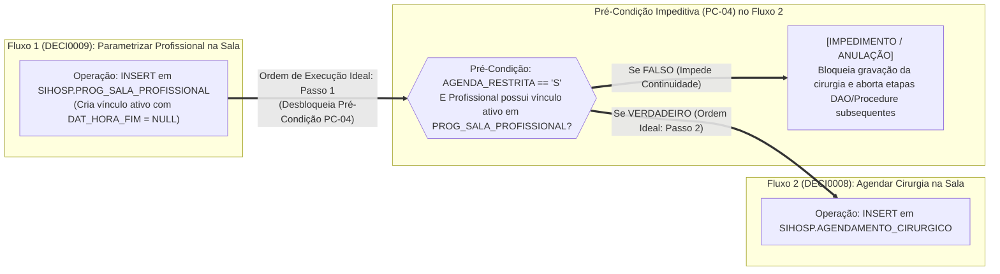

# Spec 02 — Nível 2: Call Flow Comprehension (Fluxo de Chamadas, Operações de Armazenamento, Transformações e Pré-Condições Impeditivas)

**Nível na Hierarquia:** `2 de 4` (Estritamente dependente do **Nível 1: Structural Comprehension**; pré-requisito obrigatório para os Níveis 3 e 4)  
**Diretório de Salvamento dos Dados:** `C:\Users\walter.matsuda\Documents\metadados_famema2.1\output\layer2_callflow`  
**Regra de Ouro do Nível 2:** *Neste nível, todo o mapeamento é referente exclusivamente a uma Identidade Única (`URN`) criada no Nível 1. Nenhum fluxo de chamada pode ser iniciado sem que o código-fonte das procedures mapeadas no Nível 1 tenha sido fornecido pelo usuário.*

---

## 1. Gate Bloqueante de Entrada (`GATE-L1.2` $\rightarrow$ Nível 2)

> **`{ as condições como procedures mapeadas devem ter o código-fonte fornecido antes de iniciar esta etapa }`**

1. **Verificação de Pré-Requisito Bloqueante:**
   - Antes de iniciar o mapeamento de Call Flow, o motor verifica o diretório `C:\Users\walter.matsuda\Documents\metadados_famema2.1\input\layer2_procedures_source\`.
   - Todas as identidades `ext-obj:db-procedure`, `ext-obj:db-function` e `ext-obj:db-package` listadas em `pending_procedures_extraction.txt` devem ter seu código-fonte PL/SQL ou T-SQL presente.
   - Caso falte o código-fonte de procedures mapeadas, a execução **permanece parada no Gate `{ GATE-L1.2 }`** e solicita ao usuário a alimentação dos dados faltantes.
2. **Decomposição Interna das Procedures:**
   - O código-fonte de cada procedure é analisado para extrair suas chamadas a outras procedures, suas operações sobre tabelas (`db-rel`), suas transformações de dados internas e suas pré-condições de banco (`IF`, `CASE`, `WHERE`, `RAISE_APPLICATION_ERROR`).

---

## 2. Identificação de Início e Fim de uma Chamada de Dados

Todo fluxo de dados (`CallFlow`) possui fronteiras determinísticas de início (`FlowOrigin`) e fim (`FlowTerminus`), sempre referenciando identidades do Nível 1:

### 2.1. Início da Chamada de Dados (`FlowOrigin` — UI do Sistema e Gatilhos)
- **UI do Sistema (Fronteira Primária):** Eventos de interação do usuário em telas WinForms/DevExpress ou Web (`Click`, `DoubleClick`, `Load`, `Shown`, `EditValueChanged`, `FocusedRowChanged`, `KeyDown`, `Validating`, `Page_Load`, `HttpPost`/`HttpGet`).
- **Gatilhos de Background / Integração:** `Timer_Tick`, `BackgroundWorker_DoWork`, filas ou serviços agendados.

### 2.2. Fim da Chamada de Dados (`FlowTerminus` — Dispositivos de Armazenamento e Retorno Visual)
- **Banco de Dados Relacional (`db-rel`):** Operação terminal sobre uma tabela relacional (diretamente via DAO ou internamente via Procedure `ext-obj`).
- **Armazenamento Persistente em Disco / Mídias (`storage-persist`):** Escrita ou leitura terminal em arquivo local, pasta de rede, CD/DVD, mídia física ou Registry.
- **Estado Compartilhado em Memória / Renderização na UI (`mem-ram`):** Atualização final de cache estático, sessão de usuário ou binding de `DataSource` em componentes visuais da tela.

---

## 3. Classificação de Pontos Iniciais de Dispositivos de Armazenamento e Operações (`INSERT`, `UPDATE`, `DELETE`)

> **Requisito Central:** *"a inteligência artificial precisa classificar pontos iniciais para os dispositivos de armazenamento mapeados na etapa de structural comprehension, podendo desta forma classificá-los também se é um insert ou update ou delete em seu mapeamento para facilitar o isolamento e identificação do domínio nas etapas seguintes"*

Para cada dispositivo de armazenamento mapeado no Nível 1 (`db-rel` tabelas, `storage-persist` disco/CDs/mídias e `mem-ram` caches/buffers), a IA identifica e classifica o **Ponto Inicial de Contato com o Armazenamento (`StorageEntrypoint`)** dentro do fluxo:

### 3.1. O Que É o Ponto Inicial para o Dispositivo de Armazenamento (`StorageEntrypoint`)
É a primeira identidade executável (método DAO, comando SQL ou procedure `ext-obj`) na cadeia de chamadas que abre a transação ou emite a operação sobre o dispositivo de armazenamento, juntamente com a identidade da origem na UI que desencadeou a chamada.

### 3.2. Taxonomia Obrigatória de Operações sobre o Armazenamento (`StorageOperationKind`)

| Dispositivo (Nível 1) | Operação Classificada | Semântica para Isolamento de Domínio (Nível 3) |
| :--- | :--- | :--- |
| **Banco Relacional (`db-rel`)** | **`INSERT`** | **Criação de Entidade de Domínio:** Define o fluxo dono do nascimento do registro na tabela (núcleo primário do domínio). |
| **Banco Relacional (`db-rel`)** | **`UPDATE`** | **Mutação de Estado / Transição de Ciclo de Vida:** Define fluxos que alteram atributos, status ou encerram vigência (`DAT_HORA_FIM = SYSDATE`). |
| **Banco Relacional (`db-rel`)** | **`DELETE`** | **Remoção Física:** Define fluxos de exclusão definitiva ou limpeza transacional. |
| **Banco Relacional (`db-rel`)** | **`MERGE` / `UPSERT`** | **Sincronização Híbrida:** Inserção condicional ou atualização de registro existente. |
| **Banco Relacional (`db-rel`)** | **`SELECT` (Read-Only)** | **Consumo / Consulta / Validação:** Fluxo consumidor da informação persistida (não é dono da criação, mas depende da tabela). |
| **Disco / Mídias (`storage-persist`)** | **`DISK_INSERT` (`CREATE/WRITE`)** | Criação de novo arquivo em disco, gravação de CD/DVD ou emissão de protocolo físico. |
| **Disco / Mídias (`storage-persist`)** | **`DISK_UPDATE` (`APPEND/MODIFY`)** | Alteração de arquivo `.ini`/`.xml`/`.config` existente ou append em log. |
| **Disco / Mídias (`storage-persist`)** | **`DISK_DELETE` (`REMOVE`)** | Exclusão de arquivo temporário ou limpeza de diretório local/rede. |
| **Disco / Mídias (`storage-persist`)** | **`DISK_READ`** | Leitura de arquivo de configuração, template de relatório ou certificado digital. |

```json
{
  "storage_device_identity": "urn:famema:SIHOSP:db-rel:oracle:SIHOSP:table:PROG_SALA_PROFISSIONAL",
  "storage_plane": "db-rel",
  "storage_entrypoint_method": "urn:famema:SIHOSP:mem-ram:code-method-sig:demanda-cirurgia-dao:DAOProgramacaoSalaProfissional.Inserir(ProgSalaProfDTO):Void",
  "origin_ui_caller_identity": "urn:famema:SIHOSP:mem-ram:code-method-sig:demanda-cirurgia-forms:DECI0009.btnSalvar_Click(Object,EventArgs):Void",
  "dml_operation_classification": "INSERT",
  "domain_ownership_role": "PRIMARY_STATE_CREATOR",
  "mutated_columns": ["SEQ_PROG_SALA_PROF", "SEQ_PROG_SALA", "SEQ_PROFISSIONAL", "DAT_HORA_INICIO"]
}
```

---

## 4. Estrutura de Agregação Escopada pela Identidade da Fonte Chamadora (`Caller-Scoped Aggregate`)

> **Requisito Central:** *"deve haver uma estrutura que agregue chamadas onde sua identidade única seja a mesma da fonte que a chamou"*

Para evitar que chamadas a classes compartilhadas (`BO`, `DAO`, `Utils`) percam o contexto de quem as invocou, toda árvore ou sub-árvore de chamadas é encapsulada em um **`CallerScopedAggregate`**:

1. **Identidade do Agregado = Identidade da Fonte Chamadora (`aggregate_identity_urn == caller_source_identity_urn`):**
   - O container que agrupa uma sequência de chamadas adota como sua **chave de identidade primária a própria Identidade Única (`URN`) da fonte que realizou a chamada** (qualificada pelo escopo `#agg-callflow`).
2. **Aninhamento Fractal por Fonte Chamadora:**
   - No nível de projeto individual (ex.: `demanda-cirurgia-bo`), o método `BODemanda.Salvar` é a fonte chamadora que agrega todas as sub-chamadas que ele dispara (`Validar`, `DAO.Inserir`, `DAO.RegistrarLog`).
   - No nível ponta a ponta, o evento de UI `DECI0008.btnSalvar_Click` é a fonte chamadora raiz que agrega toda a cadeia transitiva até o banco de dados, preservando a rastreabilidade exata da origem.

---

## 5. Mapeamento Incremental e Ordenado: Um Projeto por Vez $\rightarrow$ Fluxo Ponta a Ponta

Em um monolito de **700 módulos**, o mapeamento de Call Flow deve ser **incremental e ordenado**:

1. **Ordem de Leitura Baseada no Grafo de Dependências do Nível 1:**
   - Os 700 projetos são percorridos seguindo a ordem topológica gerada no Nível 1 (`topological_build_order.json`).
2. **Leitura de Um Único Projeto por Vez (`Single-Project Micro-Aggregate`):**
   - A IA analisa **um único projeto por vez**, utilizando as assinaturas pré-mapeadas no Nível 1 para resolver chamadas entre projetos sem precisar carregar o código-fonte dos outros 699 módulos na memória.
   - Para cada projeto lido, a IA cria um arquivo de **Pequenos Agregados (`output/layer2_callflow/project_micro_aggregates/<project_name>.flow.jsonl`)** contendo todos os fluxos locais, operações `INSERT/UPDATE/DELETE`, transformações de dados e pré-condições daquele projeto.
3. **Montagem Incremental do Fluxo Ponta a Ponta (`End-to-End Call Flow Assembly`):**
   - À medida que os pequenos agregados dos projetos são gerados, o consolidador une as pontas (`UI [Forms/Web]` $\rightarrow$ `Negócio [BO]` $\rightarrow$ `Dados [DAO]` $\rightarrow$ `Procedure [ext-obj]` $\rightarrow$ `Tabela [db-rel]` / `Disco [storage-persist]`), listando todas as identidades do Nível 1 que fazem parte de cada fluxo ponta a ponta.

---

## 6. Contabilização de Transformações de Dados por Parte do Fluxo

Para cada etapa (método/procedure) de um fluxo identificado, o mapeador identifica e contabiliza **quantas transformações de dados** ocorrem naquela parte do fluxo:

| Código | Categoria de Transformação de Dados | Descrição |
| :--- | :--- | :--- |
| **`T01_UI_EXTRACT_PARSE`** | Controle de UI $\rightarrow$ Tipo Primitivo / DTO | Leitura de `.Text`, `.EditValue`, `.Checked` com parse/cast (`Convert.ToInt64`, `DateTime.Parse`). |
| **`T02_OBJECT_MAPPING`** | Objeto/DTO A $\rightarrow$ Objeto/DTO B | Cópia, projeção ou tradução entre estruturas de memória diferentes. |
| **`T03_IN_MEMORY_COMPUTATION`** | Mutação, Cálculo ou Filtro em Memória | Aplicação de fórmulas, agregações LINQ (`.Where`, `.Select`, `.GroupBy`), formatação de strings. |
| **`T04_DB_PARAMETER_BINDING`** | Memória RAM $\rightarrow$ Parâmetros SQL/Procedure | Empacotamento de propriedades em `OracleParameter` / `SqlCommand` ou interpolação de query. |
| **`T05_DB_DML_TRANSFORMATION`** | Transformação Interna no Banco / Procedure | Funções SQL (`NVL`, `DECODE`, `CASE`, `TO_CHAR`, `SYSDATE`, triggers/sequences) durante `INSERT/UPDATE`. |
| **`T06_RESULTSET_MATERIALIZATION`** | Cursor/Banco $\rightarrow$ `DataReader` / `DataTable` | Materialização de linhas relacionais em estruturas tabulares em memória. |
| **`T07_HYDRATION_TO_DTO`** | `DataReader` / `DataRow` $\rightarrow$ Lista de DTOs | Instanciação e preenchimento de objetos de domínio a partir do retorno do banco. |
| **`T08_UI_RENDER_BINDING`** | Memória RAM $\rightarrow$ Componente Visual de UI | Atribuição a `GridControl.DataSource`, preenchimento de combos/campos ou exibição de alertas. |
| **`T09_PERSISTENT_MEDIA_SERIALIZATION`** | Memória RAM $\leftrightarrow$ Arquivo em Disco / CD / Mídia | Serialização/desserialização XML, JSON, CSV, INI, PDF ou stream binário em disco. |

Cada etapa $s_i$ registra `step_transformations_count`, e o fluxo completo registra a soma total $\sum_{i} \text{step\_transformations\_count}(s_i)$.

---

## 7. Pré-Condições: Detalhamento, Contabilização, Previsão de Impedimento e Ordem Ideal de Execução

> **Requisitos Centrais:**
> 1. *"é importante identificar quais fluxos possuem pré-condições para execução e ser capaz de contabilizar a quantidade de pré-condições para que um dado percorra todo o fluxo de execução; as pré-condições precisam ser detalhadas, identificáveis e contabilizadas"*
> 2. *"deve ser capaz também de que o mapeamento completo do call flow seja capaz de prever pré-condições que anulam ou impedem as partes subsequentes de dar continuidade e este impedimento deve ser capaz de cooperar para identificação da ordem de execução ideal das etapas seguintes."*

### 7.1. Identificação, Detalhamento e Contabilização de Pré-Condições
Cada condição lógica (`if`, `switch`, cláusula `guard`, verificação de permissão, parâmetro de banco `CA.PARAMETRO` ou filtro `WHERE` de vigência como `DAT_HORA_FIM IS NULL`) que governa a passagem do dado recebe:
- **Identidade Única da Pré-Condição (`precondition_id`):** `<URN_DO_METODO_OU_PROCEDURE>#PC<NNN>`;
- **Expressão Técnica e Tradução Detalhada:** A condição exata avaliada e quais identidades do Nível 1 ela inspeciona;
- **Contabilização Cumulativa:** Quantidade de pré-condições no método local e soma total acumulada necessária para percorrer o fluxo de ponta a ponta.

### 7.2. Previsão de Pré-Condições que Anulam ou Impedem Partes Subsequentes (`Impediment & Annulment Prediction`)
Toda pré-condição é analisada quanto ao seu **Efeito de Impedimento (`impediment_effect`)** sobre os passos subsequentes $(s_{i+1}, \dots, s_n)$ do Call Flow e sobre outros fluxos dependentes:

| Tipo de Impedimento (`impediment_type`) | Mecanismo no Código | Efeito sobre as Partes Subsequentes |
| :--- | :--- | :--- |
| **`HARD_ANNULMENT_EARLY_RETURN`** | `if (!valido) { MessageBox.Show(...); return; }` | **Anula 100% das chamadas subsequentes** a partir do passo atual; nenhuma camada inferior (`BO`/`DAO`/`DB`) é executada. |
| **`HARD_ANNULMENT_EXCEPTION_ROLLBACK`** | `throw new RegraNegocioException(...)` / `RAISE_APPLICATION_ERROR` | **Interrompe o fluxo em andamento e desfaz (`ROLLBACK`)** quaisquer operações `INSERT/UPDATE/DELETE` anteriores da mesma transação. |
| **`BRANCH_EXCLUSION_MUTUAL`** | `if (condA) { FluxoA(); } else { FluxoB(); }` | **Anula mutuamente o ramo alternativo:** a satisfação da pré-condição A impede a execução das etapas do ramo B. |
| **`EMPTY_DATASET_STARVATION`** | `WHERE DAT_HORA_FIM IS NULL AND FLG_ATIVO = 'S'` retornando 0 linhas | **Impedimento por Inanição de Dados:** As etapas seguintes (`foreach` / processamento em lote) são anuladas porque o filtro restritivo zerou a coleção. |
| **`CROSS_FLOW_STATE_GATE`** | Fluxo $F_2$ exige que `STATUS_DEMANDA == 'CONFIRMADA'` (gravado pelo Fluxo $F_1$) | **Impedimento Inter-Fluxo:** O Fluxo $F_2$ é impedido de prosseguir enquanto o Fluxo $F_1$ (que executa o `INSERT`/`UPDATE` habilitador) não tiver sido concluído. |

### 7.3. Cooperação do Grafo de Impedimentos para a Ordem de Execução Ideal das Etapas Seguintes
A IA utiliza as pré-condições impeditivas e a classificação `INSERT`/`UPDATE`/`DELETE` para calcular automaticamente a **Ordem de Execução Ideal (`IdealExecutionOrderGraph`)**, que alimenta diretamente o Nível 3 (Fluxo de Telas e Isolamento de Domínio):

1. **Ordenação Intra-Fluxo (Short-Circuit Precedence):**
   - Ordena as etapas de validação da mais restritiva/barata (`PRE_UI_VALIDATION` $\rightarrow$ `PRE_AUTH_PERMISSION` $\rightarrow$ `PRE_DB_PARAMETER` $\rightarrow$ `PRE_BUSINESS_RULE`) para a persistência (`INSERT/UPDATE/DELETE`), identificando exatamente quais etapas posteriores ficam inalcançáveis quando uma pré-condição falha.
2. **Ordenação Inter-Fluxos e de Telas (Producer-Before-Guard Precedence):**
   - Se a Pré-Condição $PC_x$ do Fluxo $F_B$ exige um estado no banco (ex.: existência de registro ativo na tabela $T$ com `FLG_LIBERADO = 'S'`) e o Fluxo $F_A$ é classificado como o ponto inicial de `INSERT` ou `UPDATE` que produz esse estado na tabela $T$:
   - O motor estabelece a relação de precedência obrigatória:
     $$F_A \ (\text{Produtor do Estado via INSERT/UPDATE}) \prec_{\text{ordem ideal}} F_B \ (\text{Bloqueado pela Pré-Condição } PC_x)$$
   - Essa ordem ideal determina automaticamente no Nível 3 **qual tela e qual ação humana precisa ser executada primeiro** para desbloquear as telas e regras seguintes!



---

## 8. Schema Canônico de Saída do Nível 2 (`end_to_end_flows.jsonl`)

```json
{
  "flow_id": "urn:famema:SIHOSP:callflow:DECI0008.btnConfirmar_Click->AGENDAMENTO_CIRURGICO",
  "caller_scoped_aggregate_identity": "urn:famema:SIHOSP:mem-ram:code-method-sig:demanda-cirurgia-forms:DECI0008.btnConfirmar_Click(Object,EventArgs):Void",
  "origin_ui": {
    "identity_urn": "urn:famema:SIHOSP:mem-ram:code-method-sig:demanda-cirurgia-forms:DECI0008.btnConfirmar_Click(Object,EventArgs):Void",
    "screen_class_identity": "urn:famema:SIHOSP:mem-ram:code-class:demanda-cirurgia-forms:DECI0008",
    "trigger_kind": "UI_BUTTON_CLICK"
  },
  "storage_entrypoints_and_operations": [
    {
      "storage_identity_urn": "urn:famema:SIHOSP:db-rel:oracle:SIHOSP:table:PROG_SALA_PROFISSIONAL",
      "entrypoint_method_urn": "urn:famema:SIHOSP:mem-ram:code-method-sig:demanda-cirurgia-dao:DAOProgramacaoSalaProfissional.VerificarHabilitacao(Int64,Int64):Boolean",
      "operation": "SELECT",
      "role": "PRECONDITION_GUARD_SOURCE"
    },
    {
      "storage_identity_urn": "urn:famema:SIHOSP:db-rel:oracle:SIHOSP:table:DEMANDA_CIRURGICA",
      "entrypoint_method_urn": "urn:famema:SIHOSP:ext-obj:db-procedure:SIHOSP.PRC_GRAVA_DEMANDA_CIRURGICA",
      "operation": "INSERT",
      "role": "PRIMARY_DOMAIN_MUTATION"
    }
  ],
  "participating_identities": [
    "urn:famema:SIHOSP:mem-ram:code-class:demanda-cirurgia-forms:DECI0008",
    "urn:famema:SIHOSP:mem-ram:code-method-sig:demanda-cirurgia-forms:DECI0008.btnConfirmar_Click(Object,EventArgs):Void",
    "urn:famema:SIHOSP:mem-ram:code-method-sig:demanda-cirurgia-bo:BODemandaCirurgica.ConfirmarAgendamento(DemandaDTO):Int64",
    "urn:famema:SIHOSP:mem-ram:code-method-sig:demanda-cirurgia-dao:DAODemandaCirurgica.ExecutarGravacao(DemandaDTO):Int64",
    "urn:famema:SIHOSP:ext-obj:db-procedure:SIHOSP.PRC_GRAVA_DEMANDA_CIRURGICA",
    "urn:famema:SIHOSP:db-rel:oracle:SIHOSP:table:DEMANDA_CIRURGICA"
  ],
  "transformations_summary": {
    "total_transformations_count": 6,
    "by_step": [
      { "step_order": 1, "count": 2, "types": ["T01_UI_EXTRACT_PARSE", "T02_OBJECT_MAPPING"] },
      { "step_order": 2, "count": 1, "types": ["T03_IN_MEMORY_COMPUTATION"] },
      { "step_order": 3, "count": 2, "types": ["T04_DB_PARAMETER_BINDING", "T05_DB_DML_TRANSFORMATION"] },
      { "step_order": 4, "count": 1, "types": ["T08_UI_RENDER_BINDING"] }
    ]
  },
  "preconditions_and_impediments": {
    "total_preconditions_count": 5,
    "annulling_preconditions_count": 3,
    "items": [
      {
        "precondition_id": "urn:famema:SIHOSP:mem-ram:code-method-sig:demanda-cirurgia-bo:BODemandaCirurgica.ConfirmarAgendamento(DemandaDTO):Int64#PC01",
        "category": "PRE_DB_PARAMETER",
        "expression": "CA.PARAMETRO['AGENDA_RESTRITA'] == 'S' => DAOProgramacaoSalaProfissional.VerificarHabilitacao(seqSala, seqProfissional) == true",
        "impediment_type": "HARD_ANNULMENT_EXCEPTION_ROLLBACK",
        "annuls_subsequent_steps": [3, 4],
        "requires_prior_execution_of_flows": [
          "urn:famema:SIHOSP:callflow:DECI0009.btnSalvar_Click->PROG_SALA_PROFISSIONAL"
        ]
      }
    ]
  },
  "ideal_execution_order_metadata": {
    "topological_flow_rank": 2,
    "prerequisite_flows": ["urn:famema:SIHOSP:callflow:DECI0009.btnSalvar_Click->PROG_SALA_PROFISSIONAL"],
    "unlocks_downstream_flows": ["urn:famema:SIHOSP:callflow:DECI0012.btnGerarMapaCirurgico_Click->RELATORIO_MAPA"]
  }
}
```

---

## 9. Artefatos Salvos pelo Nível 2

Todos os arquivos abaixo são gravados em `C:\Users\walter.matsuda\Documents\metadados_famema2.1\output\layer2_callflow\`:

1. `procedure_internal_flows.jsonl` — Fluxos internos, tabelas afetadas (`INSERT/UPDATE/DELETE/SELECT`), transformações e pré-condições das procedures fornecidas no `GATE-L1.2`.
2. `project_micro_aggregates/<project_name>.flow.jsonl` — 700 arquivos de pequenos agregados gerados incrementalmente (1 projeto por vez).
3. `caller_scoped_aggregates.jsonl` — Chamadas agrupadas sob a identidade única da fonte chamadora.
4. `storage_entrypoints_dml_catalog.jsonl` — Classificação de todos os pontos iniciais de dispositivos de armazenamento e suas operações (`INSERT`, `UPDATE`, `DELETE`, `SELECT`, `DISK_WRITE`, `DISK_READ`).
5. `preconditions_and_impediments_catalog.jsonl` — Catálogo detalhado e contabilizado de todas as pré-condições, incluindo quais etapas subsequentes cada pré-condição anula ou impede.
6. `ideal_execution_order_graph.json` — Ordem ideal de execução entre etapas e entre fluxos calculada a partir do grafo de impedimentos e das operações `INSERT/UPDATE/DELETE`.
7. `end_to_end_flows.jsonl` — Fluxos completos costurados de ponta a ponta desde a UI até os dispositivos de armazenamento.
