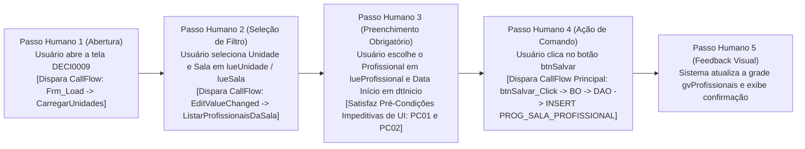
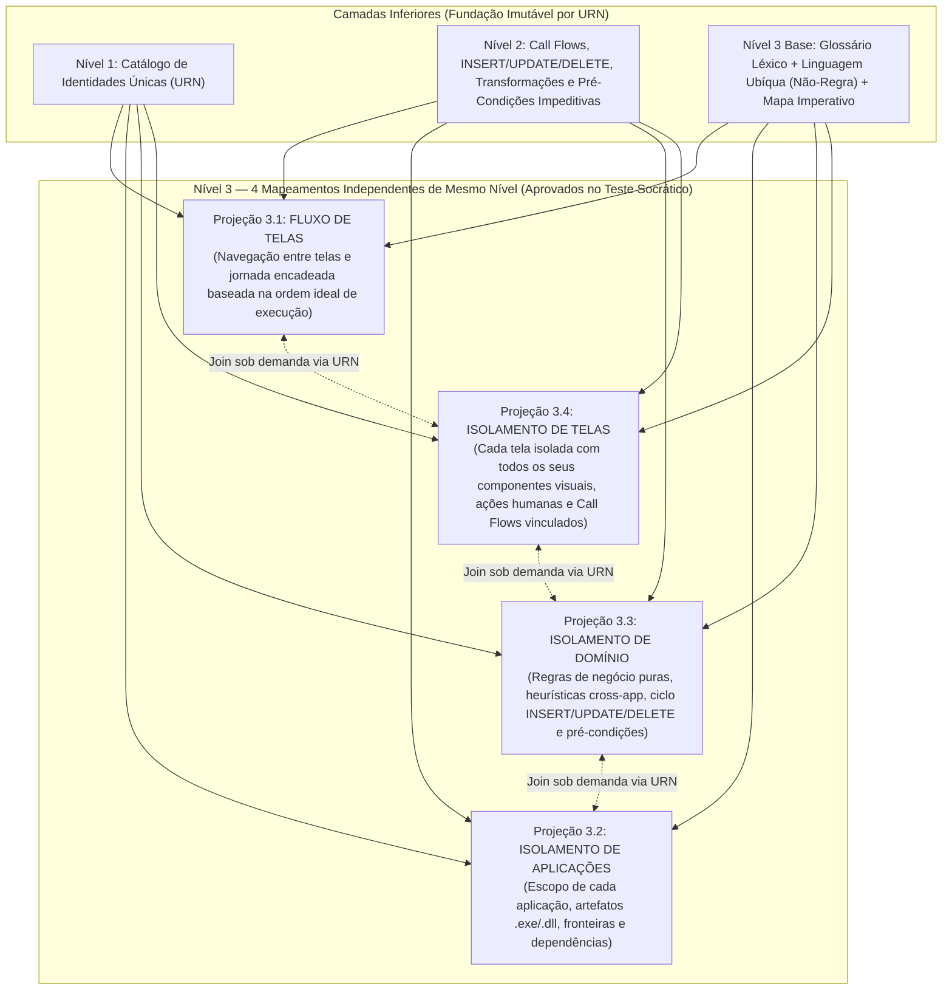

# Spec 03 — Nível 3: Tech Stack & Client Heuristics (Fluxo Humano de Telas, Glossário, Linguagem Ubíqua, Programação Imperativa e Teste Socrático)

**Nível na Hierarquia:** `3 de 4` (Estritamente dependente do **Nível 1: Structural Comprehension** e do **Nível 2: Call Flow Comprehension**; pré-requisito obrigatório para o **Nível 4: Gráficos**)  
**Diretório de Salvamento dos Dados:** `C:\Users\walter.matsuda\Documents\metadados_famema2.1\output\layer3_techstack_heuristics`  
**Regra de Ouro do Nível 3:** *Neste nível o mapeamento compõe os níveis anteriores, passando a possuir grupos semânticos, tecnológicos e de domínio. Em vez de produzir um único artefato monolítico inflado, o Nível 3 é decomposto pelo Teste Socrático em 4 projeções independentes de mesmo nível (`Fluxo de Telas`, `Isolamento de Aplicações`, `Isolamento de Domínio` e `Isolamento de Telas`) que funcionam juntas através das Identidades Únicas (`URN`), mas são consultáveis e iteráveis de forma independente.*

---

# PARTE 1 — Tech Stack, Glossário, Heurísticas Cross-App e Fluxo Humano em Telas

## 1. Mapeamento de Aplicações, Principais Artefatos, Arquivos e Tech Stack

1. **Nome de Aplicações e Principais Artefatos (`ApplicationArtifactsMap`):**
   - Agrupa os 700 módulos em suas aplicações executáveis/implantáveis (`SIHOSP_DESKTOP`, `SIHOSP_WEB`, `SERVICOS_BACKGROUND`, `INTEGRACAO_SUS`).
   - Cataloga os principais artefatos de cada aplicação: executáveis (`.exe`), bibliotecas de vínculo dinâmico (`.dll`), projetos web (`.csproj` Web), relatórios (`.rpt` / `.rdlc`) e packages de banco.
2. **Nomes de Arquivos Físicos (`source_files_registry`):**
   - Vincula todos os nomes de arquivos físicos (`.cs`, `.designer.cs`, `.resx`, `.aspx`, `.ascx`, `.config`, `.sql`) às suas respectivas identidades `src-root:source-file` do Nível 1.
3. **Identidades Pertencentes a Cada Tech Stack (`TechStackIdentityGrouping`):**
   - Classifica cada identidade única do Nível 1 dentro da tecnologia que a implementa:
     - `TECH_UI_WINFORMS_DEVEXPRESS` (`Form`, `XtraForm`, `UserControl`, `BarManager`, `GridView`)
     - `TECH_UI_WEB_ASPNET` (`Page`, `MasterPage`, `Controller`, `ApiController`)
     - `TECH_BUSINESS_IMPERATIVE_BO` (Classes `BO*`, serviços de domínio, validadores)
     - `TECH_DATA_ACCESS_DAO_ORACLE` (Classes `DAO*`, `BDOracle`, `OracleCommand`, queries SQL)
     - `TECH_MEMORY_CONTRACTS_DTO` (Classes DTO, ViewModels, `DataSet`, `StaticCache`, `Session`)
     - `TECH_RDBMS_ORACLE_PLSQL` (Tabelas `db-rel`, Views, Procedures/Functions/Packages `ext-obj`)
     - `TECH_PERSISTENT_MEDIA_IO` (Arquivos locais, pastas de rede, CDs/DVDs, mídias físicas `storage-persist`).

---

## 2. Glossário Léxico de Variáveis para Tradução em Leitura Natural

> **Requisito Central:** *"aqui é importante que seja possível ter um glossário e este glossário esteja contido no mapeamento; mapeie e armazene todos os nomes de variáveis que se assemelham a alguma palavra que pode ser utilizada para traduzir a chamada para a leitura natural depois"*

### 2.1. Extração Léxica Completa de Variáveis e Identificadores
Mesmo que variáveis locais de métodos e variáveis de classe tenham sido descartadas da geração de identidades estruturais no Nível 1 (para evitar explosão do grafo), **todos os nomes de variáveis, parâmetros, propriedades, controles visuais, métodos e colunas** que se assemelham a palavras humanas ou abreviações de negócio são extraídos e armazenados no **Glossário Contido no Mapeamento (`lexical_glossary.json`)**:

- **Decomposição Morfológica:** Quebra de `camelCase`, `PascalCase`, `snake_case` e prefixos húngaros (`txt`, `lue`, `gv`, `btn`, `flg`, `dat`, `seq`, `cod`, `nom`, `vlr`, `qtd`).
- **Vinculação à Identidade Única de Origem:** Toda palavra comum ou variável mapeada guarda a referência exata à(s) Identidade(s) Única(s) (`URN` do Nível 1) onde foi encontrada.

```json
{
  "glossary_entry_id": "GLOSS_AGENDA_SALA_PROFISSIONAL",
  "canonical_business_term": "Profissional Habilitado na Programação de Sala Cirúrgica",
  "captured_variable_names": [
    "seqProgSalaProf",
    "objProgSalaProfissional",
    "listaProfissionaisSala",
    "lueProfissional",
    "codProfissionalCirurgiao",
    "flgAgendaRestrita"
  ],
  "natural_language_reading_template": "vinculação e habilitação do profissional de saúde na programação da sala cirúrgica sob regra de agenda restrita",
  "source_identities_urn": [
    "urn:famema:SIHOSP:mem-ram:code-class:demanda-cirurgia-forms:DECI0009",
    "urn:famema:SIHOSP:mem-ram:code-method-sig:demanda-cirurgia-bo:BOProgramacaoSalaCirurgica.IncluirProfissional(ProgSalaProfDTO):Void",
    "urn:famema:SIHOSP:db-rel:oracle:SIHOSP:table:PROG_SALA_PROFISSIONAL"
  ],
  "is_business_rule_participant": true
}
```

---

## 3. Heurísticas de Negócio Cross-Application e Conjunto de Identidades + Call Flow

> **Requisitos Centrais:**
> - *"é importante que o mapeamento identifique quais abstrações fazem parte da mesma heurística de negócio mesmo de aplicações diferentes"*
> - *"abstrações de negócio e palavras comuns devem ser agregadas a uma identidade única de onde foi mapeada"*
> - *"mapeamento de um conjunto de identidades com um call flow"*

1. **União de Identidades + Call Flow:** Cada regra/heurística de negócio é formalizada pela associação de um **Conjunto de Identidades Únicas (Nível 1)** com um ou mais **Call Flows e suas Operações `INSERT/UPDATE/DELETE` e Pré-Condições (Nível 2)**.
2. **Convergência de Heurística Entre Aplicações Diferentes:**
   - Quando a Aplicação A (ex.: `SIHOSP_DESKTOP`) e a Aplicação B (ex.: `PORTAL_MEDICO_WEB`) possuem abstrações que:
     1. Manipulam os mesmos dispositivos de armazenamento (`db-rel` ou `storage-persist`) ou chamam as mesmas procedures (`ext-obj`);
     2. Compartilham as mesmas pré-condições impeditivas (ex.: parâmetro `AGENDA_RESTRITA`); ou
     3. Apresentam alta sobreposição de palavras comuns agregadas no Glossário;
   - O motor agrupa ambas sob a **mesma Identidade de Heurística de Negócio Cross-Application (`CrossAppBusinessHeuristic`)**, mantendo o ponteiro para a identidade única original onde cada abstração e palavra comum foi mapeada.

---

## 4. Mapeamento de Interface de Usuário ("Telas") com Ênfase no Fluxo Humano de Execução

> **Requisito Central:** *"mapeamento de interface de usuário precisa ser feito com ênfase no mapeamento do fluxo que um ser humano precisa fazer para executar um call flow; este fluxo precisa ser isolado em 'telas' comumente encontradas no código como uma interface de usuário; cada tela precisa identificar todos os seus componentes e quais call flows são utilizados por ele"*

### 4.1. Anatomia do Isolamento de Cada "Tela" (`ScreenBlueprint`)
Toda classe que representa uma interface visual com o usuário (`Form`, `XtraForm`, `UserControl`, `Page` `.aspx`, `View` MVC) é isolada como uma unidade `"Tela"` contendo:

1. **Identidade e Metadados da Tela:**
   - Código da Tela (ex.: `DECI0008`, `DECI0009`), Título Visual (`Text` / `Caption`), Módulo/Aplicação e Identidade Única (`urn:...:mem-ram:code-class:...`).
2. **Inventário Completo de Componentes Visuais da Tela (`screen_components`):**
   - Mapeia todos os controles declarados no `.Designer.cs` / `.cs` / `.aspx`:
     - Campos de entrada e seleção (`TextEdit`, `LookUpEdit`, `ComboBox`, `DateEdit`, `CheckEdit`, `SpinEdit`);
     - Grades e tabelas visuais (`GridControl`, `GridView`, `TreeList`, `DataGridView`);
     - Ações e comandos (`SimpleButton`, `BarButtonItem`, itens de menu, teclas de atalho `F2`, `F5`);
     - Abas e painéis (`XtraTabControl`, `TabPage`, `GroupControl`).
3. **Vinculação Componente $\rightarrow$ Call Flows Utilizados (`component_call_flows`):**
   - Cada componente lista explicitamente **quais Call Flows (do Nível 2) são disparados ou alimentados por ele** (ex.: `lueUnidade` utiliza o Call Flow de consulta `SELECT` de unidades; `btnSalvar` dispara o Call Flow de validação e `INSERT/UPDATE` na tabela `PROG_SALA_PROFISSIONAL`).

### 4.2. Mapeamento do Passo a Passo Humano para Executar um Call Flow (`HumanInteractionJourney`)
Combinando a estrutura dos componentes da tela com a **Ordem de Execução Ideal e Pré-Condições Impeditivas (calculadas no Nível 2)**, o mapeador reconstrói a jornada exata que um **ser humano** precisa realizar na tela para executar cada Call Flow com sucesso:



---

# PARTE 2 — Grupos de Pessoas, Estruturas Físicas, Linguagem Ubíqua, Programação Imperativa e Teste Socrático

## 5. Gates do `[Incremental Build Model]` na Parte 2 do Nível 3

### 5.1. Gate 3.1: Consultas para Mapear Grupos de Pessoas e Estruturas Físicas por Regra de Negócio (`GATE-L3.1`)
> **`{ identificar consultas na aplicação que sejam capazes de mapear e identificar grupos de pessoas que utilizam cada regra de negócio, quais estruturas físicas podem ser identificadas através das informações existentes e solicitar ao usuário que as forneça; aqui a IA ajuda o usuário fornecendo as consultas que devem ser executadas para que os dados sejam propriamente utilizados }`**

- **Como a IA Identifica e Constrói as Consultas:**
  1. A IA inspeciona todas as identidades de tabelas (`db-rel`) e queries mapeadas nos Níveis 1 e 2 que relacionam:
     - Controle de Acesso, Perfis, Grupos de Usuários e Telas/Transações (`CA.USUARIO`, `CA.GRUPO`, `CA.PERMISSAO`, `CA.TRANSACAO`);
     - Pessoas, Profissionais, Cargos/Especialidades e Lotação em Centros de Custo/Setores (`PESSOA.PESSOA`, `PESSOA.PROFISSIONAL`, `PESSOA.HISTORICO_CENTRO_CUSTO`, `PESSOA.CENTRO_CUSTO`);
     - Estruturas Físicas, Unidades Hospitalares, Prédios, Andares e Salas (`INFRA_ESTRUTURA.INFRA_ESTRUTURA`, `SIHOSP.PROG_SALA_CIRURGICA`, `UNIDADE_INTERNACAO`);
     - Colunas de auditoria nas tabelas de negócio (`SEQ_USUARIO_CADASTRO`, `COD_USUARIO`, `SEQ_INFRA`).
  2. A IA gera automaticamente o arquivo `C:\Users\walter.matsuda\Documents\metadados_famema2.1\output\layer3_techstack_heuristics\queries_people_groups_and_physical_structures.sql` contendo as consultas prontas.
  3. **Parada Obrigatória (`HALT`):** A execução **para** no `{ GATE-L3.1 }` e solicita ao usuário que execute as consultas geradas e salve os resultados em `C:\Users\walter.matsuda\Documents\metadados_famema2.1\input\layer3_people_and_physical\`.

#### Consultas SQL Geradas pela IA em `queries_people_groups_and_physical_structures.sql`:

```sql
-- ==================================================================================
-- [INCREMENTAL BUILD MODEL] - GATE-L3.1: MAPEAMENTO DE GRUPOS DE PESSOAS E
-- ESTRUTURAS FÍSICAS QUE UTILIZAM CADA REGRA DE NEGÓCIO / TELA
-- Pasta de Destino da Resposta:
-- C:\Users\walter.matsuda\Documents\metadados_famema2.1\input\layer3_people_and_physical\
-- ==================================================================================

-- [CONSULTA 1: GRUPOS DE PESSOAS / PERFIS / SETORES X TELAS E REGRAS DE NEGÓCIO]
SELECT
    t.COD_TRANSACAO AS CODIGO_TELA_OU_REGRA,
    t.NOM_TRANSACAO AS NOME_FUNCIONAL_TELA,
    g.NOM_GRUPO AS GRUPO_DE_PESSOAS_PERFIL,
    cc.COD_CENTRO_CUSTO AS CODIGO_SETOR,
    cc.NOM_CENTRO_CUSTO AS NOME_SETOR_ORGANIZACIONAL,
    COUNT(DISTINCT u.SEQ_USUARIO) AS QTD_PESSOAS_ATIVAS_NO_GRUPO
FROM
    CA.TRANSACAO t
    INNER JOIN CA.PERMISSAO_GRUPO pg ON pg.SEQ_TRANSACAO = t.SEQ_TRANSACAO
    INNER JOIN CA.GRUPO g ON g.SEQ_GRUPO = pg.SEQ_GRUPO
    INNER JOIN CA.USUARIO_GRUPO ug ON ug.SEQ_GRUPO = g.SEQ_GRUPO
    INNER JOIN CA.USUARIO u ON u.SEQ_USUARIO = ug.SEQ_USUARIO AND u.FLG_ATIVO = 'S'
    LEFT JOIN PESSOA.HISTORICO_CENTRO_CUSTO hcc ON hcc.SEQ_PESSOA = u.SEQ_PESSOA AND hcc.DAT_FIM IS NULL
    LEFT JOIN PESSOA.CENTRO_CUSTO cc ON cc.SEQ_CENTRO_CUSTO = hcc.SEQ_CENTRO_CUSTO
GROUP BY
    t.COD_TRANSACAO, t.NOM_TRANSACAO, g.NOM_GRUPO, cc.COD_CENTRO_CUSTO, cc.NOM_CENTRO_CUSTO
ORDER BY
    t.COD_TRANSACAO, QTD_PESSOAS_ATIVAS_NO_GRUPO DESC;

-- [CONSULTA 2: ESTRUTURAS FÍSICAS (UNIDADES, PRÉDIOS, SALAS) IDENTIFICÁVEIS NO BANCO]
SELECT
    i.SEQ_INFRA AS ID_ESTRUTURA_FISICA,
    sihosp.get_nom_infra_demanda(i.SEQ_INFRA) AS HIERARQUIA_FISICA_COMPLETA,
    i.NOM_INFRA AS NOME_SALA_OU_LOCAL_FISICO,
    i.TIP_INFRA AS TIPO_ESTRUTURA_FISICA,
    cc.COD_CENTRO_CUSTO AS CODIGO_SETOR_VINCULADO,
    cc.NOM_CENTRO_CUSTO AS NOME_SETOR_VINCULADO,
    i.FLG_ATIVO AS ESTRUTURA_ATIVA
FROM
    INFRA_ESTRUTURA.INFRA_ESTRUTURA i
    LEFT JOIN INFRA_ESTRUTURA.INFRA_CENTRO_CUSTO icc ON icc.SEQ_INFRA = i.SEQ_INFRA AND icc.DAT_FIM IS NULL
    LEFT JOIN PESSOA.CENTRO_CUSTO cc ON cc.SEQ_CENTRO_CUSTO = icc.SEQ_CENTRO_CUSTO
WHERE
    i.FLG_ATIVO = 'S'
ORDER BY
    HIERARQUIA_FISICA_COMPLETA;
```

---

### 5.2. Gate 3.2: Enriquecimento do Glossário com Linguagem Ubíqua Fora da Regra de Negócio (`GATE-L3.2`)
> **`{ fornecer dados que enriqueçam o glossário mas que não façam parte da regra de negócio; solicite fonte de informações correlacionadas que não fazem parte da regra de negócio mapeada no código; essas informações precisam estar fortemente identificadas como não participantes da regra de negócio, mas devem enriquecer a resposta através da identificação da linguagem ubíqua de seus usuários }`**

- **Comportamento de Parada (`HALT`):** A execução **para** no `{ GATE-L3.2 }` e gera o manifesto de solicitação `C:\Users\walter.matsuda\Documents\metadados_famema2.1\output\layer3_techstack_heuristics\request_ubiquitous_non_business_sources.json`, pedindo ao usuário fontes correlacionadas externas ao código (ex.: Procedimentos Operacionais Padrão [POPs], manuais de treinamento de recepção/enfermagem, apelidos de telas e salas usados no dia a dia do hospital, glossário administrativo SUS/Faturamento, chamados de suporte).
- **Isolamento e Marcação Forte Obrigatória (`NON_BUSINESS_RULE_PARTICIPANT`):**
  - Todo termo ou sinônimo ingerido no `GATE-L3.2` é armazenado com um selo criptográfico/estrutural estrito:
    - `"is_business_rule_participant": false`
    - `"origin_classification": "EXTERNAL_CORRELATED_UBIQUITOUS_LANGUAGE"`
    - `"rule_contamination_guard": "STRICTLY_EXCLUDED_FROM_LOGIC_AND_SCORE"`
  - **Por que isso é crítico:** Esses termos **nunca** alteram a lógica das pré-condições, **nunca** criam regras de negócio artificiais e **nunca** entram na soma matemática do Gráfico 1; porém, funcionam como uma **camada de tradução semântica ( Ponte de Linguagem Ubíqua )** para reconhecer como os usuários reais se referem às telas, fluxos e setores e para enriquecer as explicações geradas pela IA!

```json
{
  "ubiquitous_entry_id": "UBIQ_EXT_0042",
  "user_ubiquitous_term": "Trava da Escala do Bloco / Liberação de Cirurgião na Sala",
  "correlated_external_source": "POP-CC-014 - Manual da Enfermagem do Centro Cirúrgico",
  "is_business_rule_participant": false,
  "governance_warning": "NON_BUSINESS_RULE_CONTEXT_ONLY — Termo da linguagem ubíqua dos usuários; não constitui regra implementada em código.",
  "bridges_to_technical_glossary_ids": ["GLOSS_AGENDA_SALA_PROFISSIONAL"],
  "bridges_to_screen_identities": ["urn:famema:SIHOSP:mem-ram:code-class:demanda-cirurgia-forms:DECI0009"]
}
```

---

## 6. Mapeamento da Programação Imperativa (Símbolos e Jargões de Código)

> **Requisito Central:** *"nesta camada os símbolos e jargões de código devem produzir um mapeamento que descreva a programação imperativa"*

Para que a mecânica exata do código C# e PL/SQL não se perca na abstração de alto nível, o Nível 3 produz o **Mapeamento Descritivo da Programação Imperativa (`imperative_programming_mapping.jsonl`)**, traduzindo símbolos sintáticos e jargões técnicos para uma descrição imperativa estruturada:

| Símbolo / Jargão de Código | Classificação Imperativa | Descrição Estruturada Produzida no Mapeamento |
| :--- | :--- | :--- |
| `if (...) { return; }` / `else if` / `switch` | **`IMPERATIVE_BRANCH_GUARD`** | Desvio condicional imperativo com cláusula de guarda e avaliação booleana de curto-circuito. |
| `foreach (var x in lista)` / `for` / `while (dr.Read())` | **`IMPERATIVE_ITERATION_LOOP`** | Laço de repetição imperativo sobre coleção em memória ou cursor de banco de dados. |
| `using (TransactionScope)` / `BeginTransaction` / `Commit` / `Rollback` | **`IMPERATIVE_TRANSACTION_BOUNDARY`** | Demarcação imperativa de atomicidade transacional (tudo-ou-nada) sobre mutações `INSERT/UPDATE/DELETE`. |
| `try { ... } catch (Exception ex) { ... } finally` | **`IMPERATIVE_EXCEPTION_INTERCEPTION`** | Bloco imperativo de captura de falha, desvio de erro e liberação determinística de recursos. |
| `new DTO()` / `dto.Prop = valor` / `DataRow["COL"] = x` | **`IMPERATIVE_STATE_MUTATION`** | Alocação e mutação imperativa de estado em memória RAM. |
| `cmd.ExecuteNonQuery()` / `ExecuteReader()` / `Fill(ds)` | **`IMPERATIVE_IO_DISPATCH`** | Disparo imperativo síncrono/bloqueante de comando contra dispositivo de armazenamento externo. |
| `Delegate` / `EventHandler` / `+= new EventHandler(...)` | **`IMPERATIVE_EVENT_CALLBACK`** | Despacho imperativo orientado a evento de interface gráfica. |

---

## 7. Teste Socrático: Decomposição em 4 Mapeamentos Independentes de Mesmo Nível

> **Requisito Central:**
> *"-- teste socrático: identifique se no nível 3 é possível formar múltiplos mapeamentos de mesmo nível em cima dos níveis anteriores e não apenas um nível totalmente inflado; os níveis devem ser iterados conforme a necessidade para gerar um fluxo de tela, ou explicar a regra de negócio e definir os escopos de cada aplicação; todas as informações precisam funcionar juntas mas são independentes: Fluxo de telas, Isolamento de aplicações, Isolamento de domínio, Isolamento de telas."*

### 7.1. Formulação e Resolução do Teste Socrático Arquitetural
- **Pergunta Socrática 1:** *Se concentrarmos todas as aplicações, todos os domínios, todas as telas, todos os componentes visuais, todas as traduções imperativas e todo o glossário em um único arquivo/estrutura monolítica no Nível 3, o que acontece ao analisar 700 módulos?*  
  $\rightarrow$ **Resposta:** O Nível 3 tornar-se-ia um artefato massivamente inflado, redundante e lento para consulta, onde explicar uma única tela exigiria carregar todo o grafo de aplicações e domínios.
- **Pergunta Socrática 2:** *Como garantir que essas visões funcionem perfeitamente juntas sem depender de um único bloco inflado?*  
  $\rightarrow$ **Resposta:** Como tanto os elementos estruturais (Nível 1) quanto os fluxos e pré-condições (Nível 2) já possuem **Identidades Únicas Canônicas (`URN`)**, o Nível 3 pode ser particionado em **4 Mapeamentos Paralelos, Ortogonais e de Mesmo Nível Hierárquico (Nível 3.A, 3.B, 3.C e 3.D)**. Eles compartilham as mesmas chaves `URN` (permitindo join instantâneo sob demanda), mas são armazenados e iterados de forma **100% independente**!



### 7.2. Especificação dos 4 Mapeamentos Independentes do Nível 3

| Mapeamento de Nível 3 | Arquivo Independente Gerado | O Que Contém Isoladamente | Quando É Iterado / Utilizado |
| :--- | :--- | :--- | :--- |
| **1. `Fluxo de Telas`** | `projection_1_screen_flows.jsonl` | Sequências ordenadas de transição entre telas (`Tela A -> Modal B -> Tela C`), gatilhos de navegação e encadeamento de telas ditado pelas pré-condições impeditivas do Nível 2 (ex.: `DECI0009` deve ser executada antes de `DECI0008`). | Quando o usuário quer entender a jornada macro de navegação entre telas ou o encadeamento de um processo operacional. |
| **2. `Isolamento de Aplicações`** | `projection_2_application_isolation.jsonl` | Define estritamente o escopo de cada aplicação: quais módulos (`.csproj`), artefatos (`.exe`/`.dll`), arquivos físicos e identidades da Tech Stack pertencem exclusivamente a ela ou são compartilhados. | Quando é necessário definir os limites de implantação, desacoplar aplicações do monolito ou auditar artefatos de uma aplicação. |
| **3. `Isolamento de Domínio`** | `projection_3_domain_isolation.jsonl` | Agrupa as regras e heurísticas de negócio puras (independentes de tela), unindo identidades de armazenamento (`db-rel`/`storage-persist`), pontos iniciais `INSERT/UPDATE/DELETE`, pré-condições de negócio e tradução imperativa. | Quando é necessário explicar uma regra de negócio, auditar pré-condições ou alimentar o Gráfico 1 do Nível 4. |
| **4. `Isolamento de Telas`** | `projection_4_screen_isolation.jsonl` | Isola cada tela individualmente com 100% de seus componentes visuais (botões, combos, grids, campos), o passo a passo humano dentro daquela tela e os ponteiros `URN` para os Call Flows (Nível 2) acionados por cada componente. | Quando o usuário pergunta sobre uma tela específica ou envia um prompt com linguagem ubíqua + nome de tela. |

---

## 8. Motor de Resolução de Prompt: Linguagem Ubíqua + Nome de Tela $\rightarrow$ Explicação Enriquecida do Fluxo de Tela

> **Requisito Central:** *"O Usuário solicitará um prompt com linguagem ubíqua e um nome de tela; a IA precisa identificar qual tela e seu fluxo está no prompt, utilizar linguagem ubíqua que pertence ao call flow do nível anterior e enriquecer a compreensão do usuário com as etapas que compõem este fluxo de tela."*

### 8.1. Algoritmo de Resolução e Resposta ao Prompt do Usuário
Quando o usuário envia um prompt contendo **Linguagem Ubíqua** + **Nome de Tela** (ex.: *"Como funciona a liberação e trava de cirurgião na escala da sala cirúrgica na tela DECI0009?"*):

1. **Passo 1 — Identificação da Tela (`Screen Isolation Lookup`):**
   - O motor localiza a tela `DECI0009` diretamente no mapeamento independente **`Isolamento de Telas`** (`projection_4_screen_isolation.jsonl`), carregando seus componentes visuais e a lista de Call Flows vinculados a ela.
2. **Passo 2 — Alinhamento Semântico da Linguagem Ubíqua ao Call Flow (`Ubiquitous-to-CallFlow Matching`):**
   - O motor cruza os termos do prompt (*"liberação"*, *"trava de cirurgião"*, *"escala da sala cirúrgica"*) com:
     - O **Glossário de Linguagem Ubíqua Não-Participante de Regra** (`GATE-L3.2`, que reconhece o jargão do usuário); e
     - O **Glossário Técnico do Call Flow** (associado às identidades do fluxo no Nível 2).
   - Identifica com precisão qual Call Flow específico daquela tela corresponde ao pedido do usuário (ex.: `urn:famema:SIHOSP:callflow:DECI0009.btnSalvar_Click->PROG_SALA_PROFISSIONAL`).
3. **Passo 3 — Iteração Sob Demanda com Domínio e Call Flow (Nível 2 + `Isolamento de Domínio`):**
   - Recupera as etapas ordenadas do Call Flow no Nível 2, suas transformações de dados, suas pré-condições impeditivas, a operação de armazenamento (`INSERT`/`UPDATE`/`DELETE`) e o mapeamento imperativo.
4. **Passo 4 — Síntese Enriquecida das Etapas que Compõem o Fluxo de Tela:**
   - A IA gera a resposta estruturada para o usuário contendo:
     1. **Identificação da Tela e Contexto na Linguagem Ubíqua do Usuário** (destacando o que é contexto ubíquo e o que é regra de negócio real do código);
     2. **Jornada Humana nos Componentes da Tela** (quais campos preencher e qual botão acionar);
     3. **Etapas Imperativas do Call Flow Traduzidas em Linguagem Natural e Ubíqua** (incluindo transformações de dados);
     4. **Pré-Condições e Impedimentos** (o que pode bloquear ou anular a execução e quais fluxos/telas precisam ter sido executados antes segundo a ordem ideal);
     5. **Efeito Final nos Dispositivos de Armazenamento** (`INSERT`, `UPDATE` ou `DELETE` nas tabelas ou arquivos).

---

## 9. Artefatos Salvos pelo Nível 3

Todos os arquivos abaixo são gravados em `C:\Users\walter.matsuda\Documents\metadados_famema2.1\output\layer3_techstack_heuristics\`:

1. `lexical_glossary.json` — Glossário de nomes de variáveis e símbolos técnicos para leitura natural, vinculados às identidades únicas do Nível 1.
2. `ubiquitous_non_business_glossary.json` — Vocabulário correlacionado externo fornecido no `GATE-L3.2`, fortemente marcado com `"is_business_rule_participant": false`.
3. `imperative_programming_mapping.jsonl` — Tradução descritiva dos símbolos e jargões de programação imperativa de cada fluxo.
4. `people_groups_and_physical_structures.jsonl` — Mapeamento de grupos de pessoas e estruturas físicas associadas às regras de negócio (alimentado via `GATE-L3.1`).
5. `queries_people_groups_and_physical_structures.sql` — Consultas geradas pela IA para o `GATE-L3.1`.
6. **Os 4 Mapeamentos Independentes (Teste Socrático):**
   - `projection_1_screen_flows.jsonl` (**Fluxo de Telas**)
   - `projection_2_application_isolation.jsonl` (**Isolamento de Aplicações**)
   - `projection_3_domain_isolation.jsonl` (**Isolamento de Domínio**)
   - `projection_4_screen_isolation.jsonl` (**Isolamento de Telas**)
