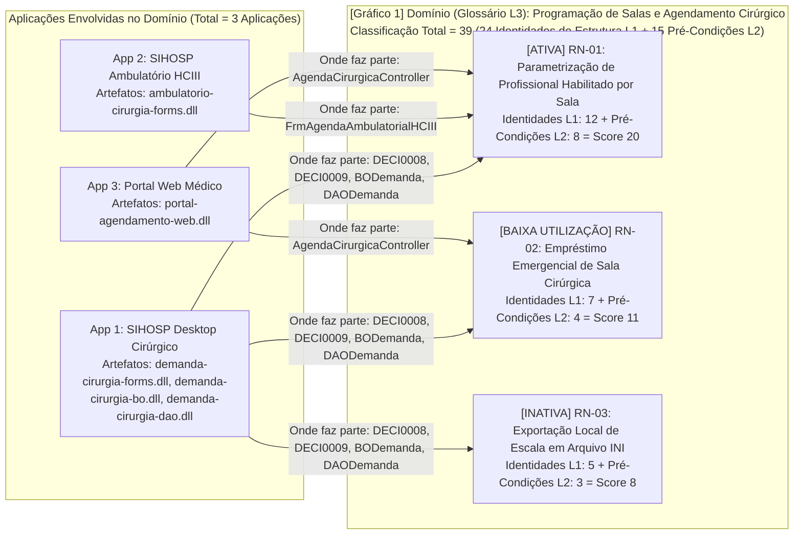
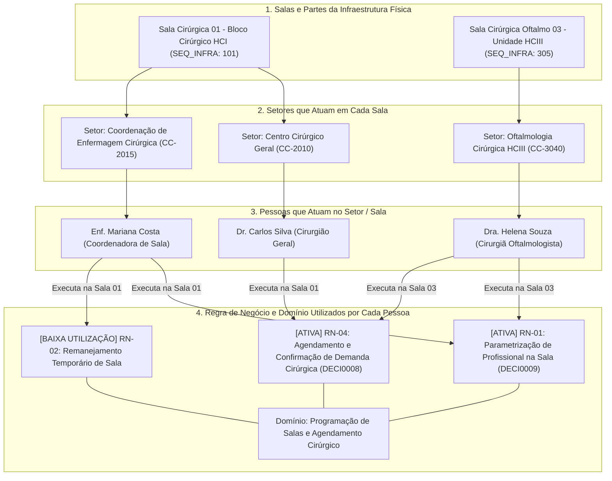
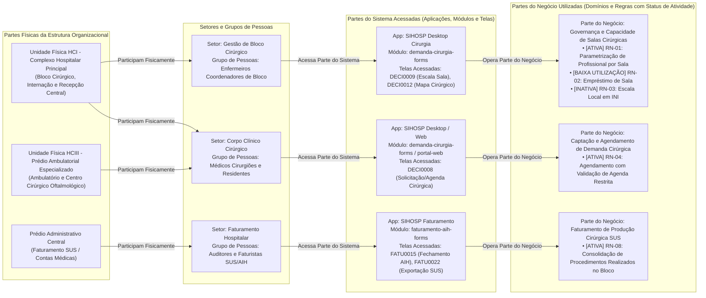

# Spec 04 — Nível 4: Gráficos e Inteligência Analítica (Auditoria de Inatividade e Gráficos 1, 2 e 3)

**Nível na Hierarquia:** `4 de 4` (Estritamente dependente dos **Níveis 1, 2 e 3** + Gate de Alimentação de Auditoria de Atividade e Infraestrutura)  
**Diretório de Salvamento dos Dados:** `C:\Users\walter.matsuda\Documents\metadados_famema2.1\output\layer4_graphics`  
**Regra de Ouro do Nível 4:** *Todos os gráficos são alimentados diretamente pelos mapeamentos determinísticos dos Níveis 1, 2 e 3, e obedecem à condição global obrigatória de discriminar quais regras de negócio estão ativas, possuem baixa utilização ou estão inativas.*

---

## 1. Condição Obrigatória para Todos os Gráficos e Gate `{ GATE-L4.1 }`

> **Condição Global para Todos os Gráficos:**  
> *"mapeamento de domínio deve discriminar quais regras de negócio foram identificadas com inatividade ou baixa utilização; deve ser possível à inteligência artificial identificar quais consultas devem ser feitas para solicitar os dados que discriminem quais regras de negócio ainda estão ativas"*

### 1.1. Gate Bloqueante `{ GATE-L4.1 }`: Solicitação de Dados de Atividade das Regras e Infraestrutura
Antes de renderizar os Gráficos 1, 2 e 3:
1. A IA analisa automaticamente:
   - As tabelas relacionais (`db-rel`) do **Nível 1**;
   - Os pontos iniciais de armazenamento classificados como `INSERT`, `UPDATE`, `DELETE` e as pré-condições (`PRE_DB_PARAMETER`, `PRE_DB_ACTIVE_FILTER`) do **Nível 2**;
   - Os domínios isolados (`Isolamento de Domínio`) e grupos de pessoas/estruturas físicas do **Nível 3**.
2. Com base nessa análise, a IA gera automaticamente o arquivo de consultas SQL `C:\Users\walter.matsuda\Documents\metadados_famema2.1\output\layer4_graphics\audit_active_inactive_rules_and_infra.sql`.
3. **Parada Obrigatória (`HALT`):** Seguindo o `[Incremental Build Model]`, a execução **para** no `{ GATE-L4.1 }` e solicita ao usuário que execute as consultas geradas e forneça os dados em `C:\Users\walter.matsuda\Documents\metadados_famema2.1\input\layer4_audit_and_infra\`.

### 1.2. Classificação Determinística de Atividade das Regras de Negócio
Com os dados estáticos do código + o retorno das consultas SQL fornecidas pelo usuário no `{ GATE-L4.1 }`, cada regra de negócio recebe um dos 4 status obrigatórios em todos os gráficos:
- **`ACTIVE` (Ativa):** Possui caminho de execução ativo a partir da UI, parâmetros de banco habilitados e operações `INSERT/UPDATE` recorrentes em produção.
- **`LOW_UTILIZATION` (Baixa Utilização):** Regra habilitada mas com frequência residual em produção (abaixo do limiar de corte operacional ou restrita a casos raros).
- **`INACTIVE_BY_DB_STATE` (Inativa por Parametrização/Banco):** O código existe, mas uma pré-condição impeditiva de banco (ex.: `CA.PARAMETRO = 'N'` ou tabela de configuração com `0` registros vigentes onde `DAT_HORA_FIM IS NULL`) anula permanentemente sua execução em produção.
- **`INACTIVE_DEAD_CODE` (Inativa no Código-Fonte):** Regra cujo fluxo não possui nenhum ponto de entrada (`FlowOrigin`) ativo alcançável na camada de UI/Serviços.

### 1.3. Consultas SQL Geradas Automaticamente pela IA para o `{ GATE-L4.1 }`

```sql
-- ==================================================================================
-- [INCREMENTAL BUILD MODEL] - GATE-L4.1: CONSULTAS GERADAS PELA IA PARA
-- DISCRIMINAR REGRAS DE NEGÓCIO ATIVAS, BAIXA UTILIZAÇÃO OU INATIVAS
-- Pasta de Destino da Resposta:
-- C:\Users\walter.matsuda\Documents\metadados_famema2.1\input\layer4_audit_and_infra\
-- ==================================================================================

-- [PARTE A: VERIFICAÇÃO DE PARÂMETROS QUE GOVERNAM PRÉ-CONDIÇÕES IMPEDITIVAS (NÍVEL 2)]
SELECT
    NOM_PARAMETRO,
    VLR_PARAMETRO,
    CASE
        WHEN UPPER(TRIM(VLR_PARAMETRO)) IN ('S', '1', 'TRUE', 'ATIVO') THEN 'ENABLED_IN_DB'
        ELSE 'DISABLED_ANNULS_RULE'
    END AS PRECONDITION_DB_STATE
FROM
    CA.PARAMETRO
WHERE
    UPPER(NOM_PARAMETRO) IN (
        'AGENDA_RESTRITA',
        'BLOQUEIA_CIRURGIA_SEM_ANESTESISTA',
        'VALIDA_COTA_EXAME_AMBULATORIAL'
        -- [Parâmetros extraídos automaticamente das pré-condições PRE_DB_PARAMETER do Nível 2]
    );

-- [PARTE B: AUDITORIA DE ATIVIDADE E VOLUME DAS TABELAS ALVO DE INSERT/UPDATE (NÍVEL 2)]
SELECT
    'RN_PARAMETRIZACAO_PROFISSIONAL_SALA' AS BUSINESS_RULE_ID,
    'SIHOSP.PROG_SALA_PROFISSIONAL' AS TARGET_STORAGE_TABLE,
    COUNT(*) AS TOTAL_REGISTROS,
    SUM(CASE WHEN DAT_HORA_FIM IS NULL THEN 1 ELSE 0 END) AS REGISTROS_VIGENTES_ATIVOS,
    SUM(CASE WHEN DAT_HORA_INICIO >= ADD_MONTHS(SYSDATE, -6) THEN 1 ELSE 0 END) AS MOVIMENTACOES_ULTIMOS_6_MESES,
    MAX(DAT_HORA_INICIO) AS ULTIMA_UTILIZACAO,
    CASE
        WHEN SUM(CASE WHEN DAT_HORA_FIM IS NULL THEN 1 ELSE 0 END) = 0 THEN 'INACTIVE_BY_DB_STATE'
        WHEN SUM(CASE WHEN DAT_HORA_INICIO >= ADD_MONTHS(SYSDATE, -6) THEN 1 ELSE 0 END) < 10 THEN 'LOW_UTILIZATION'
        ELSE 'ACTIVE'
    END AS RULE_ACTIVITY_STATUS
FROM
    SIHOSP.PROG_SALA_PROFISSIONAL;
```

---

## 2. Especificação do `[Gráfico 1]`: Mapeamento de Domínio, Classificação por (Identidades de Estrutura + Pré-Condições), Glossário e Aplicações Envolvidas

> **Requisitos do `[Gráfico 1]`:**
> - *"mapeamentos de domínio e suas classificações devem ser interpretadas pela quantidade de identidades de estrutura envolvidas somadas à quantidade de pré-condições identificadas no mapeamento de call flow"*
> - *"sua identificação deve ser feita em cima do glossário identificado na tech stack"*
> - *"deve ser possível identificar onde faz parte de uma aplicação e quantas aplicações estão envolvidas nela"*
> - *"discriminar quais regras de negócio foram identificadas com inatividade ou baixa utilização"*

### 2.1. Fórmula Matemática de Classificação do Domínio no Gráfico 1
Para cada Domínio $D$ (e cada Regra de Negócio $R \in D$) extraído da projeção **`Isolamento de Domínio`** e rotulado pelo **Glossário Léxico do Nível 3**:

$$\text{Classificação}_{\text{Gráfico 1}}(D) = \underbrace{\left| I_{\text{Estrutura}}(D) \right|}_{\text{Identidades Únicas do Nível 1}} + \underbrace{\left| P_{\text{CallFlow}}(D) \right|}_{\text{Pré-Condições Contabilizadas no Nível 2}}$$

Onde:
1. **$\left| I_{\text{Estrutura}}(D) \right|$:** Número de identidades únicas estruturais do Nível 1 envolvidas no domínio (tabelas `db-rel`, arquivos/mídias `storage-persist`, classes e assinaturas de métodos `mem-ram`, procedures `ext-obj`).
2. **$\left| P_{\text{CallFlow}}(D) \right|$:** Número total de pré-condições identificadas, detalhadas e contabilizadas nos Call Flows do domínio no Nível 2.
3. **Rotulagem via Glossário (Nível 3):** O título do domínio, seus termos-chave e a descrição de suas regras utilizam estritamente os termos normalizados do Glossário da Tech Stack (`lexical_glossary.json`).
4. **Participação em Aplicações (`Isolamento de Aplicações`):**
   - Mostra **onde** o domínio reside dentro de cada aplicação (módulos `.csproj`, artefatos `.dll`/`.exe` e telas);
   - Contabiliza **quantas aplicações estão envolvidas** naquele domínio (`applications_involved_count`).



---

## 3. Especificação do `[Gráfico 2]`: Mapeamento de Infraestrutura Física da Empresa (Salas $\times$ Setores Atuantes $\times$ Pessoas $\times$ Regras de Negócio e Domínios)

> **Requisitos do `[Gráfico 2]`:**
> - *"mapeamento de infraestrutura da empresa através dos dados fornecidos com sua infraestrutura devem ser solicitados e deve ser possível formar um gráfico onde seja identificada cada sala ou parte da infraestrutura e quais setores atuam neles junto da regra de negócio e domínio que são utilizados por cada pessoa"*
> - *"discriminar quais regras de negócio foram identificadas com inatividade ou baixa utilização"*

### 3.1. Estrutura Topológica do Gráfico 2
A partir dos dados de infraestrutura solicitados e fornecidos nos Gates `{ GATE-L3.1 }` e `{ GATE-L4.1 }`, o Gráfico 2 mapeia a planta física e operacional da instituição em 4 camadas conectadas:

1. **Sala ou Parte da Infraestrutura Física:** Cada unidade física (`HCI`, `HCII`, `HCIII`, `Hemocentro`, `Materno-Infantil`), bloco, andar e **Sala Específica** (ex.: `Sala Cirúrgica 01`, `Consultório Oftalmo 04`, `Posto de Enfermagem Ala B`, `Recepção Central`).
2. **Setores que Atuam naquela Sala / Parte da Infraestrutura:** Centros de custo e equipes operacionais alocadas naquele espaço físico (ex.: `Setor Centro Cirúrgico Geral`, `Setor Anestesiologia`, `Setor Enfermagem Bloco`).
3. **Cada Pessoa / Profissional Atuante no Setor e Sala:** Profissionais e usuários identificados nominalmente ou por função operacional naquela sala.
4. **Domínio e Regra de Negócio Utilizados por Cada Pessoa (Com Status de Atividade):** Quais regras de negócio e domínios cada pessoa executa naquela sala, discriminando se a regra utilizada está **Ativa**, com **Baixa Utilização** ou **Inativa**.



---

## 4. Especificação do `[Gráfico 3]`: Setores, Grupos de Pessoas, Partes do Sistema Acessadas e Estrutura Organizacional Física

> **Requisitos do `[Gráfico 3]`:**
> - *"gráfico de setores e partes do negócio que as utilizam"*
> - *"deve ser possível que as informações extraídas sejam capazes de fornecer as partes do sistema que são acessadas por cada grupo de pessoas e quais partes físicas da estrutura organizacional elas participam"*
> - *"discriminar quais regras de negócio foram identificadas com inatividade ou baixa utilização"*

### 4.1. Distinção Complementar entre o `[Gráfico 2]` e o `[Gráfico 3]`
Enquanto o **Gráfico 2** parte da **Planta Física (Sala por Sala)** até chegar no indivíduo e na regra de negócio, o **Gráfico 3** parte da **Visão Organizacional e Corporativa por Setores e Grupos de Pessoas**, respondendo simultaneamente a três perguntas executivas:
1. **Setores $\leftrightarrow$ Partes do Negócio:** Quais setores da organização utilizam quais partes do negócio (Domínios e Regras de Negócio Ativas / Baixa Utilização / Inativas)?
2. **Grupos de Pessoas $\leftrightarrow$ Partes do Sistema Acessadas:** Quais partes concretas do sistema (Aplicações, Módulos, Telas Isoladas e Fluxos de Tela mapeados no Nível 3) são acessadas por cada **Grupo de Pessoas / Perfil Operacional**?
3. **Grupos de Pessoas $\leftrightarrow$ Partes Físicas da Estrutura Organizacional:** De quais partes físicas da estrutura organizacional (Unidades Hospitalares, Departamentos Físicos, Pavilhões, Salas/Postos) cada grupo de pessoas participa?



---

## 5. Contratos JSON e Artefatos Salvos pelo Nível 4

Todos os dados e especificações visuais do Nível 4 são gravados em `C:\Users\walter.matsuda\Documents\metadados_famema2.1\output\layer4_graphics\`:

1. `audit_active_inactive_rules_and_infra.sql` — Consultas geradas automaticamente pela IA no `{ GATE-L4.1 }` para discriminar regras de negócio ativas, com baixa utilização ou inativas e coletar dados de infraestrutura física e setores.
2. `business_rules_activity_registry.json` — Catálogo consolidado classificando 100% das regras de negócio em `ACTIVE`, `LOW_UTILIZATION`, `INACTIVE_BY_DB_STATE` ou `INACTIVE_DEAD_CODE`.
3. `chart1_domain_identities_preconditions_apps.json` (e `.html`) — Dados e visualização do **`[Gráfico 1]`** (Domínios classificados por $|\text{Identidades Estruturais L1}| + |\text{Pré-Condições L2}|$ sobre o Glossário L3 $\times$ Aplicações envolvidas).
4. `chart2_physical_infrastructure_rooms_sectors_people.json` (e `.html`) — Dados e visualização do **`[Gráfico 2]`** (Salas/Partes da Infraestrutura Física $\times$ Setores Atuantes $\times$ Pessoas $\times$ Regras de Negócio e Domínios).
5. `chart3_sectors_people_groups_system_parts_org_structure.json` (e `.html`) — Dados e visualização do **`[Gráfico 3]`** (Setores e Grupos de Pessoas $\times$ Partes do Negócio Utilizadas $\times$ Partes do Sistema Acessadas $\times$ Partes Físicas da Estrutura Organizacional).
