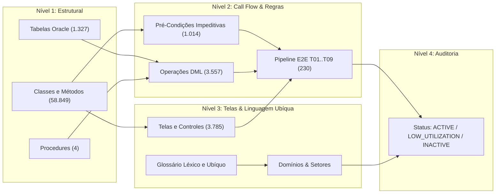
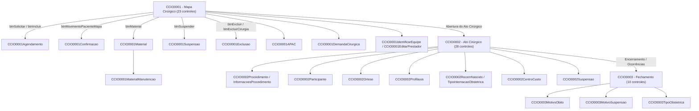
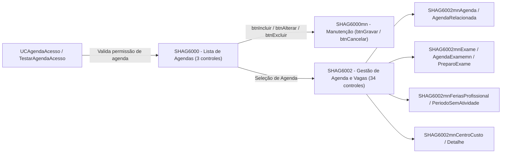
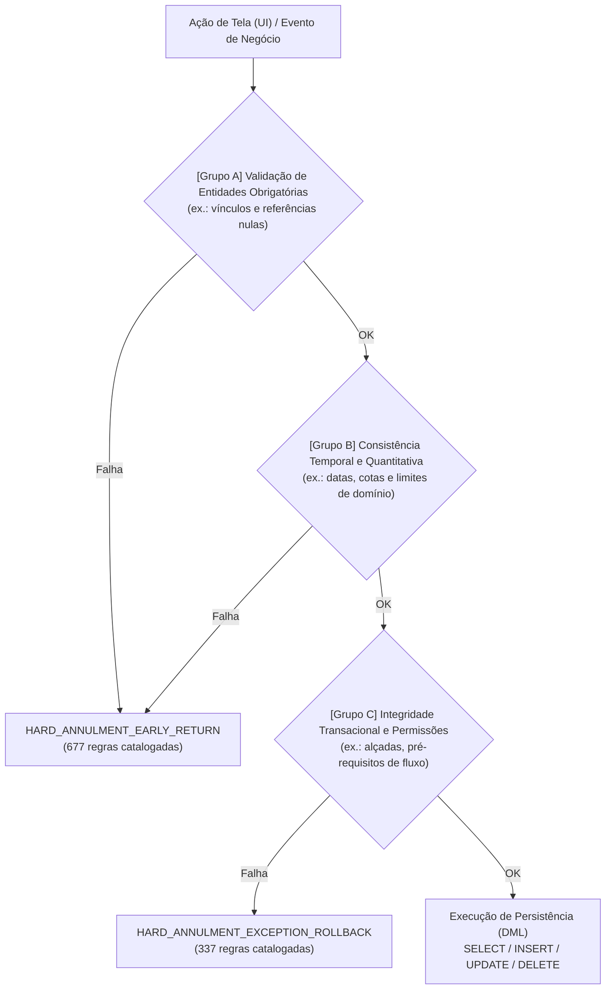

# Metadados Arquiteturais — SIHOSP / HCFAMEMA (`v2.1.0`)

Repositório de metadados extraídos do monolito hospitalar **SIHOSP (`SIHOSP_HCFAMEMA_MONOLITH`)** segundo o padrão **`[Incremental Build Model]`** em 4 camadas sequenciais e dependentes. A partir da correlação entre identidades estruturais, fluxos de chamada (*call flows*), heurísticas de interface e auditoria de produção, este conjunto de metadados permite **reconstruir automaticamente fluxos de telas, jornadas de usuário e catálogos de regras de negócio** sem depender da leitura direta do código-fonte original.

> [!NOTE]
> **Status da Consolidação:** `CONSOLIDATION_COMPLETED` — Todos os 6 gates bloqueantes (`GATE-L1.0` a `GATE-L4.1`) foram satisfeitos e os **230 projetos** do monolito foram consolidados.

> [!IMPORTANT]
> **Política de Confidencialidade:** Por segurança e sigilo institucional, expressões literais de código, nomes de tabelas/colunas internas, identificadores específicos de regras de negócio e critérios clínicos/financeiros detalhados foram **omitidos ou abstraídos** nesta documentação pública, mantendo-se apenas a estrutura arquitetural, métricas agregadas e fluxos representativos.

---

## 📊 Números Consolidados do Monolito

| Camada | Artefato / Dimensão | Quantidade Mapeada | Fonte nos Metadados |
| :--- | :--- | :---: | :--- |
| **L1 — Estrutural** | Projetos / Módulos Consolidados | **230** | [`application_context.json`](output/layer1_structural/application_context.json) |
| **L1 — Estrutural** | Tabelas Relacionais (Oracle) | **1.327** | [`identities_db_relational.jsonl`](output/layer1_structural/identities_db_relational.jsonl) |
| **L1 — Estrutural** | Identidades em Memória RAM (Classes/Métodos) | **58.849** | [`identities_memory_ram.jsonl`](output/layer1_structural/identities_memory_ram.jsonl) |
| **L1 — Estrutural** | Armazenamento Persistente (Setores/Mídias) | **50** | [`identities_storage_persistent.jsonl`](output/layer1_structural/identities_storage_persistent.jsonl) |
| **L1 — Estrutural** | Objetos Externos (Procedures) | **4** | [`identities_external_objects.jsonl`](output/layer1_structural/identities_external_objects.jsonl) |
| **L2 — Call Flow** | Operações DML Catalogadas (`SELECT` / `INSERT` / `UPDATE` / `DELETE`) | **3.557** | [`storage_entrypoints_dml_catalog.jsonl`](output/layer2_callflow/storage_entrypoints_dml_catalog.jsonl) |
| **L2 — Call Flow** | Pré-Condições Impeditivas / Regras de Bloqueio | **1.014** | [`preconditions_and_impediments_catalog.jsonl`](output/layer2_callflow/preconditions_and_impediments_catalog.jsonl) |
| **L2 — Call Flow** | Fluxos Ponta a Ponta (`UI -> DB/Disco`) | **230** | [`end_to_end_flows.jsonl`](output/layer2_callflow/end_to_end_flows.jsonl) |
| **L3 — Heurísticas UI** | Telas Únicas Identificadas (em **179** módulos) | **3.785** | [`output/layer3_techstack_heuristics/per_project/`](output/layer3_techstack_heuristics/per_project/) |
| **L3 — Heurísticas UI** | Domínios Isolados | **8** | [`projection_3_domain_isolation.jsonl`](output/layer3_techstack_heuristics/projection_3_domain_isolation.jsonl) |
| **L4 — Auditoria** | Setores Físicos e Perfis de Acesso | **8** | [`people_groups_and_physical_structures.jsonl`](output/layer3_techstack_heuristics/people_groups_and_physical_structures.jsonl) |

---

## 🧠 Como Fluxos de Telas e Regras de Negócio são Gerados

Os metadados conectam a camada visual (telas e botões) às tabelas do banco e às validações de negócio através de **URNs canônicas** (`urn:famema:SIHOSP:...`):



---

## 🖥️ Fluxos de Telas Extraídos dos Metadados

A camada L3 mapeou **3.785 telas únicas** distribuídas em **179 módulos** com interface gráfica. Os módulos com maior concentração de telas são:

| Módulo (`project_id`) | Telas Únicas | Módulo (`project_id`) | Telas Únicas |
| :--- | :---: | :--- | :---: |
| `pep-forms` | 348 | `laboratorio-forms` | 77 |
| `lucy-forms` | 242 | `controle-acesso` / `internacao-forms-dll` | 57 |
| `pep-internacao-forms` | 143 | `demanda-cirurgia-forms` / `pronto-atendimento-forms` | 54 |
| `prescricao-eletronica-forms` | 127 | `centro-cirurgico-forms` | 49 |
| `enfermagem-forms` | 117 | `atendimento-forms` | 47 |
| `exames-forms` | 86 | — | — |

### Exemplo 1 — Fluxo de Telas: Centro Cirúrgico (`centro-cirurgico-forms`)

Extraído de [`centro-cirurgico-forms.l3.json`](output/layer3_techstack_heuristics/per_project/centro-cirurgico-forms.l3.json) (e detalhado em [`fluxo_telas_centro_cirurgico.pdf`](output/fluxo_telas_centro_cirurgico.pdf)), o módulo organiza a jornada cirúrgica em torno das telas principais **`CCIO0001`** (Mapa Cirúrgico, 23 controles), **`CCIO0002`** (Registro/Execução Cirúrgica, 28 controles) e **`CCIO0003`** (Fechamento/Suspensão, 10 controles):



### Exemplo 2 — Fluxo de Telas: Agendamentos (`agendamentos-forms` & `agendamentos`)

Extraído de [`projection_1_screen_flows.jsonl`](output/layer3_techstack_heuristics/projection_1_screen_flows.jsonl) e [`projection_4_screen_isolation.jsonl`](output/layer3_techstack_heuristics/projection_4_screen_isolation.jsonl):



### Pipeline Ponta a Ponta (`UI -> Banco / Disco`)

Cada fluxo de tela atravessa até **9 estágios de transformação** catalogados em [`end_to_end_flows.jsonl`](output/layer2_callflow/end_to_end_flows.jsonl):

`T01_UI_EXTRACT_PARSE` $\rightarrow$ `T02_OBJECT_MAPPING` $\rightarrow$ `T03_IN_MEMORY_COMPUTATION` $\rightarrow$ `T04_DB_PARAMETER_BINDING` $\rightarrow$ `T05_DB_DML_TRANSFORMATION` $\rightarrow$ `T06_RESULTSET_MATERIALIZATION` $\rightarrow$ `T07_HYDRATION_TO_DTO` $\rightarrow$ `T08_UI_RENDER_BINDING` $\rightarrow$ `T09_PERSISTENT_MEDIA_SERIALIZATION`

---

## ⚖️ Regras de Negócio Extraídas dos Metadados

### 1. Pré-Condições Impeditivas (`preconditions_and_impediments_catalog.jsonl`)

Foram extraídas **1.014 pré-condições impeditivas** que interrompem ou revertem o fluxo caso não sejam atendidas:
- **`HARD_ANNULMENT_EARLY_RETURN`**: **677** regras (retorno antecipado / bloqueio antes da persistência).
- **`HARD_ANNULMENT_EXCEPTION_ROLLBACK`**: **337** regras (lançamento de exceção / rollback transacional).

**Módulos com maior densidade de regras impeditivas:**

| Módulo | Qtd. Regras | Módulo | Qtd. Regras |
| :--- | :---: | :--- | :---: |
| `pronto-atendimento` | 30 | `pep-forms` | 24 |
| `shdi-5004-dll` | 30 | `prescricao-eletronica-forms` | 24 |
| `demanda-cirurgia-forms` | 26 | `centro-cirurgico-forms` | 24 |
| `centro-cirurgico` | 26 | `spot-forms` | 23 |
| `agendamentos` | 25 | `agendamentos-forms` | 23 |

#### Fluxo Abstrato de Validação e Bloqueio de Regras

Os metadados classificam as pré-condições em **padrões estruturais de validação** (sem expor a lógica condicional interna de cada regra):



> *Nota: As expressões literais (`expression`) e os critérios específicos por módulo permanecem restritos ao catálogo privado `preconditions_and_impediments_catalog.jsonl`.*

### 2. Operações de Persistência / DML (`storage_entrypoints_dml_catalog.jsonl`)

Das **3.557** operações DML mapeadas sobre o banco relacional (nomes de tabelas omitidos):
- **`SELECT`**: `2.217` (consultas de estado e leitura)
- **`DELETE`**: `730` (remoções controladas por domínio)
- **`UPDATE`**: `335` (mutações de estado)
- **`INSERT`**: `275` (novos registros)

### 3. Registro de Atividade de Regras e Auditoria (Camada 4)

A auditoria em [`business_rules_activity_registry.json`](output/layer4_graphics/business_rules_activity_registry.json) classifica as regras de negócio mapeadas por **status de utilização em produção** (identificadores e descrições específicas omitidos):

| Categoria de Regra (Anonimizada) | Domínio | Status de Auditoria |
| :--- | :--- | :--- |
| `RULE_URGENCIA_01` *(Classificação / Triagem)* | Atendimento | `ACTIVE` |
| `RULE_AGENDA_02` *(Controle de Vagas)* | Agendamento | `ACTIVE` |
| `RULE_CIRURGIA_03` *(Alocação / Restrição)* | Cirurgia | `ACTIVE` |
| `RULE_FATURAMENTO_04` *(Consistência / Produção)* | Faturamento | `ACTIVE` |
| `RULE_INTERNACAO_05` *(Reserva Especial)* | Internação | `LOW_UTILIZATION` |
| `RULE_LEGADO_06` *(Integração Descontinuada)* | Legado | `INACTIVE_DEAD_CODE` |

---

## 🏥 Domínios, Setores Físicos e Linguagem Ubíqua

Os metadados cruzam regras e telas com a estrutura organizacional do hospital ([`chart1`](output/layer4_graphics/chart1_domain_identities_preconditions_apps.json), [`chart2`](output/layer4_graphics/chart2_physical_infrastructure_rooms_sectors_people.json), [`chart3`](output/layer4_graphics/chart3_sectors_people_groups_system_parts_org_structure.json) e [`ubiquitous_non_business_glossary.json`](output/layer3_techstack_heuristics/ubiquitous_non_business_glossary.json)):

- **8 Domínios Isolados:** `Atendimento` (score 102: 72 identidades, 30 pré-condições), `Documentos` (score 51: 36 identidades, 15 pré-condições), `Orcamento`, `Estoque`, `Contrato`, `Aquisicao`, `Relatorios` e `Patrimonio` (score 23 cada).
- **8 Setores Físicos:** `Ambulatório`, `Pronto Atendimento`, `Centro Cirúrgico`, `Internação`, `Laboratório`, `Radiologia`, `Faturamento` e `SAME` (atendidos pelos perfis `Médico`, `Enfermeiro`, `Recepcionista`, `Faturista` e `Administrativo`).
- **Glossário de Linguagem Ubíqua (`is_business_rule_participant: false`):** `SUS`, `BPA`, `APAC`, `AIH`, `CROSS`, `SAME`, `PEP`, `UTI`, `CCIH` e `NIR`.

---

## 📁 Estrutura do Repositório

```text
├── config/
│   ├── application_manifest.json          # Manifesto da aplicação SIHOSP e dos 230 projetos
│   └── incremental_build_state.json       # Estado dos gates e shards do Incremental Build Model
├── input/                                 # Insumos fornecidos nos gates (DDL, procedures, infra, glossário)
├── output/
│   ├── fluxo_telas_centro_cirurgico.pdf   # Diagrama de fluxo de telas do Centro Cirúrgico
│   ├── layer1_structural/                 # Identidades únicas (DB, RAM, Disco, Procedures) e grafo de dependências
│   ├── layer2_callflow/                   # Agregados, DML, E2E flows, pré-condições e ordem topológica
│   ├── layer3_techstack_heuristics/       # 4 projeções Socráticas, glossário e 230 arquivos *.l3.json
│   ├── layer4_graphics/                   # Registro de atividade de regras e Gráficos 1, 2 e 3 (JSON/HTML)
│   └── scripts/                           # Scripts de extração, consolidação e verificação
└── specs/                                 # Especificações normativas das 4 camadas (Specs 00 a 05)
```

---

## 📚 Documentação Normativa

- [Spec 00 — Arquitetura Mestre e Hierarquia de 4 Níveis](specs/00_MASTER_ARCHITECTURE_AND_HIERARCHY.md)
- [Spec 01 — Nível 1: Structural Comprehension](specs/01_SPEC_LAYER1_STRUCTURAL_COMPREHENSION.md)
- [Spec 02 — Nível 2: Call Flow Comprehension](specs/02_SPEC_LAYER2_CALL_FLOW_COMPREHENSION.md)
- [Spec 03 — Nível 3: Tech Stack & Client Heuristics](specs/03_SPEC_LAYER3_TECH_STACK_AND_HEURISTICS.md)
- [Spec 04 — Nível 4: Gráficos e Inteligência Analítica](specs/04_SPEC_LAYER4_GRAPHICS_AND_ANALYTICS.md)
- [Spec 05 — Plano de Execução para Monolito de 700 Módulos](specs/05_EXECUTION_PLAN_700_MODULES_MONOLITH.md)
