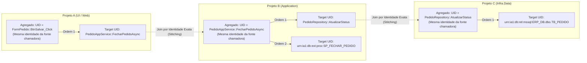

# Nível 2: Especificação de Compreensão de Fluxo de Chamadas (`Call Flow Comprehension`)

## 1. Objetivo e Dependência Estrita do Nível 1
O **Nível 2 (Call Flow Comprehension)** constrói a dinâmica comportamental do sistema exclusivamente sobre as identidades estáticas geradas no **Nível 1 (Structural Comprehension)**.

> **Regra de Dependência Estrita:**
> Nenhum nó, origem, destino ou contrato de dados pode existir no Nível 2 sem possuir uma referência válida a um `UID` (`urn:ia1:...`) previamente catalogado no Nível 1.

---

## 2. Identificação de Início e Fim de uma Chamada de Dados (Fronteiras do Fluxo)

Todo fluxo de chamada de dados possui limites bem definidos de **Início (Origin / Entry Point)** e **Fim (Terminal Sink / Source)**:

### 2.1. Pontos de Início (`FLOW_START` / UI e Gatilhos do Sistema)
1. **UI do Sistema (`SYSTEM_UI`)**:
   - Eventos de interface gráfica (WebForms `Button_Click`, MVC/Razor Actions, Blazor/SPA Handlers, WPF/WinForms Commands/Events).
2. **Endpoints de Entrada (`API_ENTRYPOINT`)**:
   - Controllers REST/gRPC/SOAP (`[HttpPost]`, `[HttpGet]`, WCF `[OperationContract]`).
3. **Gatilhos Assíncronos / Background (`ASYNC_TRIGGER`)**:
   - Jobs agendados (Quartz, Hangfire, Windows Services), consumidores de filas/mensageria.

### 2.2. Pontos de Fim (`FLOW_END` / Persistência e Saída)
1. **Persistência Relacional (`DB_SINK` / `DB_SOURCE`)**:
   - Leitura (`SELECT`) ou Escrita (`INSERT`, `UPDATE`, `DELETE`, `MERGE`) em uma tabela com identidade `urn:ia1:db:rel:...`.
2. **Execução de Entidade Externa (`DB_EXT_EXEC`)**:
   - Chamada a uma Stored Procedure ou Function com identidade `urn:ia1:db:ext:proc:...`.
3. **Persistência em Disco / Mídia (`STORAGE_SINK` / `STORAGE_SOURCE`)**:
   - Leitura ou gravação em arquivo com identidade `urn:ia1:storage:...`.
4. **Armazenamento em Memória Compartilhada (`RAM_STORE_SINK`)**:
   - Escrita/leitura terminal em Cache, Sessão ou Stream (`urn:ia1:mem:cache-...`, `urn:ia1:mem:session:...`).
5. **Retorno à UI (`UI_RENDER_RETURN`)**:
   - Devolução do contrato de memória final (`urn:ia1:mem:contract:...`) para renderização na tela do usuário.

---

## 3. Estrutura de Agregação de Chamadas pela Identidade da Fonte Chamadora (`/??/`)

> **Resolução Arquitetural para `/??/` (Agregação com a Mesma Identidade da Fonte Chamadora):**
> *Requisito*: "Deve haver uma estrutura que agregue chamadas onde sua identidade única seja a mesma da fonte que a chamou. Ao ler um único projeto por vez, a IA deve criar pequenos agregados que vão conter os fluxos identificados deste projeto."

### 3.1. O Conceito de `CallerScopedAggregate` (Pequeno Agregado por Fonte Chamadora)
Ao analisar um projeto individualmente (ex.: 1 dos 700 módulos), a IA não tenta adivinhar o monolito inteiro de uma só vez. Em vez disso, para cada método ou componente de UI que realiza chamadas, cria-se um **Agregado de Chamadas Ancorado no Chamador (`CallerScopedAggregate`)**:

- **Identidade Primária do Agregado (`aggregate_identity_uid`)**: É **exatamente o mesmo `UID` do Nível 1 da fonte que originou as chamadas** (`caller_uid`).
- **Conteúdo do Pequeno Agregado**:
  - Lista ordenada (`execution_order: 1, 2, 3...`) de todas as identidades do Nível 1 invocadas a partir dessa fonte.
  - Contrato de memória (`urn:ia1:mem:contract:...`) que entra e que sai em cada passo.
  - Quantidade e tipo de **Transformações de Dados** realizadas nesse segmento.
  - Lista detalhada, identificável e contabilizada de **Pré-Condições** que governam cada chamada.



### 3.2. Composição Incremental e Ordenada Ponta a Ponta (`End-to-End Flow Stitching`)
Como a identidade do agregado do Projeto B (`aggregate_identity_uid`) é **idêntica** ao alvo chamado pelo Projeto A (`target_uid`), o consolidador monta o fluxo ponta a ponta por **junção determinística de chaves (`UID Join`)**:
1. Lê-se **1 projeto por vez**, emitindo seu arquivo de pequenos agregados (`<module_id>.l2.aggregates.json`).
2. O grafo completo emerge naturalmente conectando `target_uid` $\rightarrow$ `aggregate_identity_uid`, preservando a identidade da raiz que iniciou o fluxo (ex.: a ação na UI do sistema) até o banco de dados ou disco.

---

## 4. Contabilização de Transformações de Dados (`Data Transformations`)

Em cada segmento do fluxo (dentro de cada pequeno agregado) e no fluxo ponta a ponta consolidado, o mapeamento identifica e contabiliza **quantas transformações de dados** ocorrem.

### 4.1. Taxonomia de Transformações de Dados Contabilizáveis
Uma transformação de dados é registrada sempre que um dado muda de contrato de memória, formato, estrutura ou valor calculado:

| Código | Tipo de Transformação | Exemplo em C# / .NET |
| :--- | :--- | :--- |
| `TX_MAP` | **Mapeamento de Contrato (DTO $\leftrightarrow$ Entidade)** | `AutoMapper.Map<Pedido>(dto)`, `new PedidoEntity { ... }` |
| `TX_PROJ` | **Projeção / Filtragem de Coleção** | LINQ `.Select(...)`, `.GroupBy(...)`, `.ToDictionary(...)` |
| `TX_CALC` | **Cálculo / Agregação / Mutação de Valor** | Cálculo de impostos, somatórios (`.Sum()`), concatenação/formatação de regras |
| `TX_SER` | **Serialização / Deserialização** | `JsonSerializer.Serialize`, `XmlSerializer`, conversão para `byte[]` / `Stream` |
| `TX_DB_BIND` | **Tradução Objeto-Relacional / Parâmetros SQL** | Mapeamento de propriedades C# para `DynamicParameters`, `SqlParameter` ou `IQueryable` |

### 4.2. Métricas Obrigatórias por Parte do Fluxo
Cada passo (`step`) dentro do agregado deve expor:
- `step_transformation_count`: Quantidade inteira de transformações ocorridas naquele passo.
- `transformations_detail`: Lista com `input_contract_uid`, `output_contract_uid` e `transformation_type`.
- `aggregate_total_transformations`: Soma das transformações do pequeno agregado local.
- `e2e_total_transformations`: Soma acumulada de todas as transformações desde o `FLOW_START` (UI) até o `FLOW_END` (Persistência).

---

## 5. Identificação, Detalhamento e Contabilização de Pré-Condições (`Preconditions`)

Para que um dado percorra um segmento ou todo o fluxo de execução, ele precisa satisfazer **Pré-Condições** (barreiras lógicas, validações, permissões e estados).

> **Requisito Obrigatório:**
> Todas as pré-condições precisam ser **identificáveis** (com ID único atrelado à identidade estrutural onde residem), **detalhadas** (expressão lógica, categoria e efeito de bloqueio) e **contabilizadas** (por passo, por agregado e no acumulado ponta a ponta).

### 5.1. Modelo de Identidade e Detalhamento de uma Pré-Condição
Cada pré-condição recebe uma sub-identidade derivada do método do Nível 1 onde ela é avaliada:
```text
urn:ia1:precond:<caller_method_uid>#P<sequencial_ordenado>
```

Campos obrigatórios no detalhamento da pré-condição:
1. `precondition_uid`: Identificador único da pré-condição.
2. `host_identity_uid`: `UID` do método/classe do Nível 1 onde a condição está declarada.
3. `order_in_method`: Ordem sequencial em que a barreira é testada antes ou durante a chamada.
4. `category`:
   - `AUTH_PERMISSION`: Atributos `[Authorize]`, verificação de roles/claims/permissões de usuário.
   - `INPUT_VALIDATION`: Guard clauses (`if (dto == null) throw...`, `FluentValidation`, `ModelState.IsValid`).
   - `BUSINESS_INVARIANT`: Regra de estado de negócio (`if (pedido.Status != Status.Aberto) return false`).
   - `STATE_OR_CACHE_CHECK`: Verificação de existência em memória/cache/sessão antes de prosseguir.
   - `INFRA_DEPENDENCY_GUARD`: Verificação de conexão, feature flag, lock ou transação ativa.
5. `condition_expression`: Expressão lógica normalizada (ex.: `dto != null && dto.Itens.Count > 0 && pedido.LimiteCredito >= dto.ValorTotal`).
6. `atomic_clause_count`: Número de cláusulas booleanas atômicas na condição (ex.: `A && B && C` = 3 condições atômicas; permite medir tanto o número de barreiras `if` quanto a complexidade condicional exata).
7. `on_failure_action`: `THROW_EXCEPTION | EARLY_RETURN | REDIRECT_ERROR | COMPENSATE`.
8. `governs_target_uids`: Quais chamadas subsequentes (`target_uid`) dependem do sucesso desta pré-condição para serem executadas.

### 5.2. Contabilização Acumulada de Pré-Condições no Fluxo Ponta a Ponta
Seja um fluxo ponta a ponta $F = (I_1 \rightarrow I_2 \rightarrow \dots \rightarrow I_k)$ onde cada identidade $I_j$ é um método ou fronteira pela qual o dado passa:
- **Pré-Condições Locais do Passo $j$**: $P_{local}(I_j, \text{call\_site})$ = quantidade de pré-condições dentro de $I_j$ que precisam ser verdadeiras para alcançar a chamada para $I_{j+1}$.
- **Total de Pré-Condições do Fluxo Ponta a Ponta**:
  $$\text{TotalPreconditions}(F) = \sum_{j=1}^{k} P_{local}(I_j)$$
- Assim, o mapeamento responde exatamente: *"Quantas pré-condições um dado precisa satisfazer para sair da tela de UI $I_1$ e ser gravado na tabela $I_k$?"*

---

## 6. Exemplo Completo de Saída do Nível 2 (Agregado de Projeto + Fluxo Consolidado)

```json
{
  "layer": 2,
  "layer_name": "call_flow_comprehension",
  "module_uid": "urn:ia1:code:module:erp-monolith-core:Faturamento.Application",
  "caller_scoped_aggregates": [
    {
      "aggregate_identity_uid": "urn:ia1:code:method:erp-monolith-core:Faturamento.Application:Faturamento.Application.Services.PedidoAppService::FecharPedidoAsync(urn:ia1:mem:contract:erp-monolith-core:Faturamento.Domain:Faturamento.Domain.DTOs.PedidoFechamentoDto):System.Threading.Tasks.Task<System.Boolean>",
      "is_ui_entry_point": false,
      "called_by_known_uids": [
        "urn:ia1:code:method:erp-monolith-core:Faturamento.WebUI:Faturamento.WebUI.Controllers.PedidoController::PostFecharPedido(urn:ia1:mem:contract:erp-monolith-core:Faturamento.Domain:Faturamento.Domain.DTOs.PedidoFechamentoDto):Microsoft.AspNetCore.Mvc.IActionResult"
      ],
      "local_metrics": {
        "total_steps": 3,
        "total_data_transformations": 4,
        "total_preconditions": 3
      },
      "preconditions": [
        {
          "precondition_uid": "urn:ia1:precond:Faturamento.Application.Services.PedidoAppService::FecharPedidoAsync#P1",
          "order_in_method": 1,
          "category": "INPUT_VALIDATION",
          "condition_expression": "dto != null && dto.PedidoId > 0",
          "atomic_clause_count": 2,
          "on_failure_action": "THROW_EXCEPTION",
          "governs_target_uids": ["*"]
        },
        {
          "precondition_uid": "urn:ia1:precond:Faturamento.Application.Services.PedidoAppService::FecharPedidoAsync#P2",
          "order_in_method": 2,
          "category": "BUSINESS_INVARIANT",
          "condition_expression": "pedidoEntity.Status == StatusPedido.EmAberto",
          "atomic_clause_count": 1,
          "on_failure_action": "EARLY_RETURN",
          "governs_target_uids": [
            "urn:ia1:db:ext:proc:mssql:ERP_DB.dbo.SP_FECHAR_PEDIDO(INT,DECIMAL)"
          ]
        },
        {
          "precondition_uid": "urn:ia1:precond:Faturamento.Application.Services.PedidoAppService::FecharPedidoAsync#P3",
          "order_in_method": 3,
          "category": "BUSINESS_INVARIANT",
          "condition_expression": "clienteCredito.SaldoDisponivel >= pedidoEntity.ValorLiquido",
          "atomic_clause_count": 1,
          "on_failure_action": "THROW_EXCEPTION",
          "governs_target_uids": [
            "urn:ia1:db:ext:proc:mssql:ERP_DB.dbo.SP_FECHAR_PEDIDO(INT,DECIMAL)"
          ]
        }
      ],
      "ordered_calls": [
        {
          "step_order": 1,
          "target_uid": "urn:ia1:code:method:erp-monolith-core:Faturamento.Infra:Faturamento.Infra.Repositories.PedidoRepository::ObterPorId(System.Int32):urn:ia1:mem:contract:erp-monolith-core:Faturamento.Domain:Faturamento.Domain.Entities.Pedido",
          "required_precondition_uids": [
            "urn:ia1:precond:Faturamento.Application.Services.PedidoAppService::FecharPedidoAsync#P1"
          ],
          "data_transformations": {
            "count": 1,
            "items": [
              {
                "type": "TX_MAP",
                "from_contract_uid": "urn:ia1:mem:contract:erp-monolith-core:Faturamento.Domain:Faturamento.Domain.DTOs.PedidoFechamentoDto",
                "to_contract_uid": "urn:ia1:mem:contract:stdlib:System.Int32",
                "description": "Extração de chave PedidoId do DTO de entrada"
              }
            ]
          }
        },
        {
          "step_order": 2,
          "target_uid": "urn:ia1:db:ext:proc:mssql:ERP_DB.dbo.SP_FECHAR_PEDIDO(INT,DECIMAL)",
          "required_precondition_uids": [
            "urn:ia1:precond:Faturamento.Application.Services.PedidoAppService::FecharPedidoAsync#P1",
            "urn:ia1:precond:Faturamento.Application.Services.PedidoAppService::FecharPedidoAsync#P2",
            "urn:ia1:precond:Faturamento.Application.Services.PedidoAppService::FecharPedidoAsync#P3"
          ],
          "data_transformations": {
            "count": 2,
            "items": [
              {
                "type": "TX_CALC",
                "from_contract_uid": "urn:ia1:mem:contract:erp-monolith-core:Faturamento.Domain:Faturamento.Domain.Entities.Pedido",
                "to_contract_uid": "urn:ia1:mem:contract:stdlib:System.Decimal",
                "description": "Cálculo de ValorLiquido com descontos e impostos"
              },
              {
                "type": "TX_DB_BIND",
                "from_contract_uid": "urn:ia1:mem:contract:erp-monolith-core:Faturamento.Domain:Faturamento.Domain.Entities.Pedido",
                "to_contract_uid": "urn:ia1:db:ext:proc:mssql:ERP_DB.dbo.SP_FECHAR_PEDIDO(INT,DECIMAL)",
                "description": "Bind de parâmetros @ID_PEDIDO e @VL_LIQUIDO para execução da procedure"
              }
            ]
          }
        },
        {
          "step_order": 3,
          "target_uid": "urn:ia1:storage:local-fs:erp-monolith-core:/var/export/nfe/{ano}/{mes}/*.xml",
          "required_precondition_uids": [
            "urn:ia1:precond:Faturamento.Application.Services.PedidoAppService::FecharPedidoAsync#P1",
            "urn:ia1:precond:Faturamento.Application.Services.PedidoAppService::FecharPedidoAsync#P2",
            "urn:ia1:precond:Faturamento.Application.Services.PedidoAppService::FecharPedidoAsync#P3"
          ],
          "data_transformations": {
            "count": 1,
            "items": [
              {
                "type": "TX_SER",
                "from_contract_uid": "urn:ia1:mem:contract:erp-monolith-core:Faturamento.Domain:Faturamento.Domain.Entities.Pedido",
                "to_contract_uid": "urn:ia1:storage:local-fs:erp-monolith-core:/var/export/nfe/{ano}/{mes}/*.xml",
                "description": "Serialização XML do pedido faturado em arquivo local"
              }
            ]
          }
        }
      ]
    }
  ]
}
```
