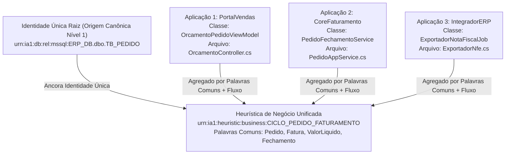

# Nível 3: Especificação de Tech Stack e Heurísticas de Negócio (`Tech Stack / Client Heuristics`)

## 1. Objetivo e Composição dos Níveis 1 e 2
O **Nível 3 (Tech Stack / Client Heuristics)** compõe as identidades estruturais do **Nível 1** e os fluxos de chamada do **Nível 2** em **Grupos Tecnológicos, Heurísticas de Negócio, Glossário de Linguagem Natural e Domínios**.

> **Papel na Hierarquia:**
> Enquanto o Nível 1 define *o que existe* (identidades únicas) e o Nível 2 define *como os dados fluem* (agregados, transformações e pré-condições), o Nível 3 organiza essas informações em **agrupamentos tecnológicos e domínios semânticos de negócio**, mesmo quando espalhados por múltiplas aplicações ou centenas de módulos.

---

## 2. Mapeamento de Aplicações, Principais Artefatos e Nomes de Arquivos

Todo conjunto de identidades estruturais do Nível 1 é vinculado explicitamente à sua organização física e de deploy:

### 2.1. Registro de Aplicação e Artefatos Principais
1. **Nome da Aplicação (`application_name` / `app_id`)**:
   - Identifica a aplicação proprietária (e aplicações satélites/integradas que compartilham o banco ou bibliotecas).
2. **Principais Artefatos (`primary_artifacts`)**:
   - Mapeia os artefatos compilados ou distribuíveis gerados pelos módulos:
     - Executáveis / Hosts (`.exe`, `WebApp`, `WindowsService`, `Worker`).
     - Bibliotecas Dinâmicas (`.dll`, pacotes NuGet internos).
     - Artefatos de Banco de Dados (`.dacpac`, scripts `.sql`, migrations).
     - Arquivos de Configuração e Manifesto (`appsettings.json`, `Web.config`, `App.config`, `.csproj`, `.sln`).
3. **Mapeamento de Nomes de Arquivos (`source_files`)**:
   - Cada identidade de classe/método do Nível 1 mantém o vínculo com o nome do arquivo físico (`file_name`, ex.: `PedidoAppService.cs`) e seu caminho relativo à pasta raiz única (`relative_path`), permitindo rastrear qualquer domínio até os arquivos físicos exatos no disco.

---

## 3. Classificação de Identidades por Tech Stack

O mapeamento agrupa todas as identidades do Nível 1 dentro das camadas e tecnologias da **Tech Stack** utilizada pelo sistema:

| Camada da Tech Stack | Exemplos de Tecnologias Detectadas | Identidades do Nível 1 Associadas |
| :--- | :--- | :--- |
| `STACK_PRESENTATION_UI` | ASP.NET MVC, WebForms, Blazor,Razor, WinForms, WPF, WebAPI | Classes/Métodos de Controllers, Pages, Views, Code-Behind, ViewModels |
| `STACK_APPLICATION_ORCHESTRATION` | Application Services, MediatR Handlers, WCF Services, UseCases | Classes/Métodos que iniciam ou coordenam agregados de Call Flow |
| `STACK_DOMAIN_CORE` | Domain Entities, Domain Services, Value Objects, Validators | Contratos de memória (`urn:ia1:mem:contract:...`) e classes de regras puras |
| `STACK_DATA_ACCESS_ORM` | Entity Framework (EF6/EFCore), Dapper, NHibernate, ADO.NET (`SqlCommand`) | Repositórios, DbContexts, DataAdapters e chamadas a bibliotecas de dados |
| `STACK_PERSISTENCE_DB` | SQL Server, Oracle, PostgreSQL, MySQL, SQLite | Tabelas (`urn:ia1:db:rel:...`) e Procedures (`urn:ia1:db:ext:...`) |
| `STACK_STORAGE_AND_IO` | Local FileSystem, SMB Network Share, XML/CSV/PDF Exports, Optical/Archive | Identidades de armazenamento (`urn:ia1:storage:...`) |
| `STACK_MEMORY_AND_CACHING` | `IMemoryCache`, Redis, `HttpContext.Session`, Static Singletons, Streams | Identidades de memória temporária (`urn:ia1:mem:cache-...`, `session`, `stream`) |

Cada identidade do Nível 1 recebe o atributo `tech_stack_binding` apontando para sua classificação tecnológica e biblioteca subjacente (`urn:ia1:code:lib:...`).

---

## 4. Glossário Semântico de Variáveis para Tradução em Leitura Natural

> **Requisito Crítico:**
> *"Aqui é importante que seja possível ter um glossário e este glossário esteja contido no mapeamento, mapeie e armazene todos os nomes de variáveis que se assemelham a alguma palavra que pode ser utilizada para traduzir a chamada para a leitura natural depois."*

### 4.1. Por que o Glossário Fica no Nível 3 (e não no Nível 1)?
- No **Nível 1**, variáveis de classe e variáveis de método foram **descartadas** da criação de identidades estruturais para evitar que os metadados ficassem maiores que o próprio código-fonte.
- No **Nível 3**, o analisador léxico varre os identificadores internos (nomes de variáveis locais, parâmetros de métodos, campos privados e propriedades) com o único propósito de **extrair vocabulário humano de negócio** para o **Glossário Semântico (`NaturalLanguageGlossary`)**.

### 4.2. Pipeline de Extração e Normalização de Variáveis para o Glossário
1. **Tokenização de Identificadores (`camelCase`, `PascalCase`, `snake_case`, prefixos húngaros)**:
   - Exemplo: `vlrLiquidoPedido` $\rightarrow$ tokens `["vlr", "liquido", "pedido"]`.
   - Exemplo: `_dtVencimentoFatura` $\rightarrow$ tokens `["dt", "vencimento", "fatura"]`.
2. **Filtro de Relevância Semântica (Descarte de Ruído Sintático)**:
   - **Descartados do glossário**: contadores e nomes genéricos sem semântica (`i`, `j`, `x`, `tmp`, `obj`, `ret`, `aux`, `list`, `item`, `sb`, `ex`).
   - **Retidos e Traduzidos no glossário**: variáveis que contêm radicais ou abreviações reconhecíveis do idioma/negócio (`cli` $\rightarrow$ `Cliente`, `vlr`/`vl` $\rightarrow$ `Valor`, `ped` $\rightarrow$ `Pedido`, `nf`/`nfe` $\rightarrow$ `Nota Fiscal`, `fat` $\rightarrow$ `Faturamento`, `sld` $\rightarrow$ `Saldo`, `cred` $\rightarrow$ `Crédito`).
3. **Estrutura de Entrada no Glossário**:
   - Cada entrada do glossário armazena:
     - `raw_variable_names`: Lista de nomes de variáveis encontradas no código (`["vlrLiquidoPedido", "vlLiquido", "valor_liquido_ped"]`).
     - `canonical_business_term`: Termo em linguagem natural (`"Valor Líquido do Pedido"`).
     - `natural_language_verb_or_noun`: Papel gramatical para tradução de chamadas (`SUBSTANTIVO_CONCEITO` | `ACAO_NEGOCIO` | `ESTADO_CONDICAO`).
     - `anchored_structural_identity_uid`: A identidade única do Nível 1 onde esse conceito nasce ou é persistido (ex.: `urn:ia1:db:rel:mssql:ERP_DB.dbo.TB_PEDIDO#VL_LIQUIDO` ou contrato de memória principal).
     - `observed_in_method_uids`: Lista de métodos do Nível 1 onde essas variáveis aparecem.

### 4.3. Tradução Automática de Call Flow para Leitura Natural
Com o Glossário do Nível 3 combinado ao Call Flow do Nível 2, qualquer chamada técnica pode ser traduzida automaticamente para uma frase em linguagem natural:
- *Assinatura Técnica (Nível 1/2)*:
  `PedidoAppService::FecharPedidoAsync(dto) -> [Precond: sldCredCli >= vlrLiqPed] -> SP_FECHAR_PEDIDO(@ID_PED, @VL_LIQ)`
- *Tradução Gerada via Glossário (Nível 3)*:
  > **"Ao acionar o Fechamento de Pedido, verifica-se se o Saldo de Crédito do Cliente (`sldCredCli`) é maior ou igual ao Valor Líquido do Pedido (`vlrLiqPed`) e, em caso positivo, executa-se a rotina de banco de fechamento do pedido gravando o valor líquido."**

---

## 5. Heurísticas de Negócio Transversais (Mesma Heurística em Aplicações Diferentes)

> **Requisitos:**
> - *"É importante que o mapeamento identifique quais abstrações fazem parte da mesma heurística de negócio mesmo de aplicações diferentes."*
> - *"Abstrações de negócio e palavras comuns devem ser agregadas a uma identidade única de onde foi mapeada."*

### 5.1. Como Unificar Abstrações de Aplicações Diferentes sob uma Identidade Única Raiz
Em um ecossistema corporativo (ou monolito de 700 módulos dividido em múltiplas aplicações como `AppVendas`, `AppFaturamento`, `AppLogistica`), diferentes aplicações criam classes diferentes para o mesmo conceito de negócio (ex.: `VendaClienteDto` na `AppVendas`, `ClienteFaturamentoModel` na `AppFaturamento`, `DestinatarioEntrega` na `AppLogistica`).

O Nível 3 resolve essa fragmentação através da **Ancoragem por Heurística de Negócio (`BusinessHeuristicCluster`)**:

1. **Convergência por Persistência Compartilhada (Âncora Primária)**:
   - Se abstrações de aplicações diferentes leem ou escrevem na mesma tabela relacional (`urn:ia1:db:rel:mssql:ERP_DB.dbo.TB_CLIENTE`) ou invocam a mesma procedure (`urn:ia1:db:ext:proc:...`), todas essas classes/métodos são agregadas sob a **Identidade Única Raiz da Tabela/Entidade Persistente**.
2. **Convergência Léxica pelo Glossário (Âncora Secundária)**:
   - Quando duas aplicações não compartilham a chamada direta de banco no mesmo módulo, mas seus contratos de memória e variáveis compartilham $\ge 70\%$ dos mesmos termos canônicos do Glossário (ex.: `CNPJ`, `InscricaoEstadual`, `LimiteCredito`, `CodigoCliente`), elas recebem a mesma etiqueta de Heurística de Negócio (`heuristic_uid: urn:ia1:heuristic:business:CLIENTE_CREDITO`), ancorada à identidade única primária de onde o conceito foi originalmente mapeado (`canonical_origin_uid`).



---

## 6. Mapeamento de um Conjunto de Identidades com um Call Flow (Formação de Domínios)

O produto final do Nível 3 é o **Agrupamento de Domínio (`DomainGroup`)**, que une formalmente:
1. **Um Conjunto de Identidades Estruturais do Nível 1** (`structural_identity_uids`: tabelas, procedures, arquivos, contratos de memória, classes e métodos).
2. **Um ou mais Fluxos de Chamada Ponta a Ponta do Nível 2** (`call_flow_uids`: incluindo suas transformações de dados e pré-condições).
3. **A Classificação de Tech Stack, Aplicações, Artefatos e Arquivos físicos** onde essas identidades residem.
4. **O Subconjunto do Glossário e Heurísticas de Negócio** que descrevem o domínio em linguagem natural.

---

## 7. Exemplo Completo de Saída do Nível 3

```json
{
  "layer": 3,
  "layer_name": "tech_stack_and_client_heuristics",
  "applications_inventory": [
    {
      "app_id": "erp-monolith-core",
      "application_name": "ERP Corporativo Monolito",
      "primary_artifacts": [
        {
          "artifact_name": "Faturamento.WebUI.dll",
          "artifact_type": "WEB_APPLICATION_HOST",
          "project_file": "src/Faturamento.WebUI/Faturamento.WebUI.csproj"
        },
        {
          "artifact_name": "Faturamento.Application.dll",
          "artifact_type": "CLASS_LIBRARY",
          "project_file": "src/Faturamento.Application/Faturamento.Application.csproj"
        }
      ]
    },
    {
      "app_id": "portal-vendas-b2b",
      "application_name": "Portal de Vendas B2B",
      "primary_artifacts": [
        {
          "artifact_name": "PortalVendas.Api.dll",
          "artifact_type": "WEB_API_HOST",
          "project_file": "src/PortalVendas.Api/PortalVendas.Api.csproj"
        }
      ]
    }
  ],
  "natural_language_glossary": [
    {
      "glossary_term_id": "GLOSS_001",
      "canonical_word": "Pedido",
      "natural_translation": "Pedido de Venda / Ordem de Faturamento",
      "anchored_origin_identity_uid": "urn:ia1:db:rel:mssql:ERP_DB.dbo.TB_PEDIDO",
      "mapped_variable_names": ["ped", "pedido", "idPedido", "pedidoEntity", "cod_ped", "dtoPedido"],
      "mapped_in_files": ["PedidoController.cs", "PedidoAppService.cs", "PedidoRepository.cs"]
    },
    {
      "glossary_term_id": "GLOSS_002",
      "canonical_word": "LimiteCreditoCliente",
      "natural_translation": "Saldo de Limite de Crédito Disponível do Cliente",
      "anchored_origin_identity_uid": "urn:ia1:db:rel:mssql:ERP_DB.dbo.TB_CLIENTE#VL_LIMITE_CREDITO",
      "mapped_variable_names": ["clienteCredito", "sldDisponivel", "vlLimite", "limiteCredCli"],
      "mapped_in_files": ["PedidoAppService.cs", "AnaliseCreditoService.cs"]
    }
  ],
  "domain_groups": [
    {
      "domain_uid": "urn:ia1:domain:FECHAMENTO_E_FATURAMENTO_PEDIDO",
      "domain_display_name": "Fechamento e Faturamento de Pedidos",
      "canonical_anchor_identity_uid": "urn:ia1:db:rel:mssql:ERP_DB.dbo.TB_PEDIDO",
      "involved_applications": ["erp-monolith-core", "portal-vendas-b2b"],
      "common_business_words": ["Pedido", "Faturamento", "ValorLiquido", "LimiteCredito", "NotaFiscal"],
      "tech_stack_breakdown": {
        "ui_tech": ["ASP.NET Core MVC"],
        "data_access_tech": ["Dapper@2.1.24", "System.Data.SqlClient"],
        "database_tech": ["Microsoft SQL Server (Relacional + Stored Procedures)"],
        "storage_tech": ["Local FileSystem XML Export"]
      },
      "source_files": [
        "src/Faturamento.WebUI/Controllers/PedidoController.cs",
        "src/Faturamento.Application/Services/PedidoAppService.cs",
        "src/Faturamento.Infra/Repositories/PedidoRepository.cs"
      ],
      "structural_identity_uids": [
        "urn:ia1:db:rel:mssql:ERP_DB.dbo.TB_PEDIDO",
        "urn:ia1:db:rel:mssql:ERP_DB.dbo.TB_CLIENTE",
        "urn:ia1:db:ext:proc:mssql:ERP_DB.dbo.SP_FECHAR_PEDIDO(INT,DECIMAL)",
        "urn:ia1:storage:local-fs:erp-monolith-core:/var/export/nfe/{ano}/{mes}/*.xml",
        "urn:ia1:mem:contract:erp-monolith-core:Faturamento.Domain:Faturamento.Domain.DTOs.PedidoFechamentoDto",
        "urn:ia1:code:type:erp-monolith-core:Faturamento.Application:Faturamento.Application.Services.PedidoAppService",
        "urn:ia1:code:method:erp-monolith-core:Faturamento.Application:Faturamento.Application.Services.PedidoAppService::FecharPedidoAsync(urn:ia1:mem:contract:erp-monolith-core:Faturamento.Domain:Faturamento.Domain.DTOs.PedidoFechamentoDto):System.Threading.Tasks.Task<System.Boolean>"
      ],
      "linked_call_flow_aggregates": [
        "urn:ia1:code:method:erp-monolith-core:Faturamento.Application:Faturamento.Application.Services.PedidoAppService::FecharPedidoAsync(urn:ia1:mem:contract:erp-monolith-core:Faturamento.Domain:Faturamento.Domain.DTOs.PedidoFechamentoDto):System.Threading.Tasks.Task<System.Boolean>"
      ]
    }
  ]
}
```
