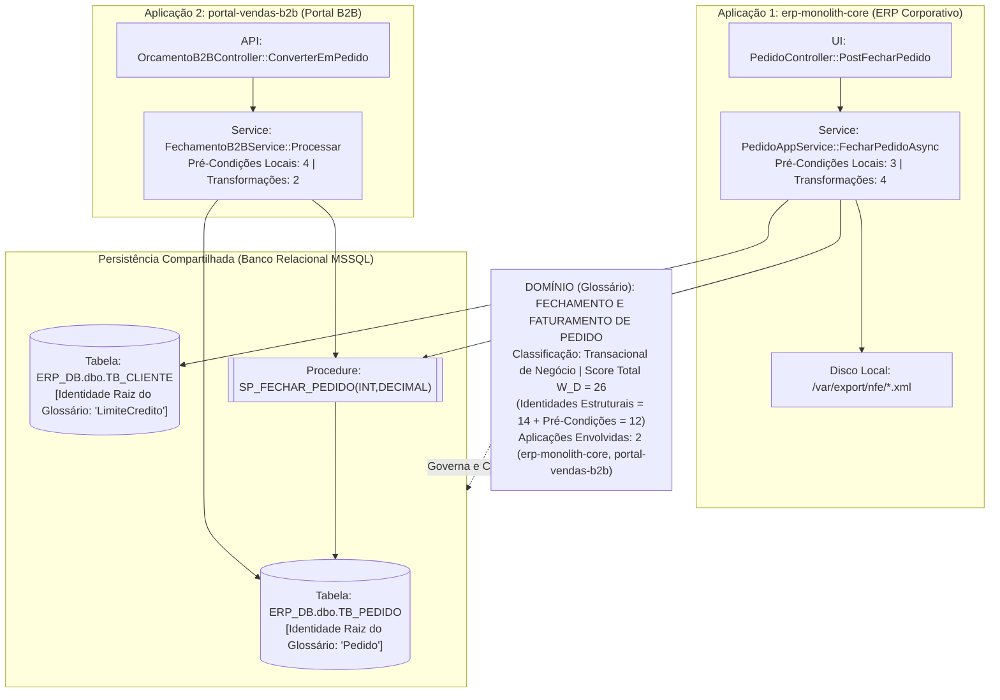

# Nível 4: Especificação de Gráficos e Classificação de Domínios (`Gráficos / Domain Analytics`)

## 1. Objetivo e Consolidação dos Níveis 1, 2 e 3
O **Nível 4 (Gráficos)** é a camada de inteligência analítica, classificação quantitativa de domínios e visualização topológica. Ela é 100% derivada dos metadados gerados nos níveis anteriores:
- **Do Nível 1**: Consome o conjunto deduplicado de **Identidades de Estrutura (`Structural Identities`)**.
- **Do Nível 2**: Consome a contagem e o detalhamento de **Pré-Condições (`Preconditions`)** e **Transformações de Dados (`Data Transformations`)** ao longo dos fluxos de chamadas.
- **Do Nível 3**: Consome o **Glossário Semântico**, os **Agrupamentos de Domínio** e o **Mapa de Aplicações/Artefatos**.

---

## 2. Fórmula de Interpretação e Classificação de Domínios

> **Regra de Cálculo Obrigatória:**
> *"Mapeamentos de domínio e suas classificações devem ser interpretadas pela quantidade de identidades de estrutura envolvidas somadas à quantidade de pré-condições identificadas no mapeamento de call flow; sua identificação deve ser feita em cima do glossário identificado na tech stack."*

### 2.1. Ancoragem do Domínio pelo Glossário do Nível 3
1. Um domínio $D$ é identificado e rotulado a partir de um cluster de termos canônicos do **Glossário do Nível 3** (`glossary_term_ids` + `anchored_origin_identity_uid`).
2. Todas as identidades estruturais do Nível 1 e todos os fluxos de chamada do Nível 2 vinculados a esse cluster do glossário formam o escopo do domínio $D$.

### 2.2. Equação de Peso e Complexidade do Domínio ($W_D$)
Para cada domínio $D$ identificado sobre o Glossário:

$$W_D = |S_D| + |P_D|$$

Onde:
- $|S_D|$ = **Quantidade de Identidades de Estrutura Únicas do Nível 1** envolvidas no domínio $D$:
  $$|S_D| = |S_{\text{tabelas\_db}}| + |S_{\text{procedures\_ext}}| + |S_{\text{arquivos\_disco}}| + |S_{\text{contratos\_ram}}| + |S_{\text{classes}}| + |S_{\text{metodos}}|$$
- $|P_D|$ = **Quantidade Total de Pré-Condições do Nível 2** identificadas nos fluxos de chamada (`Call Flows`) pertencentes ao domínio $D$:
  $$|P_D| = \sum_{f \in \text{Flows}(D)} \text{Count}(\text{Preconditions}(f))$$

*(Métrica complementar exibida nos gráficos: $|T_D| = \sum_{f \in \text{Flows}(D)} \text{Count}(\text{Transformations}(f))$, representando a densidade de transformação de dados do domínio).*

### 2.3. Tabela de Classificação Automática de Domínios por Pontuação ($W_D$)

| Faixa de Pontuação ($W_D = |S_D| + |P_D|$) | Perfil de Pré-Condições ($|P_D| / |S_D|$) | Classificação do Domínio | Cor / Destaque Visual no Gráfico |
| :--- | :--- | :--- | :--- |
| **$W_D \ge 100$** | Alta densidade de regras ($|P_D| \ge 35\%\text{ de }W_D$) | **Domínio Core Crítico (Alta Complexidade e Regra)** | Vermelho / Bordô (`#D32F2F`) — Nó de raio máximo |
| **$50 \le W_D < 100$** | Média/Alta densidade condicional | **Domínio Transacional de Negócio (Core/Supporting)** | Laranja (`#F57C00`) — Nó de raio grande |
| **$20 \le W_D < 50$** | Predominância estrutural ($|S_D| \gg |P_D|$) | **Domínio de Suporte / Integração / Cadastro** | Azul (`#1976D2`) — Nó de raio médio |
| **$W_D < 20$** | Baixa quantidade de pré-condições | **Domínio Utilitário / CRUD Simples / Auxiliar** | Verde / Cinza (`#388E3C`) — Nó compacto |

---

## 3. Topologia de Aplicações: Pertencimento e Quantidade de Aplicações Envolvidas

> **Requisito Obrigatório:**
> *"Deve ser possível identificar onde faz parte de uma aplicação e quantas aplicações estão envolvidas nela."*

Para cada Domínio $D$, Fluxo de Chamada $F$ e Identidade Estrutural Compartilhada $I$ (como uma tabela de banco ou procedure), a camada gráfica calcula e exibe duas dimensões de fronteira de aplicação:

### 3.1. Mapa de Pertencimento (`Application Ownership & Footprint`)
Identifica exatamente **onde** cada parte do domínio reside dentro de uma aplicação:
- `owner_application_id`: Aplicação detentora do módulo/código.
- `module_uid`: Qual dos 700 módulos contém a identidade.
- `artifact_name` e `source_file`: Qual `.dll`/`.exe` e arquivo `.cs` materializa aquela parte do domínio.
- `partition_by_layer`: Distribuição percentual e absoluta de identidades do domínio dentro da aplicação (ex.: `App 1 [ERP Core]: 72% (UI + App + Infra)`, `App 2 [Portal B2B]: 28% (API + DTO)`).

### 3.2. Contador e Índice de Envolvimento Multi-Aplicação (`Involved Applications Count`)
Para qualquer Domínio $D$ ou Identidade Compartilhada $I$:
$$\text{AppCount}(D) = |\text{UniqueApplications}(D)|$$

- **$\text{AppCount}(D) = 1$ (`Domínio Isolado / Single-App`)**: O domínio inteiro começa e termina dentro de uma única aplicação.
- **$\text{AppCount}(D) = 2$ (`Domínio Integrado Dual-App`)**: Duas aplicações compartilham o mesmo domínio (ex.: via banco compartilhado ou chamada de serviço).
- **$\text{AppCount}(D) \ge 3$ (`Domínio Transversal / Hotspot de Acoplamento`)**: Múltiplas aplicações convergem sobre as mesmas tabelas/identidades e heurísticas do glossário — sinalizado visualmente no gráfico com **borda dupla tracejada e alerta de acoplamento inter-aplicações**.

---

## 4. Especificação das Visões Gráficas Obrigatórias

O motor do Nível 4 gera 3 representações gráficas complementares a partir do JSON consolidado:

### 4.1. Gráfico 1: Mapa de Bolhas e Topologia de Domínios (`Domain Complexity & Application Overlap Graph`)
- **Nós de Domínio**: Nomeados a partir do Glossário do Nível 3.
  - **Tamanho do Nó**: Proporcional a $W_D = |S_D| + |P_D|$.
  - **Rótulo Interno**: Exibe explicitamente:
    - Nome Canônico do Domínio (Glossário)
    - `Score Total:` $W_D$ (`Identidades Estruturais:` $|S_D|$ `+ Pré-Condições:` $|P_D|$)
    - `Transformações:` $|T_D|$
    - `Aplicações Envolvidas:` $\text{AppCount}(D)$ (`[Lista de Aplicações]`)
- **Contêineres / Raias (`Subgraphs`)**: Agrupam onde cada parte do domínio reside por aplicação (`app_id`), destacando nós de banco de dados/arquivos que ficam na interseção entre aplicações.



### 4.2. Gráfico 2: Matriz Visual de Pré-Condições e Transformações por Fluxo Ponta a Ponta (`Call Flow Gate Chart`)
- Exibe a sequência ordenada $1 \dots k$ do fluxo desde a UI até o Disco/Banco, mostrando em cada etapa:
  - Barra acumulada de **Pré-Condições** ($+P_1, +P_2 \dots$)
  - Contador de **Transformações de Dados** ($+T_1, +T_2 \dots$)
  - Tradução em **Leitura Natural** gerada pelo Glossário do Nível 3.

### 4.3. Gráfico 3: Matriz de Acoplamento Aplicação $\times$ Domínio (`Application Involvement Matrix`)
Tabela e gráfico bipartido relacionando cada Aplicação $A_i$ com cada Domínio $D_j$, indicando quantas identidades estruturais e quantas pré-condições a aplicação $A_i$ contribui para o domínio $D_j$.

---

## 5. Exemplo Completo de Saída do Nível 4

```json
{
  "layer": 4,
  "layer_name": "graphics_and_domain_classifications",
  "domain_analytics": [
    {
      "domain_uid": "urn:ia1:domain:FECHAMENTO_E_FATURAMENTO_PEDIDO",
      "glossary_anchor_terms": ["Pedido", "LimiteCreditoCliente", "Faturamento", "ValorLiquido"],
      "canonical_root_identity_uid": "urn:ia1:db:rel:mssql:ERP_DB.dbo.TB_PEDIDO",
      "classification_formula": {
        "structural_identities_count": 14,
        "preconditions_count": 12,
        "domain_total_score": 26,
        "formula_expression": "14 (Identidades Estruturais N1) + 12 (Pré-Condições N2) = 26",
        "supplementary_data_transformations_count": 9,
        "classification_tier": "DOMINIO_TRANSACIONAL_DE_NEGOCIO",
        "severity_color_hex": "#F57C00"
      },
      "application_involvement": {
        "total_applications_involved": 2,
        "is_cross_application_domain": true,
        "applications_breakdown": [
          {
            "app_id": "erp-monolith-core",
            "application_name": "ERP Corporativo Monolito",
            "modules_involved_count": 4,
            "structural_identities_in_app": 9,
            "preconditions_in_app": 7,
            "roles_in_domain": ["UI_ENTRYPOINT", "BUSINESS_ORCHESTRATION", "DB_PROCEDURE_CALLER", "LOCAL_DISK_WRITER"]
          },
          {
            "app_id": "portal-vendas-b2b",
            "application_name": "Portal de Vendas B2B",
            "modules_involved_count": 2,
            "structural_identities_in_app": 5,
            "preconditions_in_app": 5,
            "roles_in_domain": ["API_ENTRYPOINT", "DB_TABLE_READER_WRITER"]
          }
        ]
      }
    }
  ]
}
```
