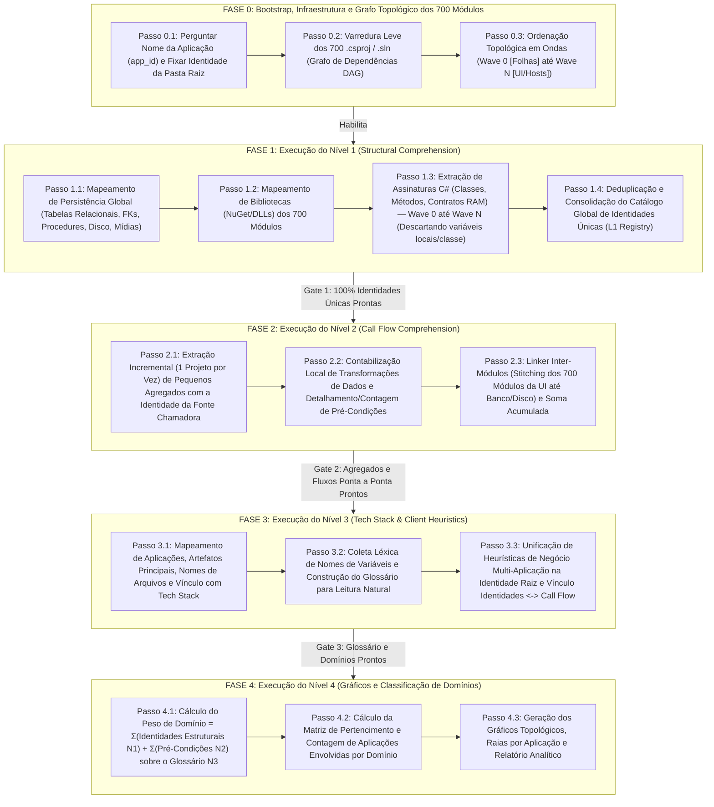

# Plano de Execução Ordenado para Monolito de 700 Módulos (`Execution Plan`)

## 1. Visão Geral e Desafio de Escala (700 Módulos)

Em um monolito composto por **700 projetos/módulos** (ex.: soluções `.NET / C#` com centenas de `.csproj`, bibliotecas compartilhadas, serviços, interfaces gráficas e acesso a bancos relacionais e arquivos locais):
1. **Impossibilidade de Contexto Único**: É impossível carregar 700 projetos simultaneamente na memória de contexto de uma IA sem estourar limites de tokens ou degradar a precisão.
2. **Interdependência Estrutural**: O Projeto #450 (ex.: `UI`) chama métodos do Projeto #210 (`Application`), que usa DTOs do Projeto #15 (`Contracts`) e grava na Tabela `TB_PEDIDO` via Projeto #88 (`Infra.Data`).
3. **Solução Arquitetural**: O processamento deve ser **estritamente faseado por camada (Nível 1 $\rightarrow$ Nível 2 $\rightarrow$ Nível 3 $\rightarrow$ Nível 4)** e, dentro das camadas de código, executado **um projeto por vez seguindo a Ordem Topológica Inversa de Dependências (Bottom-Up DAG)**.

---

## 2. Diagrama Geral da Ordem de Execução



---

## 3. Estrutura de Diretórios de Trabalho e Metadados

Durante a execução sobre a pasta raiz do monolito (ex.: `D:\Monolito700\`), o motor cria um diretório de índice estruturado e incremental `.ia1_index/`:

```text
<PASTA_RAIZ_MONOLITO>/
└── .ia1_index/
    ├── 00_infra/
    │   ├── application_manifest.json          # app_id, root_uid, mapeamento de aplicações
    │   └── topological_waves_700.json         # Ordem exata de execução dos 700 módulos (Wave 0..N)
    ├── 01_structural/
    │   ├── persistence_and_external.l1.json   # Tabelas relacionais, FKs, procedures, arquivos locais, mídias
    │   ├── libraries_catalog.l1.json          # Todas as bibliotecas externas/internas identificadas antes do código
    │   ├── modules/                           # 1 arquivo compacto de assinaturas por módulo (700 arquivos)
    │   │   ├── Module_001.l1.signatures.json  # Classes, Métodos, Contratos RAM + sig_hash + body_hash
    │   │   └── ... (até Module_700)
    │   └── global_identity_registry.l1.json   # Índice global deduplicado de todos os UIDs (Chave -> Metadado Mínimo)
    ├── 02_callflow/
    │   ├── module_aggregates/                 # 1 arquivo de pequenos agregados por projeto lido (700 arquivos)
    │   │   ├── Module_001.l2.aggregates.json  # CallerScopedAggregates + Transformações + Pré-Condições
    │   │   └── ... (até Module_700)
    │   └── stitched_e2e_flows.l2.json         # Fluxos completos ponta a ponta (UI -> Persistência)
    ├── 03_techstack_heuristics/
    │   ├── artifacts_and_files.l3.json        # Aplicações, DLLs/EXEs, arquivos .cs e vínculo com Tech Stack
    │   ├── natural_language_glossary.l3.json  # Glossário de variáveis -> termos humanos ancorados em UIDs
    │   └── business_domains.l3.json           # Heurísticas multi-aplicação e conjuntos Identidades + Call Flow
    └── 04_graphics/
        ├── domain_classifications.l4.json     # Score (Identidades + Pré-Condições) e Contagem de Aplicações
        ├── topology_diagrams.mmd              # Diagramas Mermaid gerados por domínio e aplicação
        └── interactive_architecture_graph.json # Payload pronto para visualização gráfica
```

---

## 4. Detalhamento Passo a Passo da Execução Ordenada

### FASE 0: Bootstrap, Identidade de Infraestrutura e Ordenação dos 700 Módulos
*(Pré-requisito obrigatório antes de qualquer leitura de código C# ou SQL)*

1. **Passo 0.1 — Pergunta de Infraestrutura e Identidade da Pasta Raiz**:
   - O sistema pergunta ao usuário (ou lê da configuração): **"Qual o nome da aplicação principal (e sub-aplicações, se houver) que compõe este repositório de 700 módulos?"**
   - Gera o `root_uid` (`urn:ia1:root:<app_id>:<hash>`) para a pasta raiz que contém os 700 projetos.
2. **Passo 0.2 — Inventário dos 700 Módulos e Extração de `<ProjectReference>`**:
   - Varre todos os arquivos `.sln` e os 700 arquivos `.csproj`.
   - Constrói um Grafo Direcionado Acíclico (DAG) de dependências entre os 700 projetos (caso existam ciclos legados via reflexão ou interfaces, agrupa Componentes Fortemente Conexos — SCCs).
3. **Passo 0.3 — Particionamento em Ondas Topológicas (`Topological Waves`)**:
   - **Wave 0 (Módulos Folha — ~100 a 150 módulos)**: Projetos que não dependem de nenhum outro projeto interno (`Crosscutting`, `Shared`, `Primitives`, `DTOs`, `Contracts`).
   - **Wave 1 (Acesso a Dados e Clientes Externos — ~150 módulos)**: `Repositories`, `DAL`, `Adapters`, `FileIO`.
   - **Wave 2 (Domínio e Regras de Negócio — ~200 módulos)**: `Domain`, `BusinessRules`, `Calculators`, `Engines`.
   - **Wave 3 (Orquestração e Aplicação — ~120 módulos)**: `ApplicationServices`, `Facades`, `Handlers`.
   - **Wave 4 (Fronteira / UI / Hosts / Jobs — ~80 módulos)**: `WebUI`, `Controllers`, `WebForms`, `WinForms`, `APIs`, `Workers`.

---

### FASE 1: Execução do Nível 1 (`Structural Comprehension`)
*(Objetivo: Gerar 100% das identidades únicas deduplicadas. Nenhum Call Flow é extraído ainda).*

1. **Passo 1.1 — Mapeamento de Persistência e Entidades Externas**:
   - Varre scripts DDL/SQL, `DbContext`/mapeamentos EF, arquivos `.edmx`, `.dacpac`, procedures e strings de conexão/arquivos de configuração.
   - Emite identidades únicas para:
     - Tabelas relacionais e seus relacionamentos (`urn:ia1:db:rel:...`)
     - Procedures, Functions e Triggers (`urn:ia1:db:ext:proc:...`)
     - Arquivos locais, diretórios e mídias persistentes (`urn:ia1:storage:...`)
2. **Passo 1.2 — Mapeamento Prévio de Bibliotecas C# (`Libraries First`)**:
   - Extrai todas as bibliotecas (`PackageReference`, `packages.config`, `Reference` DLLs) dos 700 projetos.
   - Registra cada biblioteca com identidade única (`urn:ia1:code:lib:...`) e classifica seu papel (ORM, UI, I/O, Cache, Serialização) para que suas fontes sejam 100% conhecidas antes do mapeamento de código.
3. **Passo 1.3 — Mapeamento de Assinaturas C# e Contratos de Memória RAM (Wave 0 $\rightarrow$ Wave 4)**:
   - Percorre os 700 módulos na ordem `Wave 0` até `Wave 4`, processando **1 módulo por vez**:
     - Extrai apenas **Classes/Interfaces/Structs** (`urn:ia1:code:type:...`), **Assinaturas de Métodos** (`urn:ia1:code:method:...`), **Contratos de Memória RAM** (`urn:ia1:mem:contract:...`) e **Stores de Memória Temporária** (`urn:ia1:mem:cache-...`, `session`, `stream`).
     - **Descarta variáveis de classe e variáveis locais de métodos**.
     - Calcula `sig_hash` e `body_hash` para cada classe e método (garantindo reuso incremental).
   - *Por que na ordem Wave 0 $\rightarrow$ Wave 4?* Porque quando um método na `Wave 2` recebe como parâmetro um DTO definido na `Wave 0`, a identidade `urn:ia1:mem:contract:...` desse DTO já existe e é referenciada com 100% de precisão!
4. **Passo 1.4 — Consolidação e Deduplicação Global (Gate de Validação 1)**:
   - Soma os 700 arquivos `.l1.signatures.json` + persistência + bibliotecas no `global_identity_registry.l1.json`.
   - **Critério de Gate 1**: Zero colisões de `UID`; toda informação somada é estritamente única.

---

### FASE 2: Execução do Nível 2 (`Call Flow Comprehension`)
*(Pré-condição: Catálogo Global de Identidades do Nível 1 congelado e disponível para consulta O(1)).*

1. **Passo 2.1 — Extração Incremental de Pequenos Agregados (1 Projeto por Vez)**:
   - A IA/analisador lê **1 projeto por vez** (dentre os 700), consultando apenas o arquivo local do projeto e os `UIDs` de assinatura das dependências diretas daquele projeto no índice do Nível 1.
   - Para cada método do projeto, cria um `CallerScopedAggregate` cuja identidade única (`aggregate_identity_uid`) é **a própria identidade do Nível 1 do método chamador**.
   - Registra a lista ordenada (`step_order: 1..N`) das identidades do Nível 1 chamadas por ele.
2. **Passo 2.2 — Contabilização de Transformações e Detalhamento de Pré-Condições por Agregado**:
   - Dentro de cada pequeno agregado, identifica e conta:
     - **Transformações de Dados (`TX_MAP`, `TX_PROJ`, `TX_CALC`, `TX_SER`, `TX_DB_BIND`)** entre contratos de memória do Nível 1.
     - **Pré-Condições (`urn:ia1:precond:<method_uid>#P<n>`)**: detalha a expressão condicional, categoria, número de cláusulas e quais chamadas do fluxo dependem dela.
   - Salva `Module_XXX.l2.aggregates.json` (700 arquivos independentes e leves).
3. **Passo 2.3 — Linker / Stitching Ponta a Ponta entre os 700 Módulos (Gate de Validação 2)**:
   - O consolidador percorre todos os pontos de início (`UI do sistema`, `Controllers`, `Jobs` na `Wave 4`) e segue recursivamente as arestas `target_uid` $\rightarrow$ `aggregate_identity_uid` através das Waves `3 -> 2 -> 1 -> 0 -> Banco/Disco`.
   - Calcula os totais acumulados por fluxo ponta a ponta:
     - `e2e_total_transformations` (soma de todas as transformações no caminho)
     - `e2e_total_preconditions` (soma e lista ordenada de todas as pré-condições que o dado precisa vencer desde a UI até a persistência).

---

### FASE 3: Execução do Nível 3 (`Tech Stack / Client Heuristics`)
*(Pré-condição: Identidades do Nível 1 e Fluxos Ponta a Ponta do Nível 2 concluídos).*

1. **Passo 3.1 — Mapeamento de Aplicações, Principais Artefatos, Arquivos e Tech Stack**:
   - Associa cada um dos 700 módulos e suas identidades do Nível 1 ao nome da aplicação (`app_id`), ao artefato compilado (`.dll`/`.exe`), aos nomes de arquivos físicos (`.cs`, `.sql`, `.config`) e à sua camada na Tech Stack.
2. **Passo 3.2 — Construção do Glossário Semântico de Variáveis para Leitura Natural**:
   - Executa um passe léxico leve sobre os métodos dos 700 módulos extraindo apenas **nomes de variáveis e parâmetros com semântica de negócio** (sem criar nós estruturais no Nível 1).
   - Agrupa variações/abreviações (ex.: `vlrPed`, `valor_pedido`, `dtoPed`) em termos canônicos do Glossário (`natural_language_glossary.l3.json`), ancorando cada termo à identidade única de origem do Nível 1 (`anchored_origin_identity_uid`).
3. **Passo 3.3 — Agrupamento de Heurísticas de Negócio Multi-Aplicação e Domínios (Gate de Validação 3)**:
   - Identifica abstrações em aplicações ou módulos diferentes que operam sobre a mesma tabela/procedure raiz ou compartilham o mesmo cluster de palavras comuns do Glossário.
   - Agrega essas abstrações sob a identidade única de origem e vincula cada **Conjunto de Identidades Estruturais** ao seu respectivo **Call Flow Ponta a Ponta**, formando os `DomainGroups`.

---

### FASE 4: Execução do Nível 4 (`Gráficos e Classificação de Domínios`)
*(Pré-condição: Domínios e Glossário do Nível 3 concluídos).*

1. **Passo 4.1 — Cálculo Quantitativo e Classificação de Domínios**:
   - Para cada domínio identificado em cima do Glossário da Tech Stack (Nível 3), executa a fórmula:
     $$\text{Score}(D) = |\text{Identidades de Estrutura (Nível 1)}| + |\text{Pré-Condições dos Call Flows (Nível 2)}|$$
   - Classifica cada domínio por criticidade e densidade de regras.
2. **Passo 4.2 — Mapeamento de Fronteiras e Contagem de Aplicações Envolvidas**:
   - Calcula para cada domínio e identidade compartilhada:
     - Onde faz parte dentro de cada aplicação (módulos, artefatos, arquivos).
     - Quantas aplicações distintas (`total_applications_involved`) estão envolvidas naquele domínio.
3. **Passo 4.3 — Renderização dos Gráficos**:
   - Gera os diagramas Mermaid (`.mmd`) e o grafo analítico JSON (`interactive_architecture_graph.json`) com raias por aplicação, tamanho de nó proporcional ao Score e destaque de acoplamento multi-aplicação.

---

## 5. Protocolo de Execução Incremental (Delta Update quando o Código Muda)

Quando um desenvolvedor altera código em $K$ módulos (ex.: 3 módulos alterados dentro dos 700):
1. **Detecção no Nível 1**: Recalcula `sig_hash` e `body_hash` apenas dos arquivos `.cs` modificados nos 3 módulos:
   - Se **apenas `body_hash` mudou** (a assinatura pública do método permaneceu idêntica):
     - O Catálogo Global do Nível 1 **não muda** os UIDs.
     - No Nível 2, apenas os pequenos agregados (`CallerScopedAggregate`) dos métodos cujo `body_hash` mudou são reextraídos, e o Linker recalcula a soma de pré-condições/transformações dos fluxos que passam por eles.
   - Se **`sig_hash` mudou** (assinatura pública alterada/criada/removida):
     - Atualiza o `UID` no Nível 1 para o módulo alterado e reprocessa no Nível 2 apenas os módulos dependentes diretos no DAG topológico.
2. **Recálculo Instantâneo dos Níveis 3 e 4**:
   - Atualiza o Glossário local dos 3 módulos e recalcula a fórmula $|S_D| + |P_D|$ do Nível 4 em milissegundos.
