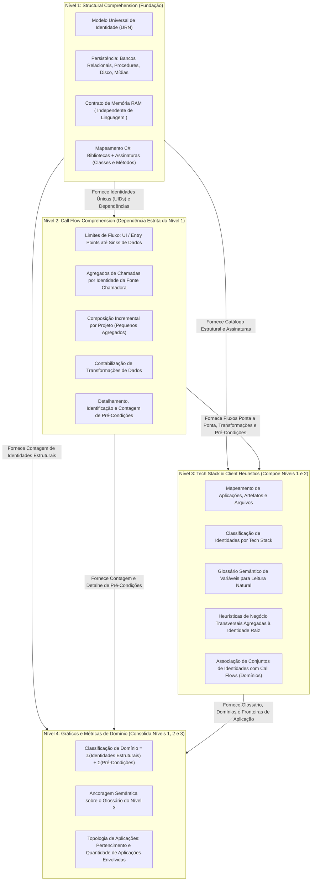

# Especificações de Mapeamento e Compreensão Arquitetural por IA (`specs_test_ia1`)

Este diretório contém a especificação técnica completa, contratos de dados e o plano de execução ordenado para o mapeamento automatizado de sistemas monolíticos de grande porte (dimensionado para **700+ módulos/projetos**), estruturado em **4 camadas estritamente dependentes**.

---

## 1. Hierarquia de Dependência e Ordem de Execução das Camadas

A arquitetura de extração e compreensão respeita uma **dependência unidirecional estrita (Top-Down Construction / Bottom-Up Dependency)**: nenhuma camada inferior pode existir ou criar elementos órfãos sem referenciar as identidades canônicas produzidas pelas camadas superiores na ordem de execução.

### Regra de Ouro da Hierarquia
1. **Ordem Obrigatória de Execução**: `Nível 1` $\rightarrow$ `Nível 2` $\rightarrow$ `Nível 3` $\rightarrow$ `Nível 4`.
2. **Imutabilidade de Identidade**: O Nível 1 gera identidades únicas globais (`UID`/`URN`). Os Níveis 2, 3 e 4 **nunca inventam identidades estruturais paralelas**; eles apenas referenciam, agrupam, enriquecem e quantificam as identidades do Nível 1.
3. **Incrementalidade**: Todo artefato mapeado no Nível 1 possui um hash de assinatura (`sig_hash`) e hash de corpo (`body_hash`), permitindo reprocessar apenas módulos alterados dentro de um monolito de 700 módulos.

---

## 2. Índice de Documentos da Especificação

| Ordem | Arquivo | Escopo Principal |
| :--- | :--- | :--- |
| **01** | [01_STRUCTURAL_COMPREHENSION_SPEC.md](file:///C:/Users/walte/OneDrive/Documentos/specs_test_ia1/01_STRUCTURAL_COMPREHENSION_SPEC.md) | **Nível 1 — Structural Comprehension**: Modelo de Identidade Única (Tabelas relacionais, Procedures, Arquivos locais, Mídias persistentes, Memória RAM filtrada), Contrato agnóstico de linguagem, Mapeamento C# (bibliotecas, assinaturas de classes e métodos, descarte de variáveis locais/classe) e Pergunta de Infraestrutura (Nome da Aplicação). |
| **02** | [02_CALL_FLOW_COMPREHENSION_SPEC.md](file:///C:/Users/walte/OneDrive/Documentos/specs_test_ia1/02_CALL_FLOW_COMPREHENSION_SPEC.md) | **Nível 2 — Call Flow Comprehension**: Identificação de início/fim (UI até Persistência), Estrutura de Agregação com identidade da fonte chamadora, Mapeamento incremental projeto a projeto, Contagem de transformações de dados e Identificação/Detalhamento/Contagem de pré-condições. |
| **03** | [03_TECH_STACK_AND_HEURISTICS_SPEC.md](file:///C:/Users/walte/OneDrive/Documentos/specs_test_ia1/03_TECH_STACK_AND_HEURISTICS_SPEC.md) | **Nível 3 — Tech Stack / Client Heuristics**: Composição de grupos e domínios, Nome de aplicações, artefatos e arquivos, Vínculo de identidades à Tech Stack, Heurísticas de negócio multi-aplicação agregadas à identidade única, Glossário de nomes de variáveis para tradução em linguagem natural e vínculo Identidades $\leftrightarrow$ Call Flow. |
| **04** | [04_GRAPHICS_AND_DOMAIN_METRICS_SPEC.md](file:///C:/Users/walte/OneDrive/Documentos/specs_test_ia1/04_GRAPHICS_AND_DOMAIN_METRICS_SPEC.md) | **Nível 4 — Gráficos e Classificação de Domínios**: Fórmula de peso e classificação de domínio ($\text{Identidades Estruturais} + \text{Pré-Condições}$) baseada no Glossário do Nível 3, Mapa de pertencimento a aplicações e contabilização de quantas aplicações estão envolvidas em cada domínio/fluxo. |
| **05** | [05_EXECUTION_PLAN_700_MODULES.md](file:///C:/Users/walte/OneDrive/Documentos/specs_test_ia1/05_EXECUTION_PLAN_700_MODULES.md) | **Plano de Execução Ordenado (Monolito de 700 Módulos)**: Pipeline em fases, ordenação topológica de projetos (DAG), execução em lotes com controle de janela de contexto para IA, consolidação incremental e protocolo de atualização delta. |
| **06** | [06_DATA_CONTRACTS_AND_SCHEMAS.json](file:///C:/Users/walte/OneDrive/Documentos/specs_test_ia1/06_DATA_CONTRACTS_AND_SCHEMAS.json) | **Contratos de Dados e Schemas JSON**: Estruturas formais de metadados para validação automatizada das saídas dos Níveis 1, 2, 3 e 4. |

---

## 3. Resumo das Decisões Arquiteturais para os Pontos Críticos (`/*?? ... */`)

1. **Filtro do Mapeamento de Memória RAM (Nível 1)**:
   - *Problema apontado*: Mapear tudo que está em memória RAM (cada instância, variável primitiva ou alocação efêmera) geraria metadados maiores que o próprio código-fonte, inviabilizando o uso como metadados simplificados.
   - *Solução especificada*: O contrato de memória RAM opera no nível de **Fronteiras Estruturais de Tipo e Execução** (Contratos de Dados/Classes/DTOs, Assinaturas de Métodos, Caches Nomeados, Sessões e Streams), **descartando variáveis de classe (fields internos) e variáveis locais de métodos** na geração de identidades estruturais do Nível 1. Os nomes de variáveis relevantes ao negócio são capturados exclusivamente no **Glossário léxico do Nível 3** como dicionário de tradução, sem inflar o grafo estrutural.
2. **Estrutura de Agregação de Chamadas pela Identidade da Fonte Chamadora (Nível 2)**:
   - *Problema apontado*: Como agregar chamadas mantendo a identidade única da fonte que a chamou ao ler um projeto por vez?
   - *Solução especificada*: Define-se o **Caller-Scoped Flow Aggregate (`CallAggregate`)**, onde o container de chamadas recebe como chave primária de agrupamento o próprio `UID` do elemento chamador (ex.: método ou ação de UI do Nível 1) e lista ordenadamente os `UIDs` invocados, suas transformações e pré-condições locais. Quando múltiplos projetos são lidos separadamente, a junção (`stitching`) ocorre por casamento exato entre o `callee_uid` de um projeto e o `caller_uid` da assinatura pública no projeto de destino.
