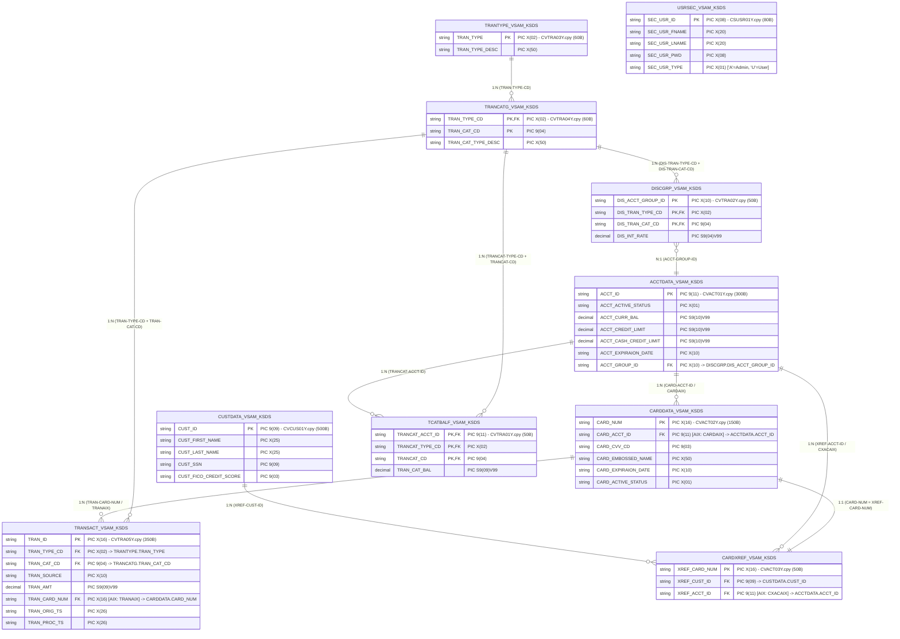
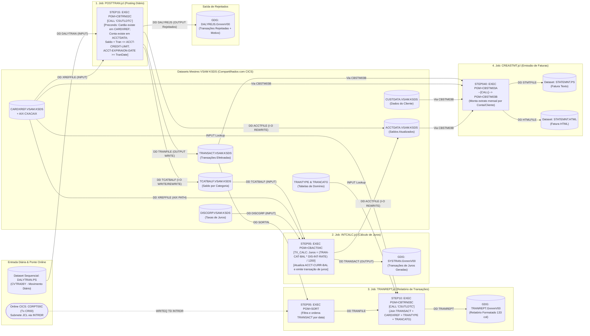
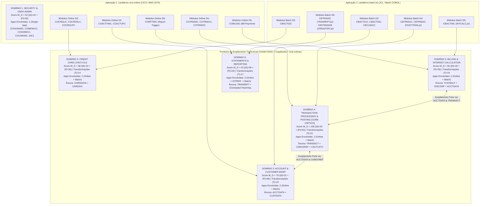
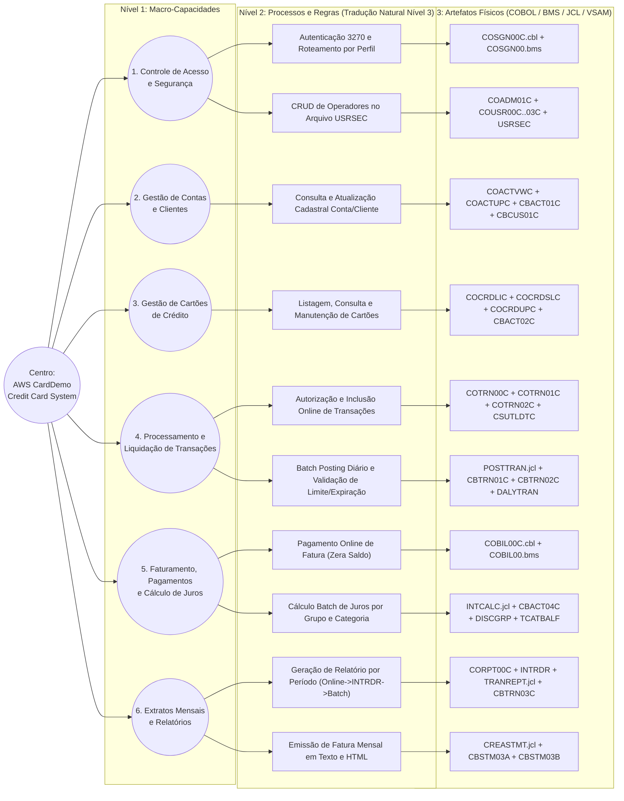

# 02 — Especificação Técnica e Visual dos 6 Gráficos Canônicos do AWS CardDemo

**Repositório de Referência:** [`https://github.com/aws-samples/aws-mainframe-modernization-carddemo`](https://github.com/aws-samples/aws-mainframe-modernization-carddemo)  
**Padrões Gráficos Cobertos:**
1. Diagramas nativos do repositório (`diagrams/CARDDEMO-DataModel.drawio` e arquitetura Online/Batch).
2. Gráficos de Decomposição de Domínio e Dependências do **AWS Transform for Mainframe / AWS Blu Age**.
3. **Knowledge Graph Enriquecido** e **Capability Map Radial** do estudo *Legacy Modernization Meets GenAI* (Martin Fowler / Thoughtworks sobre o CardDemo).

---

## 1. Gráfico 1: Modelo de Dados e Topologia de Persistência VSAM + AIX + Copybooks (`CARDDEMO-DataModel`)

### 1.1. Objetivo e Fonte Estrutural
Reproduz o diagrama `diagrams/CARDDEMO-DataModel.drawio` do repositório oficial, conectando cada **Dataset Físico VSAM (`KSDS`/`PS`)**, seus **Índices Alternativos (`AIX Path`)**, o **Copybook COBOL (`.cpy`)** que define seu schema em memória e as **Chaves Primárias/Estrangeiras Lógicas (`1:1`, `1:N`, `N:1`)**.

### 1.2. Representação Gráfica Canônica (Gráfico 1)

---

## 2. Gráfico 2: Fluxo de Chamadas Online CICS, Transações, Mapas BMS e `DFHCOMMAREA` (`Online CICS Screen & Call Flow Graph`)

### 2.1. Objetivo e Fonte Estrutural
Mapeia o **Nível 2 (Call Flow Comprehension)** para o subsistema Online CICS (`carddemo-cics-online`), rastreando:
- O ponto de entrada (`FLOW_START`): Transação `CC00` $\rightarrow$ Mapa `COSGN00` $\rightarrow$ Programa `COSGN00C`.
- As **Pré-Condições** (`urn:ia1:precond:*`): Validação de credenciais em `USRSEC` e bifurcação por `SEC-USR-TYPE` (`'A'` vs. `'U'`).
- O transporte de estado em memória RAM via `DFHCOMMAREA` (`COCOM01Y.cpy`).
- Os pontos terminais de persistência (`FLOW_END`): leituras e escritas em `USRSEC`, `ACCTDAT`, `CUSTDAT`, `CARDDAT`, `CCXREF`, `TRANSACT` e a fila `INTRDR`.

### 2.2. Representação Gráfica Canônica (Gráfico 2)

```mermaid
flowchart TD
    subgraph ENTRY["Porta de Entrada CICS 3270 (Sign-On)"]
        TX_CC00(["Tx: CC00 | Mapa BMS: COSGN00\nPrograma: COSGN00C.cbl\n[Precond P1: UserId & Pwd != Spaces]\n[Precond P2: Registro existe em USRSEC]"])
    end

    subgraph MENUS["Roteadores de Menu (Bifurcação por SEC-USR-TYPE em COCOM01Y)"]
        TX_CA00["Tx: CA00 | Mapa: COADM01\nPrograma: COADM01C.cbl (Admin Menu)\n[Precond: SEC-USR-TYPE == 'A']"]
        TX_CM00["Tx: CM00 | Mapa: COMEN01\nPrograma: COMEN01C.cbl (Main Menu)\n[Precond: SEC-USR-TYPE == 'U']"]
    end

    subgraph ADMIN_FLOWS["Fluxos de Administração de Usuários (CICS)"]
        CU00["Tx: CU00 | COUSR00C (User List)\nBMS: COUSR00"]
        CU01["Tx: CU01 | COUSR01C (User Add)\nBMS: COUSR01"]
        CU02["Tx: CU02 | COUSR02C (User Update)\nBMS: COUSR02"]
        CU03["Tx: CU03 | COUSR03C (User Delete)\nBMS: COUSR03"]
    end

    subgraph USER_FLOWS["Fluxos Transacionais de Cartão de Crédito (CICS)"]
        CAVW["Tx: CAVW | COACTVWC (Account View)\nBMS: COACTVW"]
        CAUP["Tx: CAUP | COACTUPC (Account Update)\nBMS: COACTUP\n[Preconds: Validação FICO, Limite, Datas, CPF/SSN]"]
        CCLI["Tx: CCLI | COCRDLIC (Card List)\nBMS: COCRDLI"]
        CCDL["Tx: CCDL | COCRDSLC (Card Detail)\nBMS: COCRDSL"]
        CCUP["Tx: CCUP | COCRDUPC (Card Update)\nBMS: COCRDUP\n[Preconds: Luhn/16 dígitos, CVV, Status, Expiração]"]
        CT00["Tx: CT00 | COTRN00C (Transaction List)\nBMS: COTRN00"]
        CT01["Tx: CT01 | COTRN01C (Transaction View)\nBMS: COTRN01"]
        CT02["Tx: CT02 | COTRN02C (Transaction Add)\nBMS: COTRN02\n[CALL 'CSUTLDTC' | Precond: Cartão válido em CCXREF]"]
        CB00["Tx: CB00 | COBIL00C (Bill Payment)\nBMS: COBIL00\n[Precond: ACCT-CURR-BAL > 0 & Confirm == 'Y']"]
        CR00["Tx: CR00 | CORPT00C (Transaction Reports)\nBMS: CORPT00\n[CALL 'CSUTLDTC' | Submete JCL via INTRDR]"]
    end

    subgraph VSAM_SINKS["Sinks de Persistência VSAM e Filas (Nível 1)"]
        DB_USRSEC[("VSAM KSDS: USRSEC\n(CSUSR01Y)")]
        DB_ACCT[("VSAM KSDS: ACCTDAT\n(CVACT01Y)")]
        DB_CUST[("VSAM KSDS: CUSTDAT\n(CVCUS01Y)")]
        DB_CARD[("VSAM KSDS: CARDDAT\n(CVACT02Y)")]
        DB_XREF[("VSAM KSDS/AIX: CCXREF\n(CVACT03Y)")]
        DB_TRAN[("VSAM KSDS: TRANSACT\n(CVTRA05Y)")]
        Q_INTRDR[["Fila CICS TD: INTRDR\n(Dispara Job Batch TRANREPT.jcl)"]]
    end

    TX_CC00 -->|"READ"| DB_USRSEC
    TX_CC00 -->|"XCTL (COMMAREA: USR-TYPE='A')"| TX_CA00
    TX_CC00 -->|"XCTL (COMMAREA: USR-TYPE='U')"| TX_CM00

    TX_CA00 -->|"XCTL Opt 1"| CU00
    TX_CA00 -->|"XCTL Opt 2"| CU01
    TX_CA00 -->|"XCTL Opt 3"| CU02
    TX_CA00 -->|"XCTL Opt 4"| CU03
    CU00 -->|"XCTL Sel 'U'"| CU02
    CU00 -->|"XCTL Sel 'D'"| CU03
    CU00 & CU01 & CU02 & CU03 -->|"BROWSE / WRITE / REWRITE / DELETE"| DB_USRSEC

    TX_CM00 -->|"XCTL Opt 01"| CAVW
    TX_CM00 -->|"XCTL Opt 02"| CAUP
    TX_CM00 -->|"XCTL Opt 03"| CCLI
    TX_CM00 -->|"XCTL Opt 04"| CCDL
    TX_CM00 -->|"XCTL Opt 05"| CCUP
    TX_CM00 -->|"XCTL Opt 06"| CT00
    TX_CM00 -->|"XCTL Opt 07"| CT01
    TX_CM00 -->|"XCTL Opt 08"| CT02
    TX_CM00 -->|"XCTL Opt 09"| CR00
    TX_CM00 -->|"XCTL Opt 10"| CB00

    CCLI -->|"XCTL Sel 'S'"| CCDL
    CCLI -->|"XCTL Sel 'U'"| CCUP
    CT00 -->|"XCTL Sel 'S'"| CT01

    CAVW -->|"READ"| DB_XREF & DB_ACCT & DB_CUST
    CAUP -->|"READ / REWRITE"| DB_XREF & DB_ACCT & DB_CUST
    CCLI & CCDL -->|"BROWSE / READ"| DB_CARD
    CCUP -->|"READ / REWRITE"| DB_CARD
    CT00 & CT01 -->|"BROWSE / READ"| DB_TRAN
    CT02 -->|"READ CCXREF / WRITE TRANSACT"| DB_XREF & DB_TRAN
    CB00 -->|"REWRITE Saldo=0 / WRITE Pagto"| DB_ACCT & DB_XREF & DB_TRAN
    CR00 -->|"WRITEQ TD"| Q_INTRDR
```

---

## 3. Gráfico 3: Pipeline de Execução Batch JCL, Utilitários e Linhagem de Datasets/GDGs (`Batch JCL & Dataset Lineage Graph`)

### 3.1. Objetivo e Fonte Estrutural
Representa o fluxo operacional noturno (Batch Processing Path) coordenado pelos scripts `app/jcl/*.jcl` (`POSTTRAN.jcl`, `INTCALC.jcl`, `COMBTRAN.jcl`, `TRANBKP.jcl`, `CREASTMT.jcl`, `TRANREPT.jcl`), detalhando como os dados saem dos arquivos sequenciais de movimento diário (`DALYTRAN.PS`), passam por validações e cálculos de juros, atualizam os arquivos mestres VSAM (`ACCTDATA`, `TCATBALF`, `TRANSACT`) e geram relatórios e faturas (`TRANREPT`, `STATEMNT.PS`, `STATEMNT.HTML`).

### 3.2. Representação Gráfica Canônica (Gráfico 3)

---

## 4. Gráfico 4: Grafo de Dependências Estruturais Estáticas (`Programs × Copybooks × Subroutines × BMS`)

### 4.1. Objetivo e Fonte Estrutural
Exibe a árvore de acoplamento em tempo de compilação e linkedição (*Dependency View* do AWS Transform / Blu Age), mostrando quais Copybooks de dados (`CV*Y.cpy`, `CSUSR01Y.cpy`), Copybooks de sessão (`COCOM01Y.cpy`) e Sub-rotinas (`CSUTLDTC`, `CBSTM03B`) são compartilhados entre múltiplos programas COBOL.

### 4.2. Representação Gráfica Canônica (Gráfico 4)

```mermaid
flowchart TD
    subgraph SHARED_CPY["Copybooks de Dados & Sessão Compartilhados (app/cpy/)"]
        CPY_COMM["COCOM01Y.cpy\n(CARDDEMO-COMMAREA)\n[17 Programas Online]"]
        CPY_USR["CSUSR01Y.cpy\n(SEC-USER-DATA)\n[7 Programas Online]"]
        CPY_ACT1["CVACT01Y.cpy\n(ACCOUNT-RECORD)\n[7 Online + 6 Batch = 13 Pgms]"]
        CPY_ACT2["CVACT02Y.cpy\n(CARD-RECORD)\n[4 Online + 2 Batch = 6 Pgms]"]
        CPY_ACT3["CVACT03Y.cpy\n(CARD-XREF-RECORD)\n[5 Online + 6 Batch = 11 Pgms]"]
        CPY_CUS1["CVCUS01Y.cpy\n(CUSTOMER-RECORD)\n[4 Online + 3 Batch = 7 Pgms]"]
        CPY_TRA5["CVTRA05Y.cpy\n(TRAN-RECORD)\n[5 Online + 4 Batch = 9 Pgms]"]
        CPY_TRA12["CVTRA01Y & CVTRA02Y\n(TCATBAL & DISCGRP)\n[CBTRN02C, CBACT04C]"]
        CPY_TRA34["CVTRA03Y & CVTRA04Y\n(TRANTYPE & TRANCATG)\n[CBTRN03C]"]
    end

    subgraph SUBROUTINES["Sub-rotinas COBOL Invocadas via CALL"]
        SUB_DATE[["CSUTLDTC.cbl\n(Validador de Datas CEEDAYS)"]]
        SUB_STMT[["CBSTM03B.cbl\n(Subprograma I/O Faturas)"]]
    end

    subgraph PGMS_AUTH["Cluster 1: Auth & Users"]
        P_AUTH["COSGN00C, COMEN01C, COADM01C,\nCOUSR00C, COUSR01C, COUSR02C, COUSR03C"]
    end

    subgraph PGMS_ACCT_CARD["Cluster 2: Accounts & Cards (Online + Batch)"]
        P_AC["COACTVWC, COACTUPC, COCRDLIC, COCRDSLC, COCRDUPC,\nCBACT01C, CBACT02C, CBACT03C, CBCUS01C"]
    end

    subgraph PGMS_TRAN_BILL["Cluster 3: Transactions, Billing, Interest & Reports"]
        P_TB_ON["COTRN00C, COTRN01C, COTRN02C, COBIL00C, CORPT00C"]
        P_TB_BT["CBTRN01C, CBTRN02C, CBTRN03C, CBACT04C, CBSTM03A"]
    end

    P_AUTH & P_AC & P_TB_ON -->|"COPY"| CPY_COMM
    P_AUTH -->|"COPY"| CPY_USR
    P_AC -->|"COPY"| CPY_ACT1 & CPY_ACT2 & CPY_ACT3 & CPY_CUS1
    P_TB_ON -->|"COPY"| CPY_TRA5 & CPY_ACT1 & CPY_ACT3
    P_TB_BT -->|"COPY"| CPY_ACT1 & CPY_ACT3 & CPY_TRA5 & CPY_TRA12 & CPY_TRA34

    P_TB_ON -->|"CALL 'CSUTLDTC' (COTRN02C, CORPT00C)"| SUB_DATE
    P_TB_BT -->|"CALL 'CSUTLDTC' (CBTRN02C, CBTRN03C)"| SUB_DATE
    P_TB_BT -->|"CALL 'CBSTM03B' (CBSTM03A)"| SUB_STMT
```

---

## 5. Gráfico 5: Decomposição de Domínios e Acoplamento Multi-Aplicação (`Nível 4 de specs_test_ia1` / AWS Transform Domain View)

### 5.1. Aplicação da Fórmula do Nível 4 ($W_D = |S_D| + |P_D|$) sobre o CardDemo
Aplicando as regras do **Nível 3 (Glossário Semântico e Heurísticas)** e do **Nível 4 (Equação $W_D = |S_D| + |P_D|$ e Contagem de Aplicações Envolvidas)** de `specs_test_ia1` sobre o repositório CardDemo, emergem **6 Domínios de Negócio**:

| Domínio (`domain_uid`) | Termos Âncora do Glossário (`Nível 3`) | Identidade Estrutural Raiz (`Nível 1`) | Identidades Estruturais ($\|S_D\|$) | Pré-Condições Mapeadas ($\|P_D\|$) | Score Total ($W_D = \|S_D\| + \|P_D\|$) | Classificação (`Nível 4`) | Aplicações Envolvidas ($\text{AppCount}$) |
| :--- | :--- | :--- | :---: | :---: | :---: | :--- | :---: |
| **`D1: SECURITY_AND_USER_ADMIN`** | `User`, `Password`, `UserType`, `SignOn`, `Admin` | `urn:ia1:storage:vsam-ksds:carddemo:USRSEC` (`CSUSR01Y`) | 24 | 28 | **52** | `DOMINIO_TRANSACIONAL_DE_NEGOCIO` (`#F57C00`) | **1** (`carddemo-cics-online`) |
| **`D2: ACCOUNT_AND_CUSTOMER_MGMT`** | `Account`, `Customer`, `CreditLimit`, `Balance`, `FicoScore` | `urn:ia1:storage:vsam-ksds:carddemo:ACCTDATA` (`CVACT01Y`) | 31 | 48 | **79** | `DOMINIO_TRANSACIONAL_DE_NEGOCIO` (`#F57C00`) | **2** (`carddemo-cics-online`, `carddemo-batch-jcl`) |
| **`D3: CREDIT_CARD_LIFECYCLE`** | `CardNumber`, `CvvCode`, `EmbossedName`, `CardStatus`, `ExpirationDate` | `urn:ia1:storage:vsam-ksds:carddemo:CARDDATA` (`CVACT02Y`) | 22 | 36 | **58** | `DOMINIO_TRANSACIONAL_DE_NEGOCIO` (`#F57C00`) | **2** (`carddemo-cics-online`, `carddemo-batch-jcl`) |
| **`D4: TRANSACTION_PROCESSING_AND_POSTING`** | `Transaction`, `DailyTran`, `Amount`, `CardXref`, `RejectCode` | `urn:ia1:storage:vsam-ksds:carddemo:TRANSACT` (`CVTRA05Y`) | 42 | 64 | **106** | `DOMINIO_CORE_CRITICO` (`#D32F2F`) | **2** (`carddemo-cics-online`, `carddemo-batch-jcl`) |
| **`D5: BILLING_PAYMENT_AND_INTEREST_CALC`** | `InterestRate`, `CategoryBalance`, `DisclosureGroup`, `BillPayment` | `urn:ia1:storage:vsam-ksds:carddemo:TCATBALF` (`CVTRA01Y`) | 26 | 29 | **55** | `DOMINIO_TRANSACIONAL_DE_NEGOCIO` (`#F57C00`) | **2** (`carddemo-cics-online`, `carddemo-batch-jcl`) |
| **`D6: STATEMENTS_AND_REPORTING`** | `Statement`, `TransactionReport`, `DateRange`, `HtmlStatement` | `urn:ia1:storage:seq-ps:carddemo:STATEMNT` (`CVTRA07Y`) | 28 | 24 | **52** | `DOMINIO_TRANSACIONAL_DE_NEGOCIO` (`#F57C00`) | **2** (`carddemo-cics-online` via `INTRDR`, `carddemo-batch-jcl`) |

### 5.2. Representação Gráfica Canônica (Gráfico 5 — Mapa de Bolhas e Fronteiras de Aplicação)

---

## 6. Gráfico 6: Knowledge Graph Enriquecido e Capability Map Radial (*Martin Fowler / CodeConcise*)

### 6.1. Objetivo e Fonte Estrutural
Reproduz o **Knowledge Graph Enriquecido (Figura 5)** e o **Capability Map Radial** do artigo *Legacy Modernization Meets GenAI* (Martin Fowler), onde nós estruturais de AST (Programas, Parágrafos COBOL, Copybooks, Telas BMS e Datasets VSAM) são conectados a nós semânticos gerados via Glossário/LLM (Capacidades de Negócio e Explicações em Linguagem Natural).

### 6.2. Representação Gráfica Canônica (Gráfico 6)

