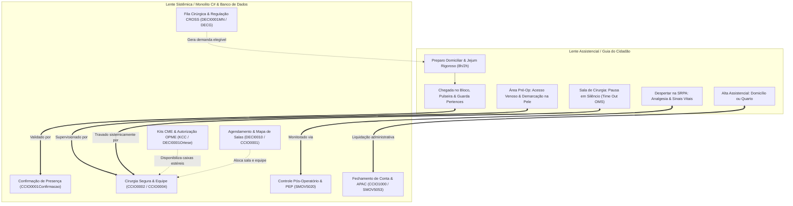
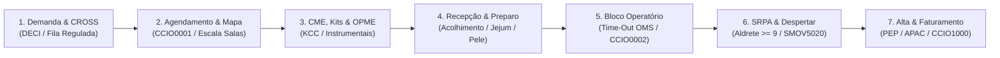

# Visão Arquitetural Mestra e Síntese Executiva — GraphRAG Centro Cirúrgico FAMEMA

**Especificação Canônica:** `00_GRAPHRAG_CENTRO_CIRURGICO_OVERVIEW.md`  
**Domínio Primário:** `urn:domain:centro-cirurgico-procedimentos` (*Bloco Cirúrgico, Agendamento e Procedimentos Invasivos*)  
**Cluster ID:** `cluster:cirurgia` (*Centro Cirúrgico & Demanda Operatória*)  
**Complexo Hospitalar:** FAMEMA (Faculdade de Medicina de Marília)  
**Metodologia:** GraphRAG (Knowledge Graph Multi-Level Community Retrieval)

---

## 1. Visão Executiva e Abordagem "Dual-Lens"

O mapeamento arquitetural do Centro Cirúrgico da FAMEMA através do **GraphRAG** adota uma abordagem **Dual-Lens (Lente Dupla)**, estabelecendo uma correspondência estrita e bidirecional entre:

1. **A Lente Assistencial e Humana (Jornada do Paciente / Guia do Cidadão):** A experiência vivida pelo paciente e seu acompanhante desde a preparação domiciliar (jejum de 8h, documentação, banho com sabonete neutro), acolhimento no 2º andar do Prédio São Francisco, demarcação de lateralidade na pele, condução estéril à Sala de Operação, Time-Out verbal da OMS, despertar na SRPA com escore de Aldrete $\ge 9$ e alta hospitalar.
2. **A Lente Sistêmica e Tecnológica (Monolito .NET / Oracle SIHOSP):** A malha de 140 telas WinForms, 454 módulos C#, 115 tabelas relacionais, regras parametrizadas via banco (`CC_EQUIPE`, `SALA_CIRURGICA`), travas sistêmicas de óbito/inativação e integrações com o sistema regulador CROSS do Governo do Estado de São Paulo e faturamento APAC/AIH.

---

## 2. A Arquitetura do Pipeline GraphRAG

O GraphRAG implementa uma arquitetura de cinco fases concebida para extrair a inteligência contida em bases de código legado e documentação hospitalar:

1. **Ingestão Heterogênea:** Processamento unificado de arquivos HTML (`Guia_do_Cidadao_Fluxo_Centro_Cirurgico.html`), fichas atômicas em Markdown (`clusters/centro-cirurgico/screens/*.md`), manifests de projetos C# (`projects/*/manifest.json`), grafos de capacidade (`capability-graph.json`) e dicionários relacionais (`ALL_TABLES_202611130813.csv`).
2. **Extração de Entidades e Grafo de Conhecimento:** Identificação de nós canônicos com URNs globais imutáveis. Cada tela, tabela, módulo C#, setor físico e regra de negócio torna-se um nó com atributos tipados.
3. **Decomposição Hierárquica em Comunidades (Algoritmo de Leiden):** O grafo completo é clusterizado hierarquicamente em:
   - **Nível 0 (Global):** Todo o ecossistema do Centro Cirúrgico.
   - **Nível 1 (Macro Sub-Comunidades):** 7 grandes etapas do ciclo cirúrgico.
   - **Nível 2 (Micro-Comunidades):** 15 grupos de módulos e telas com alto acoplamento transacional.
4. **Geração de Sínteses de Comunidade (Community Summaries):** Para cada comunidade, o GraphRAG produz um relatório narrativo denso contendo escopo executivo, entidades centrais, achados assistenciais, pontes externas e matriz de risco/débito técnico.
5. **Estrutura de Indexação e Consulta (Retrieval Engine):** Os dados são gravados em arquivos JSON otimizados para busca vetorial, busca por grafos de conhecimento e travessia relacional.

---

## 3. O Fluxo Cirúrgico Ponta a Ponta: Da Fila ao Faturamento

O fluxo do Centro Cirúrgico FAMEMA cobre **7 macro-etapas interdependentes**:

### Detalhamento das 7 Macro-Etapas

1. **Etapa 1: Indicação Cirúrgica, Lista de Espera e Regulação CROSS**
   - **Atores:** Secretária de Especialidades, Médico Assistente, Central de Regulação de Ofertas de Serviços de Saúde (CROSS).
   - **Telas Principais:** `DECI0001MN` (Inclusão em Lista de Espera), `DECI0001` (Manutenção da Demanda), `DECG0001` (Estratificação de Risco), `DECG0002` (Pontuação por Procedimento).
   - **Tabelas Centrais:** `SIHOSP.DEMANDA_CIRURGICA`, `SIHOSP.DEMANDA_CIRURGICA_PROCEDIMENTO`, `SIHOSP.DEMANDA_RISCO_CIRURGIA`.
   - **Objetivo:** Registrar a indicação cirúrgica eletiva ou de urgência, estratificar a pontuação de prioridade clínica conforme critérios éticos e regulatórios do SUS e comunicar com a fila estadual CROSS.

2. **Etapa 2: Agendamento da Data Cirúrgica e Montagem do Mapa Operatório**
   - **Atores:** Enfermeiro Regulador, Gestor do Centro Cirúrgico, Chefia de Anestesiologia.
   - **Telas Principais:** `DECI0010` (Agendamento da Data Cirúrgica), `CCIO0001` (Mapa Cirúrgico Central), `CCIO0001Agendamento` (Manutenção do Agendamento), `CCIO0001MapaCirurgia` (Alocação de Salas).
   - **Tabelas Centrais:** `SIHOSP.MAPA_CIRURGICO`, `SIHOSP.SALA_CIRURGICA`, `INFRA_ESTRUTURA.LEITO`.
   - **Objetivo:** Definir data, turno, sala cirúrgica específica (distribuindo entre as salas de grande porte do HCI, salas pediátricas/obstétricas do HCII e cirurgias oftalmológicas do HCIII) e alocar equipe cirúrgica e anestésica.

3. **Etapa 3: Preparação CME, Caixas de Instrumental e Kits de OPME**
   - **Atores:** Auxiliar de Enfermagem CME, Instrumentador Cirúrgico, Almoxarife de Órteses e Próteses.
   - **Telas Principais:** `KCCI0001` (Caixa Cirúrgica), `KCCKitProdutoForms` (Montagem de Kits), `KCCInstrumentalForms` (Controle de Instrumentais), `DECI0001OrteseProtese` (Solicitação OPME).
   - **Tabelas Centrais:** `SIHOSP.KCC_KIT_ASSISTENCIAL`, `SIHOSP.KCC_CAIXA_CIRURGICA`, `SIHOSP.FICHA_OPME`, `SIHOSP.KCC_MOVIMENTACAO`.
   - **Objetivo:** Rastrear a esterilização em autoclave, montar as caixas cirúrgicas e garantir a disponibilização tempestiva de OPMEs com autorização formal prévia antes da abertura de sala.

4. **Etapa 4: Recepção, Acolhimento e Cuidados Pré-Operatórios Imediatos**
   - **Atores:** Recepcionista, Técnico de Enfermagem, Enfermeiro Pré-Op, Paciente, Acompanhante.
   - **Telas Principais:** `CCIO0001Confirmacao` (Confirmação de Chegada), `TermoConsentimentoAvaliacaoPreAnestesica` (TCLE e Parecer Anestésico), `CCIO0001IdentificarEquipe`.
   - **Setores Físicos:** `RECEP CENTRO CIRÚRGICO HCI` (2º Andar, Prédio São Francisco).
   - **Objetivo:** Conferir jejum obrigatório (8h sólidos / 2h líquidos claros), instalar pulseira de identificação com conferência verbal dupla, recolher e arquivar TCLEs, punção venosa periférica, troca de roupa privativa e **demarcação física de lateralidade na pele** pelo cirurgião.

5. **Etapa 5: Bloco Operatório, Protocolo de Cirurgia Segura OMS e Ato Cirúrgico**
   - **Atores:** Cirurgião Principal, Cirurgião Assistente / Residente, Anestesiologista, Enfermeiro de Bloco, Circulante de Sala, Instrumentador.
   - **Telas Principais:** `CCIO0002` (Ficha da Cirurgia), `CCIO0004` (Checklist de Cirurgia Segura), `CCIO0002Procedimento` (Procedimentos Realizados), `CCIO0002Participante` (Equipe), `CCIO0002Ortese` (OPME Utilizado), `CCIO0004DataChegada` (Tempos Operatórios).
   - **Tabelas Centrais:** `SIHOSP.CIRURGIA`, `SIHOSP.CHECKLIST_CIRURGICO`, `SIHOSP.CHK_PRE_INDUC_ANEST`, `SIHOSP.CHK_PRE_SAIDA_SALA_CIR`, `SIHOSP.CIRURGIA_PROFISSIONAL`, `SIHOSP.CIRURGIA_ORTESE`.
   - **Objetivo:** Condução segura do procedimento invasivo sob três barreiras críticas da OMS:
     - **Sign-In:** Antes da indução anestésica (identificação, sítio demarcado, alergias, risco de via aérea difícil e perda sanguínea).
     - **Time-Out:** Pausa verbal em silêncio antes da incisão na pele (confirmação em voz alta da equipe, paciente, sítio operatório, profilaxia antibiótica ministrada há menos de 60min e conferência de imagens).
     - **Sign-Out:** Antes da saída de sala (conferência verbal do procedimento realizado, **contagem rigorosa de compressas, agulhas e instrumentais**, identificação de biópsias/amostras anatômicas e plano para recuperação).

6. **Etapa 6: Sala de Recuperação Pós-Anestésica (SRPA) e Vitalidade**
   - **Atores:** Enfermeiro Anestesista, Anestesiologista de Plantão na SRPA, Técnico de Enfermagem.
   - **Telas Principais:** `SMOV5020` (Acompanhamento Perioperatório), `SMOV5020Anestesico` (Drogas Anestésicas e Analgesia), `SMOV5020Cirurgia`, `DCMO0003` (Dashboard de Etapas).
   - **Setores Físicos:** `SALA DE RECUPERAÇÃO CC HCI` (1º Andar HCI) / Salas de Recuperação HCII e HCIII.
   - **Tabelas Centrais:** `SIHOSP.CIRURGIA`, `SIHOSP.PEP_CIRURGIA`, `SIHOSP.CIRURGIA_PROFILAXIA`.
   - **Objetivo:** Manter vigilância intensiva durante o despertar pós-anestésico, controlar dor aguda e náuseas/vômitos (NVPO), monitorar estabilidade cardiopulmonar e avaliar os critérios de alta pelo **Índice de Aldrete e Kroulik $\ge 9$**. Em caso de cirurgia ambulatorial (hospital-dia), orientar acompanhante e liberar; em cirurgias de grande porte, transportar leito a leito para enfermaria ou UTI.

7. **Etapa 7: Alta / Destino, Laudo Cirúrgico no PEP e Faturamento APAC / AIH**
   - **Atores:** Cirurgião Responsável, Faturamento SUS, Auditoria Médica, SAME/SPP.
   - **Telas Principais:** `CCIO1000` (Registro da Cirurgia Realizada / Conclusão), `SMOV5053CirurgiaAPAC` (Faturamento Cirurgia APAC), `rptCirurgiaRegistro` (Relatório Operatório), `rep9000` (Espelho de Fechamento).
   - **Tabelas Centrais:** `SIHOSP.CIRURGIA_PROCEDI_REALIZADO`, `SIHOSP.FICHA_OPME_MATERIAL`, `SIHOSP.CIRURGIA_CENTRO_CUSTO`.
   - **Objetivo:** Assinatura digital do laudo operatório no Prontuário Eletrônico do Paciente (PEP), baixa física definitiva de todos os itens de OPME consumidos com número de lote/série, geração de guias de faturamento SUS (APAC para ambulatório / AIH para internação) e disponibilização de dados estatísticos de taxa de ocupação e suspensão cirúrgica.

---

## 4. Matriz de Distribuição Física por Unidade Hospitalar

O complexo FAMEMA distribui suas salas cirúrgicas em 3 prédios distintos para evitar contaminação cruzada e otimizar fluxos:

| Unidade | Nome Oficial | Especialidades Cirúrgicas Predominantes | Salas Cirúrgicas | Setores Mapeados no Grafo |
| :---: | :--- | :--- | :---: | :--- |
| **HCI** | Hospital das Clínicas I (Prédio São Francisco) | Cirurgia Geral, Gastrocirurgia, Ortopedia, Neurocirurgia, Urologia, Vascular e Torácica. | Salas de Grande Porte e Alta Complexidade Adulto | `RECEP CENTRO CIRÚRGICO HCI` `SALA DE RECUPERAÇÃO CC HCI` `SALA DE CONSIGNADO CC HCI` `CENTRAL DE MATERIAL HCI` `CAMARA ESCURA HCI` |
| **HCII** | Hospital das Clínicas II (Materno-Infantil) | Pediatria Cirúrgica, Cirurgia Neonatal, Ginecologia e Obstetrícia (Cesáreas e Partos de Alto Risco). | Salas Cirúrgicas Pediátricas e Obstétricas (Bloco 1C) | `CC HC II` `CENTRAL DE MATERIAL HCII` |
| **HCIII** | Hospital das Clínicas III (Ambulatorial Oftalmo) | Oftalmologia (Catarata, Retina, Transplante de Córnea SPOT, Glaucoma). | Salas Ambulatoriais Oftalmológicas (Day-Clinic) | `CENTRO CIRÚRGICO OFTALMO` |
