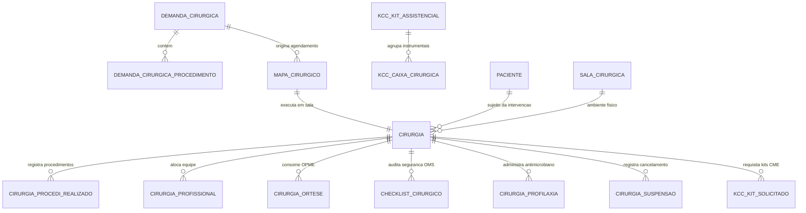
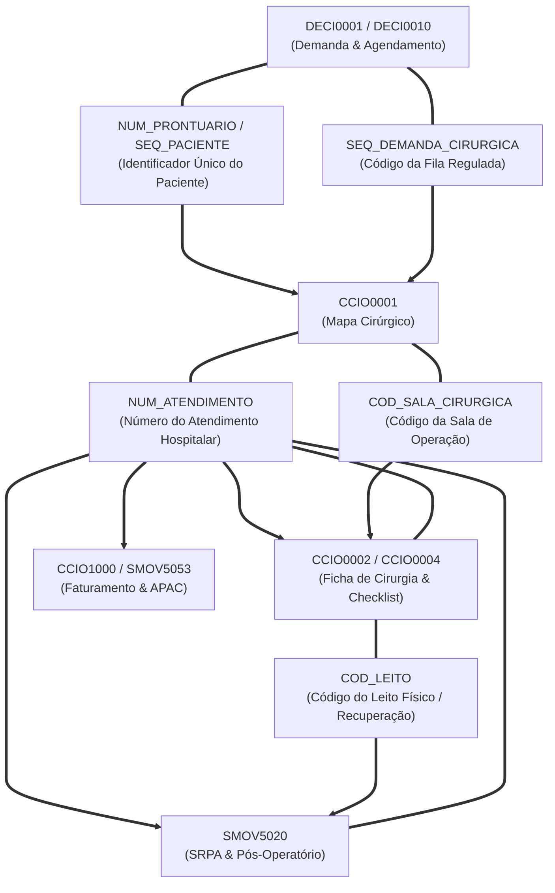

# Grafo de Conhecimento Estrutural (Nível 1) — GraphRAG Centro Cirúrgico FAMEMA

**Especificação Canônica:** `01_GRAPHRAG_STRUCTURAL_KNOWLEDGE_GRAPH.md`  
**Escopo:** Nível 1 — Structural Comprehension & Fundação de Entidades Canônicas  
**Domínio:** `urn:domain:centro-cirurgico-procedimentos`  
**Padrão de Identidade:** Universal Resource Name (`urn:ia1:*` / `urn:famema:*`)

---

## 1. Princípios do Nível 1 Estrutural no GraphRAG

Em conformidade com a arquitetura de especificações da FAMEMA (`specs_test_ia1` / `pattern_mapping/information_layers.txt`), o **Nível 1 (Structural Comprehension)** serve como a fundação imutável de todo o grafo. Nenhuma entidade nas camadas superiores de Call Flow ou de Métricas pode existir sem uma correspondência canônica estrutural no Nível 1.

### Regras de Extração Estrutural
1. **Deduplicação Estrita:** Todas as tabelas, telas, módulos C#, setores físicos e papéis hospitalares são deduplicados e recebem uma URN canônica global invariante.
2. **Descarte de Voláteis:** Variáveis locais de métodos e campos privados efêmeros são descartados da taxonomia de nós para evitar a explosão combinatória do grafo. Mapeiam-se assinaturas públicas, tipos base, contratos de interface e estruturas persistentes.
3. **Isolamento de Origem:** Cada entidade possui taxonomia precisa sobre sua natureza de armazenamento: banco relacional (`DATABASE_TABLE`), arquivo executável (.NET assembly / WinForms), armazenamento físico (leito/sala cirúrgica) ou documento não relacional.

---

## 2. Taxonomia Canônica de Tipos de Entidades (Nós do Grafo)

| Tipo de Entidade (`type`) | Padrão URN Canônico | Total Mapeado | Descrição e Finalidade |
| :--- | :--- | :---: | :--- |
| **`CLINICAL_STAGE`** | `urn:stage:<order>:<slug>` | **7** | Macro-etapas cronológicas da jornada cirúrgica assistencial do paciente. |
| **`SCREEN_FORM`** | `urn:screen:centro-cirurgico:<Code>` | **140** | Telas e formulários WinForms operacionais de interação com usuários. |
| **`CSHARP_MODULE`** | `urn:module:<projectSlug>:<File.cs>` | **454** | Arquivos de código C# (.NET v4.0), contendo classes, métodos e modelos de domínio. |
| **`DATABASE_TABLE`** | `urn:table:<schema>:<table_name>` | **115** | Tabelas relacionais em banco Oracle (SIHOSP, PESSOA, CA, INFRA_ESTRUTURA). |
| **`PHYSICAL_SECTOR`** | `urn:sector:famema:<slug>` | **24** | Ambientes físicos assistenciais mapeados em plantas prediais (HCI, HCII, HCIII). |
| **`HOSPITAL_UNIT`** | `urn:unit:famema:<HCI\|HCII\|HCIII>` | **3** | Complexos hospitalares físicos que compõem o centro cirúrgico. |
| **`ROLE_ACTOR`** | `urn:role:famema:<slug>` | **21** | Perfis de acesso e categorias profissionais com alçadas no bloco cirúrgico. |
| **`BUSINESS_RULE`** | `urn:rule:famema:<ruleId>` | **10** | Covariáveis, portões de bloqueio e travas clínicas do protocolo de cirurgia segura. |

---

## 3. Modelo Relacional de Persistência e Chaves de Costura (`flowStitchKeys`)

A persistência de dados no Centro Cirúrgico da FAMEMA é ancorada no schema `SIHOSP`, complementada pelos schemas de governança `CA` (Controle de Acesso), `PESSOA` (Cadastro Central Unificado) e `INFRA_ESTRUTURA` (Leitos e Recursos Físicos).

### Dicionário Canônico das Tabelas Centrais de Cirurgia

#### 1. `SIHOSP.DEMANDA_CIRURGICA`
- **Classificação:** Tabela Mestra de Entrada / Fila Regulada.
- **Chave Primária (PK):** `SEQ_DEMANDA_CIRURGICA` (NUMBER).
- **Chaves Estrangeiras (FK):** `SEQ_PACIENTE` $\rightarrow$ `PESSOA.PACIENTE`, `COD_PROFISSIONAL` $\rightarrow$ `PESSOA.PROFISSIONAL`.
- **Finalidade:** Armazena a solicitação cirúrgica ambulatorial ou interna, registrando data de indicação, prioridade de triagem e vínculo com regulação CROSS.

#### 2. `SIHOSP.MAPA_CIRURGICO`
- **Classificação:** Orquestradora de Escala e Alocação de Salas.
- **Chave Primária (PK):** `COD_MAPA_CIRURGICO` (NUMBER).
- **Chaves de Relacionamento:** `DAT_CIRURGIA` (DATE), `COD_SALA_CIRURGICA` $\rightarrow$ `SIHOSP.SALA_CIRURGICA`, `SEQ_DEMANDA_CIRURGICA` $\rightarrow$ `SIHOSP.DEMANDA_CIRURGICA`.
- **Finalidade:** Consolida o agendamento prévio das salas operatórias em HCI, HCII e HCIII, organizando horários de início previstos e equipe médica solicitante.

#### 3. `SIHOSP.CIRURGIA`
- **Classificação:** Ficha Mestra de Execução Perioperatória (Coração Transacional).
- **Chave Primária (PK):** `SEQ_CIRURGIA` (NUMBER).
- **Chaves de Costura (`flowStitchKeys`):** `NUM_ATENDIMENTO`, `NUM_PRONTUARIO`, `COD_SALA_CIRURGICA`, `COD_LEITO`.
- **Campos de Controle Temporal:** `DAT_ENTRADA_SALA`, `DAT_INI_ANESTESIA`, `DAT_FIM_ANESTESIA`, `DAT_INI_CIRURGIA`, `DAT_FIM_CIRURGIA`, `DAT_SAIDA_SALA`.
- **Finalidade:** Representa o ato operatório formal realizado dentro do bloco cirúrgico.

#### 4. `SIHOSP.CHECKLIST_CIRURGICO`
- **Classificação:** Registro de Governança e Segurança do Paciente (OMS).
- **Chave Primária (PK):** `SEQ_CHECKLIST_CIRURGICO` (NUMBER).
- **Chave Estrangeira (FK):** `SEQ_CIRURGIA` $\rightarrow$ `SIHOSP.CIRURGIA`.
- **Sub-Tabelas de Etapa:**
  - `SIHOSP.CHK_PRE_INDUC_ANEST`: Checagem Sign-In (identificação, alergias, via aérea, reserva sanguínea).
  - `SIHOSP.CHK_PRE_INCISAO_CIR`: Checagem Time-Out (equipe em silêncio, confirmação verbal, profilaxia antibiótica).
  - `SIHOSP.CHK_PRE_SAIDA_SALA_CIR`: Checagem Sign-Out (contagem de compressas e instrumentais, rotulagem de biópsia).

#### 5. `SIHOSP.FICHA_OPME` & `SIHOSP.CIRURGIA_ORTESE`
- **Classificação:** Rastreabilidade e Auditoria de Alto Custo.
- **Campos Centrais:** `NUM_LOTE`, `NUM_SERIE`, `NUM_ANVISA`, `QTD_CONSUMIDA`, `VALOR_UNITARIO`, `NUM_AUTORIZACAO_CONVENIO_SUS`.
- **Finalidade:** Garantir rastreabilidade de cada prótese/órtese implantada no paciente para auditoria clínica e faturamento hospitalar.

#### 6. Família `SIHOSP.KCC_*` (Kit Cirúrgico & Central de Materiais Esterilizados)
- **Tabelas Principais:** `SIHOSP.KCC_KIT_ASSISTENCIAL`, `SIHOSP.KCC_CAIXA_CIRURGICA`, `SIHOSP.KCC_CAIXA_INSTRUMENTAL`, `SIHOSP.KCC_EQUIPAMENTO`, `SIHOSP.KCC_MOVIMENTACAO`.
- **Finalidade:** Monitorar o ciclo físico das caixas cirúrgicas entre a CME (autoclave, esterilização) e o bloco cirúrgico, impedindo o uso de caixas com prazo de esterilização expirado.

---

## 4. Matriz de Chaves de Costura Transversal (`flowStitchKeys`)

Para permitir que o GraphRAG una dados provenientes de telas diferentes sem perda de rastreabilidade, o modelo emprega cinco chaves de costura primárias:

1. **`NUM_ATENDIMENTO`**: Identificador central que conecta o acolhimento pré-operatório, o ato cirúrgico na sala, a permanência na SRPA e o faturamento APAC/AIH.
2. **`NUM_PRONTUARIO` / `SEQ_PACIENTE`**: Liga todo o histórico pregresso do paciente no ambulatório à indicação cirúrgica no CROSS e aos laudos finais no PEP.
3. **`COD_SALA_CIRURGICA`**: Amarra a escala de salas do Mapa Operatório (`CCIO0001`) à ocupação física real na sala (`CCIO0002`), garantindo que não ocorram colisões de agendamento.
4. **`COD_LEITO`**: Controla a transição do leito de origem na enfermaria $\rightarrow$ leito de espera pré-op $\rightarrow$ mesa cirúrgica $\rightarrow$ leito de recuperação na SRPA $\rightarrow$ leito de destino final.
5. **`SEQ_DEMANDA_CIRURGICA`**: Assegura que toda cirurgia eletiva realizada possua rastreabilidade direta com a indicação médica e a respectiva vaga do CROSS.

---

## 5. Mapeamento dos Projetos C# e Camadas Arquiteturais

Os metadados cirúrgicos da FAMEMA provêm de 14 projetos organizados no modelo clássico de duas camadas do .NET:

| Projeto / Assembly | Camada Arquitetural | Módulos `.cs` | Linhas de Código | Responsabilidade no Grafo |
| :--- | :--- | :---: | :---: | :--- |
| **`CentroCirurgico`** | `BUSINESS_LOGIC_BO` | 90 | 11.301 LOC | Regras de negócio centrais, entidades de persistência e validações de mapa e cirurgia. |
| **`CentroCirurgicoForms`** | `PRESENTATION_WINFORMS` | 45 | 14.546 LOC | Formulários de mapa operatório (`CCIO0001`), cirurgia (`CCIO0002`), checklist (`CCIO0004`) e laudos. |
| **`DemandaCirurgia`** | `BUSINESS_LOGIC_BO` | 43 | 6.670 LOC | Regras de negócio da fila de espera, cancelamento de demandas e integração CROSS. |
| **`DemandaCirurgiaForms`** | `PRESENTATION_WINFORMS` | 48 | 12.596 LOC | Interfaces de cadastro de demanda (`DECI0001`), agendamento de data (`DECI0010`) e insumos. |
| **`KitCirurgicoDLL`** | `BUSINESS_LOGIC_BO` | 40 | 5.121 LOC | Validações de montagem de caixas cirúrgicas, validade de esterilização e movimentação CME. |
| **`KitCirurgicoForms`** | `PRESENTATION_WINFORMS` | 72 | 8.809 LOC | Telas operacionais da CME, dispensação de instrumentais e conferência de equipamentos (`KCC*`). |
| **`DemandaCirurgicaGerencial`** | `PRESENTATION_WINFORMS` | 10 | 928 LOC | Telas de estratificação de risco cirúrgico, pontuação por idade e procedimento (`DECG*`). |
| **`DemandaCirurgicaMonitoracao`**| `PRESENTATION_WINFORMS` | 7 | 587 LOC | Painéis e dashboards de monitoramento de status perioperatório (`DCMO*`). |
