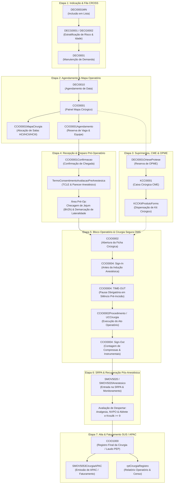
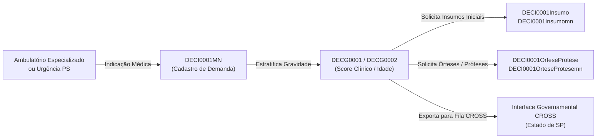
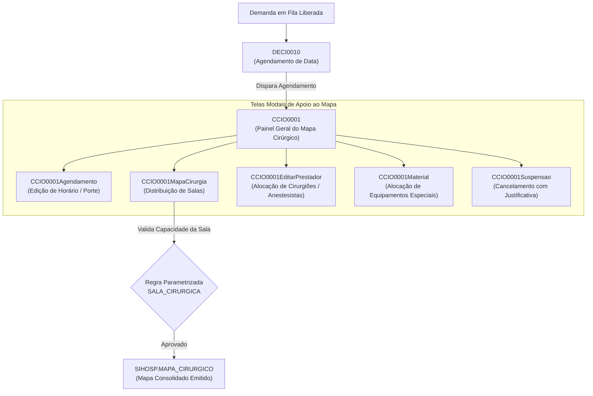
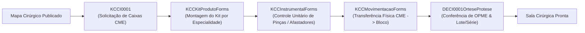
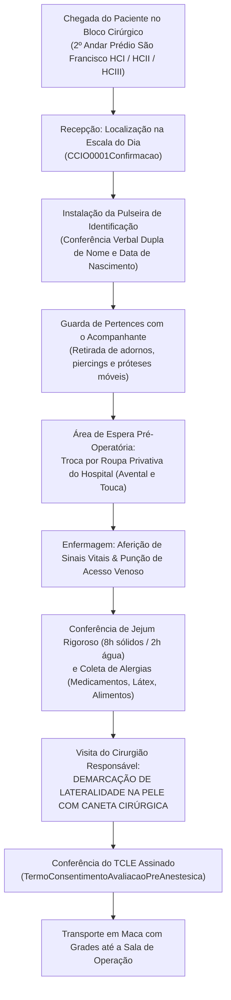
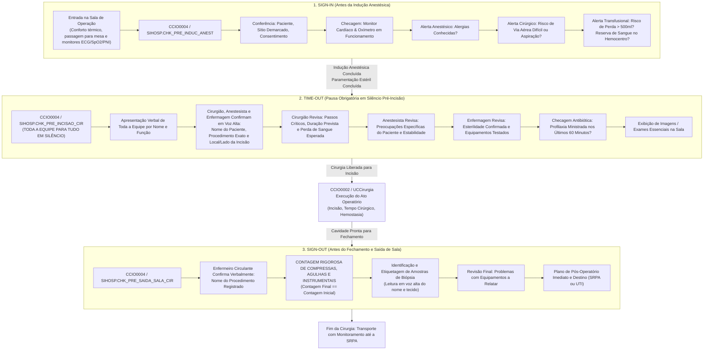
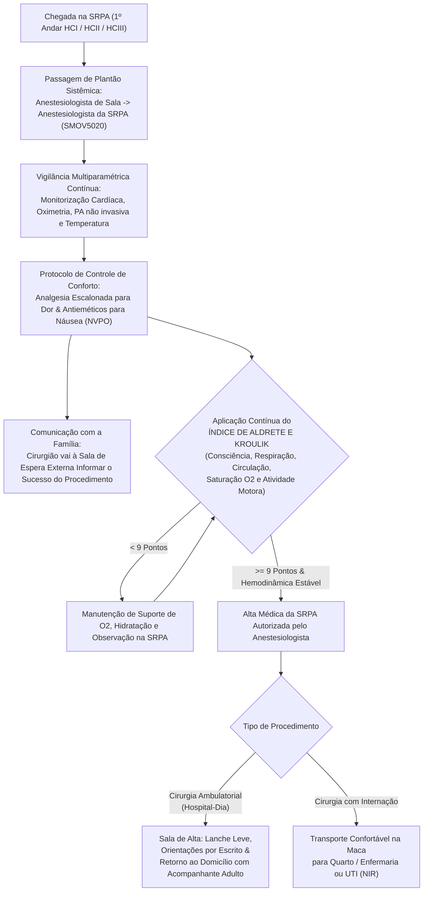
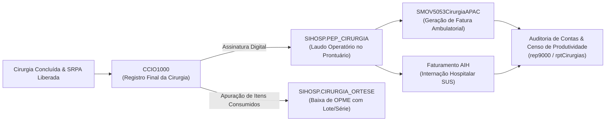

# Grafo de Fluxos de Chamada e Jornada Cirúrgica (Nível 2) — GraphRAG Centro Cirúrgico FAMEMA

**Especificação Canônica:** `02_GRAPHRAG_CALL_FLOW_AND_JOURNEY_GRAPH.md`  
**Escopo:** Nível 2 — Call Flow Comprehension & Travessia da Jornada Assistencial  
**Domínio:** `urn:domain:centro-cirurgico-procedimentos`  
**Base Documental:** [Guia do Cidadão: Fluxo Centro Cirúrgico](file:///home/walter/repos/metadados_famema/docs_pdf/Guia_do_Cidadao_Fluxo_Centro_Cirurgico.html) & `clusters/centro-cirurgico/screens`

---

## 1. Princípios do Nível 2 (Call Flow) no GraphRAG

O **Nível 2 (Call Flow Comprehension)** estabelece as rotas de travessia do grafo, mapeando como o paciente, as equipes multiprofissionais e as mensagens trafegam entre as entidades canônicas do Nível 1.

O fluxo é estruturado em **duas malhas sincronizadas**:
1. **Malha Clínica Sequencial:** A ordem biológica e assistencial estrita do paciente (Pré-Operatório $\rightarrow$ Trans-Operatório $\rightarrow$ Pós-Operatório Imediato $\rightarrow$ Pós-Operatório Tardio / Alta).
2. **Malha de Execução e Navegação de Software:** A árvore de navegação entre telas WinForms (`canNavigateTo`, `invokedByScreens`), ativação de métodos C# e transações de banco de dados (`PERSISTS_MASTER_TABLE`, `QUERIES_RELATED_TABLE`).

---

## 2. Visão Global da Travessia do Grafo: As 7 Etapas Cronológicas

---

## 3. Detalhamento dos Sub-Fluxos e Travessias de Chamada

### Sub-Fluxo 1: Indicação Cirúrgica, Lista de Espera e Regulação CROSS

- **Ponto de Entrada:** Médico do ambulatório ou da urgência diagnostica a necessidade cirúrgica.
- **Transação:** Gravação em `SIHOSP.DEMANDA_CIRURGICA` e `SIHOSP.DEMANDA_CIRURGICA_PROCEDIMENTO`.
- **Regra de Decisão:** `DECG_ESTRATIFICACAO` calcula a prioridade com base na gravidade da patologia, idade do paciente e presença de comorbidades.
- **Portão de Saída:** Demanda ativa aguardando liberação de cota hospitalar.

---

### Sub-Fluxo 2: Planejamento, Agendamento e Mapa Cirúrgico Diário

- **Ponto de Entrada:** `DECI0010` (Agendamento de Data Cirúrgica).
- **Validações Pré-Agendamento:**
  - Checagem de óbito: `SIHOSP.PACIENTE.DAT_OBITO IS NULL`.
  - Checagem de cadastro: `SIHOSP.CA_CLIENTE.STATUS != 'INATIVO'`.
  - Reserva prévia de sangue no Hemocentro para cirurgias com perda sanguínea prevista $\ge 500\text{ ml}$ (Regra `RN-CC-001`).
- **Orquestração Física:** Alocação entre salas de cirurgia geral em HCI (Salas 1 a 6), pediátricas/obstétricas em HCII (Salas 1 a 3) e oftalmológicas em HCIII (Salas 1 e 2).

---

### Sub-Fluxo 3: Central de Materiais Esterilizados (CME), Kits e OPME

- **Módulos C# Envolvidos:** `KitCirurgicoDLL.dll` (regras e movimentação de estoque estéril) e `KitCirurgicoForms.dll` (interfaces WinForms).
- **Controle de Rastreabilidade:** Cada caixa instrumental possui URN própria e registro de ciclo de autoclave (`DAT_ESTERILIZACAO`, `NUM_LOTE_AUTOCLAVE`). Caixas com ciclo vencido geram bloqueio visual impeditivo.

---

### Sub-Fluxo 4: Recepção, Acolhimento e Cuidados Pré-Operatórios (Guia do Cidadão)

- **Foco do Guia do Cidadão:** O guia impresso distribuído pela FAMEMA educa o paciente sobre a importância da demarcação de lateralidade ("*maior garantia de que a cirurgia será feita no lado exato*") e desmistifica a repetição de perguntas da equipe sobre seu nome e procedimento ("*Protocolo Internacional de Cirurgia Segura OMS: sua confirmação em voz alta é a melhor barreira contra falhas*").

---

### Sub-Fluxo 5: Bloco Operatório, Cirurgia Segura OMS e Ato Cirúrgico

---

### Sub-Fluxo 6: Sala de Recuperação Pós-Anestésica (SRPA) e Vitalidade

---

### Sub-Fluxo 7: Alta / Destino, Laudo Cirúrgico no PEP e Faturamento APAC / AIH

- **Liquidação Administrativa:** O fechamento só é completado se todos os procedimentos realizados possuírem códigos compatíveis na tabela SIGTAP/SUS e se o consumo de materiais estiver 100% justificado pelo laudo operatório assinado.
