# Decomposição em Comunidades e Sínteses GraphRAG (Nível 3) — Centro Cirúrgico FAMEMA

**Especificação Canônica:** `03_GRAPHRAG_COMMUNITY_DETECTION_AND_SUMMARIES.md`  
**Escopo:** Nível 3 — Hierarchical Community Detection & GraphRAG Community Summaries  
**Algoritmo de Particionamento:** Leiden / Louvain Multilevel Graph Clustering  
**Domínio:** `urn:domain:centro-cirurgico-procedimentos`

---

## 1. Fundamentos da Detecção de Comunidades no GraphRAG

No GraphRAG, a detecção de comunidades divide o grafo global de entidades e relações em **clusters semântica e operacionalmente densos**. Essa partição hierárquica permite que o motor de RAG responda tanto a consultas microscópicas (ex: *"Quais campos compõem o Time-Out da tela CCIO0004?"*) quanto a consultas holísticas de alto nível (ex: *"Qual o impacto assistencial e financeiro de um cancelamento de cirurgia por falta de esterilização na CME?"*).

```mermaid
flowchart TD
    subgraph L0["Nível 0: Comunidade Raiz (Macro-Ecossistema)"]
        C0["C0: Bloco Cirúrgico Integrado & Ciclo Perioperatório FAMEMA"]
    end

    subgraph L1["Nível 1: 7 Macro-Comunidades Funcionais"]
        C1["C1: Demanda Cirúrgica & Regulação CROSS"]
        C2["C2: Agendamento & Mapa Cirúrgico"]
        C3["C3: CME, Instrumental, Kits & OPME"]
        C4["C4: Acolhimento & Preparo Pré-Operatório"]
        C5["C5: Bloco Operatório & Cirurgia Segura OMS"]
        C6["C6: SRPA & Vitalidade Pós-Anestésica"]
        C7["C7: Documentação, PEP & Faturamento APAC"]
    end

    subgraph L2["Nível 2: 15 Micro-Comunidades Atômicas"]
        C1 --> M1["C1.1: Fila CROSS"]
        C1 --> M2["C1.2: Estratificação de Risco (DECG)"]
        C2 --> M3["C2.1: Escala Diária"]
        C2 --> M4["C2.2: Alocação de Salas HCI/HCII/HCIII"]
        C3 --> M5["C3.1: Autoclave & Caixas CME"]
        C3 --> M6["C3.2: Rastreio OPME & Lotes"]
        C4 --> M7["C4.1: Recepção & Pulseira"]
        C4 --> M8["C4.2: Demarcação Lateralidade"]
        C5 --> M9["C5.1: Sign-In Pré-Indução"]
        C5 --> M10["C5.2: TIME-OUT Verbal OMS"]
        C5 --> M11["C5.3: Ato Invasivo & Equipe"]
        C5 --> M12["C5.4: Sign-Out & Compressas"]
        C6 --> M13["C6.1: Vigilância SRPA & Analgesia"]
        C6 --> M14["C6.2: Índice de Aldrete & Destino"]
        C7 --> M15["C7.1: Laudo PEP, AIH & APAC"]
    end

    C0 --> C1 & C2 & C3 & C4 & C5 & C6 & C7
```

---

## 2. Relatório de Comunidade Nível 0 (Macro-Ecossistema Global)

### **Comunidade C0: Bloco Cirúrgico Integrado e Ciclo Perioperatório FAMEMA**
- **Identificador Canônico:** `community:l0:centro-cirurgico-global`
- **Nível Hierárquico:** 0 (Raiz)
- **Classificação:** Macro-Domínio Cirúrgico de Alta Complexidade (`SURGICAL_INTERVENTIONAL`)
- **Cor Temática:** `#E11D48`
- **Volume Agregado:** 140 Telas, 454 Módulos C#, 115 Tabelas Relacionais, 24 Setores Físicos, 21 Papéis.

#### Síntese Executiva GraphRAG
O Centro Cirúrgico do Complexo Hospitalar FAMEMA opera como um ecossistema crítico de suporte à vida estruturado para garantir a execução segura de procedimentos invasivos eletivos e de urgência em três unidades físicas (`HCI`, `HCII`, `HCIII`). O ciclo operacional inicia-se externamente com a regulação de vagas via sistema CROSS do Estado de São Paulo e o agendamento em mapa cirúrgico diário, passa pela esterilização de materiais na CME e conferência de órteses e próteses (OPME), recebe o cidadão na recepção com conferência de jejum e demarcação de lateralidade na pele, realiza a cirurgia sob o protocolo de segurança da OMS em 3 etapas (Sign-In, Time-Out e Sign-Out), estabiliza o paciente na SRPA sob índice de Aldrete e Kroulik $\ge 9$ e liquida as contas hospitalares em prontuário eletrônico (PEP) e faturamento SUS (APAC e AIH).

#### Achados Sistêmicos Centrais
1. **Forte Acoplamento Assistencial-Regulatório:** Toda cirurgia eletiva é rigidamente subordinada à existência de demanda prévia com código de procedimento SUS e aprovação de cotas no CROSS.
2. **Barreiras Físicas e Digitais Redundantes contra Erros de Lateralidade:** A demarcação física com caneta na pele do paciente consciente é validada independentemente na recepção, no Sign-In e no Time-Out verbal da equipe.
3. **Controle Rigoroso de Rastreabilidade OPME:** Procedimentos de ortopedia e neurocirurgia possuem validação dupla entre a cota autorizada, o código de barras/lote implantado e o laudo operatório final.

---

## 3. Relatórios Detalhados das 7 Macro-Comunidades Nível 1

### **Comunidade C1: Demanda Cirúrgica, Lista de Espera e Regulação CROSS (`DECI` & `DECG`)**
- **Identificador Canônico:** `community:l1:demanda-regulacao`
- **Cor Temática:** `#EA580C`
- **Telas Nucleares:** `DECI0001MN`, `DECI0001`, `DECG0001`, `DECG0002`, `DECG0003`, `DECI0002`.
- **Tabelas Centrais:** `SIHOSP.DEMANDA_CIRURGICA`, `SIHOSP.DEMANDA_CIRURGICA_PROCEDIMENTO`, `SIHOSP.DEMANDA_RISCO_CIRURGIA`.
- **Atores:** Secretária de Especialidades, Médico Cirurgião, Regulador CROSS.

#### Síntese da Comunidade
Comunidade responsável pela gestão da fila cirúrgica regulada. Realiza a triagem e pontuação clínica das demandas através do subsistema `DECG` (Demanda Cirúrgica Gerencial), ponderando a gravidade da doença, faixa etária do paciente e tempo decorrido em espera. Serve como a interface formal com o portal CROSS estadual para agendamento de pacientes referenciados da Diretoria Regional de Saúde (DRS IX - Marília).

#### Pontes Externas (Inter-Community Bridges)
- **Ponte para C2 (Agendamento):** Fornece as demandas autorizadas com suas chaves `SEQ_DEMANDA_CIRURGICA` e `SEQ_PACIENTE` para a tela `DECI0010`.
- **Ponte para C3 (Suprimentos):** Pré-requisita materiais especiais através de `DECI0001OrteseProtese`.

#### Riscos e Débitos Técnicos
- **Débito Técnico:** A parametrização de pontuação de prioridade (`DECG0002mn`) utiliza tabelas auxiliares legadas que exigem manutenção manual periódica de coeficientes.
- **Risco Assistencial:** Risco de desatualização de contato telefônico do paciente na fila de espera, gerando abstenção no dia do procedimento.

---

### **Comunidade C2: Planejamento, Agendamento e Mapa Cirúrgico Diário (`CCIO0001` & `DECI0010`)**
- **Identificador Canônico:** `community:l1:agendamento-mapa`
- **Cor Temática:** `#3B82F6`
- **Telas Nucleares:** `DECI0010`, `CCIO0001`, `CCIO0001Agendamento`, `CCIO0001MapaCirurgia`, `CCIO0001EditarPrestador`, `CCIO9000`.
- **Tabelas Centrais:** `SIHOSP.MAPA_CIRURGICO`, `SIHOSP.SALA_CIRURGICA`, `INFRA_ESTRUTURA.LEITO`.
- **Atores:** Enfermeiro Regulador do Centro Cirúrgico, Chefia Médica, Gestão de Leitos (NIR).

#### Síntese da Comunidade
Orquestra o tabuleiro de xadrez das salas cirúrgicas em escala diária. Realiza o balanceamento entre procedimentos de grande porte (oncologia, neurocirurgia e cirurgia cardíaca no HCI), cirurgias pediátricas/obstétricas (HCII) e cirurgias de alta rotatividade oftalmológicas (HCIII). Garante que nenhuma sala seja superalocada ou que cirurgias sem reserva de sangue / anestesiologista entrem no mapa final.

#### Pontes Externas
- **Ponte para C4 (Recepção):** Alimenta a lista de pacientes esperados no dia via `CCIO0001Confirmacao`.
- **Ponte para C5 (Bloco):** Envia a escala formal de cirurgias e a atribuição de equipes para abertura de sala em `CCIO0002`.

#### Riscos e Débitos Técnicos
- **Ponto Crítico:** Se uma cirurgia de urgência do Pronto Socorro ingressar no mapa sem leito pós-operatório (SRPA/UTI) garantido, todo o mapa subsequente sofre efeito dominó de atraso ou suspensão.

---

### **Comunidade C3: Central de Materiais Esterilizados (CME), Kits e OPME (`KCC`)**
- **Identificador Canônico:** `community:l1:cme-kits-opme`
- **Cor Temática:** `#10B981`
- **Telas Nucleares:** `KCCI0001`, `KCCKitProdutoForms`, `KCCInstrumentalForms`, `KCCMovimentacaoForms`, `DECI0001OrteseProtese`.
- **Tabelas Centrais:** `SIHOSP.KCC_KIT_ASSISTENCIAL`, `SIHOSP.KCC_CAIXA_CIRURGICA`, `SIHOSP.FICHA_OPME`, `SIHOSP.KCC_MOVIMENTACAO`.
- **Atores:** Auxiliar de Enfermagem CME, Instrumentador Cirúrgico, Fornecedor de OPME Consignado.

#### Síntese da Comunidade
Assegura a esterilidade biológica absoluta e a disponibilidade dos instrumentais cirúrgicos e implantes. Controla caixas cirúrgicas por código de barras, monitora ciclos termoquímicos e biológicos de autoclave e rastreia órteses e próteses consignadas desde a entrega pelo fornecedor até o momento da implantação na sala.

#### Pontes Externas
- **Ponte para C5 (Bloco):** Libera a caixa cirúrgica para a sala de operação; sem a confirmação de esterilização válida no `KCC`, a tela `CCIO0002` emite alerta de bloqueio.
- **Ponte para C7 (Faturamento):** Envia as etiquetas de lote/série consumidas para baixa contábil e auditoria SUS.

#### Riscos e Débitos Técnicos
- **Risco Assistencial:** Suspensão de cirurgia no dia do procedimento por falha no indicador biológico da autoclave ou por atraso na entrega de prótese importada.

---

### **Comunidade C4: Recepção, Acolhimento e Cuidados Pré-Operatórios (Guia do Cidadão)**
- **Identificador Canônico:** `community:l1:acolhimento-preparo`
- **Cor Temática:** `#8B5CF6`
- **Telas Nucleares:** `CCIO0001Confirmacao`, `TermoConsentimentoAvaliacaoPreAnestesica`, `CCIO0001IdentificarEquipe`, `Agradecimento`.
- **Setores Físicos:** `RECEP CENTRO CIRÚRGICO HCI`, `Área de Espera Pré-Operatória`.
- **Atores:** Recepcionista, Técnico de Enfermagem, Enfermeiro Pré-Op, Paciente, Acompanhante.

#### Síntese da Comunidade
Materializa o acolhimento humanizado e a primeira linha de defesa clínica do bloco operatório. Acolhe o paciente e acompanhante, confere documentos oficiais e termo de consentimento livre e esclarecido (TCLE), instala a pulseira de identificação padronizada, confere o jejum de 8h para sólidos e 2h para líquidos, instala acesso venoso periférico, recolhe adornos/próteses e promove a demarcação compulsória de lateralidade pelo cirurgião.

#### Pontes Externas
- **Ponte para C5 (Bloco):** Envia o paciente com pulseira conferida, acesso venoso instalado e pele demarcada para a sala cirúrgica.
- **Ponte com o Acompanhante:** Orienta a permanência do familiar na sala de espera externa do 2º andar com comunicação telefônica ativa.

#### Riscos e Débitos Técnicos
- **Risco Assistencial:** Ingestão inadvertida de água/alimentos nas 2 horas que antecedem a cirurgia (quebra de jejum), exigindo adiamento de horário para prevenção de broncoaspiração.

---

### **Comunidade C5: Bloco Operatório, Cirurgia Segura OMS e Ato Cirúrgico (`CCIO0002` & `CCIO0004`)**
- **Identificador Canônico:** `community:l1:bloco-cirurgia-segura`
- **Cor Temática:** `#D97706`
- **Telas Nucleares:** `CCIO0002`, `CCIO0004`, `CCIO0002Procedimento`, `CCIO0002Participante`, `CCIO0002Ortese`, `UCCirurgia`.
- **Tabelas Centrais:** `SIHOSP.CIRURGIA`, `SIHOSP.CHECKLIST_CIRURGICO`, `SIHOSP.CIRURGIA_PROFISSIONAL`, `SIHOSP.CIRURGIA_ORTESE`.
- **Atores:** Cirurgião Chefe, Cirurgiões Auxiliares, Anestesiologista, Enfermeiro de Bloco, Circulante, Instrumentador.

#### Síntese da Comunidade
Núcleo assistencial invasivo de maior densidade de risco do complexo hospitalar. Executa a intervenção cirúrgica sob a égide do Protocolo Internacional de Cirurgia Segura da OMS:
1. **Sign-In:** Pré-indução anestésica (identificação, consentimento, via aérea e reserva de sangue).
2. **Time-Out:** Pausa em silêncio antes da incisão na pele (conferência verbal obrigatória da equipe, paciente, cirurgia, lado e profilaxia antibiótica).
3. **Sign-Out:** Antes do fechamento e saída de sala (contagem rigorosa de compressas e instrumentais, rotulagem de biópsias).

#### Pontes Externas
- **Ponte para C6 (SRPA):** Transfere o paciente estabilizado com passagem de plantão formal entre o anestesista de sala e o anestesista da recuperação.
- **Ponte para C7 (Faturamento):** Gera a base de dados de tempo cirúrgico, procedimentos executados e equipe para confecção do laudo no PEP.

#### Riscos e Débitos Técnicos
- **Risco Assistencial Crítico:** Evento adverso por omissão do Time-Out verbal ou esquecimento de compressa em cavidade (mitigado pela checagem eletrônica e contagem dupla na tela `CCIO0004`).

---

### **Comunidade C6: Sala de Recuperação Pós-Anestésica (SRPA) e Vitalidade (`SMOV5020`)**
- **Identificador Canônico:** `community:l1:srpa-recuperacao`
- **Cor Temática:** `#06B6D4`
- **Telas Nucleares:** `SMOV5020`, `SMOV5020Anestesico`, `SMOV5020Cirurgia`, `DCMO0003`.
- **Setores Físicos:** `SALA DE RECUPERAÇÃO CC HCI` (1º Andar HCI) e anexos HCII/HCIII.
- **Atores:** Enfermeiro Anestesista, Anestesiologista de Plantão na SRPA, Técnico de Enfermagem.

#### Síntese da Comunidade
Vigia o período de maior vulnerabilidade hemodinâmica e respiratória pós-cirúrgica. Monitora continuamente pressão arterial, frequência cardíaca, oximetria de pulso e estado de consciência. Administra drogas de alívio rápido de dor e náuseas. Avalia o paciente através do **Índice de Aldrete e Kroulik**, liberando a alta da SRPA somente após atingir pontuação $\ge 9$.

#### Pontes Externas
- **Ponte para a Família:** O cirurgião se desloca à sala de espera externa para comunicar à família o término e desfecho da cirurgia.
- **Ponte para Destino Final:** Direciona cirurgias ambulatoriais para a sala de alta e cirurgias com internação para a enfermaria ou UTI.

#### Riscos e Débitos Técnicos
- **Risco Assistencial:** Laringoespasmo pós-extubação ou hipotermia na recuperação (tratada com mantas térmicas e oxigenoterapia ativa).

---

### **Comunidade C7: Documentação Cirúrgica, PEP, APAC e Faturamento SUS (`CCIO1000` & `SMOV5053`)**
- **Identificador Canônico:** `community:l1:faturamento-apac-pep`
- **Cor Temática:** `#4F46E5`
- **Telas Nucleares:** `CCIO1000`, `SMOV5053CirurgiaAPAC`, `rptCirurgiaRegistro`, `rep9000`, `FichaInfeccao`.
- **Tabelas Centrais:** `SIHOSP.PEP_CIRURGIA`, `SIHOSP.CIRURGIA_PROCEDI_REALIZADO`, `SIHOSP.FICHA_OPME_MATERIAL`.
- **Atores:** Cirurgião Responsável, Faturamento SUS, Auditoria Médica, Comissão de Controle de Infecção Hospitalar (CCIH).

#### Síntese da Comunidade
Encerra a vida transacional do episódio cirúrgico. Realiza o preenchimento e assinatura digital do laudo operatório no PEP, associa os códigos de diagnóstico (CID-10) e procedimentos (SIGTAP/SUS), valida o consumo de materiais e OPME para liquidação contábil e emite as faturas governamentais (APAC para procedimentos de alta complexidade ambulatorial e espelhos de AIH para internação).

#### Pontes Externas
- **Ponte para CCIH:** Notificação compulsória de cirurgias com implantes e antibioticoterapia profilática para busca ativa de infecção de sítio cirúrgico (`FichaInfeccao`).

#### Riscos e Débitos Técnicos
- **Débito Financeiro:** Glosa de faturamento pelo SUS se o laudo cirúrgico no PEP for assinado após o fechamento da competência mensal ou se houver divergência entre o procedimento autorizado no CROSS e o laudo operatório.
