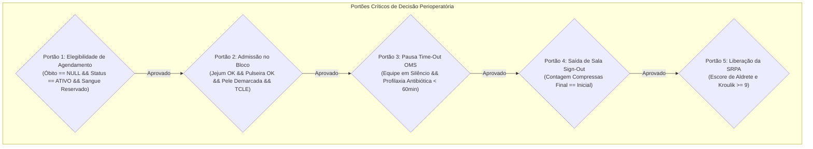

# Catálogo de Covariáveis, Portões de Decisão e Regras de Negócio — Centro Cirúrgico FAMEMA

**Especificação Canônica:** `04_GRAPHRAG_BUSINESS_RULES_AND_COVARIATES.md`  
**Escopo:** Covariáveis, Condições de Bloqueio, Protocolos Clínicos e Regras Parametrizadas  
**Domínio:** `urn:domain:centro-cirurgico-procedimentos`  
**Base Normativa:** OMS / ANVISA RDC 36/2013 / Regras de Negócio SIHOSP

---

## 1. Classificação das Covariáveis e Portões de Decisão no GraphRAG

No GraphRAG, as **covariáveis** são declarações de fatos condicionais, portões lógicos de decisão e restrições de conformidade que afetam diretamente o fluxo entre os nós do grafo. Uma aresta entre duas telas ou etapas só pode ser percorrida se as covariáveis associadas forem satisfeitas.

As regras são classificadas em quatro categorias principais:
1. **`CLINICAL_SAFETY_MANDATORY`:** Protocolos internacionais compulsórios de segurança do paciente (Cirurgia Segura OMS, Jejum, Demarcação).
2. **`SYSTEM_HARD_BLOCK`:** Travas transacionais rígidas de software e integridade de banco de dados (bloqueio de óbito, inativação cadastral).
3. **`DATA_FILTER_RULE`:** Regras dinâmicas parametrizadas armazenadas em tabelas de configuração do banco (`CC_EQUIPE`, `SALA_CIRURGICA`).
4. **`POST_ANESTHESIA_DISCHARGE`:** Critérios fisiológicos de liberação pós-anestésica (Índice de Aldrete e Kroulik $\ge 9$).

---

## 2. Catálogo Formal de Regras de Negócio e Covariáveis

---

### **RN-CC-001: Validação de Pedido Cirúrgico, Sangue (Hemocentro) e OPME**
- **Identificador Canônico:** `urn:rule:famema:RN-CC-001`
- **Categoria:** `PRE_CONDITION_SURGICAL`
- **Telas Executoras:** `CCIO0001Agendamento`, `DECI0010`.
- **Expressão Lógica:**
  $$\text{Condição} = (\text{PERDA\_SANGUINEA\_PREVISTA} < 500\text{ ml} \lor \text{RESERVA\_HEMOCENTRO\_CONFIRMADA} == \text{TRUE}) \land (\text{EXIGE\_OPME} == \text{FALSE} \lor \text{OPME\_STATUS} == \text{"AUTORIZADO"})$$
- **Descrição Operacional:** O agendamento de cirurgias eletivas de médio e grande porte exige comprovação eletrônica de reserva sanguínea junto ao Hemocentro de Marília e autorização da Secretaria de Saúde para materiais de alto custo (OPME). O descumprimento impede o avanço da demanda para o Mapa Cirúrgico oficial.

---

### **RN-CC-002: Protocolo de Cirurgia Segura OMS (Sign-In, Time-Out e Sign-Out)**
- **Identificador Canônico:** `urn:rule:famema:RN-CC-002`
- **Categoria:** `CLINICAL_SAFETY_MANDATORY`
- **Telas Executoras:** `CCIO0004`, `CCIO0002`.
- **Tabelas de Registro:** `SIHOSP.CHK_PRE_INDUC_ANEST`, `SIHOSP.CHK_PRE_INCISAO_CIR`, `SIHOSP.CHK_PRE_SAIDA_SALA_CIR`.
- **Estrutura dos 3 Portões:**
  1. **Sign-In (Antes da Indução):** Confirmação verbal ativa com o paciente acordado: identificação completa, cirurgia planejada, sítio operatório demarcado na pele, consentimento assinado, checagem do oxímetro e avaliação de risco anestésico (alergias e via aérea difícil).
  2. **Time-Out (Antes da Incisão):** Pausa compulsória com toda a equipe em silêncio. Apresentação verbal de todos por nome e papel. Confirmação unânime do paciente, sítio cirúrgico, procedimento, tempo cirúrgico previsto e **ministração da profilaxia antibiótica dentro dos últimos 60 minutos**.
  3. **Sign-Out (Antes de Sair da Sala):** Confirmação do nome definitivo do procedimento realizado, **contagem física rigorosa de compressas, agulhas e instrumentais (Contagem Inicial == Contagem Final)**, etiquetagem em voz alta de amostras de biópsia e revisão de problemas de equipamentos.

---

### **RN-CC-003: Critérios de Alta da SRPA por Índice de Aldrete e Kroulik $\ge 9$**
- **Identificador Canônico:** `urn:rule:famema:RN-CC-003`
- **Categoria:** `POST_ANESTHESIA_DISCHARGE`
- **Telas Executoras:** `SMOV5020`, `CCIO0002`.
- **Matriz de Pontuação:**

| Parâmetro Fisiológico | 2 Pontos | 1 Ponto | 0 Pontos |
| :--- | :--- | :--- | :--- |
| **Atividade Motora** | Move os 4 membros voluntariamente ou sob comando | Move 2 membros | Incapaz de mover membros |
| **Respiração** | Respira profundamente e tosse livremente | Dispneia ou respiração limitada | Apneia |
| **Circulação (Pressão Arterial)** | $\text{PA} \pm 20\%$ do nível pré-anestésico | $\text{PA} \pm 20\text{ a }49\%$ do nível pré-anestésico | $\text{PA} \pm 50\%$ do nível pré-anestésico |
| **Consciência** | Completamente lúcido e orientado | Desperta quando chamado | Não responde |
| **Saturação de $\text{O}_2$** | $\text{SpO}_2 > 92\%$ em ar ambiente | Necessita de $\text{O}_2$ suplementar para $\text{SpO}_2 > 90\%$ | $\text{SpO}_2 < 90\%$ mesmo com $\text{O}_2$ |

- **Expressão de Liberação:**
  $$\text{Score Total} = \sum_{i=1}^{5} \text{Ponto}_i \ge 9 \land \text{DOR\_CONTROLADA} == \text{TRUE} \land \text{SEM\_NÁUSEA\_GRAVE} == \text{TRUE}$$

---

### **RN-CC-004: Bloqueio Assistencial por Registro de Óbito**
- **Identificador Canônico:** `urn:rule:famema:RN-CC-004`
- **Categoria:** `SYSTEM_HARD_BLOCK`
- **Telas Executoras:** `CCIO0001`, `CCIO0002`, `DECI0001`, `DECI0010`.
- **Condição SQL:** `SIHOSP.PACIENTE.DAT_OBITO IS NOT NULL`.
- **Efeito:** Interrompe a abertura do formulário e emite mensagem de erro crítico impeditivo. Protege o sistema contra agendamento fantasma e inconsistências no censo hospitalar.

---

### **RN-CC-005: Bloqueio Assistencial por Inativação de Cadastro**
- **Identificador Canônico:** `urn:rule:famema:RN-CC-005`
- **Categoria:** `SYSTEM_HARD_BLOCK`
- **Telas Executoras:** `CCIO0001`, `CCIO0002`, `DECI0001`.
- **Condição Lógica:** `SIHOSP.CA_CLIENTE.STATUS == 'INATIVO'`.
- **Efeito:** Trava o cadastro de demanda e a alocação no mapa para pacientes com pendências cadastrais ou convênios cancelados.

---

### **RN-CC-006: Parametrização Dinâmica de Equipe Cirúrgica (`CC_EQUIPE`)**
- **Identificador Canônico:** `urn:rule:famema:RN-CC-006`
- **Categoria:** `DATA_FILTER_RULE`
- **Telas Executoras:** `CCIO0001`, `CCIO0002CentroCusto`.
- **Descrição:** Aplica regra de filtro de banco (`DATA_FILTER`) que restringe a listagem de profissionais médicos e de enfermagem com base nas especialidades credenciadas para aquele Centro de Custo cirúrgico específico (ex: ortopedistas não aparecem na escala de oftalmologia).

---

### **RN-CC-007: Parametrização e Restrição de Sala Operatória (`SALA_CIRURGICA`)**
- **Identificador Canônico:** `urn:rule:famema:RN-CC-007`
- **Categoria:** `DATA_FILTER_RULE`
- **Telas Executoras:** `CCIO0001`, `CCIO0002`.
- **Descrição:** Valida a compatibilidade técnica da sala cirúrgica escolhida: porte cirúrgico (pequeno, médio ou grande porte), presença de foco cirúrgico especial, fluxo laminar, raio-x arco cirúrgico ou aparelho de videolaparoscopia.

---

### **RN-CC-008: Jejum Pré-Operatório Rigoroso (Guia do Cidadão)**
- **Identificador Canônico:** `urn:rule:famema:RN-CC-008`
- **Categoria:** `CITIZEN_CLINICAL_PROTOCOL`
- **Telas Executoras:** `CCIO0001Confirmacao`, `Guia_do_Cidadao`.
- **Diretriz Clínica:**
  - **Sólidos, Leite e Alimentos Gordurosos:** Mínimo de 8 horas de jejum absoluto.
  - **Líquidos Claros (Água pura, chá sem açúcar):** Mínimo de 2 horas de jejum.
  - **Proibições Expressas:** Fumar, mastigar chiclete ou chupar balas nas 8 horas que antecedem a cirurgia (estimulam a secreção gástrica e aumentam o risco de broncoaspiração).

---

### **RN-CC-009: Demarcação Compulsória de Lateralidade na Pele**
- **Identificador Canônico:** `urn:rule:famema:RN-CC-009`
- **Categoria:** `PATIENT_SAFETY_PROTOCOL`
- **Telas Executoras:** `CCIO0004`, `Guia_do_Cidadao`.
- **Diretriz Clínica:** O cirurgião responsável deve comparecer à área pré-operatória e, em diálogo com o paciente lúcido, realizar uma marca indelével na pele do sítio cirúrgico exato utilizando caneta cirúrgica própria. É terminantemente proibido delegar esta marcação para a enfermagem ou equipe administrativa.

---

### **RN-CC-010: Contagem Rigorosa de Instrumentais e Compressas**
- **Identificador Canônico:** `urn:rule:famema:RN-CC-010`
- **Categoria:** `INTRA_OPERATIVE_SAFETY`
- **Telas Executoras:** `CCIO0004`, `KCCI0001`.
- **Diretriz de Segurança:** Antes de iniciar o fechamento da cavidade corporal (aponeurose/pele), o instrumentador e a circulante contam todas as compressas radiopacas e agulhas. Se a contagem divergir da contagem de entrada, o cirurgião interrompe o fechamento e realiza busca ativa e radiografia intraoperatória de emergência.

---

## 3. Matriz de Controle de Acesso por Papel (RBAC) no Centro Cirúrgico

| Papel Hospitalar | Telas com Acesso Total (`INSERT/UPDATE/DELETE`) | Telas com Permissão Apenas Leitura (`READ`) | Setores com Livre Circulação Física |
| :--- | :--- | :--- | :--- |
| **Cirurgião Geral / Especialista** | `CCIO0002`, `CCIO0004`, `CCIO1000`, `CCIO0002Procedimento` | `CCIO0001`, `KCCI0001`, `DECI0001` | Salas de Operação, Espera Pré-Op, SRPA, Vestiário Privativo |
| **Médico Anestesiologista** | `CCIO0002`, `CCIO0004`, `SMOV5020`, `SMOV5020Anestesico` | `CCIO0001`, `CCIO1000`, `DECI0010` | Salas de Operação, SRPA, Vestiário Privativo |
| **Enfermeiro de Bloco** | `CCIO0001`, `CCIO0004`, `CCIO0001Confirmacao`, `DCMO0001` | `CCIO0002`, `CCIO1000`, `SMOV5020` | Recepção, Espera Pré-Op, Salas de Operação, SRPA |
| **Instrumentador Cirúrgico** | `CCIO0004`, `KCCI0001`, `KCCInstrumentalForms` | `CCIO0001`, `CCIO0002` | Salas de Operação, Arsenal Estéril CME, Vestiário |
| **Auxiliar de Enfermagem CME** | `KCCI0001`, `KCCKitProdutoForms`, `KCCMovimentacaoForms` | `CCIO0001` | Central de Material Esterilizado (HCI/HCII), Salas de Descontaminação |
| **Recepcionista do Bloco** | `CCIO0001Confirmacao`, `DECI0001MN` | `CCIO0001`, `DECI0010` | Recepção Centro Cirúrgico, Espera Externa Família |
| **Faturamento SUS / SPP** | `SMOV5053CirurgiaAPAC`, `rep9000` | `CCIO1000`, `CCIO0002`, `SIHOSP.PEP_CIRURGIA` | Prédio Administrativo, Faturamento |
