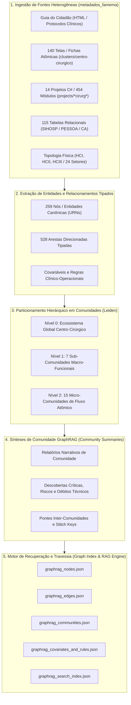

# GraphRAG — Mapeamento do Fluxo do Centro Cirúrgico FAMEMA (`TESTE_112326_graphRAG`)

Este diretório contém a especificação técnica completa, contratos de dados, grafos de conhecimento estruturados e o mapeamento de fluxo ponta a ponta do **Centro Cirúrgico & Demanda Operatória** do Complexo Hospitalar FAMEMA, gerado através da metodologia **GraphRAG (Graph Retrieval-Augmented Generation)** a partir da extração dos metadados unificados do repositório [`metadados_famema`](file:///home/walter/repos/metadados_famema).

---

## 1. Visão Geral da Metodologia GraphRAG Aplicada

A metodologia **GraphRAG** unifica o processamento de texto não estruturado (como o [Guia do Cidadão: Fluxo Centro Cirúrgico](file:///home/walter/repos/metadados_famema/docs_pdf/Guia_do_Cidadao_Fluxo_Centro_Cirurgico.html)) com a engenharia reversa estrita de código-fonte C# (.NET WinForms e Business Objects), schemas relacionais de banco de dados e topologia física hospitalar em um **Grafo de Conhecimento Multicamadado (Hierarchical Knowledge Graph)**.

---

## 2. Índice de Especificações Técnicas Desta Pasta

| Ordem | Arquivo | Escopo e Conteúdo |
| :---: | :--- | :--- |
| **00** | [00_GRAPHRAG_CENTRO_CIRURGICO_OVERVIEW.md](file:///home/walter/repos/code_mapping_ai/test_specs/TESTE_112326_graphRAG/00_GRAPHRAG_CENTRO_CIRURGICO_OVERVIEW.md) | **Visão Arquitetural Mestra e Síntese Executiva**: Integração entre a jornada do cidadão/paciente e a arquitetura técnica do monolito (140 telas, 454 módulos C#, 115 tabelas, 24 setores), pipeline GraphRAG e diagrama Mermaid ponta a ponta. |
| **01** | [01_GRAPHRAG_STRUCTURAL_KNOWLEDGE_GRAPH.md](file:///home/walter/repos/code_mapping_ai/test_specs/TESTE_112326_graphRAG/01_GRAPHRAG_STRUCTURAL_KNOWLEDGE_GRAPH.md) | **Grafo de Conhecimento Estrutural (Nível 1)**: Taxonomia formal de entidades (`CLINICAL_STAGE`, `SCREEN_FORM`, `CSHARP_MODULE`, `DATABASE_TABLE`, `PHYSICAL_SECTOR`, `HOSPITAL_UNIT`, `ROLE_ACTOR`), modelo relacional de persistência e layout físico hospitalar (HCI, HCII, HCIII). |
| **02** | [02_GRAPHRAG_CALL_FLOW_AND_JOURNEY_GRAPH.md](file:///home/walter/repos/code_mapping_ai/test_specs/TESTE_112326_graphRAG/02_GRAPHRAG_CALL_FLOW_AND_JOURNEY_GRAPH.md) | **Grafo de Fluxos de Chamada e Jornada Cirúrgica (Nível 2)**: As 7 etapas perioperatórias (Indicação $\rightarrow$ Agendamento $\rightarrow$ CME/Kits $\rightarrow$ Acolhimento Pré-Op $\rightarrow$ Cirurgia Segura OMS $\rightarrow$ SRPA $\rightarrow$ Alta/APAC), chaves de costura (`flowStitchKeys`) e grafos Mermaid por etapa. |
| **03** | [03_GRAPHRAG_COMMUNITY_DETECTION_AND_SUMMARIES.md](file:///home/walter/repos/code_mapping_ai/test_specs/TESTE_112326_graphRAG/03_GRAPHRAG_COMMUNITY_DETECTION_AND_SUMMARIES.md) | **Decomposição em Comunidades e Sínteses GraphRAG**: Detecção hierárquica (Leiden Nível 0, Nível 1 e Nível 2), resumos executivos, achados clínicos/técnicos, pontes de fluxo e matriz de débitos técnicos e riscos assistenciais. |
| **04** | [04_GRAPHRAG_BUSINESS_RULES_AND_COVARIATES.md](file:///home/walter/repos/code_mapping_ai/test_specs/TESTE_112326_graphRAG/04_GRAPHRAG_BUSINESS_RULES_AND_COVARIATES.md) | **Catálogo de Covariáveis, Portões de Decisão e Regras de Negócio**: Protocolo de Cirurgia Segura da OMS (Sign-In, Time-Out, Sign-Out), índice de Aldrete e Kroulik $\ge 9$, bloqueios de óbito/inativação, regras parametrizadas via banco (`CC_EQUIPE`, `SALA_CIRURGICA`) e matriz RBAC. |
| **05** | [05_GRAPHRAG_DATA_CONTRACTS_AND_SCHEMAS.json](file:///home/walter/repos/code_mapping_ai/test_specs/TESTE_112326_graphRAG/05_GRAPHRAG_DATA_CONTRACTS_AND_SCHEMAS.json) | **Contrato Formal de Dados e JSON Schema (`Draft 2020-12`)**: Especificação formal em schema JSON do modelo de dados do GraphRAG (Nós, Arestas, Comunidades, Covariáveis e Caminhos de Travessia). |

---

## 3. Conjuntos de Dados e Índices do GraphRAG (Exportação Executável)

Estes arquivos contêm os dados indexados diretamente extraídos do código e metadados, prontos para consumo por pipelines de RAG e motores de busca baseados em grafos:

- **[`graphrag_nodes.json`](file:///home/walter/repos/code_mapping_ai/test_specs/TESTE_112326_graphRAG/graphrag_nodes.json)**: 259 entidades canônicas estruturadas com URNs únicas, atributos tipados e pertinência hierárquica a comunidades.
- **[`graphrag_edges.json`](file:///home/walter/repos/code_mapping_ai/test_specs/TESTE_112326_graphRAG/graphrag_edges.json)**: 528 arestas direcionadas tipadas com pesos, descrições e propriedades de conexão.
- **[`graphrag_communities.json`](file:///home/walter/repos/code_mapping_ai/test_specs/TESTE_112326_graphRAG/graphrag_communities.json)**: Catálogo das 8 comunidades (1 global Nível 0 + 7 macro Nível 1) com métricas, sínteses e achados.
- **[`graphrag_covariates_and_rules.json`](file:///home/walter/repos/code_mapping_ai/test_specs/TESTE_112326_graphRAG/graphrag_covariates_and_rules.json)**: Catálogo de 10 covariáveis e regras clínicas/sistêmicas parametrizadas.
- **[`graphrag_search_index.json`](file:///home/walter/repos/code_mapping_ai/test_specs/TESTE_112326_graphRAG/graphrag_search_index.json)**: Índice invertido de termos e conceitos clínicos para recuperação sub-segundo em GraphRAG.
- **[`generate_graphrag_data.py`](file:///home/walter/repos/code_mapping_ai/test_specs/TESTE_112326_graphRAG/generate_graphrag_data.py)**: Script em Python responsável pela ingestão, extração e geração dos arquivos JSON.

---

## 4. Métricas Globais da Base Mapeada

- **Telas Operacionais Analisadas:** 140 (Distribuídas em 70 *epic*, 48 *major*, 8 *standard*, 14 *micro*).
- **Projetos C# Cirúrgicos Mapeados:** 14 projetos (.NET Framework v4.0).
- **Módulos de Código C# Indexados:** 454 arquivos `.cs` (Presentation WinForms e Business Logic BOs).
- **Linhas de Código C# Mapeadas:** 64.339 LOC.
- **Tabelas de Banco de Dados Mapeadas:** 115 tabelas relacionais (`SIHOSP.*`, `PESSOA.*`, `CA.*`, `INFRA_ESTRUTURA.*`).
- **Setores Físicos Mapeados:** 24 setores hospitalares distribuídos entre HCI, HCII e HCIII.
- **Papéis Hospitalares Mapeados:** 21 perfis de acesso assistencial e administrativo.
