# Plano Mestre de Execução — `[Incremental Build Model]` para Monolito de 700 Módulos

> **Padrão Arquitetural:** `[Incremental Build Model]` com Gates de Parada Obrigatória (`{ condição }`)
> **Alvo de Execução:** Diretório raiz contendo os ~700 módulos/projetos C# (.NET) de um sistema monolítico corporativo e seu ecossistema de Banco de Dados Relacional.
> **Arquivos de Especificação das Camadas:**
> 1. [01_NIVEL_1_STRUCTURAL_COMPREHENSION_SPEC.md](file:///C:/Users/walte/OneDrive/Documentos/specs_test_ia1/01_NIVEL_1_STRUCTURAL_COMPREHENSION_SPEC.md)
> 2. [02_NIVEL_2_CALL_FLOW_COMPREHENSION_SPEC.md](file:///C:/Users/walte/OneDrive/Documentos/specs_test_ia1/02_NIVEL_2_CALL_FLOW_COMPREHENSION_SPEC.md)
> 3. [03_NIVEL_3_TECH_STACK_CLIENT_HEURISTICS_SPEC.md](file:///C:/Users/walte/OneDrive/Documentos/specs_test_ia1/03_NIVEL_3_TECH_STACK_CLIENT_HEURISTICS_SPEC.md)
> 4. [04_NIVEL_4_GRAFICOS_E_ANALYTICS_SPEC.md](file:///C:/Users/walte/OneDrive/Documentos/specs_test_ia1/04_NIVEL_4_GRAFICOS_E_ANALYTICS_SPEC.md)

---

## 1. Hierarquia de Dependência Estrita entre as 4 Camadas

A arquitetura respeita uma **cadeia de dependência unidirecional estrita**, onde cada nível consome exclusivamente os metadados consolidados e validados pelos níveis superiores:

```mermaid
flowchart TD
    L1["<b>NÍVEL 1: Structural Comprehension</b><br/>• Identidade Única Global (UID) deduplicada<br/>• Banco Relacional, Disco/Mídias Físicas e Contrato Filtrado de Memória RAM<br/>• Grafo de Bibliotecas C# e Assinaturas (Classes e Métodos; descarte de variáveis locais/classe)<br/>• Extração de Procedures com geração de arquivo .txt contendo SELECT"]
    
    L2["<b>NÍVEL 2: Call Flow Comprehension</b><br/><i>Depende estritamente do Nível 1 + Fontes das Procedures</i><br/>• Identificação de Início (UI/Entry) e Fim (Storage Sinks)<br/>• Estrutura Agregadora com Identidade igual à da Fonte Chamadora<br/>• Pequenos Agregados Incrementais por Projeto (1 a 700)<br/>• Contagem de Transformações (T), Pré-Condições (P), Impedimentos e Classificação CRUD"]
    
    L3["<b>NÍVEL 3: Tech Stack / Client Heuristics (Partes 1 e 2)</b><br/><i>Compõe os Níveis 1 e 2 em Grupos e Domínios</i><br/>• Aplicações, Artefatos, Tech Stack e Heurísticas Trans-Aplicação<br/>• Glossário Léxico (captura de nomes de variáveis p/ tradução em leitura natural)<br/>• Isolamento em 'Telas', Componentes e Fluxo Humano + Tradução Imperativa<br/>• Consultas Assistidas (Grupos de Pessoas/Estruturas Físicas) + Linguagem Ubíqua Não-Regra"]
    
    L4["<b>NÍVEL 4: Gráficos e Analytics</b><br/><i>Depende dos Níveis 1, 2 e 3 + Diagnóstico de Regras Ativas/Inativas</i><br/>• Condição Global: Discriminar Regras Ativas vs. Baixa Utilização vs. Inativas<br/>• Gráfico 1: Domínios = (Identidades N1 + Pré-Condições N2) x Glossário N3 x Nº Aplicações<br/>• Gráfico 2: Infraestrutura Física (Salas) x Setores x Pessoas x Regras/Domínios<br/>• Gráfico 3: Setores x Partes do Sistema Acessadas x Estrutura Física Organizacional"]

    L1 ==>|"Tabela Global de UIDs + Fontes SQL das Procedures"| L2
    L2 ==>|"Agregados de Call Flow + CRUD + Matriz de Impedimentos"| L3
    L3 ==>|"Domínios + Glossário + Telas + Dados Sócio-Físicos"| L4
```



### Por que esta ordem de execução é obrigatória?
1. **Nível 1 $\to$ Nível 2:** É impossível rastrear um Call Flow ponta-a-ponta através de 700 módulos sem antes possuir (a) a **Identidade Única (`UID`)** das classes, métodos, tabelas, arquivos e contratos de memória, (b) a **árvore de dependências das bibliotecas C#** que define qual módulo chama qual, e (c) o **código-fonte das Stored Procedures** chamadas pelo C#.
2. **Nível 2 $\to$ Nível 3:** É impossível agrupar o sistema em **Domínios de Negócio**, mapear quais **Call Flows** cada componente de **Tela** aciona ou determinar a ordem da jornada humana sem antes ter os fluxos montados, suas operações classificadas em `INSERT/UPDATE/DELETE/READ` e as pré-condições impeditivas contabilizadas.
3. **Nível 3 $\to$ Nível 4:** Os 3 gráficos exigem a soma de Identidades (Nível 1) + Pré-Condições (Nível 2) rotuladas pelo **Glossário e Fronteiras de Aplicação (Nível 3)** e cruzadas com os **Grupos de Pessoas, Setores e Estruturas Físicas (Nível 3 Parte 2)**.

---

## 2. Mecânica do `[Incremental Build Model]` para 700 Módulos

Processar 700 módulos monolíticos de uma só vez causaria exaustão de memória e perda de determinismo. O padrão **`[Incremental Build Model]`** resolve isso através de 3 pilares:

1. **Particionamento e Ordem Topológica (DAG de Módulos):**
   Os 700 projetos (`.csproj`) são ordenados em lotes topológicos (`Wave 0: Core/Infra` $\to$ `Wave 1: Data/Repositories` $\to$ `Wave 2: Domain/Services` $\to$ `Wave 3: UI/Apps/APIs`), processando **1 módulo por vez** e gravando seu estado incremental em disco (`.ia_metadata/`).
2. **Idempotência por Hash de Assinatura e AST (`Merkle-Build Cache`):**
   Cada arquivo `.cs` e cada assinatura de método possuem um hash SHA-256. Se a execução parar em um Gate `{ ... }` ou se apenas 5 dos 700 módulos sofrerem modificação no código, o motor reutiliza os 695 módulos inalterados e reprocessa apenas o delta.
3. **Protocolo de Parada Estrita nos Gates `{ condição }` (*Human-in-the-Loop Checkpoint*):**
   Sempre que o plano encontra uma instrução entre chaves `{ ... }`:
   * O motor **salva o checkpoint atual** em `.ia_metadata/build_state.json`;
   * **Gera os artefatos/consultas SQL** necessários para ajudar o usuário;
   * **INTERROMPE A EXECUÇÃO (`STATUS = WAITING_USER_INPUT`)**;
   * Só retoma a etapa seguinte após a validação dos dados fornecidos pelo usuário.

---

## 3. Plano de Execução Sequencial Passo-a-Passo (Ordem de Execução)

Abaixo está o roteiro exato de execução sobre a pasta raiz dos 700 módulos:

---

### FASE 1 — Execução do Nível 1: Structural Comprehension

#### Passo 1.1 — Gate de Identificação da Aplicação e Raiz
> **`{ GATE 1.1: O mapeamento de infraestrutura deve perguntar ao usuário o nome da aplicação (ou conjunto de aplicações) de que o código mapeado na pasta raiz faz parte }`**
* **Ação de Parada:** O agente solicita o nome da aplicação e confirma o caminho raiz dos 700 módulos.
* **Condição de Continuidade:** Usuário informa o nome da aplicação (`APP_NAME`).

#### Passo 1.2 — Gate de Mapeamento Relacional do Banco de Dados
> **`{ GATE 1.2: forneça o mapeamento relacional do banco de dados (tabelas, colunas, chaves primárias, chaves estrangeiras e relacionamentos) }`**
* **Ação de Parada:** O agente solicita o schema relacional do banco (e disponibiliza a query de extração de catálogo `INFORMATION_SCHEMA` / `sys.tables` / `sys.foreign_keys` caso o usuário deseje rodá-la).
* **Processamento após input:** Criação de todas as identidades únicas `id://db-rel/<catalog>/<schema>/<table>` e registro do grafo de persistência compartilhada.

#### Passo 1.3 — Descoberta dos 700 Módulos, Bibliotecas C# e Ordem Topológica
* **Execução Automática Incremental:**
  1. Varre os ~700 arquivos `.csproj` / `.sln` na pasta raiz.
  2. Registra as identidades de todas as bibliotecas externas e internas (`id://lib/...`).
  3. Constrói o Grafo Acíclico Direcionado (DAG) de dependências entre os 700 módulos para definir a ordem de leitura.

#### Passo 1.4 — Mapeamento Incremental de Assinaturas C#, Armazenamento Físico e Contrato de Memória RAM (Módulo 1 até 700)
* **Execução Automática Incremental (Lote a Lote nos 700 Módulos):**
  Para cada módulo $M_i \in \{1..700\}$:
  1. Mapeia assinaturas de **Classes e Métodos** (`id://code/...`), **descartando variáveis de classe e variáveis internas de métodos**.
  2. Aplica o **Contrato de Filtragem de Memória RAM**, gerando identidades `id://mem-ram/...` exclusivamente para contratos de fronteira (parâmetros/retornos), buffers de I/O e caches compartilhados.
  3. Identifica todas as referências a formas de armazenamento persistente em disco, rede ou mídias físicas (`id://storage/PERSIST_DISK_LOCAL`, `PERSIST_DISK_NETWORK`, `PERSIST_MEDIA_REMOVABLE`, etc.).
  4. Identifica todas as chamadas a entidades externas de banco (**Stored Procedures, Functions, Triggers**) e registra suas identidades `id://db-proc/...`.
  5. Deduplica todas as identidades na Tabela de Símbolos Global (`.ia_metadata/level1_structural/global_identities.jsonl`).
  6. Gera o arquivo `01_procedures_pendentes_extracao.txt` contendo a lista única de procedures encontradas e o comando `SELECT` montado para extração do código-fonte.

#### Passo 1.5 — Gate de Alimentação do Código-Fonte das Stored Procedures
> **`{ GATE 1.3: No fim do mapeamento inicial, a execução DEVE PARAR, entregar o arquivo 01_procedures_pendentes_extracao.txt com o SELECT montado e solicitar ao usuário a alimentação do código-fonte dessas procedures antes de iniciar o Nível 2 }`**
* **Ação de Parada:** Execução bloqueada no fim do Nível 1.
* **Condição de Continuidade:** Usuário executa o `SELECT` fornecido e entrega o arquivo com o código-fonte das procedures mapeadas.

---

### FASE 2 — Execução do Nível 2: Call Flow Comprehension

#### Passo 2.1 — Parsing Estrutural e de Fluxo das Stored Procedures Fornecidas
* **Execução Automática:**
  Analisa o código SQL das procedures recebidas no Gate 1.3, mapeando tabelas afetadas (`SELECT`, `INSERT`, `UPDATE`, `DELETE`), pré-condições SQL (`IF`, `WHERE`, `RAISERROR`) e chamadas encadeadas entre procedures.

#### Passo 2.2 — Construção Incremental dos Pequenos Agregados de Call Flow por Projeto (Módulo 1 até 700)
* **Execução Automática Incremental (1 Projeto por Vez na Ordem Topológica):**
  Para cada módulo $M_i \in \{1..700\}$:
  1. Identifica pontos de início (`---UI do sistema`, endpoints, jobs, leituras iniciais de armazenamento) e pontos de fim (gravações em banco/disco, retornos à UI).
  2. Cria o **Pequeno Agregado do Projeto (`MCA_Mod_i.json`)** usando o **Envelope Agregador cuja Identidade Única é a mesma da fonte que iniciou a chamada (`id://call-agg/<uid_da_fonte>`)**.
  3. Contabiliza em cada trecho a quantidade de **Transformações de Dados (`T_count`)**.
  4. Identifica, detalha e contabiliza todas as **Pré-Condições (`P_count`)** necessárias para o dado percorrer o fluxo.
  5. Classifica os dispositivos de armazenamento do Nível 1 tocados pelo fluxo como Ponto Inicial (`READ`/`SELECT`) ou Mutação (`INSERT`, `UPDATE`, `DELETE`).

#### Passo 2.3 — Linkagem Ponta-a-Ponta e Matriz de Pré-Condições Impeditivas
* **Execução Automática:**
  1. Conecta os 700 agregados locais (`MCA_001`..`MCA_700`) em Call Flows ponta-a-ponta.
  2. Identifica as **Pré-Condições Anuladoras/Impeditivas** (que abortam ou bloqueiam etapas subsequentes) e calcula a **Ordem Ideal de Execução Lógica** entre os fluxos.

---

### FASE 3 — Execução do Nível 3: Tech Stack / Client Heuristics (Partes 1 e 2)

#### Passo 3.1 — Mapeamento de Tech Stack, Artefatos, Heurísticas Trans-Aplicação e Domínios (Parte 1)
* **Execução Automática Incremental:**
  1. Agrupa as identidades (Nível 1) e Call Flows (Nível 2) por aplicação, artefatos principais (`.dll`, `.exe`), nomes de arquivos e camada da Tech Stack.
  2. Agrupa abstrações da mesma heurística de negócio (mesmo entre aplicações diferentes) e agrega palavras comuns de negócio à identidade única de origem.
  3. Consolida os conjuntos `Identidades + Call Flows + Tabelas CRUD` em **Domínios de Negócio (`id://domain/...`)**.

#### Passo 3.2 — Construção do Glossário Léxico e Isolamento de "Telas" / Jornada Humana (Parte 1)
* **Execução Automática Incremental:**
  1. Extrai todos os nomes de variáveis, parâmetros, métodos e colunas que se assemelham a palavras naturais, construindo o **Glossário Integrado** e traduzindo as cadeias técnicas de Call Flow para leitura natural.
  2. Isola a interface de usuário em **"Telas"** (`id://ui-screen/...`), mapeando todos os componentes visuais de cada tela, a sequência de passos que um ser humano executa e quais Call Flows cada componente aciona.
  3. Mapeia os símbolos e jargões de código (`for`, `if`, `lock`, `transaction`, mutações) em uma descrição estruturada da **Programação Imperativa**.

#### Passo 3.3 — Gate de Consultas para Grupos de Pessoas e Estruturas Físicas (Parte 2)
> **`{ GATE 3.1: Identificar consultas na aplicação capazes de mapear grupos de pessoas que utilizam cada regra de negócio e quais estruturas físicas podem ser identificadas através das informações existentes; a execução DEVE PARAR, fornecer as consultas SQL prontas ao usuário e solicitar que ele execute e forneça os dados }`**
* **Ação de Parada:** O agente entrega o arquivo `03_consultas_grupos_pessoas_e_estruturas_fisicas.sql` (baseado nas tabelas de usuários, perfis, setores, logs, filiais e terminais descobertas no código) e aguarda o retorno dos dados pelo usuário.
* **Condição de Continuidade:** Usuário fornece o resultado das consultas relacionando grupos de pessoas, regras de negócio acessadas e estruturas físicas existentes no banco.

#### Passo 3.4 — Gate de Linguagem Ubíqua e Fontes Correlacionadas Não-Participantes da Regra de Negócio (Parte 2)
> **`{ GATE 3.2: Solicitar ao usuário fontes de informações correlacionadas que enriqueçam o glossário mas que NÃO façam parte da regra de negócio mapeada no código (manuais, organogramas, jargões operacionais dos usuários) }`**
* **Ação de Parada:** O agente pausa e solicita documentos/vocabulário externo dos usuários.
* **Processamento após input:** Os termos recebidos são integrados ao Glossário com a marcação rígida `"part_of_executable_business_rule": false` e `"classification_tag": "NON_BUSINESS_RULE_UBIQUITOUS_CONTEXT"`, enriquecendo a linguagem ubíqua sem contaminar a contagem de regras ou pré-condições.

---

### FASE 4 — Execução do Nível 4: Gráficos e Analytics

#### Passo 4.1 — Gate Global de Consultas de Atividade vs. Inatividade de Regras de Negócio
> **`{ GATE 4.1: Condição obrigatória para todos os gráficos — A IA identifica e entrega as consultas SQL (04_consultas_atividade_regras_negocio.sql) para verificar a volumetria e última execução das tabelas de mutação/logs de cada regra de negócio; a execução DEVE PARAR e solicitar ao usuário os dados que discriminem quais regras estão ATIVAS, em BAIXA UTILIZAÇÃO ou INATIVAS }`**
* **Ação de Parada:** Execução bloqueada aguardando os dados de atividade operacional das regras.
* **Condição de Continuidade:** Usuário fornece o retorno das consultas geradas pela IA; cada regra e domínio recebe a classificação 🟢 `ACTIVE`, 🟡 `LOW_USAGE` ou 🔴 `INACTIVE_DORMANT`.

#### Passo 4.2 — Gate de Complementação da Infraestrutura Física da Empresa (Salas, Prédios e Alocação Setorial)
> **`{ GATE 4.2: Solicitar ao usuário os dados da infraestrutura física da empresa (salas, andares, prédios, galpões) vinculados aos setores e pessoas que neles atuam, utilizando o template pré-populado 04_template_infraestrutura_fisica_empresa.csv }`**
* **Ação de Parada:** Caso os dados físicos completos (salas/espaços físicos) não estivessem 100% explícitos no Gate 3.1, a IA pausa e solicita o preenchimento/validação da alocação física por sala e setor.
* **Condição de Continuidade:** Usuário fornece/confirma a relação `Sala/Infraestrutura <-> Setor <-> Pessoas`.

#### Passo 4.3 — Compilação e Renderização dos 3 Gráficos Finais
* **Execução Automática Final:**
  1. **Geração do `[Gráfico 1]` (`04_grafico1_dominios_complexidade_aplicacoes.md`):**
     Calcula para cada domínio $\text{Score}(D) = \text{Identidades Estruturais (N1)} + \text{Pré-Condições (N2)}$, aplica os nomes do Glossário (N3), destaca a qual aplicação pertence, quantas aplicações estão envolvidas e discrimina regras ativas vs. inativas/baixa utilização.
  2. **Geração do `[Gráfico 2]` (`04_grafico2_infraestrutura_salas_setores_pessoas_regras.md`):**
     Mapeia cada Sala/Parte da Infraestrutura $\to$ Setores atuantes $\to$ Pessoas/Perfis $\to$ Regras de Negócio e Domínios utilizados (com status de atividade).
  3. **Geração do `[Gráfico 3]` (`04_grafico3_setores_partes_sistema_estrutura_fisica.md`):**
     Mapeia Setores e Grupos de Pessoas $\to$ Partes do Sistema Acessadas (Telas, Módulos, Call Flows, Domínios ativos/inativos) $\to$ Partes Físicas da Estrutura Organizacional de que participam.

---

## 4. Resumo dos Gates de Parada (`{ ... }`) do Incremental Build Model

| Ordem | Gate ID | Camada | Condição de Parada `{ ... }` | Artefato Entregue pela IA ao Usuário | Insumo Esperado do Usuário para Continuar |
| :---: | :---: | :--- | :--- | :--- | :--- |
| **1º** | **Gate 1.1** | Nível 1 | `{ Perguntar o nome da aplicação em que o código mapeado faz parte }` | Prompt de inicialização de contexto | Nome canônico da aplicação e confirmação do diretório raiz dos 700 módulos |
| **2º** | **Gate 1.2** | Nível 1 | `{ forneça o mapeamento relacional do banco de dados }` | Query auxiliar de extração de schema (`INFORMATION_SCHEMA` / `sys`) | DDL / Schema relacional (Tabelas, Colunas, PKs, FKs) |
| **3º** | **Gate 1.3** | Fim do Nível 1 $\to$ Nível 2 | `{ Separar procedures em arquivo .txt com SELECT montado e solicitar o código-fonte das procedures }` | `01_procedures_pendentes_extracao.txt` com `SELECT` pronto | Resultado da consulta contendo o código-fonte SQL das procedures mapeadas |
| **4º** | **Gate 3.1** | Nível 3 (Parte 2) | `{ Identificar e fornecer consultas para mapear grupos de pessoas por regra de negócio e estruturas físicas existentes }` | `03_consultas_grupos_pessoas_e_estruturas_fisicas.sql` | Dados extraídos de usuários/grupos/setores x telas/regras x filiais/locais físicos |
| **5º** | **Gate 3.2** | Nível 3 (Parte 2) | `{ Solicitar fontes correlacionadas que enriqueçam o glossário mas NÃO façam parte da regra de negócio (linguagem ubíqua) }` | Solicitação estruturada de vocabulário externo | Manuais, jargões, organograma ou dicionário de termos dos usuários |
| **6º** | **Gate 4.1** | Nível 4 (Global) | `{ Identificar e fornecer consultas que discriminem quais regras de negócio estão ativas vs. inatividade ou baixa utilização }` | `04_consultas_atividade_regras_negocio.sql` | Volumetria e datas de última execução por tabela/regra de negócio |
| **7º** | **Gate 4.2** | Nível 4 (Gráficos 2 e 3) | `{ Solicitar dados da infraestrutura física da empresa (salas, prédios, setores atuantes) }` | `04_template_infraestrutura_fisica_empresa.csv` | Mapeamento das salas/infraestrutura física x setores x pessoas |

---

## 5. Estrutura de Diretórios de Metadados Gerada Durante a Execução (`.ia_metadata/`)

Ao executar este plano na pasta raiz do monolito de 700 módulos, o motor mantém o estado incremental na seguinte estrutura:

```text
<PASTA_RAIZ_MONOLITO_700_MODULOS>/
└── .ia_metadata/
    ├── build_state.json                                      # Checkpoint atual, Gate ativo e hashes dos 700 módulos
    ├── level1_structural/
    │   ├── module_dag_700.json                               # Grafo topológico de dependências e bibliotecas C#
    │   ├── global_identities.jsonl                           # Registro único deduplicado (db-rel, storage, mem-ram, code, db-proc)
    │   ├── signatures_by_module/                             # 700 arquivos incrementais de assinaturas (Mod_001..Mod_700)
    │   └── 01_procedures_pendentes_extracao.txt              # [GATE 1.3] Arquivo com SELECT para o usuário
    ├── level2_call_flows/
    │   ├── parsed_procedures_ast.json                        # AST e CRUD das procedures fornecidas no Gate 1.3
    │   ├── module_call_aggregates/                           # 700 pequenos agregados (MCA_001..MCA_700)
    │   ├── end_to_end_call_flows.jsonl                       # Fluxos linkados com T_count, P_count e CRUD
    │   └── blocking_preconditions_execution_order.json       # Matriz de impedimentos e ordem ideal de execução
    ├── level3_tech_stack/
    │   ├── domains_and_cross_app_heuristics.json             # Agrupamento em domínios e heurísticas trans-aplicação
    │   ├── glossary_and_ubiquitous_language.json             # Glossário técnico + linguagem ubíqua [NON_BUSINESS_RULE]
    │   ├── ui_screens_human_flows.json                       # Isolamento em "Telas", componentes e jornada humana
    │   ├── imperative_programming_narrative.json             # Tradução descritiva dos símbolos e jargões imperativos
    │   └── 03_consultas_grupos_pessoas_e_estruturas_fisicas.sql # [GATE 3.1] Consultas geradas pela IA
    └── level4_graphs/
        ├── 04_consultas_atividade_regras_negocio.sql         # [GATE 4.1] Consultas de atividade/inatividade
        ├── 04_template_infraestrutura_fisica_empresa.csv     # [GATE 4.2] Template de salas e estrutura física
        ├── 04_grafico1_dominios_complexidade_aplicacoes.md
        ├── 04_grafico2_infraestrutura_salas_setores_pessoas_regras.md
        └── 04_grafico3_setores_partes_sistema_estrutura_fisica.md
```
