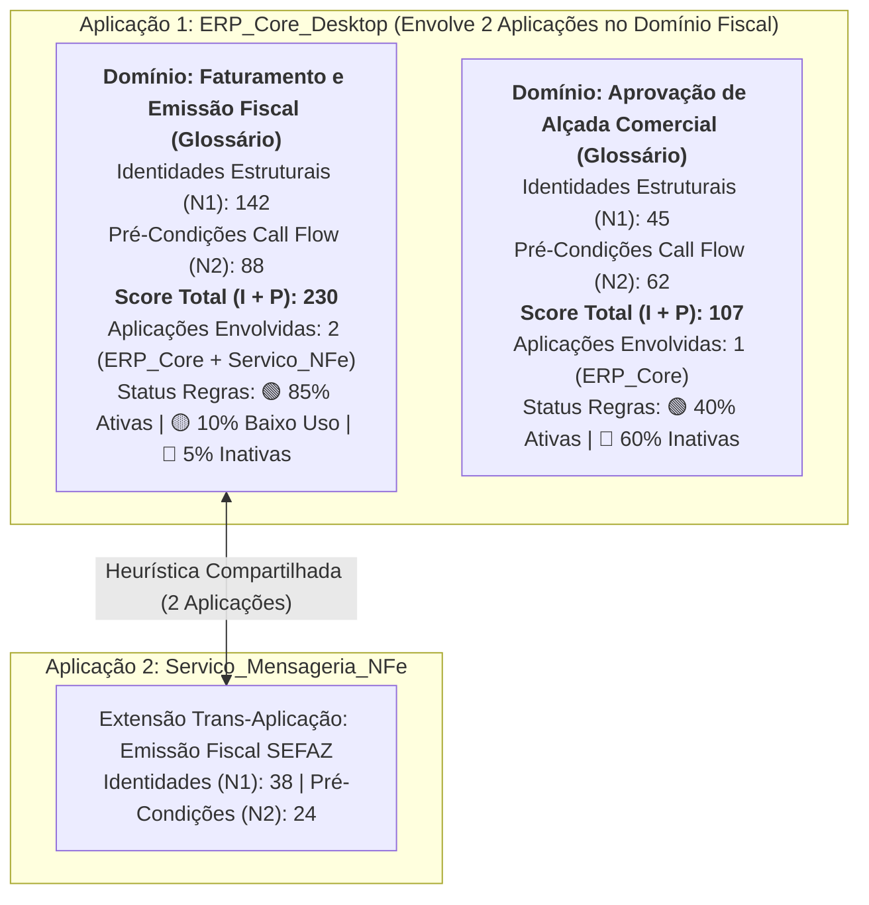
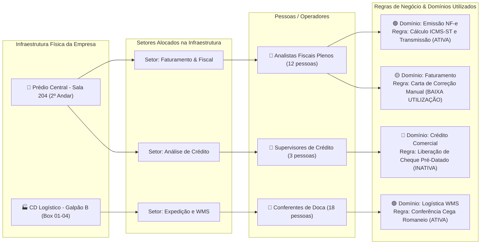
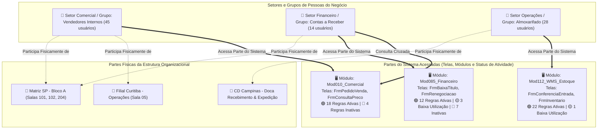

# Especificação Técnica — Nível 4: Gráficos e Analytics de Domínio e Infraestrutura

> **Nível Hierárquico:** 4 (Topo da pirâmide — Depende estritamente da conclusão dos **Níveis 1, 2 e 3**)
> **Padrão de Execução:** `[Incremental Build Model]`
> **Escopo Alvo:** Geração de consultas de telemetria de atividade das regras de negócio e renderização estruturada dos 3 Gráficos Analíticos (Domínios/Complexidade/Aplicações, Infraestrutura Física/Salas/Setores/Pessoas e Matriz Setores/Partes do Sistema/Estrutura Física).

---

## 1. Condição Global Obrigatória para Todos os Gráficos (Detecção de Atividade vs. Inatividade)

> **Regra Transversal do Nível 4:**
> `[Condição para todos os gráficos: o mapeamento de domínio deve discriminar quais regras de negócio foram identificadas com inatividade ou baixa utilização. Deve ser possível à inteligência artificial identificar quais consultas devem ser feitas para solicitar os dados que discriminem quais regras de negócio ainda estão ativas]`

Um monolito de 700 módulos acumula anos de código morto (*dead code*), regras de negócio obsoletas e fluxos sazonais ou raramente acionados. Nenhum dos 3 gráficos pode ser gerado sem classificar o **Estado de Vitalidade Operacional** de cada regra de negócio / Call Flow.

### 1.1. Gate 4.1 — Geração de Consultas para Discriminar Regras Ativas, de Baixa Utilização ou Inativas
```text
{ executar as consultas geradas pela IA sobre as tabelas de mutação (INSERT/UPDATE) e logs de auditoria mapeados nos Níveis 1 e 2 para discriminar quais regras de negócio estão ATIVAS, em BAIXA UTILIZAÇÃO ou INATIVAS, e fornecer o resultado para alimentar os Gráficos 1, 2 e 3 }
```

* **Como a IA constrói essas consultas automaticamente:**
  1. Para cada Call Flow ($F_i$) mapeado no Nível 2, a IA identifica suas tabelas terminais de mutação (`STORAGE_MUTATE_INSERT` e `STORAGE_MUTATE_UPDATE`).
  2. A IA localiza no schema relacional (Nível 1) as colunas temporais dessas tabelas (`DT_CRIACAO`, `DT_ATUALIZACAO`, `CREATED_AT`, `DATA_MOVIMENTO`) e/ou tabelas de trilha de auditoria (`TB_LOG_ACESSO`, `TB_AUDITORIA_TELA`).
  3. A IA gera o arquivo `04_consultas_atividade_regras_negocio.sql` agrupando a volumetria por janela temporal (últimos 30 dias, 90 dias, 12 meses, > 12 meses ou 0 registros):

```sql
-- ============================================================================
-- GATE 4.1: DIAGNÓSTICO DE ATIVIDADE, BAIXA UTILIZAÇÃO E INATIVIDADE DE REGRAS
-- Gerado automaticamente cruzando Call Flows (Nível 2) e Tabelas (Nível 1)
-- ============================================================================

SELECT 
    'id://domain/Faturamento/EmissaoNFe' AS DomainUid,
    'id://call-agg/.../FrmEmissaoNFe/BtnEmitir_Click' AS CallFlowUid,
    'TB_NOTA_FISCAL' AS TargetTable,
    COUNT(*) AS TotalRegistrosHistorico,
    SUM(CASE WHEN DT_EMISSAO >= DATEADD(DAY, -30, GETDATE()) THEN 1 ELSE 0 END) AS ExecucoesUltimos30Dias,
    SUM(CASE WHEN DT_EMISSAO >= DATEADD(DAY, -365, GETDATE()) THEN 1 ELSE 0 END) AS ExecucoesUltimos12Meses,
    MAX(DT_EMISSAO) AS UltimaExecucaoRegistrada
FROM dbo.TB_NOTA_FISCAL
UNION ALL
SELECT 
    'id://domain/Comercial/DescontoAlcadaEspecial' AS DomainUid,
    'id://call-agg/.../FrmPedido/BtnAprovarAlcada_Click' AS CallFlowUid,
    'TB_APROVACAO_ALCADA' AS TargetTable,
    COUNT(*) AS TotalRegistrosHistorico,
    SUM(CASE WHEN DT_APROVACAO >= DATEADD(DAY, -30, GETDATE()) THEN 1 ELSE 0 END) AS ExecucoesUltimos30Dias,
    SUM(CASE WHEN DT_APROVACAO >= DATEADD(DAY, -365, GETDATE()) THEN 1 ELSE 0 END) AS ExecucoesUltimos12Meses,
    MAX(DT_APROVACAO) AS UltimaExecucaoRegistrada
FROM dbo.TB_APROVACAO_ALCADA;
```

### 1.2. Critério de Classificação de Vitalidade da Regra de Negócio
Com os dados retornados pelo usuário no Gate 4.1, cada Regra de Negócio / Call Flow / Domínio recebe um selo visual obrigatório em todos os gráficos:
* 🟢 **`ACTIVE` (Ativa):** Uso recorrente nos últimos 30/90 dias acima do limiar operacional.
* 🟡 **`LOW_USAGE` (Baixa Utilização):** Frequência esporádica ou abaixo do percentil 15% nos últimos 12 meses.
* 🔴 **`INACTIVE_DORMANT` (Inativa / Obsoleta):** Zero execuções nos últimos 12+ meses (ou tabela/log sem registros recentes).

---

## 2. Especificação do `[Gráfico 1]` — Mapa de Domínios, Peso Estrutural-Condicional e Fronteiras de Aplicação

### 2.1. Regra Matemática de Classificação e Dimensionamento
O `[Gráfico 1]` interpreta e classifica cada Domínio ($D$) pela soma exata das **Identidades Estruturais envolvidas (Nível 1)** com a **Quantidade de Pré-Condições acumuladas nos Call Flows (Nível 2)**, rotuladas pelo **Glossário (Nível 3)**:

$$\text{Peso\_Domínio}(D) = |I_{\text{estruturais}}(D)| + \sum_{F \in D} P_{\text{pré-condições}}(F)$$

Onde:
* $|I_{\text{estruturais}}(D)|$ = Quantidade de identidades únicas do Nível 1 participantes do domínio (`Classes` + `Métodos` + `Procedures` + `Tabelas` + `Arquivos Disco` + `Contratos RAM`).
* $\sum_{F \in D} P_{\text{pré-condições}}(F)$ = Soma de todas as pré-condições (`precond_uid`) contabilizadas no Nível 2 nos fluxos que compõem o domínio.

### 2.2. Dimensões Visuais Obrigatórias do `[Gráfico 1]`
1. **Rótulo Semântico:** Extraído do **Glossário da Tech Stack (Nível 3)** (ex: *"Domínio: Faturamento e Emissão Fiscal"* em vez de siglas técnicas).
2. **Peso / Magnitude ($|I| + P$):** Define a área/tamanho do nó ou barra do domínio e sua classe de criticidade (`Alta Complexidade`, `Média Complexidade`, `Baixa Complexidade`).
3. **Topologia de Aplicações (`Application Boundaries`):**
   * Identifica explicitamente **a qual aplicação** o domínio pertence.
   * Contabiliza e exibe **quantas aplicações distintas estão envolvidas** naquele domínio ($N_{\text{apps}}(D)$) — destacando domínios acoplados que atravessam 2, 3 ou mais aplicações/artefatos.
4. **Camada de Vitalidade (Condição Global):** Proporção de regras 🟢 `ACTIVE`, 🟡 `LOW_USAGE` e 🔴 `INACTIVE_DORMANT` dentro do domínio.

### 2.3. Esquema de Dados e Representação Mermaid do `[Gráfico 1]`


---

## 3. Especificação do `[Gráfico 2]` — Topologia da Infraestrutura Física x Setores x Pessoas x Regras/Domínios

### 3.1. Gate 4.2 — Solicitação dos Dados de Infraestrutura Física da Empresa
```text
{ solicitar ao usuário o mapeamento da infraestrutura física da empresa (prédios, andares, salas, galpões, unidades físicas) correlacionado aos setores e pessoas/cargos que atuam em cada espaço físico, complementando os dados extraídos no Gate 3.1 }
```
* **Template fornecido pela IA ao usuário (`04_template_infraestrutura_fisica_empresa.csv`):**
  Caso o banco de dados não contenha a planta física completa (salas/andares), a IA gera uma planilha pré-populada com os **Setores** e **Terminais/Filiais** descobertos no Gate 3.1 para que o usuário apenas preencha a coluna `Sala_Ou_Espaco_Fisico`:
  `Unidade_Predio; Sala_Ou_Parte_Infraestrutura; Setor_Atuante; Grupo_Ou_Pessoa; Login_Ou_Perfil_Vinculado`

### 3.2. Estrutura Hierárquica do `[Gráfico 2]`
O `[Gráfico 2]` modela a planta física-organizacional em 4 camadas conectadas:
1. **Nó Físico (`Sala / Parte da Infraestrutura`):** Ex: *Prédio Sede - Sala 204*, *Galpão Logístico - Doca 02*, *Filial Sul - Sala Financeira*.
2. **Nó Setorial (`Setores Atuantes na Sala`):** Quais departamentos operam fisicamente naquela sala.
3. **Nó Humano (`Pessoa / Perfil Operacional`):** Pessoas ou grupos alocados naquele setor/sala.
4. **Nó de Negócio (`Regra de Negócio e Domínio Utilizado + Status de Atividade`):** Quais regras de negócio e domínios (com seu selo 🟢 Ativa / 🟡 Baixo Uso / 🔴 Inativa) são executados por cada pessoa naquela sala.

### 3.3. Representação Estrutural do `[Gráfico 2]`


---

## 4. Especificação do `[Gráfico 3]` — Matriz Organizacional: Setores x Partes do Sistema Acessadas x Estrutura Física

### 4.1. Objetivo Analítico do `[Gráfico 3]`
Enquanto o Gráfico 2 parte da sala física até a regra, o **`[Gráfico 3]`** é centrado nos **Setores e Partes do Negócio**, respondendo simultaneamente a duas perguntas críticas de governança sobre o monolito de 700 módulos:
1. **Quais partes do sistema** (Módulos C#, Telas mapeadas no Nível 3, Call Flows do Nível 2 e Tabelas do Nível 1) são efetivamente acessadas por cada Grupo de Pessoas / Setor?
2. **De quais partes físicas da estrutura organizacional** (Unidades, Prédios, Salas, Filiais) esses grupos de pessoas participam?

### 4.2. Modelo Tripartido do `[Gráfico 3]`
Cada registro do `[Gráfico 3]` conecta três eixos verificados:
$$\text{Eixo Organizacional (Setor / Grupo de Pessoas)} \;\bowtie\; \text{Eixo Sistêmico (Telas + Módulos + Regras Ativas/Inativas)} \;\bowtie\; \text{Eixo Físico (Salas / Unidades onde atuam)}$$

### 4.3. Representação Visual e Tabular Combinada do `[Gráfico 3]`


---

## 5. Artefatos Persistidos no Nível 4

Ao final do Nível 4, após a resolução dos Gates 4.1 e 4.2, a IA grava na pasta de saída:
1. `04_grafico1_dominios_complexidade_aplicacoes.md` (e `.json` para renderização interativa): Contendo o cálculo $|I| + P$ de todos os domínios, glossário aplicado, contagem de aplicações envolvidas e discriminação de regras ativas/inativas.
2. `04_grafico2_infraestrutura_salas_setores_pessoas_regras.md` (e `.json`): Topologia completa por sala/infraestrutura $\to$ setores $\to$ pessoas $\to$ regras/domínios.
3. `04_grafico3_setores_partes_sistema_estrutura_fisica.md` (e `.json`): Mapeamento cruzado de grupos de pessoas/setores $\to$ telas/módulos do sistema acessados $\to$ unidades/salas físicas da organização.
