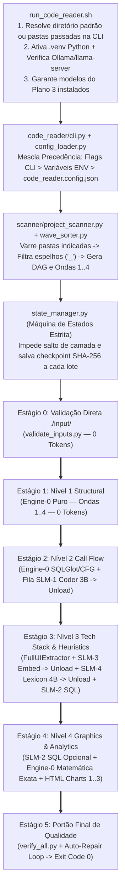

# Spec 00 — Visão Geral e Arquitetura da Aplicação `FAMEMA Code Reader` (`v2.11-reader`)

**Diretório destas Especificações:** `./spec_code_reader/` (`C:\Users\walte\OneDrive\Documentos\metadados_famema2.11\spec_code_reader`)  
**Diretório Base da Aplicação (Portátil):** `./` (`C:\Users\walte\OneDrive\Documentos\metadados_famema2.11`)  
**Comando de Inicialização:** `./run_code_reader.sh [opções] [pasta_1 pasta_2 ...]`  
**Motor de IA:** Modelos Locais Gratuitos do **Plano 3** (`Multi-SLM Sequencial` como padrão de baixo hardware + perfis `Single-SLM` 7B/14B opcionais) combinados com o motor estático **`Engine-0` (`AST + CFG + SQLGlot`)**.

---

## 1. Objetivo da Aplicação

Especificar uma aplicação CLI autossuficiente (`famema-code-reader`), iniciada por um comando Shell (`./run_code_reader.sh`), que:
1. Possua um **diretório padrão pré-configurado** de varredura e de persistência (permitindo execução imediata com zero argumentos: `./run_code_reader.sh`);
2. Aceite dinamicamente **uma ou múltiplas pastas raiz de código-fonte** via argumentos de linha de comando para varrer recursivamente todos os arquivos de projeto (`.sln`, `.csproj`, `.vbproj`, `packages.config`, `web.config`, `WebSites` ASP.NET e scripts SQL);
3. Execute o mapeamento completo do código **exatamente na sequência hierárquica obrigatória** (`Validação Input-First` $\rightarrow$ `Nível 1 Estrutural` $\rightarrow$ `Nível 2 Call Flow` $\rightarrow$ `Nível 3 Tech Stack, UI & Teste Socrático` $\rightarrow$ `Nível 4 Auditoria & Gráficos 1–3` $\rightarrow$ `Portão de Verificação verify_all.py`);
4. Utilize os **modelos locais gratuitos do Plano 3** com economia extrema de tokens (~98% de redução via `Engine-0`, internação de URNs `@Xnnnn`, deduplicação morfológica em lotes e descarregamento sequencial `keep_alive=0`).

---

## 2. Topologia de Diretórios da Aplicação no Workspace

A aplicação reside de forma autocontida na raiz `./`, preservando integralmente `./input/`, `./output/` e `./config/`:

```text
./ (metadados_famema2.11)
├── run_code_reader.sh                           # Ponto de entrada Shell (.sh) principal (Git Bash / WSL / Linux / macOS)
├── config/
│   ├── code_reader.config.json                  # Configuração central: diretório padrão de scan, perfis SLM e limites
│   ├── code_reader.env                          # Overrides opcionais por variáveis de ambiente
│   ├── application_manifest.json                # Manifesto atualizado pelo varredor com os projetos descobertos
│   ├── input_folders_manifest.json              # Contratos Input-First das subpastas de ./input/
│   ├── input_validation_policy.json             # Política de validação direta e sufixos anti-espelho ("_")
│   ├── incremental_build_state.json             # Checkpoints atômicos por estágio/módulo e hashes SHA-256
│   ├── urn_symbol_table.json                    # Dicionário bijetivo @Xnnnn <-> URN Canônico de 7 Níveis (8+ tokens)
│   └── semantic_cache.jsonl                     # Cache persistente SHA-256 de radicais e esqueletos inferidos
├── code_reader/                                 # Código-fonte modular da aplicação Python 3.11+
│   ├── __init__.py
│   ├── cli.py                                   # Parser de argumentos recebidos do run_code_reader.sh
│   ├── config_loader.py                         # Resolução de diretórios (CLI > ENV > code_reader.config.json > manifest)
│   ├── state_manager.py                         # Máquina de estados finita (FSM), checkpoints e resume atômico
│   ├── scanner/
│   │   ├── project_scanner.py                   # Varredura recursiva de .sln/.csproj/.vbproj/WebSites + filtro anti-espelho
│   │   └── wave_sorter.py                       # Grafo de dependências (DAG) e classificação nas Ondas 1 a 4
│   ├── engine0/                                 # Motor Determinístico Zero-Token
│   │   ├── csharp_ast.py                        # Extrator Tree-Sitter / Lexical-AST de classes, assinaturas, CFG e T01..T09
│   │   ├── sql_plsql_parser.py                  # Parser SQLGlot + PL/SQL para DML (INSERT/UPDATE/DELETE/SELECT) e guards
│   │   ├── full_ui_extractor.py                 # Extrator multi-encoding (.Designer.cs/.resx/.aspx) + UserControl recursivo
│   │   ├── urn_registry.py                      # Gerador/validador de URNs 7 níveis + internação @Xnnnn
│   │   └── graph_analytics.py                   # Tarjan/Kahn (Ordem Ideal) + Cálculo exato e HTML dos Gráficos 1, 2 e 3
│   ├── slm/                                     # Orquestrador dos Modelos Gratuitos do Plano 3
│   │   ├── model_manager.py                     # Healthcheck Ollama/llama.cpp, auto-pull e swap sequencial (keep_alive=0)
│   │   ├── grammar_schemas.py                   # JSON Schemas / Gramáticas GBNF estritas por micro-tarefa
│   │   ├── embed_linker.py                      # Cliente bge-m3 / nomic-embed-text + BM25 (0 tokens gerados)
│   │   └── batch_dispatcher.py                  # Despachante de filas com cache SHA-256, retry e fallback determinístico
│   ├── stages/                                  # Executores estritos da sequência de mapeamento
│   │   ├── stage0_preflight_inputs.py           # Validação direta das pastas ./input/
│   │   ├── stage1_structural.py                 # Camada 1 (100% determinística)
│   │   ├── stage2_callflow.py                   # Camada 2 (Engine-0 + Fila SLM-1)
│   │   ├── stage3_heuristics.py                 # Camada 3 (FullUIExtractor + SLM-3 + SLM-4 + SLM-2 + 4 Projeções)
│   │   ├── stage4_graphics.py                   # Camada 4 (Auditoria + Gráficos 1, 2 e 3 JSON/HTML)
│   │   └── stage5_verification.py               # Execução integrada de verify_all.py + auto-reparo
│   └── query_cli.py                             # Modo consulta: Motor de Resolução de Prompt (Linguagem Ubíqua + Tela)
├── input/                                       # Insumos pré-concentrados e validados diretamente
└── output/                                      # Artefatos mapeados (layer1_structural .. layer4_graphics)
```

---

## 3. Arquitetura de Componentes e Fluxo de Controle



---

## 4. Schema do Arquivo de Configuração Padrão (`./config/code_reader.config.json`)

Este arquivo garante que a aplicação já venha configurada com um **diretório padrão** pronto para uso imediato ao executar `./run_code_reader.sh`:

```json
{
  "config_version": "2.11-reader",
  "default_application_name": "SIHOSP",
  "default_scan_directories": [
    "c:/git"
  ],
  "additional_named_targets": {
    "sihosptray": ["c:/Sistemas/sihosptray"],
    "benner": ["c:/Sistemas/benner"],
    "all_famema": ["c:/git", "c:/Sistemas/sihosptray", "c:/Sistemas/benner"]
  },
  "workspace_paths": {
    "input_dir": "./input",
    "output_dir": "./output",
    "config_dir": "./config",
    "urn_symbol_table_file": "./config/urn_symbol_table.json",
    "semantic_cache_file": "./config/semantic_cache.jsonl",
    "state_checkpoint_file": "./config/incremental_build_state.json"
  },
  "scanner_rules": {
    "project_extensions": [".sln", ".csproj", ".vbproj"],
    "detect_legacy_websites": true,
    "ignored_directories": [".git", ".svn", ".vs", "bin", "obj", "packages", "node_modules", "TestResults"],
    "exclude_mirror_suffixes": ["_", "-bkp", "-old", "_backup"],
    "batch_size_modules": 50,
    "encoding_fallback_chain": ["utf-8-sig", "utf-8", "utf-16", "cp1252", "latin-1"]
  },
  "ai_runtime": {
    "provider": "ollama",
    "base_url": "http://127.0.0.1:11434",
    "active_profile": "multi-slm",
    "auto_pull_missing_models": true,
    "sequential_unload_keep_alive": 0,
    "max_context_tokens": 4096,
    "temperature": 0.05,
    "profiles": {
      "multi-slm": {
        "slm_1_code": "qwen2.5-coder:3b",
        "slm_2_sql": "phi4-mini:latest",
        "slm_3_embed": "bge-m3:latest",
        "slm_4_lexicon": "gemma3:4b"
      },
      "single-slm-8gb": {
        "slm_1_code": "qwen2.5-coder:7b",
        "slm_2_sql": "qwen2.5-coder:7b",
        "slm_3_embed": "bge-m3:latest",
        "slm_4_lexicon": "qwen2.5-coder:7b"
      },
      "single-slm-16gb": {
        "slm_1_code": "qwen2.5-coder:14b",
        "slm_2_sql": "qwen2.5-coder:14b",
        "slm_3_embed": "bge-m3:latest",
        "slm_4_lexicon": "qwen2.5-coder:14b"
      }
    }
  }
}
```

---

## 5. Índice das Especificações em `./spec_code_reader/`

1. [00_SPEC_APPLICATION_OVERVIEW_AND_ARCHITECTURE.md](file:///C:/Users/walte/OneDrive/Documentos/metadados_famema2.11/spec_code_reader/00_SPEC_APPLICATION_OVERVIEW_AND_ARCHITECTURE.md) — Arquitetura geral, árvore de pacotes Python e configuração padrão `code_reader.config.json`.
2. [01_SPEC_SH_CLI_LAUNCHER_AND_CONFIG.md](file:///C:/Users/walte/OneDrive/Documentos/metadados_famema2.11/spec_code_reader/01_SPEC_SH_CLI_LAUNCHER_AND_CONFIG.md) — Especificação completa do script `./run_code_reader.sh`, argumentos CLI, resolução de diretórios padrão/customizados e preflight.
3. [02_SPEC_PROJECT_SCANNER_AND_WAVE_DISCOVERY.md](file:///C:/Users/walte/OneDrive/Documentos/metadados_famema2.11/spec_code_reader/02_SPEC_PROJECT_SCANNER_AND_WAVE_DISCOVERY.md) — Especificação da varredura recursiva de pastas indicadas, filtro anti-espelho, DAG `.csproj`/`.sln` e ordenação nas 4 Ondas.
4. [03_SPEC_MULTI_SLM_RUNTIME_AND_TOKEN_ENGINE.md](file:///C:/Users/walte/OneDrive/Documentos/metadados_famema2.11/spec_code_reader/03_SPEC_MULTI_SLM_RUNTIME_AND_TOKEN_ENGINE.md) — Orquestração dos modelos gratuitos do Plano 3, swap sequencial `keep_alive=0`, internação de URNs e gramáticas JSON.
5. [04_SPEC_SEQUENTIAL_PIPELINE_L1_TO_L4.md](file:///C:/Users/walte/OneDrive/Documentos/metadados_famema2.11/spec_code_reader/04_SPEC_SEQUENTIAL_PIPELINE_L1_TO_L4.md) — Execução passo a passo na sequência obrigatória (Estágios 0 a 5 / Níveis 1 a 4), retomada incremental e auto-verificação.
