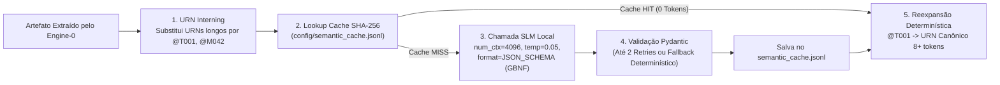

# Spec 03 — Orquestrador dos Modelos Gratuitos do Plano 3 (`Multi-SLM Runtime`) e Motor de Economia de Tokens

**Módulos Alvo:** `code_reader/slm/model_manager.py`, `grammar_schemas.py`, `embed_linker.py`, `batch_dispatcher.py` e `code_reader/engine0/urn_registry.py`  
**Objetivo:** Integrar nativamente na aplicação os **modelos locais gratuitos do Plano 3**, garantindo pico mínimo de memória (`<= 2,6 GB VRAM` no perfil `multi-slm`), saída 100% estruturada via JSON Schema/GBNF e zero corrupção de URNs.

---

## 1. Perfis de Modelos Gratuitos do Plano 3 Suportados Nativamente

A aplicação implementa em `model_manager.py` o suporte nativo aos modelos abertos gratuitos (via **Ollama** em `http://127.0.0.1:11434` ou servidor OpenAI-compatível **`llama-server` / LM Studio**):

### 1.1. Perfil Padrão `multi-slm` (Modo B do Plano 3 — Máquinas Modestas: GPU 4–6 GB VRAM ou CPU 8–16 GB RAM)
Carrega **apenas 1 especialista por vez na memória** e o descarrega imediatamente ao esvaziar a fila da etapa:

| Slot na Aplicação | Modelo Primário (Ollama Tag) | Alternativas Gratuitas Compatíveis (Drop-in) | Peso (`Q4_K_M`) | Onde Atua na Sequência |
| :--- | :--- | :--- | :---: | :--- |
| **`Engine-0`** | *(Nativo Python: `tree-sitter` + `sqlglot` + `networkx`)* | Roslyn CLI / Regex AST Fallback | `0 GB VRAM` | 100% do Nível 1, 92% do Nível 2, UI/Imperativo L3 e 100% Matemática/HTML L4. |
| **`slm_1_code`** | `qwen2.5-coder:3b` | `qwen2.5-coder:1.5b`, `qwen2.5-coder:7b` | `~2,0 GB` *(1,1 GB se 1.5B)* | **Estágio 2:** Fila residual `dynamic_sql_queue.jsonl` (`StringBuilder` / `EXECUTE IMMEDIATE`). |
| **`slm_3_embed`** | `bge-m3:latest` | `nomic-embed-text:v1.5`, `qwen3-embedding:0.6b` | `~0,57 GB` *(0,28 GB se nomic)* | **Estágio 3 (Passo A):** Alinhamento vetorial `VAL-L3.2` (GLPI/POPs), clusters cross-app e busca semântica. |
| **`slm_4_lexicon`** | `gemma3:4b` | `llama3.2:3b`, `phi4-mini:latest`, `qwen2.5:3b` | `~2,6 GB` *(2,0 GB se 3B)* | **Estágio 3 (Passo B):** Lotes de 30 radicais únicos (`lexical_glossary.json`) e jornadas humanas de telas (`< 450 tok`). |
| **`slm_2_sql`** | `phi4-mini:latest` *(3.8B)* | `hf.co/XGenerationLab/XiYanSQL-QwenCoder-3B-2502-GGUF`, `sqlcoder:7b` | `~2,4 GB` | **Estágios 3/4 (Sob demanda):** Adaptação de colunas SQL não-padrão em `VAL-L3.1` e `VAL-L4.1`. |

### 1.2. Perfis `single-slm-8gb` e `single-slm-16gb` (Modo A do Plano 3 — Um Único LLM + Embedder)
Para máquinas com placa de vídeo dedicada de 8 GB a 16 GB VRAM (evitando até mesmo o tempo de ~2s de troca de modelo entre estágios):
- **`single-slm-8gb`:** Usa `qwen2.5-coder:7b` (ou `qwen3:8b` / `llama3.1:8b` / `deepseek-r1:7b`) para `slm_1`, `slm_2` e `slm_4` + `bge-m3` para `slm_3`.
- **`single-slm-16gb`:** Usa `qwen2.5-coder:14b` (ou `phi4:14b` / `qwen3:14b` / `gemma3:12b` / `mistral-nemo:12b`) para `slm_1`, `slm_2` e `slm_4` + `bge-m3` para `slm_3`.

---

## 2. Ciclo de Vida e Protocolo de Descarregamento Sequencial (`Sequential Swap Protocol`)

O `model_manager.py` governa o consumo de RAM/VRAM por meio de 4 chamadas determinísticas à API local:

1. **Verificação e Auto-Pull no Preflight (`GET /api/tags` & `POST /api/pull`):**
   - Antes de iniciar o mapeamento, consulta os modelos instalados localmente.
   - Se `auto_pull_missing_models == true`, baixa apenas os modelos do perfil selecionado exibindo barra de progresso no terminal.
2. **Aquecimento por Fila (`keep_alive: "10m"` durante o lote):**
   - Enquanto processa os N itens de uma mesma fila (ex.: 80 lotes de 30 radicais no `slm_4_lexicon`), mantém o modelo residente em memória com o `system_prompt` fixo para reaproveitar 100% do **Prefix KV Cache** (latência por lote cai pela metade).
3. **Descarregamento Forçado Imediato ao Fim da Fila (`keep_alive: 0`):**
   - Assim que o último item da fila termina, `model_manager.unload_model(model_tag)` envia:
     ```json
     POST http://127.0.0.1:11434/api/generate
     {"model": "<model_tag>", "prompt": "", "keep_alive": 0}
     ```
   - Libera 100% da VRAM/RAM antes de carregar o especialista do estágio seguinte.
4. **Modo `deterministic-only` (Fallback Zero-GPU / Offline Estrito):**
   - Se executado com `--profile deterministic-only`, a aplicação pula as chamadas HTTP de IA e usa os **Templates Determinísticos Morfológicos** do `Engine-0` (expansão por dicionário de abreviações hospitalares PT-BR embutido + templates canônicos de tela), entregando **100% dos arquivos válidos em `verify_all.py` com 0 modelos externos**!

---

## 3. Motor de Compressão Simbólica e Economia de Tokens (`batch_dispatcher.py`)

Toda interação com `slm_1`, `slm_2` ou `slm_4` passa obrigatoriamente pelo pipeline de 5 etapas do `batch_dispatcher.py`:



### 3.1. Regras Obrigatórias dos Contratos JSON Schema (`grammar_schemas.py`)
1. **`DynamicSqlSchema` (`slm_1_code`):**
   - Entrada máxima: `350 tokens` (apenas linhas com montagem SQL).
   - Schema: `{"type":"object","required":["dml","tables"],"properties":{"dml":{"enum":["INSERT","UPDATE","DELETE","MERGE","SELECT"]},"tables":{"type":"array","items":{"type":"string"}},"mutated_cols":{"type":"array","items":{"type":"string"}}}}`.
2. **`StemBatchGlossarySchema` (`slm_4_lexicon`):**
   - Entrada máxima: `500 tokens` (array de até `30` radicais morfológicos inéditos).
   - Schema: `{"type":"object","required":["items"],"properties":{"items":{"type":"array","items":{"type":"object","required":["stem","term","reading"],"properties":{"stem":{"type":"string"},"term":{"type":"string"},"reading":{"type":"string"}}}}}}`.
3. **`ScreenJourneySchema` (`slm_4_lexicon`):**
   - Entrada máxima: `450 tokens` (esqueleto JSON da tela extraído pelo `FullUIExtractor` com aliases `@Fnnnn` e `@Tnnnn`).
   - Schema: `{"type":"object","required":["functional_summary","human_steps"],"properties":{"functional_summary":{"type":"string"},"human_steps":{"type":"array","items":{"type":"string"}}}}`.
4. **`DomainSummarySchema` (`slm_4_lexicon`):**
   - Entrada máxima: `400 tokens` (tabelas DML primárias + radicais dominantes do cluster).
   - Schema: `{"type":"object","required":["domain_title","business_heuristic_summary"],"properties":{"domain_title":{"type":"string"},"business_heuristic_summary":{"type":"string"}}}`.

---

## 4. Garantia de Resiliência (`Zero Pipeline Crash`)

Em nenhum cenário uma resposta imperfeita de um modelo pequeno (1.5B–4B) pode derrubar a varredura de 700 módulos:
1. **Timeout por Requisição:** `45s` em GPU / `120s` em CPU.
2. **Auto-Retry com Feedback Curto:** Se a validação Pydantic/semântica detectar alias inexistente ou campo vazio, reexecuta até `2` vezes com `temperature: 0.0`.
3. **Fallback Determinístico Garantido:** Persistindo falha após 2 tentativas, o `Engine-0` sintetiza o texto a partir do dicionário morfológico estático PT-BR (ex.: `btnSalvar` $\rightarrow$ `"Acionar comando Salvar para executar o fluxo correspondente"`), registra um `warning` no log e mantém **100% de integridade estrutural**.
