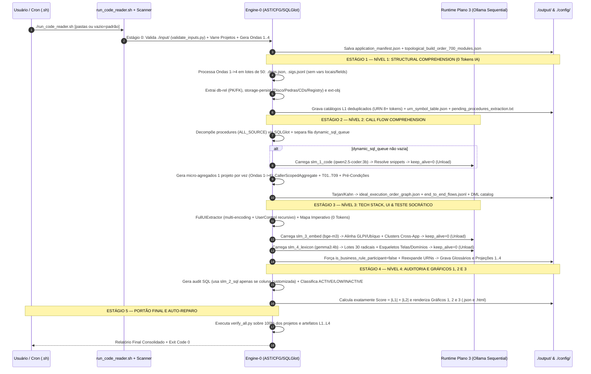

# Spec 04 — Sequência Estrita de Execução do Mapeamento (`Estágios 0 a 5` / `Níveis 1 a 4`) e Auto-Verificação

**Módulos Alvo:** `code_reader/state_manager.py` e `code_reader/stages/stage0_preflight_inputs.py` .. `stage5_verification.py`  
**Regra Inviolável de Sequenciamento:** A máquina de estados finita (`state_manager.py`) executa obrigatoriamente a cadeia linear abaixo. Nenhum estágio $K$ pode iniciar sem que o estágio $K-1$ esteja marcado como `COMPLETED_VALIDATED` em `./config/incremental_build_state.json`.

---

## 1. Visão Completa da Sequência Executada após `./run_code_reader.sh`

---

## 2. Detalhamento Normativo de Cada Estágio Sequencial

### Estágio 0 — Preflight, Validação Direta de `./input/` e Varredura (`stage0_preflight_inputs.py`)
1. Invoca a lógica de `./scripts/validate_inputs.py` sobre todas as 8 pastas contratuais de `./input/` (`VAL-L1.0`, `VAL-L1.1`, `VAL-L1.S`, `VAL-L1.2`, `VAL-L3.1`, `VAL-L3.2`, `VAL-L4.1`, `VAL-BUSCAS`) e grava `./config/input_validation_report.json`.
2. Executa `ProjectScanner` nas pastas alvo (ou `default_scan_directories`), filtrando pastas espelho (`_`) e ordenando os projetos nas **Ondas 1, 2, 3 e 4**.
3. Carrega `./config/incremental_build_state.json` (se `--resume` ativo) identificando quais arquivos mudaram via `SHA-256`.

---

### Estágio 1 — Nível 1: `Structural Comprehension` (`stage1_structural.py` — `0 Tokens`)
Percorre estritamente **Onda 1 $\rightarrow$ Onda 2 $\rightarrow$ Onda 3 $\rightarrow$ Onda 4** em lotes de 50 projetos:
1. Gera `./output/layer1_structural/application_context.json` e `helper_extract_relational_schema.sql`.
2. Para cada projeto, grava `module_dependencies/<proj>.deps.json` e `module_signatures/<proj>.sigs.jsonl` (`code-class`, `code-method-sig`, `dto-contract`, `static-cache`, `user-session`), **bloqueando em código qualquer variável local ou field de instância**.
3. Colhe lateralmente os radicais morfológicos das variáveis descartadas em `lexical_stems_staging.json`.
4. Consolida e deduplica 100% por URN de 7 níveis (`8+ segmentos`):
   - `identities_db_relational.jsonl` (`persisted_and_reusable: true` + FKs + `multi_source_utilization`)
   - `identities_storage_persistent.jsonl` (`local-disk`, `network-share`, `optical-cd-dvd`, `removable-hardware`, `archival-immutable`, `win-registry`)
   - `identities_memory_ram.jsonl`
   - `identities_external_objects.jsonl`
5. Popula `./config/urn_symbol_table.json` (`@Tnnnn`, `@Mnnnn`, `@Snnnn`, `@Pnnnn`) e grava `pending_procedures_extraction.txt` com o delta de procedures em relação a `./input/layer2_procedures_source/`.

---

### Estágio 2 — Nível 2: `Call Flow Comprehension` (`stage2_callflow.py`)
1. **Decomposição de Procedures:** Faz parse de `./input/layer2_procedures_source/` via `sqlglot`/PLSQL e grava `procedure_internal_flows.jsonl`.
2. **Resolução em Lote de SQL Dinâmico (`slm_1_code`):** Se houver queries concatenadas dinâmicas em `dynamic_sql_queue.jsonl`, carrega `slm_1_code` (`qwen2.5-coder:3b`), processa toda a fila com JSON Schema estrito e executa `unload_model()` (`keep_alive=0`).
3. **Micro-Agregados Projeto a Projeto (Onda 1 $\rightarrow$ Onda 4):**
   - Lê **1 projeto por vez**, resolvendo chamadas externas contra `identities_memory_ram.jsonl` sem carregar o código dos outros módulos.
   - Constrói `CallerScopedAggregate` (`aggregate_identity_urn == caller_source_identity_urn`), contabiliza transformações `T01_UI_EXTRACT_PARSE` a `T09_PERSISTENT_MEDIA_SERIALIZATION` e extrai pré-condições impeditivas (`HARD_ANNULMENT_EARLY_RETURN`, `HARD_ANNULMENT_EXCEPTION_ROLLBACK`, `BRANCH_EXCLUSION_MUTUAL`, `EMPTY_DATASET_STARVATION`, `CROSS_FLOW_STATE_GATE`).
   - Salva `project_micro_aggregates/<proj>.flow.jsonl`.
4. **Costura Global e Ordem Ideal:**
   - Roda Tarjan + Kahn para gerar `ideal_execution_order_graph.json`.
   - Costura desde `FlowOrigin` (UI/Gatilhos) até `FlowTerminus` (Banco/Disco/RAM) gerando `storage_entrypoints_dml_catalog.jsonl`, `caller_scoped_aggregates.jsonl`, `preconditions_and_impediments_catalog.jsonl` e `end_to_end_flows.jsonl`.

---

### Estágio 3 — Nível 3: `Tech Stack & Client Heuristics` (`stage3_heuristics.py`)
1. **Extração Determinística de UI e Imperativo (`0 Tokens`):**
   - Roda `FullUIExtractor` (multi-encoding `utf-8`..`cp1252` + achatamento recursivo de `UserControl`s + guarda anti-zero) em todos os projetos, gerando `per_project/<proj>.l3.json` e `imperative_programming_mapping.jsonl`.
   - Consolida `projection_2_application_isolation.jsonl`, `people_groups_and_physical_structures.jsonl`, `queries_people_groups_and_physical_structures.sql` e `request_ubiquitous_non_business_sources.json`.
2. **Etapa Vetorial (`slm_3_embed` — `bge-m3`):**
   - Carrega `slm_3_embed`, vetoriza termos externos de `./input/layer3_ubiquitous_external_sources/` e radicais técnicos para parear sinônimos ubíquos e agrupar clusters `CrossAppBusinessHeuristic`. Executa `unload_model()`.
3. **Etapa Léxica e de Jornadas (`slm_4_lexicon` — `gemma3:4b`):**
   - Carrega `slm_4_lexicon`:
     - Traduz radicais únicos inéditos em lotes de 30 $\rightarrow$ monta `lexical_glossary.json` re-hidratando todos os URNs.
     - Sintetiza resumos de domínio e `HumanInteractionJourney` a partir de esqueletos compactos `< 450 tokens`.
   - Executa `unload_model()`.
4. **Trava de Governança e 4 Projeções Socráticas:**
   - Força em Python `"is_business_rule_participant": false` em 100% de `ubiquitous_non_business_glossary.json`.
   - Reexpande todos os aliases `@Xnnnn` para URNs de 7 níveis e grava `projection_1_screen_flows.jsonl`, `projection_3_domain_isolation.jsonl` e `projection_4_screen_isolation.jsonl`.

---

### Estágio 4 — Nível 4: `Graphics & Analytics` (`stage4_graphics.py`)
1. Gera `audit_active_inactive_rules_and_infra.sql` via templates parametrizados (acionando `slm_2_sql` apenas se houver tabela customizada sem coluna temporal padrão e descarregando em seguida).
2. Cruza o código estático com `./input/layer4_audit_and_infra/` para classificar todas as regras em `business_rules_activity_registry.json` (`ACTIVE`, `LOW_UTILIZATION`, `INACTIVE_BY_DB_STATE`, `INACTIVE_DEAD_CODE`).
3. Calcula em Python puro $\text{domain\_score}(D) = |I_{\text{Estrutura L1}}(D)| + |P_{\text{CallFlow L2}}(D)|$ e renderiza os pares `.json` e `.html` offline de:
   - `chart1_domain_identities_preconditions_apps.{json,html}`
   - `chart2_physical_infrastructure_rooms_sectors_people.{json,html}`
   - `chart3_sectors_people_groups_system_parts_org_structure.{json,html}`

---

### Estágio 5 — Portão Final de Conformidade e Auto-Reparo (`stage5_verification.py`)
1. Executa automaticamente a suíte completa de verificações de `verify_all.py` apontada para o `output_dir` e `application_manifest.json` ativos.
2. **Loop Auto-Corretivo (`Self-Healing Pass`):**
   - Caso detecte qualquer anomalia pontual (ex.: alias `@Xnnnn` não expandido, duplicata residual em JSONL ou módulo órfão sem `.l3.json`), executa o normalizador determinístico sobre o artefato afetado e roda `verify_all.py` uma segunda vez.
3. Grava `./output/execution_summary.json` com contagens por camada, tempo por estágio, consumo total de tokens, taxa de acerto de cache e `verification_passed: true`, encerrando o `./run_code_reader.sh` com `exit 0`.
