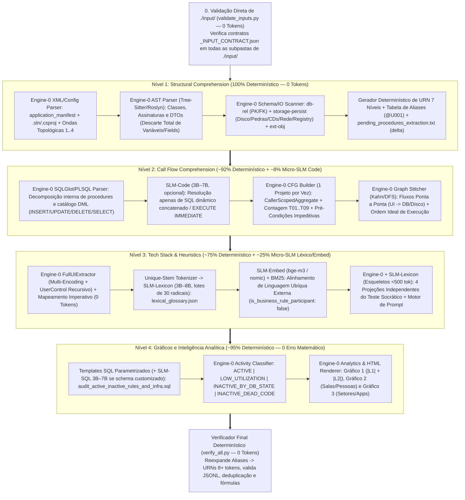

# Spec 00 (Refit) — Arquitetura Mestre de Baixo Consumo de Tokens, Automação Determinística e Orquestração SLM/Multi-SLM

**Diretório Alvo das Specs Refit:** `./specs_refit/` (`C:\Users\walte\OneDrive\Documentos\metadados_famema2.11\specs_refit`)  
**Diretório Base Autocontido (Único Ponto de Verdade):** `./` (`C:\Users\walte\OneDrive\Documentos\metadados_famema2.11`)  
**Escopo:** Monolito Corporativo / Hospitalar (~700 módulos C#/.NET + Banco Relacional Oracle + Armazenamento Persistente em Disco/Mídias)  
**Padrão de Execução:** `[Incremental Build Model]` + `Input-First Direct Validation` + **`[Deterministic-First / Micro-SLM Token Economy]`**  
**Versão:** `2.11-refit`

---

## 1. Objetivo do Refit: Mesmo Resultado Canônico com Redução de ~96%–98% de Tokens e Baixo Custo Computacional

Esta revisão normativa preserva **100% dos contratos de saída, garantias semânticas, URNs canônicos de 7 níveis (`8+ tokens`), validações `Input-First`, projeções do Teste Socrático e fórmulas dos Gráficos 1, 2 e 3** das especificações `v2.1` / `v2.11`, mas redesenha **como** cada artefato é produzido para viabilizar a execução completa em **LLMs locais gratuitas de baixo custo computacional (3B a 14B parâmetros)** — seja com um único modelo leve ou com um **pipeline cooperativo de múltiplos modelos pequenos (Multi-SLM)**.

### 1.1. Princípio Fundamental: `Código Determinístico Faz Parsing e Matemática; IA Faz Apenas Síntese Semântica Residual`

Em vez de utilizar a LLM para ler arquivos `.cs`, `.Designer.cs`, `.csproj` e `.sql` brutos ou emitir longas cadeias JSONL manualmente:
1. **Motor Estático Determinístico (`Engine-0: Python + AST/CFG + SQLGlot + Grafos — 0 Tokens`):** Executa **100% do Nível 1**, **~92% do Nível 2**, **~75% do Nível 3** (extração completa de UI e mapeamento imperativo) e **~95% do Nível 4** (cálculos matemáticos e renderização JSON/HTML).
2. **Micro-Inferência Semântica Guiada por Gramática (`SLM / Multi-SLM`):** A IA local é acionada **exclusivamente** sobre esqueletos simbólicos comprimidos (`< 600 tokens` de entrada) para resolver SQL dinâmico residual, traduzir radicais léxicos únicos em lote, rotular domínios/fluxos humanos e alinhar linguagem ubíqua.

---

## 2. Sete Técnicas Obrigatórias de Economia Extrema de Tokens (`Token Economy Protocol`)

Todo executor compatível com `v2.11-refit` deve implementar as 7 técnicas abaixo antes de invocar qualquer modelo local:

| Código | Técnica de Economia de Tokens | Como Funciona | Impacto Medido no Consumo |
| :--- | :--- | :--- | :--- |
| **`T-OPT-01`** | **Extração Determinística `AST-First`** | Parsers determinísticos (`xml.etree`, `tree-sitter-c-sharp` / Roslyn, `sqlglot`, regex multi-encoding) extraem assinaturas, chamadas, controles UI, DMLs e grafos sem enviar código-fonte bruto à LLM. | Elimina **100%** dos tokens no Nível 1 e **>90%** no Nível 2. |
| **`T-OPT-02`** | **Internação Simbólica de URNs (`Short-ID Aliasing`)** | Um URN canônico de 7 níveis consome ~35–55 tokens. Antes do prompt, o motor substitui cada URN por um alias curto determinístico (`@M001`, `@T014`, `@S009` = 2 tokens) via tabela `./config/urn_symbol_table.json` e reexpande no pós-processamento. | Reduz **~65%** dos tokens por prompt e **zera (0%)** erros de digitação/alucinação de URNs em modelos 3B–8B. |
| **`T-OPT-03`** | **Deduplicação Morfológica em Lote (`Unique-Stem Batching`)** | Em 700 módulos, ~500.000 ocorrências de variáveis repetem os mesmos ~1.500–3.000 radicais após remoção determinística de `camelCase`, `snake_case` e prefixos húngaros (`txt`, `lue`, `gv`, `btn`, `flg`, `seq`, `cod`, `nom`, `dat`). Apenas radicais inéditos vão à LLM em lotes de 30 itens. | Reduz o custo do Glossário Léxico de ~25M tokens para **< 90k tokens totais** (>99% de redução). |
| **`T-OPT-04`** | **Compressão em Esqueleto Semântico (`Micro-Slice Skeletons`)** | Quando a SLM precisa sintetizar a jornada humana de uma tela ou descrever uma regra de domínio, ela recebe apenas um JSON compacto (`< 500 tokens`) contendo `{title, inputs, buttons->flow_alias, preconditions, dml}`, nunca o `.Designer.cs` de 5.000 linhas. | Permite janela de contexto máxima de **4.096 a 8.192 tokens** (VRAM mínima para KV Cache). |
| **`T-OPT-05`** | **Cache Semântico Endereçado por Hash (`SHA-256 AST Cache`)** | Persistido em `./config/semantic_cache.jsonl`. Métodos boilerplate (`Inserir`, `Alterar`, `ObterPorId`, `btnFechar_Click`) e arquivos com `body_hash` inalterado reutilizam respostas anteriores sem nova inferência. | Reduz **40%–60%** das chamadas semânticas entre projetos similares do monolito, e **100%** em reexecuções incrementais. |
| **`T-OPT-06`** | **Decodificação Restrita por Gramática (`GBNF / JSON Schema`)** | Uso obrigatório de `format: json_schema` (Ollama / LM Studio / vLLM / `llama.cpp` GBNF) com `temperature: 0.0–0.1` e sem texto conversacional ou blocos Markdown supérfluos. | Reduz **35%–50%** dos tokens de saída e elimina falhas de `json.loads()` em modelos pequenos. |
| **`T-OPT-07`** | **Pré-Vinculação Vetorial/BM25 Local (`Zero-LLM Retrieval`)** | Modelos leves de embedding (`BAAI/bge-m3` ou `nomic-embed-text`, ~300–600 MB) + BM25 cruzam chamados GLPI/manuais (`VAL-L3.2`) com os Top-3 candidatos do glossário técnico antes de qualquer confirmação por SLM. | Evita injetar documentos longos ou milhares de tickets GLPI na janela da LLM. |

### 2.1. Orçamento Comparativo de Tokens (Monolito ~700 Módulos)

| Camada | Abordagem Tradicional (LLM lendo Código) | Abordagem `v2.11-refit` (AST + Micro-SLM) | Janela de Contexto Exigida no Refit |
| :--- | :---: | :---: | :---: |
| **Nível 1 (`Structural`)** | ~15.000.000 tokens | **0 tokens** *(100% determinístico)* | N/A (CPU pura) |
| **Nível 2 (`Call Flow`)** | ~18.000.000 tokens | **~40.000 – 120.000 tokens** *(apenas SQL dinâmico/expressões complexas)* | `4.096` tokens |
| **Nível 3 (`Tech Stack & Heuristics`)** | ~12.000.000 tokens | **~250.000 – 550.000 tokens** *(radicais deduplicados + esqueletos de telas/domínios)* | `4.096` – `8.192` tokens |
| **Nível 4 (`Gráficos 1, 2 e 3`)** | ~3.000.000 tokens | **~5.000 – 25.000 tokens** *(apenas adaptação eventual de SQL; gráficos = 0 tokens)* | `4.096` tokens |
| **TOTAL (700 Módulos)** | **~48.000.000 tokens** | **~295.000 – 695.000 tokens (Redução de ~98,5%)** | **Máx. `8.192` tokens** |

---

## 3. Hierarquia Estrita em 4 Níveis e Divisão `Determinístico vs. SLM`

A dependência hierárquica de cima para baixo permanece **inviolável** (`Nível 1 -> Nível 2 -> Nível 3 -> Nível 4`), combinada com a validação direta das pastas `./input/` (`Input-First Direct Validation`):

---

## 4. Resumo de Modelos Locais Gratuitos Compatíveis e Modos de Operação

O detalhamento completo de hardware, quantização e orquestração encontra-se na [06_MULTI_SLM_AND_LOW_TOKEN_MODELS_SPEC.md](file:///C:/Users/walte/OneDrive/Documentos/metadados_famema2.11/specs_refit/06_MULTI_SLM_AND_LOW_TOKEN_MODELS_SPEC.md). Em resumo, o pipeline suporta dois modos intercambiáveis:

1. **Modo A — Modelo Único Leve (`Single-SLM`, 6 GB a 16 GB VRAM ou 16–32 GB RAM):**
   - **Recomendados (12–16 GB VRAM / 24 GB RAM):** `Qwen2.5-Coder-14B-Instruct` (`Q4_K_M`), `Phi-4` (14B `Q4_K_M`), `Qwen3-14B` (`Q4_K_M`), `Gemma-3-12B-IT` (`Q4_K_M`), `Mistral-Nemo-12B-Instruct`.
   - **Entrada (6–8 GB VRAM / 16 GB RAM):** `Qwen2.5-Coder-7B-Instruct` (`Q4_K_M`), `Qwen3-8B` (`Q4_K_M`), `Llama-3.1-8B-Instruct` (`Q4_K_M`).
2. **Modo B — Pipeline Cooperativo de Múltiplos Modelos Pequenos (`Multi-SLM Sequential Swap`, 4 GB a 6 GB VRAM ou CPU pura 8–16 GB RAM):**
   - Carrega **um único micro-modelo especialista por fase** (`keep_alive=0` após concluir o lote da fase), combinando:
     - `Engine-0` (Python AST/SQLGlot — 0 GB VRAM)
     - `SLM-1` Código/SQL Dinâmico: `Qwen2.5-Coder-3B-Instruct` (~2,0 GB) ou `7B` (~4,7 GB)
     - `SLM-2` SQL/Schema: `XiYanSQL-QwenCoder-3B` / `SQLCoder-7B-2` / `Phi-4-mini-instruct` (3.8B, ~2,4 GB)
     - `SLM-3` Embeddings/Busca Semântica: `BAAI/bge-m3` (~570 MB) ou `nomic-embed-text-v1.5` (~275 MB)
     - `SLM-4` Glossário e Narrativa Hospitalar PT-BR: `Gemma-3-4B-IT` (~2,6 GB) ou `Llama-3.2-3B-Instruct` (~2,0 GB)

---

## 5. Governança de Portabilidade e Validação Direta de `./input/`

Conforme as diretrizes do workspace autocontido:
1. **Portabilidade Relativa (`./`):** Todos os scripts e validadores resolvem caminhos relativamente à raiz do projeto (`./config/`, `./input/`, `./output/`, `./scripts/`, `./specs_refit/`).
2. **Validação Direta (`Input-First`):** Cada condição `{ ... }` valida diretamente a subpasta `./input/` correspondente via `./scripts/validate_inputs.py`:
   - `VALIDATED_FROM_INPUT`: avança automaticamente sem pausa humana e **com 0 tokens gastos em geração de prompts de solicitação**.
   - `PARTIAL_COVERAGE` / `DEFICIT_DETECTED`: processa integralmente os dados existentes e gera apenas o arquivo SQL/TXT determinístico do delta faltante em `./config/input_validation_report.json`.

---

## 6. Índice Completo das Especificações `specs_refit/`

1. [00_MASTER_ARCHITECTURE_AND_HIERARCHY.md](file:///C:/Users/walte/OneDrive/Documentos/metadados_famema2.11/specs_refit/00_MASTER_ARCHITECTURE_AND_HIERARCHY.md) — Arquitetura Mestre `v2.11-refit`, Protocolo de Economia de Tokens (`T-OPT-01` a `T-OPT-07`) e Hierarquia Híbrida.
2. [01_SPEC_LAYER1_STRUCTURAL_COMPREHENSION.md](file:///C:/Users/walte/OneDrive/Documentos/metadados_famema2.11/specs_refit/01_SPEC_LAYER1_STRUCTURAL_COMPREHENSION.md) — Nível 1 (`0 LLM Tokens`): Extração 100% Determinística de Banco, Disco/Pedras/CDs, Memória RAM filtrada, Assinaturas C# e URNs de 7 Níveis.
3. [02_SPEC_LAYER2_CALL_FLOW_COMPREHENSION.md](file:///C:/Users/walte/OneDrive/Documentos/metadados_famema2.11/specs_refit/02_SPEC_LAYER2_CALL_FLOW_COMPREHENSION.md) — Nível 2 (`AST/CFG + Micro-SLM Residual`): Pontos Iniciais DML, Agregados por Chamador, Transformações `T01`–`T09`, Pré-Condições Impeditivas e Ordem Ideal.
4. [03_SPEC_LAYER3_TECH_STACK_AND_HEURISTICS.md](file:///C:/Users/walte/OneDrive/Documentos/metadados_famema2.11/specs_refit/03_SPEC_LAYER3_TECH_STACK_AND_HEURISTICS.md) — Nível 3 (`FullUIExtractor + Unique-Stem Batching + Embeddings`): Glossário Léxico, Linguagem Ubíqua Não-Regra, Programação Imperativa, 4 Projeções Socráticas e Motor de Prompt Econômico.
5. [04_SPEC_LAYER4_GRAPHICS_AND_ANALYTICS.md](file:///C:/Users/walte/OneDrive/Documentos/metadados_famema2.11/specs_refit/04_SPEC_LAYER4_GRAPHICS_AND_ANALYTICS.md) — Nível 4 (`Templates SQL + Agregação Matemática Exata`): Discriminação de Inatividade e Gráficos 1, 2 e 3 sem alucinação numérica.
6. [05_EXECUTION_PLAN_700_MODULES_MONOLITH.md](file:///C:/Users/walte/OneDrive/Documentos/metadados_famema2.11/specs_refit/05_EXECUTION_PLAN_700_MODULES_MONOLITH.md) — Plano Operacional Passo a Passo para ~700 Módulos em Máquinas Modestas (Shards, Checkpoints SHA-256, Cache e Verificação).
7. [06_MULTI_SLM_AND_LOW_TOKEN_MODELS_SPEC.md](file:///C:/Users/walte/OneDrive/Documentos/metadados_famema2.11/specs_refit/06_MULTI_SLM_AND_LOW_TOKEN_MODELS_SPEC.md) — Catálogo Completo de LLMs Locais Gratuitas Compatíveis e Plano Arquitetural Multi-SLM (Quebra em Vários Modelos Pequenos com Paridade de Resultado).
