# Spec 06 (Refit) — Catálogo de Modelos Locais Gratuitos Compatíveis e Plano de Orquestração Multi-SLM (`v2.11-refit`)

**Diretório das Specs Refit:** `./specs_refit/`  
**Objetivo:** Especificar os modelos locais gratuitos de baixo custo computacional (disponíveis em **Hugging Face**, **Ollama**, **LM Studio** e **llama.cpp**) capazes de gerar **100% das 4 camadas do mapeamento**, e detalhar o **Plano de Decomposição em Múltiplos Modelos Pequenos (`Multi-SLM Pipeline`)** para máquinas modestas (4–8 GB VRAM ou CPU com 8–16 GB RAM) com paridade total de resultado.

---

## 1. Catálogo de Modelos Locais Gratuitos Compatíveis (Open-Weights)

Graças à automação determinística do `Engine-0` e às 7 técnicas de economia de tokens (`Spec 00`), **não é mais necessário um modelo de 70B parâmetros (48–64 GB VRAM)**. Abaixo estão os modelos gratuitos compatíveis validados arquiteturalmente para o pipeline `v2.11-refit`:

### 1.1. Modo A — Modelo Único de Baixo Custo (`Single-SLM` faz todas as micro-tarefas de IA)

| Modelo Gratuito (Hugging Face / Ollama) | Parâmetros | Peso (`Q4_K_M`) | Hardware Mínimo Recomendado (Ctx `8k`) | Papel e Aderência às 4 Camadas |
| :--- | :---: | :---: | :--- | :--- |
| **`Qwen2.5-Coder-14B-Instruct`** *(ou `Qwen3-14B`)* | 14B | ~9,0 GB | **GPU 12–16 GB VRAM** *(ex: RTX 3060 12GB, 4060 Ti 16GB, 4070)* ou **PC 24–32 GB RAM** | **Melhor custo-benefício único.** Excelente em C#, PL/SQL, JSON estrito e português técnico hospitalar. |
| **`Phi-4`** *(Microsoft)* | 14B | ~9,1 GB | **GPU 12–16 GB VRAM** ou **PC 24–32 GB RAM** | Altíssima densidade lógica para pré-condições (`Nível 2`) e síntese de domínios (`Nível 3`). |
| **`Gemma-3-12B-IT`** *(Google)* | 12B | ~7,8 GB | **GPU 10–12 GB VRAM** ou **Mac/PC 16–24 GB RAM** | Ótima fluência em PT-BR para Glossário Léxico, Fluxo Humano de Telas e Motor de Prompt (`Nível 3`). |
| **`Mistral-Nemo-Instruct-2407`** | 12B | ~7,5 GB | **GPU 10–12 GB VRAM** ou **PC 16–24 GB RAM** | Forte obediência a JSON Schema / Function Calling e bom vocabulário multilíngue. |
| **`Qwen2.5-Coder-7B-Instruct`** | 7B | ~4,7 GB | **GPU 6–8 GB VRAM** *(ex: RTX 3050/3060/4060)* ou **CPU 16 GB RAM** | **Melhor modelo único leve (8 GB VRAM).** Resolve SQL dinâmico e JSONL perfeitamente quando apoiado por `URN Aliasing` (`@Xnnnn`). |
| **`Qwen3-8B`** / **`Llama-3.1-8B-Instruct`** | 8B | ~4,9 GB | **GPU 6–8 GB VRAM** ou **CPU 16 GB RAM** | Equilibrados para tradução léxica, resumo de telas e queries SQL guiadas por template. |
| **`DeepSeek-R1-Distill-Qwen-7B`** *(ou `14B`)* | 7B / 14B | ~4,7 / 9,0 GB | **GPU 8–16 GB VRAM** | Útil especificamente quando se deseja raciocínio passo a passo em regras de negócio ambíguas *(desativar `<think>` longo em tarefas simples de glossário para poupar tokens)*. |

---

### 1.2. Modo B — Especialistas Ultra-Leves para o Plano Multi-SLM (`0.3B a 4B`, Pico de Memória $\le$ 3–4 GB!)

Para máquinas **sem placa de vídeo dedicada (CPU-only com 8 GB a 16 GB de RAM)** ou GPUs de entrada (**4 GB a 6 GB de VRAM**), divide-se o trabalho semântico entre **4 micro-modelos gratuitos especializados**:

| Papel no Pipeline | Modelos Gratuitos Recomendados (Escolha 1 por Papel) | Tamanho em Disco / RAM | Especialidade Exata |
| :--- | :--- | :---: | :--- |
| **`SLM-1: Code & Dynamic SQL`** | `Qwen2.5-Coder-3B-Instruct` *(rec.)* ou `Qwen2.5-Coder-1.5B-Instruct` | **1,1 GB – 2,0 GB** | Analisar apenas snippets de 15 linhas de SQL dinâmico C#/PLSQL (`EXECUTE IMMEDIATE` / `StringBuilder`) no Nível 2. |
| **`SLM-2: SQL & Schema Adapter`** | `XiYanSQL-QwenCoder-3B` / `Phi-4-mini-instruct` (3.8B) / `SQLCoder-7B-2` | **2,0 GB – 2,4 GB** *(4,5 GB se 7B)* | Adaptar queries de auditoria e estrutura física (`VAL-L3.1` e `VAL-L4.1`) quando colunas fogem do template padrão. |
| **`SLM-3: Semantic Embedder`** | `BAAI/bge-m3` *(multilíngue PT-BR)* ou `nomic-embed-text-v1.5` ou `Qwen3-Embedding-0.6B` | **275 MB – 570 MB** | Vetorização rápida (0 tokens gerados) para clusterizar heurísticas cross-app, cruzar GLPI/POPs (`VAL-L3.2`) e buscar telas no Motor de Prompt. |
| **`SLM-4: PT-BR Hospital Lexicon`** | `Gemma-3-4B-IT` *(rec.)*, `Phi-4-mini-instruct` (3.8B), `Qwen2.5-3B-Instruct` ou `Llama-3.2-3B-Instruct` | **2,0 GB – 2,6 GB** | Traduzir lotes de 30 radicais técnicos para PT-BR hospitalar (`lexical_glossary.json`), nomear domínios e redigir jornadas humanas de tela. |

---

## 2. Arquitetura do Plano Multi-SLM: Como Vários Modelos Pequenos Reproduzem o Mesmo Resultado de um 70B

### 2.1. Regra de Troca Sequencial de Modelo (`Sequential Stage Swapping` — Pico de Memória Mínimo)
> **Nunca carregue os 4 modelos pequenos simultaneamente na VRAM/RAM.**  
> O pipeline agrupa todas as micro-tarefas de uma mesma natureza em uma **Fila de Lote (`Batch Queue`)**, carrega o micro-modelo especialista daquela fila, processa todos os itens em sequência rápida (aproveitando o prompt de sistema em cache de prefixo) e **descarrega imediatamente o modelo da memória** (`keep_alive: 0` no Ollama ou encerramento do worker `llama-server`) antes de iniciar o próximo especialista.

```mermaid
flowchart LR
    subgraph STAGE1["Etapa 1 (CPU Pura — 0 GB VRAM)"]
        E0_A["Engine-0 AST/XML/CSV<br/>Conclui 100% do Nível 1 +<br/>92% do Nível 2 + FullUIExtractor L3"]
        Q1[("Fila 1: dynamic_sql_queue.jsonl<br/>(~50-200 snippets curtos)")]
        E0_A --> Q1
    end

    subgraph STAGE2["Etapa 2 (Pico ~2,0 GB VRAM/RAM)"]
        SLM1["Carrega SLM-1 (Qwen2.5-Coder-3B)<br/>Resolve Fila 1 com GBNF JSON -> Descarrega"]
    end

    subgraph STAGE3["Etapa 3 (Pico ~0,5 GB VRAM/RAM)"]
        SLM3["Carrega SLM-3 (bge-m3 Embeddings)<br/>Alinha GLPI/Ubíquo + Clusters Cross-App -> Descarrega"]
    end

    subgraph STAGE4["Etapa 4 (Pico ~2,5 GB VRAM/RAM)"]
        SLM4["Carrega SLM-4 (Gemma-3-4B / Phi-4-mini)<br/>Traduz Lotes de 30 Radicais + Esqueletos Telas/Domínios -> Descarrega"]
    end

    subgraph STAGE5["Etapa 5 (Pico ~2,0 GB VRAM/RAM — Opcional)"]
        SLM2["Carrega SLM-2 (XiYanSQL-3B / Phi-4-mini)<br/>Ajusta colunas SQL customizadas L3.1/L4.1 -> Descarrega"]
    end

    subgraph STAGE6["Etapa 6 (CPU Pura — 0 GB VRAM)"]
        E0_B["Engine-0 Consolidador + Verificador<br/>Reexpande @Aliases -> URNs 8+ tokens,<br/>Força flags de governança, calcula Gráficos 1-3 e roda verify_all.py"]
    end

    Q1 --> SLM1 --> SLM3 --> SLM4 --> SLM2 --> E0_B
```



---

## 3. Contratos de Micro-Prompts e Gramáticas Estritas (`GBNF / JSON Schema`) por Modelo

Para que um modelo de **3B ou 4B parâmetros** atinja a mesma confiabilidade estrutural de um modelo de **70B**, ele **jamais** recebe instruções abertas nem escreve arquivos `.jsonl` finais diretamente. Ele responde apenas a micro-contratos fechados:

### 3.1. Contrato do `SLM-1` (`Dynamic SQL & Precondition Micro-Analyst`)
- **Entrada (`<= 300 tokens`):**
  ```json
  {"method":"@M0412","snippet":"sb.Append(\"UPDATE SIHOSP.DEMANDA_CIRURGICA SET SIT_DEMANDA = 'C' WHERE SEQ_DEMANDA = :p1\");"}
  ```
- **Schema JSON Forçado na Saída (`<= 60 tokens`):**
  ```json
  {"dml":"UPDATE","tables":["SIHOSP.DEMANDA_CIRURGICA"],"mutated_cols":["SIT_DEMANDA"],"guard_cols":["SEQ_DEMANDA"]}
  ```

### 3.2. Contrato do `SLM-4` — Tarefa A (`Unique-Stem Glossary Batch`)
- **Entrada (`<= 450 tokens`, lote de 30 radicais únicos):**
  ```json
  {"domain_hint":"Hospitalar SIHOSP","stems":["prog_sala_prof","agenda_restrita","nro_faa","dat_hora_inicio_cir"]}
  ```
- **Schema JSON Forçado na Saída (`<= 350 tokens`):**
  ```json
  {
    "items": [
      {"stem":"prog_sala_prof","term":"Profissional na Programação de Sala","reading":"vínculo do profissional habilitado na sala cirúrgica"},
      {"stem":"agenda_restrita","term":"Regra de Agenda Restrita","reading":"indicador de restrição de agendamento por sala habilitada"},
      {"stem":"nro_faa","term":"Número da FAA (Ficha de Atendimento Ambulatorial)","reading":"identificador da ficha de atendimento ambulatorial do paciente"},
      {"stem":"dat_hora_inicio_cir","term":"Data e Hora de Início da Cirurgia","reading":"instante inicial registrado do procedimento cirúrgico"}
    ]
  }
  ```
- **Pós-Processamento Determinístico (`Engine-0`):** O Python associa cada `stem` traduzido de volta a todas as centenas de variáveis (`seqProgSalaProf`, `lueProfissionalSala`, etc.) e a todas as `source_identities_urn` reais colhidas na AST do Nível 1.

### 3.3. Contrato do `SLM-4` — Tarefa B (`Screen Human Journey Skeleton`)
- **Entrada (`<= 450 tokens`, gerada pelo `FullUIExtractor` + Nível 2):**
  ```json
  {
    "screen":"DECI0009","title":"Programação de Sala Cirúrgica",
    "inputs":["lueUnidade (Unidade)","lueSala (Sala)","lueProfissional (Profissional)","dtInicio (Data Início)"],
    "actions":[{"btn":"btnSalvar (Salvar)","flow":"@F0089","dml":"INSERT @T0012","guards":["@PC01: campos obrigatórios"]}],
    "grids":["gvProfissionais"]
  }
  ```
- **Schema JSON Forçado na Saída (`<= 220 tokens`):**
  ```json
  {
    "functional_summary":"Parametrização de profissionais habilitados por sala cirúrgica",
    "human_steps":[
      "Abrir a tela DECI0009 (Programação de Sala Cirúrgica).",
      "Selecionar a Unidade e a Sala nos campos lueUnidade e lueSala.",
      "Escolher o Profissional em lueProfissional e informar a Data Início em dtInicio.",
      "Acionar o botão Salvar (btnSalvar) para disparar @F0089 e gravar em @T0012.",
      "Conferir a atualização da listagem na grade gvProfissionais."
    ]
  }
  ```
- **Pós-Processamento Determinístico (`Engine-0`):** Substitui `@F0089` e `@T0012` pelos URNs canônicos de 8 segmentos e monta o registro completo de `projection_4_screen_isolation.jsonl`.

---

## 4. Matriz de Garantia de Paridade (`Por Que o Resultado Final É Idêntico ao de um Modelo Grande`)

| Risco Típico de Modelos Pequenos (1.5B–7B) | Mecanismo do `v2.11-refit` Que Neutraliza 100% do Risco | Resultado em `verify_all.py` |
| :--- | :--- | :--- |
| **Corrupção ou truncamento de URNs longos** | Modelos nunca geram URNs; usam aliases curtos `@M01`/`@T02` ou chaves de radical, e o `Engine-0` injeta os URNs reais validados. | **0 defeitos** de URN de 7 níveis (`8+ tokens`). |
| **Inclusão acidental de variáveis locais em `mem-ram`** | O Nível 1 é 100% determinístico em AST; nós de variáveis locais/fields são bloqueados em código Python. | **0 defeitos** de `FORBIDDEN_MEM_RAM_SUBTYPES`. |
| **JSON inválido / chaves faltantes em JSONL** | Decodificação GBNF / `json_schema` + validação Pydantic no `Engine-0` com até 2 re-tentativas automáticas e template determinístico de fallback. | **100% de JSON/JSONL válidos** e não vazios. |
| **Contaminação de regras por linguagem ubíqua (`GATE-L3.2`)** | O `Engine-0` sobrescreve em código `"is_business_rule_participant": false` em todos os itens de `ubiquitous_non_business_glossary.json`. | **100% de conformidade** de isolamento semântico. |
| **Telas com `0` controles por falha de leitura `.Designer.cs`** | `FullUIExtractor` determinístico com fallback `utf-8 -> utf-16 -> cp1252 -> latin-1` e achatamento recursivo de `UserControl`s. | **100% dos controles e eventos mapeados.** |
| **Erro de soma no escore de domínios do Gráfico 1** | A soma $\text{score} = |I_{L1}| + |P_{L2}|$ é calculada por conjuntos Python (`len(set_l1) + len(set_l2)`), sem intervenção de IA. | **0 divergências matemáticas** no Nível 4. |

---

## 5. Guia Rápido de Escolha por Perfil de Máquina Local

1. **Notebook / PC sem GPU dedicada (CPU + 8 a 16 GB RAM):**
   - Use o **Modo B (Multi-SLM Sequencial)** via `Ollama` (`OLLAMA_NUM_PARALLEL=1`, `OLLAMA_MAX_LOADED_MODELS=1`, `num_ctx=4096`):
     - `qwen2.5-coder:3b` (`SLM-1` + `SLM-2`)
     - `bge-m3` ou `nomic-embed-text` (`SLM-3`)
     - `gemma3:4b` ou `phi4-mini` (`SLM-4`)
2. **PC / Workstation com GPU de 6 a 8 GB VRAM + 16 GB RAM:**
   - Use **`qwen2.5-coder:7b`** + **`bge-m3`** + **`gemma3:4b`** (em troca sequencial a 40–70 tokens/s na GPU) ou **`qwen2.5-coder:7b`** como modelo único.
3. **PC / Workstation com GPU de 12 a 16 GB VRAM (ou Mac 24–32 GB):**
   - Use o **Modo A (Modelo Único)** com **`qwen2.5-coder:14b`** ou **`phi4:14b`** + **`bge-m3`** (`num_ctx=8192`), obtendo velocidade máxima e simplicidade operacional de um único LLM principal.
