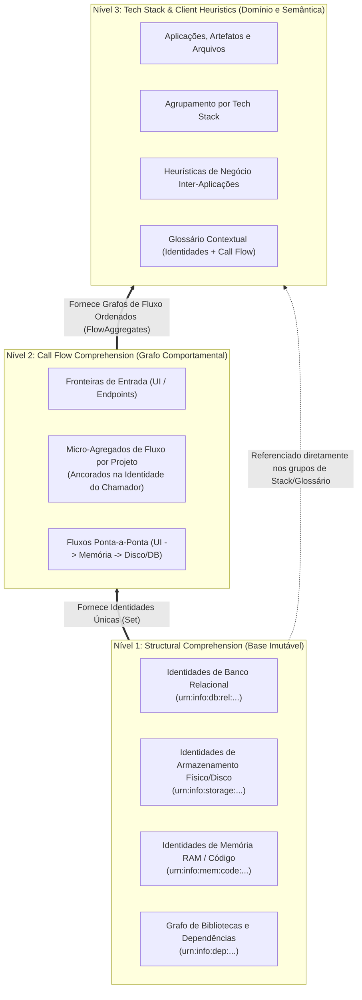

# Especificação Arquitetural Mestre: Hierarquia de Compreensão em 3 Camadas (Monolito 700+ Módulos)

## 1. Visão Geral e Princípio de Dependência Estrita

Esta especificação define a arquitetura de metadados, o modelo de identidade universal e o plano de execução para mapeamento estático e semântico de grandes bases de código (monolitos de 700+ projetos/módulos em C# e ecossistemas acoplados).

A arquitetura é regida por uma **Hierarquia Estrita de 3 Níveis**, onde cada nível superior depende exclusivamente das estruturas e identidades consolidadas no nível imediatamente inferior:

---

## 2. Leis de Dependência e Invariantes entre Camadas

Para garantir que a IA ou motor de indexação nunca gere metadados órfãos, duplicados ou ambíguos durante a leitura de 700 módulos, aplicam-se **4 Invariantes Fundamentais**:

### Invariante 1: Unicidade Absoluta no Nível 1 (Semântica de Conjunto)
* Todo elemento mapeado no **Nível 1 (Structural Comprehension)** possui um `IdentityURN` determinístico e globalmente único.
* A operação de combinação entre o mapeamento de dois projetos quaisquer $P_A$ e $P_B$ é uma **União Idempotente de Conjuntos**:
  $$\text{L1}(P_A \cup P_B) = \text{L1}(P_A) \cup \text{L1}(P_B)$$
* Se 50 projetos diferentes acessam a mesma tabela `dbo.Clientes` ou invocam a mesma biblioteca compartilhada `Core.Auth`, **existe apenas 1 registro de identidade** para `dbo.Clientes` e **1 registro de identidade** para cada classe/método de `Core.Auth` no repositório consolidado do Nível 1.

### Invariante 2: Proibição de Nós Anônimos no Nível 2
* O **Nível 2 (Call Flow Comprehension)** **não pode criar novas entidades estruturais**.
* Todo vértice (nó de origem, nó intermediário ou nó de destino) dentro de um fluxo de chamada deve ser obrigatoriamente uma chave estrangeira (`IdentityURN`) existente no **Nível 1**.
* Se um fluxo de chamada encontrar uma referência a um método ou tabela ainda não indexado localmente, ele emite um `StubIdentityURN` determinístico (baseado na assinatura qualificada) que será resolvido na etapa de consolidação do Nível 1.

### Invariante 3: Agregação Ancorada na Fonte Chamadora (Nível 2)
* Todo subgrafo de chamadas no Nível 2 é agrupado sob uma estrutura de **Agregado de Fluxo (`CallFlowAggregate`)** cuja identidade de contexto deriva da **identidade única da fonte que iniciou a chamada** (`CallerIdentityURN`), preservando a ordem sequencial das invocações (`StepOrder`).

### Invariante 4: Composição Semântica no Nível 3
* O **Nível 3 (Tech Stack & Client Heuristics)** opera exclusivamente como uma camada de **agrupamento, classificação tecnológica e indexação lexical/semântica** sobre pares $(\{\text{Identidades L1}\}, \{\text{Fluxos L2}\})$.
* Nenhum termo de glossário ou heurística de negócio existe isolado: todo termo de negócio deve apontar para o conjunto exato de identidades do Nível 1 onde o termo aparece e para os fluxos do Nível 2 que executam essa regra.

---

## 3. Matriz de Ordem de Execução Global

A tabela abaixo resume a ordem obrigatória de execução para garantir que nenhuma camada seja processada sem suas dependências:

| Ordem | Fase / Camada | Escopo de Leitura | Entrada Necessária | Saída Produzida |
| :--- | :--- | :--- | :--- | :--- |
| **Fase 0** | **Pré-Indexação & Topologia** | Pasta Raiz do Monolito (`.sln`, `.csproj`) | Sistema de arquivos bruto (700 módulos) | Grafo Acíclico Dirigido (DAG) de dependências de projetos e inventário de pacotes/bibliotecas. |
| **Fase 1.1** | **L1: Persistência (DB & Disco)** | Scripts SQL, Migrations, Configs, Schemas, Acessos I/O | Arquivos de banco, config e mapeamentos ORM | Catálogo único de identidades `urn:info:db:rel:*` (tabelas + relações) e `urn:info:storage:*` (disco/mídias). |
| **Fase 1.2** | **L1: Assinaturas de Código & RAM** | Projeto a Projeto (em ordem topológica bottom-up) | AST C# (`.cs`) + Catálogo de Bibliotecas (Fase 0) | Catálogo único de identidades em memória `urn:info:mem:code:*` (Classes e Métodos; sem variáveis) com hash incremental. |
| **Fase 2.1** | **L2: Micro-Agregados de Call Flow** | Projeto a Projeto (incremental) | Catálogo L1 (Fase 1.1 + 1.2) + Corpos de métodos C# | Micro-agregados locais de chamadas (`ProjectFlowBundle`) ancorados na identidade do chamador. |
| **Fase 2.2** | **L2: Linker de Fluxo Ponta-a-Ponta** | Grafo consolidado de Micro-Agregados | Todos os `ProjectFlowBundle` + Identidades de UI/Sinks | Fluxos completos ponta-a-ponta (`E2ECallFlow`: UI $\to$ Serviços $\to$ DB/Disco). |
| **Fase 3.1** | **L3: Tech Stack & Artefatos** | Metadados de Build + Identidades L1 + Fluxos L2 | Catálogos L1 e L2 | Mapeamento de Aplicações, Artefatos (`.dll`/`.exe`), Arquivos e grupos de Tech Stack. |
| **Fase 3.2** | **L3: Heurísticas & Glossário** | Todos os Fluxos L2 + Nomes simbólicos L1 | L1 + L2 + L3.1 | Clusters de Heurísticas de Negócio inter-aplicações + Glossário de Domínio vinculado a Identidades e Call Flows. |

---

## 4. Índice dos Documentos de Especificação

1. [01_LAYER1_STRUCTURAL_COMPREHENSION_SPEC.md](file:///C:/Users/walte/OneDrive/Documentos/specs_test_ia1/01_LAYER1_STRUCTURAL_COMPREHENSION_SPEC.md): Modelo de Identidade Universal, Banco Relacional, Armazenamento Físico/Disco, Filtro de Memória RAM e Assinaturas C#.
2. [02_LAYER2_CALL_FLOW_COMPREHENSION_SPEC.md](file:///C:/Users/walte/OneDrive/Documentos/specs_test_ia1/02_LAYER2_CALL_FLOW_COMPREHENSION_SPEC.md): Fronteiras de UI/Dados, Estrutura de Agregação por Identidade Chamadora, Micro-Agregados incrementais e Fluxo Ponta-a-Ponta.
3. [03_LAYER3_TECH_STACK_AND_HEURISTICS_SPEC.md](file:///C:/Users/walte/OneDrive/Documentos/specs_test_ia1/03_LAYER3_TECH_STACK_AND_HEURISTICS_SPEC.md): Aplicações, Artefatos, Agrupamento por Tech Stack, Heurísticas de Negócio entre Aplicações e Glossário Contextual.
4. [04_EXECUTION_PLAN_700_MODULES_MONOLITH.md](file:///C:/Users/walte/OneDrive/Documentos/specs_test_ia1/04_EXECUTION_PLAN_700_MODULES_MONOLITH.md): Plano operacional passo a passo para execução em pasta com 700 módulos, estrutura de diretórios de saída, particionamento de contexto para IA e atualização incremental.
