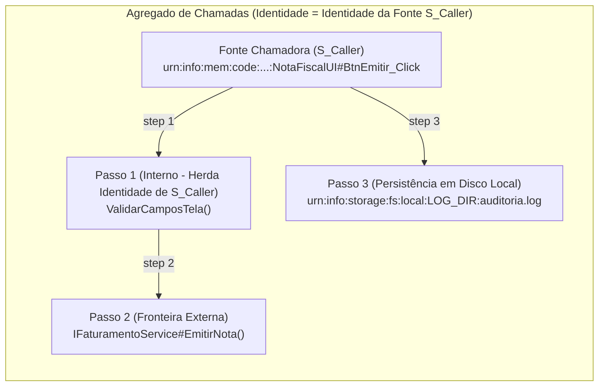

# Especificação do Nível 2: Call Flow Comprehension (Compreensão de Fluxo de Chamadas)

## 1. Objetivo e Dependência Estrita do Nível 1

O **Nível 2 (Call Flow Comprehension)** transforma o catálogo estático de identidades únicas do Nível 1 em um **Grafo Dirigido, Ordenado e Incremental de Fluxos de Dados e Execução**.

> **Invariante de Dependência:**
> O Nível 2 **não declara novas identidades de recursos**. Todo nó participante de um fluxo no Nível 2 é uma referência direta a um `IdentityURN` previamente mapeado no Nível 1 (`urn:info:mem:code:*`, `urn:info:mem:state:*`, `urn:info:db:rel:*`, `urn:info:storage:*`).

---

## 2. Identificação de Fronteiras: Início (UI / Gatilhos) e Fim (Persistência / Sinks)

Para mapear um fluxo de ponta a ponta, o Nível 2 classifica as identidades do Nível 1 que atuam como **Fronteiras de Fluxo**:

### 2.1. Início de uma Chamada de Dados (`FLOW_ORIGIN / UI & ENTRY`)
Representa o ponto exato onde uma interação do usuário ou gatilho do sistema inicia uma cadeia de processamento:
1. **UI Desktop / Cliente Rico (WinForms, WPF, Delphi/Interop):**
   * Métodos de eventos de interface (`btnSalvar_Click`, `Form_Load`, `ICommand.Execute`, *ViewModels*).
2. **UI Web & Fronteiras HTTP (ASP.NET WebForms, MVC, Razor, Blazor, WebAPI, Minimal API):**
   * `Page_Load`, Actions de `Controller`, Handlers HTTP, componentes de página.
3. **Fronteiras de Serviço e Integração (WCF, WebServices ASMX, gRPC, Mensageria, Jobs):**
   * Métodos decorados com `[OperationContract]`, `[WebMethod]`, consumidores de fila (`IConsumer<T>`) e timers/jobs (`IHostedService`, Quartz, Hangfire).

### 2.2. Fim de uma Chamada de Dados (`FLOW_TERMINAL / DATA SINK & SOURCE`)
Representa o ponto onde o fluxo em memória atinge um meio de armazenamento ou fronteira externa para ler (`READ`), gravar (`WRITE`) ou mutar (`MUTATE`) dados:
1. **Terminal de Banco Relacional:** Qualquer identidade `urn:info:db:rel:*` (Tabela, View, Stored Procedure) acionada via ADO.NET, Dapper, Entity Framework ou NHibernate.
2. **Terminal de Disco / Mídia Física:** Qualquer identidade `urn:info:storage:*` (Arquivo local, compartilhamento de rede, mídia óptica/fria).
3. **Terminal de Estado Compartilhado em Memória RAM:** Qualquer identidade `urn:info:mem:state:*` (Cache em RAM, Sessão compartilhada).

---

## 3. Estrutura de Agregação Ancorada na Identidade da Fonte Chamadora

> **Resolução Arquitetural para o Ponto Crítico da Especificação:**
> *"deve haver uma estrutura que agregue chamadas onde sua identidade única seja a mesma da fonte que a chamou /??/"*

### 3.1. O Problema da Fragmentação de Chamadas
Em um projeto C#, um método de entrada `A` (ex: `BtnEmitirNota_Click` na UI ou `FaturamentoController.Post`) pode chamar 5 métodos auxiliares internos (`A1`, `A2`, `A3`), que por sua vez chamam serviços e repositórios. Se cada chamada individual for salva apenas como uma aresta solta `(X -> Y)`, perde-se o vínculo imediato de **qual fonte originou e governa aquele conjunto de chamadas**.

### 3.2. Solução: O Agregado de Chamadas Escopado pelo Chamador (`CallerScopedAggregate`)

Definimos uma estrutura formal chamada **`CallerScopedAggregate` (Envelope de Agregação por Fonte Chamadora)** que obedece a duas regras:

1. **Identidade Herdada da Fonte (`caller_anchor_identity`):**
   * O identificador único do agregado de chamadas **é indexado diretamente pela própria identidade única do Nível 1 da fonte que iniciou a chamada**:
     ```text
     aggregate_identity := urn:info:mem:code:<Repo>:<Proj>:<NS>:<Class>#<CallerMethodSig>
     ```
   * Dessa forma, o agregado não cria uma identidade arbitrária desconectada: **a chave primária do agregado de chamadas dentro do escopo local É a identidade única da fonte chamadora**.

2. **Propagação de Identidade em Sub-Chamadas Internas (Folding / Herança de Escopo):**
   * Quando uma fonte pública/fronteira $S_{\text{caller}}$ invoca métodos privados ou internos de suporte ($h_1, h_2$) dentro da mesma classe ou componente, essas sub-chamadas **herdam a identidade de agregação de $S_{\text{caller}}$** (`root_caller_identity = S_caller`).
   * Cada passo dentro do agregado recebe um número de ordem estrito (`step_order: 1, 2, 3...`) e preserva tanto o `immediate_caller_identity` (quem chamou imediatamente) quanto o `root_caller_identity` (a identidade da fonte dona do agregado).



---

## 4. Micro-Agregados Incrementais por Projeto (Para Leitura de 700 Módulos)

Ao analisar um monolito de 700 módulos, a Inteligência Artificial **lê um único projeto por vez**.
Para cada projeto lido, a IA gera um arquivo compacto de **Micro-Agregados de Fluxo do Projeto (`ProjectFlowMicroAggregate`)**.

### 4.1. Anatomia de um Micro-Agregado de Projeto
Ao ler apenas o Projeto $P_i$:
1. A IA identifica todos os métodos de entrada/fronteira pública de $P_i$.
2. Para cada método fonte $S \in P_i$, cria um `CallerScopedAggregate` contendo a sequência ordenada de chamadas originadas por $S$.
3. **Resolução de Fronteiras do Micro-Agregado:**
   * **Chamada Intra-Projeto:** Se $S$ chama outro método $M \in P_i$, a transição é resolvida imediatamente dentro do micro-agregado.
   * **Chamada Inter-Projeto (Porta de Saída / `EXIT_PORT`):** Se $S$ chama um método de outro projeto $P_j$ (identificado pelas dependências mapeadas no Nível 1), o passo aponta para o `IdentityURN` da assinatura do método em $P_j$ (ou de sua `Interface`) e marca o passo como `BOUNDARY_CROSS_PROJECT`.
   * **Chamada de Dados (Terminal de Persistência / `DATA_TERMINAL`):** Se $S$ executa SQL/ORM ou I/O de arquivo, o passo aponta diretamente para a identidade `urn:info:db:rel:*` ou `urn:info:storage:*` do Nível 1 e classifica a operação (`READ`, `INSERT`, `UPDATE`, `DELETE`, `EXEC`).

### 4.2. Schema JSON do Micro-Agregado Incremental (Por Projeto)
```json
{
  "project_identity": "urn:info:mem:code:monolito_root:src/Faturamento.Service",
  "micro_aggregates": [
    {
      "caller_source_identity": "urn:info:mem:code:monolito_root:src/Faturamento.Service:Empresa.Faturamento:FaturamentoAppService#ProcessarFatura(System.Int32,System.Boolean)->Empresa.Faturamento.ResultadoFaturaDto",
      "is_entry_boundary": true,
      "boundary_kind": "SERVICE_PUBLIC_CONTRACT",
      "ordered_call_steps": [
        {
          "step_order": 1,
          "root_caller_identity": "urn:info:mem:code:monolito_root:src/Faturamento.Service:Empresa.Faturamento:FaturamentoAppService#ProcessarFatura(System.Int32,System.Boolean)->Empresa.Faturamento.ResultadoFaturaDto",
          "immediate_caller_identity": "urn:info:mem:code:monolito_root:src/Faturamento.Service:Empresa.Faturamento:FaturamentoAppService#ProcessarFatura(System.Int32,System.Boolean)->Empresa.Faturamento.ResultadoFaturaDto",
          "target_identity": "urn:info:mem:state:cache:monolito_root:ParametrosFiscaisCache",
          "interaction_type": "MEMORY_STATE_READ",
          "boundary_status": "TERMINAL_RAM_STATE"
        },
        {
          "step_order": 2,
          "root_caller_identity": "urn:info:mem:code:monolito_root:src/Faturamento.Service:Empresa.Faturamento:FaturamentoAppService#ProcessarFatura(System.Int32,System.Boolean)->Empresa.Faturamento.ResultadoFaturaDto",
          "immediate_caller_identity": "urn:info:mem:code:monolito_root:src/Faturamento.Service:Empresa.Faturamento:FaturamentoAppService#ValidarRegrasInternas(System.Int32)->System.Boolean",
          "target_identity": "urn:info:mem:code:monolito_root:src/Impostos.Core:Empresa.Impostos:ICalculoImpostoService#CalcularIcms(System.Int32)->System.Decimal",
          "interaction_type": "METHOD_CALL",
          "boundary_status": "CROSS_PROJECT_EXIT_PORT"
        },
        {
          "step_order": 3,
          "root_caller_identity": "urn:info:mem:code:monolito_root:src/Faturamento.Service:Empresa.Faturamento:FaturamentoAppService#ProcessarFatura(System.Int32,System.Boolean)->Empresa.Faturamento.ResultadoFaturaDto",
          "immediate_caller_identity": "urn:info:mem:code:monolito_root:src/Faturamento.Service:Empresa.Faturamento:FaturamentoAppService#ProcessarFatura(System.Int32,System.Boolean)->Empresa.Faturamento.ResultadoFaturaDto",
          "target_identity": "urn:info:db:rel:mssql:default:erp_db:dbo:table:TB_FATURA",
          "interaction_type": "DB_WRITE_INSERT",
          "boundary_status": "TERMINAL_RELATIONAL_DB"
        },
        {
          "step_order": 4,
          "root_caller_identity": "urn:info:mem:code:monolito_root:src/Faturamento.Service:Empresa.Faturamento:FaturamentoAppService#ProcessarFatura(System.Int32,System.Boolean)->Empresa.Faturamento.ResultadoFaturaDto",
          "immediate_caller_identity": "urn:info:mem:code:monolito_root:src/Faturamento.Service:Empresa.Faturamento:FaturamentoAppService#ProcessarFatura(System.Int32,System.Boolean)->Empresa.Faturamento.ResultadoFaturaDto",
          "target_identity": "urn:info:storage:fs:local:XML_EXPORT_ROOT:Fatura_{id}.xml:xml",
          "interaction_type": "DISK_FILE_WRITE",
          "boundary_status": "TERMINAL_PERSISTENT_STORAGE"
        }
      ]
    }
  ]
}
```

---

## 5. Montagem do Fluxo Ponta-a-Ponta (`EndToEndCallFlow`)

Uma vez que os micro-agregados dos projetos foram gerados incrementalmente, o **Montador de Fluxo Ponta-a-Ponta (Flow Linker)** une os micro-agregados sem precisar reler o código-fonte:

### 5.1. Algoritmo de Costura Determinística (Stitching)
1. **Seleção das Raízes Globais (`UI / Entry Points`):** Filtra todos os micro-agregados cujo `boundary_kind` seja `UI_EVENT_HANDLER`, `API_ENDPOINT`, `MVC_ACTION`, `WCF_OPERATION` ou `JOB_TRIGGER`.
2. **Resolução de Interfaces (Polimorfismo L1):** Quando um passo aponta para a identidade de um método de `Interface` (`urn:info:mem:code:...:IFaturamentoAppService#ProcessarFatura`), o Linker consulta o índice `implements` do Nível 1 para localizar a implementação concreta (`FaturamentoAppService#ProcessarFatura`).
3. **Expansão Ordenada em Profundidade (DFS com Detecção de Ciclos):**
   * Substitui cada `CROSS_PROJECT_EXIT_PORT` pelo micro-agregado correspondente do projeto chamado, mantendo uma numeração hierárquica ordenada (`1`, `2`, `2.1`, `2.2`, `3`, `4`).
4. **Consolidação do Manifesto de Participantes do Fluxo:**
   * Cada fluxo ponta-a-ponta produz a lista exata e deduplicada de **todas as identidades do Nível 1 que fazem parte daquele fluxo**, separadas por categoria:
     * `origin_ui_identity` (Onde começou)
     * `participating_code_identities` (Classes e métodos atravessados em RAM)
     * `participating_memory_state_identities` (Caches/Sessões lidos ou escritos em RAM)
     * `participating_db_identities` (Tabelas/Procs lidas ou gravadas no banco relacional)
     * `participating_storage_identities` (Arquivos em disco/mídias lidos ou gravados)
