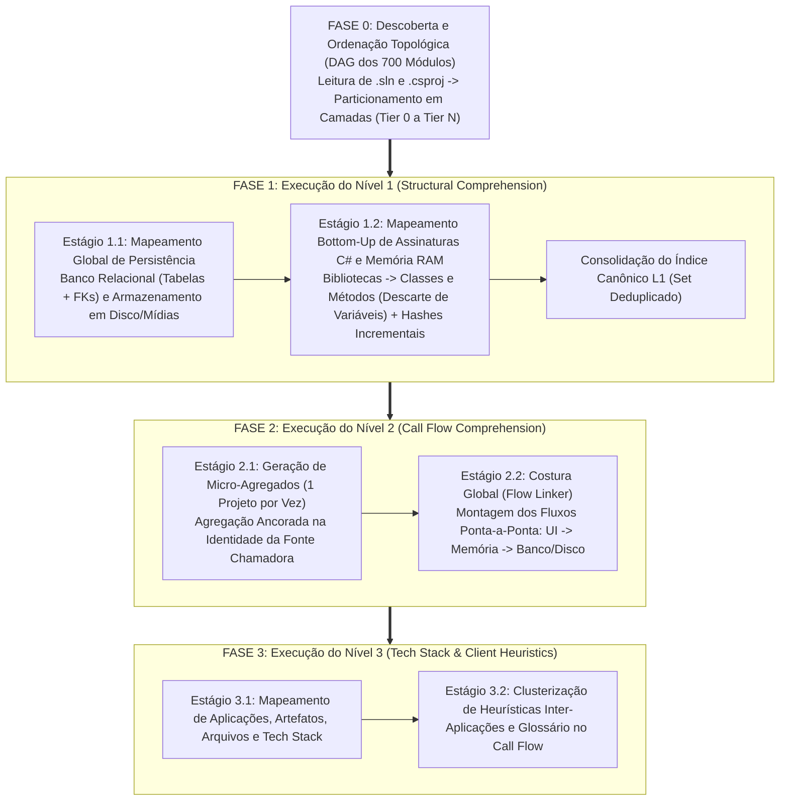

# Plano de Execução Ordenado: Mapeamento de Monolito com 700 Módulos

## 1. Desafio Escalar e Estratégia de Execução

Em um monolito composto por **700 módulos (projetos C#)**, tentar carregar o código-fonte completo na janela de contexto de uma IA é impossível e resulta em perda de referências cruzadas, explosão de memória e duplicação de identidades.

Para respeitar estritamente a dependência hierárquica (**Nível 1 $\to$ Nível 2 $\to$ Nível 3**) e permitir processamento **incremental, ordenado e um projeto por vez**, a execução é dividida em **4 Fases Sequenciais (7 Estágios Operacionais)** guiadas por ordenação topológica.



---

## 2. Passo a Passo Detalhado da Ordem de Execução

### FASE 0: Descoberta da Pasta Raiz e Grafo Topológico dos 700 Módulos

**Objetivo:** Identificar todos os 700 módulos a partir da pasta raiz do monolito e determinar a ordem exata em que devem ser lidos para que nenhum projeto seja analisado antes de suas dependências.

1. **Passo 0.1 — Varredura da Pasta Raiz:**
   * Localizar a pasta raiz do monolito (que define o `<RepoRootId>`).
   * Listar todos os arquivos `.sln`, `.csproj`, `packages.config`, `Directory.Build.props`, scripts `.sql` e arquivos de configuração (`App.config`, `Web.config`, `appsettings.json`).
2. **Passo 0.2 — Construção do DAG de Dependências (`ProjectReference`):**
   * Extrair de cada um dos 700 `.csproj` as tags `<ProjectReference>` e `<PackageReference>` / `<Reference>`.
   * Construir o Grafo Acíclico Dirigido (DAG) de dependências entre os 700 projetos.
   * *Tratamento de Ciclos:* Caso existam referências circulares legadas (via DLL pré-compilada), aplicar o algoritmo de Componentes Fortemente Conectados (Tarjan) para agrupar o ciclo no mesmo lote lógico.
3. **Passo 0.3 — Ordenação Topológica em Camadas (`Tiers`):**
   * **Tier 0 (Folhas / Core Base):** Projetos que não dependem de nenhum outro projeto interno (ex: `Core.Primitives`, `CrossCutting.Utils`, `Contracts`).
   * **Tier 1..K (Intermediários):** Projetos de Acesso a Dados (`Infra.Data`), Domínio (`Domain`) e Serviços de Aplicação (`Application.Services`) que dependem apenas dos Tiers inferiores.
   * **Tier N (Topo / Fronteiras de Entrada):** Projetos executáveis, UIs Desktop (WinForms/WPF), WebApps (MVC/WebForms/Blazor), APIs REST/WCF e Workers/Jobs.

---

### FASE 1: Execução do Nível 1 — Structural Comprehension

**Objetivo:** Criar o catálogo completo e 100% deduplicado de identidades únicas (`IdentityURN`) de Banco Relacional, Disco/Mídia Física, Estado em Memória RAM, Bibliotecas e Assinaturas de Código C#.

#### Estágio 1.1 — Mapeamento de Persistência Relacional e Armazenamento Físico
*Por que executa primeiro?* Porque múltiplas camadas de código referenciam tabelas de banco e arquivos em disco. Ter as identidades de dados prontas permite vinculá-las imediatamente quando o código for lido.

1. **Extração de Banco Relacional (`urn:info:db:rel:*`):**
   * Ler projetos `.sqlproj` / `.dacpac`, scripts DDL (`.sql`), mapeamentos Entity Framework (`DbSet<T>`, `OnModelCreating`, `[Table]`, `[Column]`, `.edmx`) e queries SQL constantes.
   * Gerar uma identidade única para cada Tabela, View, Stored Procedure e Coluna chave.
   * Mapear os relacionamentos entre tabelas (`FOREIGN_KEY`, relacionamentos `1:N`, `N:N`) garantindo a classificação estrita como estrutura de banco de dados relacional.
2. **Extração de Armazenamento em Disco e Mídias (`urn:info:storage:*`):**
   * Mapear diretórios configurados em `appsettings.json` / `Web.config` / constantes de caminho.
   * Identificar chamadas de I/O persistente (disco local `fs:local`, rede `fs:network`, mídias ópticas/CDs `media:optical`, arquivos frios/imutáveis `media:immutable_cold`) e registrar suas identidades únicas.

#### Estágio 1.2 — Mapeamento Bottom-Up de Código C# e Memória RAM (`Tier 0` até `Tier N`)
*Ordem de Execução:* Percorrer os 700 módulos do **Tier 0 até o Tier N**, lendo **1 projeto por vez**.

Para cada projeto $P_i$:
1. **Registro de Bibliotecas do Projeto:**
   * Mapear todas as bibliotecas externas utilizadas por $P_i$ (`urn:info:dep:pkg:nuget:*` e `urn:info:dep:pkg:assembly:*`) a partir do `.csproj`.
2. **Extração de Assinaturas de Classes e Métodos (`urn:info:mem:code:*`):**
   * Fazer o parse sintático (Roslyn / AST) dos arquivos `.cs` do projeto $P_i$.
   * Extrair **exclusivamente**:
     * Declarações de `Class`, `Interface`, `Struct`, `Record` (e sua lista `implements` / `inherits`).
     * Assinaturas completas de `Method` e `Constructor` (visibilidade, nome, identidades dos tipos de parâmetros, identidade do tipo de retorno).
   * **Descartar obrigatoriamente:** Variáveis de classe (*fields*) e variáveis locais de métodos.
3. **Extração de Contratos de Armazenamento Temporário em Memória RAM (`urn:info:mem:state:*`):**
   * Aplicar o filtro de memória RAM: registrar apenas estruturas de retenção de estado compartilhado entre chamadas (`IMemoryCache`, dicionários estáticos de cache, `Session`, buffers de stream nomeados).
4. **Cálculo de Hashes Incrementais:**
   * Gravar `signature_hash` e `body_ast_hash` em cada método e classe.
5. **União Idempotente no Catálogo Global L1:**
   * Inserir as identidades extraídas no índice global do Nível 1 usando semântica de conjunto (`UPSERT by IdentityURN`), garantindo que a soma de todos os 700 projetos contenha apenas informações únicas.

> **Barreira de Sincronização 1 (Checkpoint L1):**
> O Nível 2 **só pode iniciar** após todos os 700 módulos terem suas assinaturas e fontes de dados consolidadas no Catálogo Global do Nível 1.

---

### FASE 2: Execução do Nível 2 — Call Flow Comprehension

**Objetivo:** Construir os fluxos de chamada referenciando exclusivamente as identidades do Nível 1, primeiro em pequenos agregados por projeto e depois costurando o fluxo de ponta a ponta.

#### Estágio 2.1 — Geração Incremental de Micro-Agregados (1 Projeto por Vez)
*Ordem de Execução:* Como o Catálogo Global de Assinaturas do Nível 1 já está completo, os 700 projetos podem ser processados **um por vez** (sequencialmente ou em lotes paralelos, com orçamento controlado de contexto para a IA).

Para cada projeto $P_i$, fornecer à IA / analisador **apenas**:
* O código-fonte dos métodos de $P_i$.
* O subconjunto do Catálogo L1 contendo: as identidades de $P_i$ + as identidades públicas dos projetos que $P_i$ referencia no `.csproj` + o catálogo L1 de tabelas de banco (`db:rel`) e arquivos (`storage`).

**Ações dentro do Projeto $P_i$:**
1. Identificar se o método é um ponto de início (`UI_EVENT_HANDLER`, `API_ACTION`, `SERVICE_CONTRACT`, `JOB_ENTRY`).
2. Para cada método chamador $S \in P_i$, instanciar um **`CallerScopedAggregate`** cuja identidade de agregação é a própria identidade única do chamador $S$.
3. Percorrer as chamadas dentro do corpo de $S$ em ordem sequencial (`step_order: 1, 2, 3...`):
   * Chamadas a métodos privados auxiliares dentro da mesma classe herdam a identidade da fonte chamadora $S$ (`root_caller_identity = S`).
   * Chamadas a outros métodos (mesmo projeto ou outro projeto) são gravadas usando o `IdentityURN` de destino do Nível 1.
   * Operações de leitura/escrita em Banco Relacional (via EF, Dapper, ADO.NET), Disco (via `System.IO`) ou Cache em RAM são gravadas apontando para o respectivo `urn:info:db:rel:*`, `urn:info:storage:*` ou `urn:info:mem:state:*` como fim de chamada de dados (`FLOW_TERMINAL`).
4. Salvar o micro-agregado do projeto em `02_layer2_callflow/micro_aggregates/<project_slug>.flow.json`.

#### Estágio 2.2 — Costura Ordenada de Fluxos Ponta-a-Ponta (Global Flow Linker)
*Entrada:* Os 700 arquivos `.flow.json` de micro-agregados + o mapa `implements` (Interface $\to$ Classe Concreta) do Nível 1.
*Observação:* Esta etapa **não precisa reler código-fonte C#**; ela opera puramente sobre os JSONs compactos de micro-agregados!

1. Partir de todas as identidades marcadas como **UI do Sistema / Fronteira Inicial (`FLOW_ORIGIN`)**.
2. Encadear os micro-agregados conectando cada `target_identity` de saída de um projeto ao `caller_source_identity` correspondente no projeto chamado.
3. Emitir cada fluxo completo (`EndToEndCallFlow`) contendo:
   * A identidade de início (UI/Endpoint).
   * A árvore/sequência ordenada de todas as identidades de memória atravessadas.
   * As identidades terminais de fim de chamada (Tabelas de Banco Relacional, Arquivos em Disco, Estado em RAM).
   * O conjunto consolidado de todas as identidades L1 participantes daquele fluxo.

> **Barreira de Sincronização 2 (Checkpoint L2):**
> Valida que 100% dos nós presentes nos fluxos ponta-a-ponta existem no Catálogo do Nível 1.

---

### FASE 3: Execução do Nível 3 — Tech Stack & Client Heuristics

**Objetivo:** Agrupar as identidades do Nível 1 e os fluxos do Nível 2 em Aplicações, Artefatos, Tech Stacks, Heurísticas de Negócio Inter-Aplicações e Glossários embarcados nos fluxos.

#### Estágio 3.1 — Mapeamento de Aplicações, Artefatos, Arquivos e Tech Stack
1. **Agrupamento Físico e de Deploy:**
   * A partir dos projetos de topo (`Tier N` com `<OutputType>Exe</OutputType>`, `<OutputType>WinExe</OutputType>` ou projetos Web/Host), definir as **Aplicações** do monolito.
   * Mapear a árvore transitiva de `.csproj` de cada aplicação para listar seus **Principais Artefatos** (`.exe`, `.dll`, `.dacpac`) e **Nomes de Arquivos** (`.cs`, `.sql`, `.config`), vinculando cada arquivo às identidades L1 que ele hospeda.
2. **Classificação por Tech Stack:**
   * Cruzar as dependências L1 (`urn:info:dep:pkg:*`) de cada projeto com suas identidades L1 para rotular a qual camada da Tech Stack cada identidade pertence (`UI/WinForms`, `API/ASP.NET`, `ORM/Dapper`, `DB/SQLServer`, `Disk/XML`).

#### Estágio 3.2 — Descoberta de Heurísticas de Negócio Inter-Aplicações e Glossário no Call Flow
1. **Extração e Agregação de Palavras Comuns de Negócio:**
   * Tokenizar os identificadores de todas as identidades L1 participantes dos fluxos L2.
   * Remover termos puramente técnicos e agregar as palavras comuns de negócio (substantivos e verbos de domínio) diretamente às identidades únicas L1 de onde foram mapeadas.
2. **Clusterização de Heurísticas de Negócio entre Aplicações Diferentes:**
   * Agrupar fluxos ponta-a-ponta (L2) provenientes de aplicações diferentes que:
     * Convergem para as mesmas tabelas de banco relacional (`urn:info:db:rel:*`) ou arquivos em disco (`urn:info:storage:*`); OU
     * Compartilham as mesmas identidades de domínio/serviço core e vocabulário de negócio.
   * Batizar cada grupo como uma **Heurística de Negócio (`urn:heuristic:biz:<Dominio>:<Regra>`)**.
3. **Geração do Glossário Contido no Mapeamento (Identidades + Call Flow):**
   * Para cada cluster de Identidades + Call Flow, sintetizar com auxílio da IA o **Glossário Contextual**:
     * Nome do Termo de Negócio e Abreviações no Código.
     * Definição Semântica baseada no comportamento real do fluxo.
     * Lista estrita de `bound_identity_set` (Identidades L1) e `bound_call_flows` (Call Flows L2) onde o termo atua.

---

## 3. Arquitetura de Diretórios de Saída para os 700 Módulos

Ao executar este plano sobre a pasta raiz do monolito, os metadados gerados devem ser persistidos na seguinte estrutura hierárquica determinística:

```text
<pasta_raiz_output_specs>/
├── 00_topology/
│   ├── monolith_dag_tiers.json                 # Os 700 módulos ordenados do Tier 0 ao Tier N
│   └── circular_dependency_clusters.json       # Ciclos detectados e agrupados
│
├── 01_layer1_structural/
│   ├── l1_db_relational_identities.jsonl       # Todas as identidades urn:info:db:rel:* e relacionamentos de tabelas
│   ├── l1_storage_disk_media_identities.jsonl  # Todas as identidades urn:info:storage:* (disco, rede, CDs, mídias frias)
│   ├── l1_memory_state_identities.jsonl        # Todas as identidades urn:info:mem:state:* (caches, sessões, buffers)
│   ├── l1_external_libraries_catalog.jsonl     # Todas as bibliotecas urn:info:dep:pkg:*
│   ├── l1_code_signatures_global.jsonl         # Índice global deduplicado de Classes e Métodos (sem variáveis)
│   └── per_project_signatures/                 # 700 arquivos JSON (1 por módulo) com signature_hash e body_ast_hash
│       ├── Tier0_Core.Primitives.l1.json
│       └── ... (700 módulos)
│
├── 02_layer2_callflow/
│   ├── micro_aggregates/                       # 700 arquivos gerados lendo 1 projeto por vez
│   │   ├── Tier0_Core.Primitives.flow.json     # Agregados ancorados na identidade da fonte chamadora
│   │   └── ... (700 módulos)
│   ├── l2_interface_implementation_map.json    # Mapa de resolução Interface -> Classe Concreta
│   └── l2_end_to_end_call_flows.jsonl          # Fluxos ponta-a-ponta completos (UI -> Memória -> Banco/Disco)
│
└── 03_layer3_techstack_heuristics/
    ├── l3_applications_and_artifacts.json      # Aplicações, artefatos (.dll/.exe), nomes de arquivos e suas identidades L1
    ├── l3_tech_stack_groups.json               # Identidades L1 agrupadas por tecnologia/camada da Tech Stack
    ├── l3_business_lexical_index.json          # Palavras comuns de negócio agregadas às identidades L1 de origem
    └── domains_and_glossaries/                 # Domínios contendo Heurísticas Inter-Aplicações + Glossário no Call Flow
        ├── domain_faturamento_fiscal.l3.json
        ├── domain_estoque_logistica.l3.json
        └── ...
```

---

## 4. Protocolo de Atualização Incremental (Quando Houver Modificações no Código)

Graças à separação em 3 camadas e aos hashes do Nível 1 (`signature_hash` e `body_ast_hash`), quando um desenvolvedor modificar arquivos em 3 dos 700 módulos:

1. **Detecção de Delta (`Git Diff` / Timestamp):** O motor lê apenas os arquivos `.cs` ou `.sql` alterados.
2. **Caso A — Apenas o corpo do método mudou (`signature_hash` igual, `body_ast_hash` diferente):**
   * O Catálogo de Assinaturas do Nível 1 **não muda** para os demais 699 projetos.
   * Reexecuta-se o **Estágio 2.1 (Micro-Agregado)** **apenas para o método alterado**.
   * O **Estágio 2.2 (Flow Linker)** reconecta apenas os fluxos ponta-a-ponta que passavam por aquele método (em segundos).
3. **Caso B — A assinatura pública de uma classe/método ou tabela mudou (`signature_hash` diferente):**
   * Atualiza-se a identidade no Nível 1.
   * Consulta-se o DAG da Fase 0 para reprocessar apenas os micro-agregados dos projetos dependentes diretos que invocavam a assinatura antiga.
   * Atualiza-se o vínculo no Glossário e nas Heurísticas do Nível 3.
